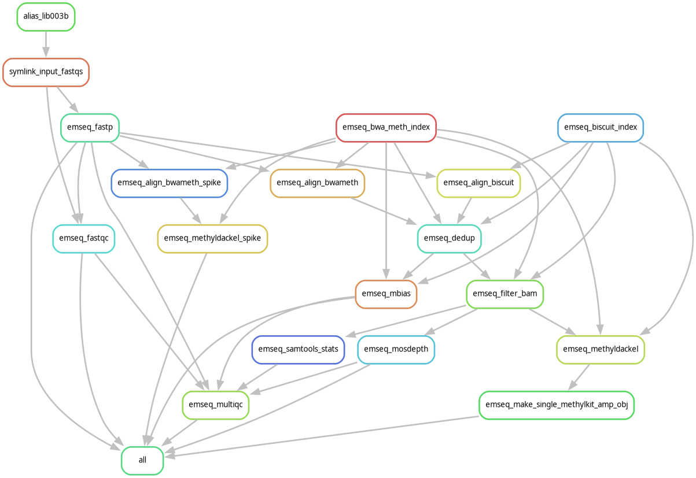
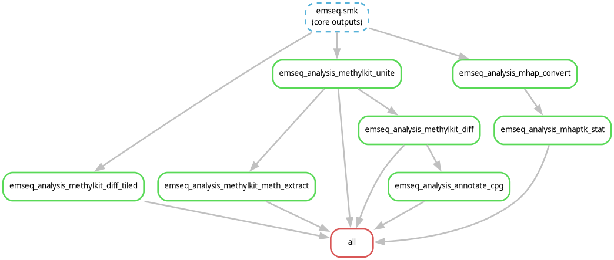
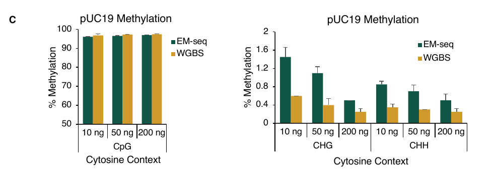
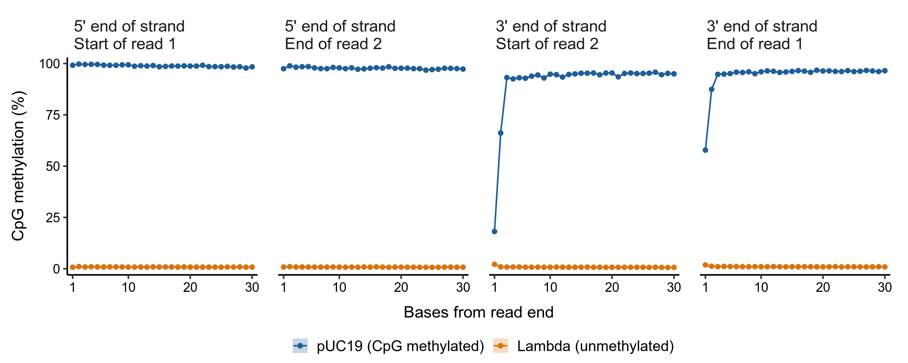
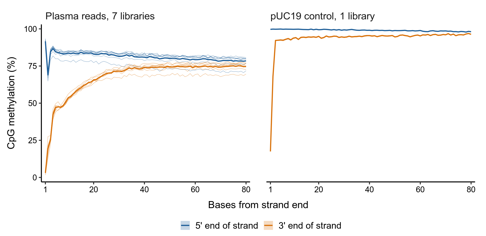
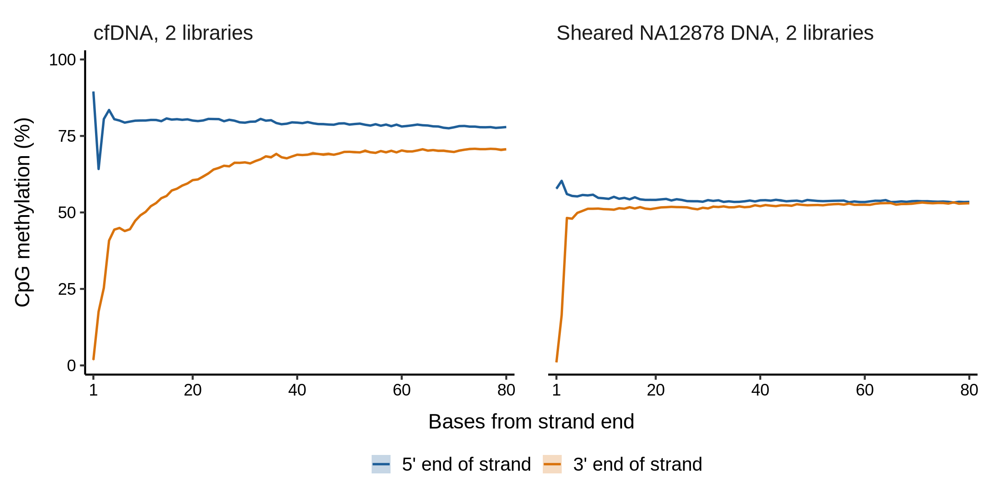

* Enzymatic Methylation Sequencing Bioinformatics Processes
:PROPERTIES:
:ID:       cd9489fd-c6e7-4c64-8317-e3d9a283b36c
:END:

- [cite:@liu2020]

- [[https://teams.microsoft.com/l/message/19:meeting_ZWFhYjE4YzktYWM0Zi00NzllLTk1NWItYjA5YTJkYWQwN2Jj@thread.v2/1769216157607?context=%7B%22contextType%22%3A%22chat%22%7D][teams]]
- Matteo mosdepth update [[https://github.com/jeszyman/emseq/pull/1][PR #1]]

*TANGLE NOTE (2026-03-25):* All divergences from 2026-03-24 resolved (rule_threads, mosdepth quantize, wildcard constraints, haplotype deps). Org source and tangled files are in sync.

- [2026-11-24 Tue] Claude session "emseq-read-end-validation": [[elisp:(start-process "claude-resume" nil (expand-file-name "~/.claude/bin/claude-resume") "acacea49-0f2d-481e-ac99-c9d2cf4ccfef" "/home/jeszyman/repos/emseq")][resume]]

** Plans
:PROPERTIES:
:TODO_SET: plans
:PLANS_SINCE: [2026-09-25 Fri]
:END:
*** COMPLETE EM-seq analysis module
:PROPERTIES:
:ID:       85db17f4-f22f-4445-84e8-e1433b885364
:END:
[[file:docs/superpowers/plans/2026-03-16-analysis-module-plan.md]]
*** COMPLETE Snakemake config-contract tool
:PROPERTIES:
:ID:       cea4afb9-72be-4ff2-9ba8-f4dde895e006
:END:
[[file:docs/superpowers/plans/2026-06-09-snakemake-config-contract.md]]
*** COMPLETE JEEPERS test on one deep plasma library
CLOSED: [2026-11-21 Sat 07:26]
:PROPERTIES:
:ID:       be04fd25-2136-45dc-8ca2-440513a14620
:END:
:LOGBOOK:
- State "COMPLETE"   from "ACTIVE"     [2026-11-21 Sat 07:26]
- State "ACTIVE"     from "FUTURE"     [2026-11-20 Fri 18:19]
:END:

[[file:docs/plans/2026-11-20-jeepers-test.md]]

*** COMPLETE Validation tier: read-end handling
CLOSED: [2026-11-24 Tue 07:51]
:PROPERTIES:
:ID:       99e53181-4b7d-4854-9a58-92868846be3c
:END:
:LOGBOOK:
- State "COMPLETE"   from "ACTIVE"     [2026-11-24 Tue 07:51]
- State "ACTIVE"     from "FUTURE"     [2026-11-20 Fri 12:38]
:END:

[[file:docs/plans/2026-11-20-validation-tier-end-handling.md]]

- [2026-11-20 Fri] MethylDackel 0.6.1 end bounds, from [[file:tests/unit/test_methyldackel_bounds.py][tests/unit/test_methyldackel_bounds.py]]: bounds and =mbias= positions count along the stored alignment, not the sequencing cycle. NEB's flags (=--nOT 0,0,0,5 --nOB 0,0,5,0=) both mask the first sequenced bases of read 2, 4 bases on original-top pairs and 5 on original-bottom pairs. Where mates overlap, a base masked in read 2 is still called from read 1, so the flags remove nothing on a fragment shorter than the read.
*** FUTURE Sample identity check from SNP genotypes
:PROPERTIES:
:ID:       592d6186-5eb4-4df3-8553-19a6e1bcc935
:END:

[[file:docs/plans/2026-11-21-sample-identity-check.md]]

** [[id:bda70cff-0713-4e32-8da1-ee83924b8f00][README]]
** [[elisp:(let ((window-config (current-window-configuration))) (async-shell-command "bash ~/repos/emseq/tools/shell/org_update.sh") (set-window-configuration window-config))][org update]]
** Repository setup and administration
*** Org update
#+begin_src bash :tangle ./tools/shell/org_update.sh
#!/usr/bin/env bash
set -euo pipefail

source ~/repos/basecamp/lib/basecamp_functions.sh

REPOS=(emseq)

# ---------- config ----------
REPO_DIR=~/repos/emseq
README_ORG="$REPO_DIR/emseq.org"
README_NODE=bda70cff-0713-4e32-8da1-ee83924b8f00
METHOD_NODE=065c6944-8708-4da2-b855-f849dbd669f1
README_EXPORT=~/repos/html/scripts/emacs_export_header_to_markdown.py
# ----------------------------

save_in_emacs() {
  if command -v emacsclient >/dev/null 2>&1 && emacsclient -e "(progn t)" >/dev/null 2>&1; then
    emacsclient -e "(save-some-buffers t)" >/dev/null
    echo "💾 saved buffers via emacsclient"
  else
    echo "ℹ️ no Emacs server; skipping save"
  fi
}

update_readme() {
  echo "📝 exporting README.md from $README_ORG"
  pushd "$REPO_DIR" >/dev/null
  python3 "$README_EXPORT" --org_file "$README_ORG" --node_id "$README_NODE"
  echo "📝 exporting METHOD.md from $README_ORG"
  python3 "$README_EXPORT" --org_file "$README_ORG" --node_id "$METHOD_NODE"
  popd >/dev/null
}

tangle_repo_org() {
  local repo=$1
  local org_file=~/repos/"$repo"/"$repo".org

  echo "=== $repo ==="
  if [[ -f "$org_file" ]]; then
    echo "⏳ tangling $repo..."
    tangle "$org_file" || { echo "❌ tangle failed for $repo"; return 1; }
  else
    echo "⚠️  no $repo.org, skipping"
  fi
}

git_update_repo() {
  local repo=$1
  echo "🔄 updating $repo..."
  pushd ~/repos/"$repo" >/dev/null || { echo "❌ cd failed for $repo"; return 1; }

  if ! output=$(git_wkflow_up 2>&1); then
    echo "❌ git_wkflow_up failed in $repo"
    echo "$output"
  else
    echo -e "$(date)\n$output"
  fi

  popd >/dev/null
}

main() {
  save_in_emacs

  for repo in "${REPOS[@]}"; do
    tangle_repo_org "$repo" || true
  done

  update_readme
  save_in_emacs

  for repo in "${REPOS[@]}"; do
    git_update_repo "$repo" || true
  done
}

main "$@"
#+end_src

*** Tool to get in-repo test data
#+begin_src bash :tangle ./tools/get_test_data.sh
#!/usr/bin/env bash
# setup_test_data.sh — chr22 subset + lambda + pUC19 FASTA, plus 4 tiny paired WGBS FASTQs
# Paired-only; hard-fails if a run lacks _1/_2. Cleans tests/full/ before writing.
set -euo pipefail

# --- self-locate & cd to repo root (script is assumed to live one level below root, e.g., tools/) ---
SCRIPT_DIR="$(cd "$(dirname "${BASH_SOURCE[0]}")" && pwd)"
REPO_DIR="$(dirname "$SCRIPT_DIR")"
cd "$REPO_DIR" || { echo "ERR: failed to cd to repo root: $REPO_DIR" >&2; exit 1; }

# --- config ---
R_EMSEQ="${R_EMSEQ:-$PWD}"
TEST_DIR="${R_EMSEQ}/tests/full"
OUT_DIR="${TEST_DIR}/inputs"
OUT_FA="${OUT_DIR}/chr22.test.fa.gz"
OUT_LAMBDA="${OUT_DIR}/lambda.fa.gz"
OUT_PUC19="${OUT_DIR}/pUC19.fa.gz"
OUT_BLK="${OUT_DIR}/hg38-blacklist.v2.bed.gz"

# NEW: bed outputs
KEEP_BED="${OUT_DIR}/chr22.keep.bed"
EXCL_BED="${OUT_DIR}/chr22.exclude.blacklist.bed.gz"

REF_URL="https://hgdownload.soe.ucsc.edu/goldenPath/hg38/chromosomes/chr22.fa.gz"
FA_HEAD_LINES=4000000

# full (small) references
LAMBDA_URL="https://www.ncbi.nlm.nih.gov/sviewer/viewer.fcgi?id=9626243&db=nuccore&report=fasta&retmode=text"

# pUC19 via NCBI efetch (hard-coded tool/email)
PUC19_EFETCH="https://eutils.ncbi.nlm.nih.gov/entrez/eutils/efetch.fcgi?db=nuccore&id=L09137.2&rettype=fasta&retmode=text&tool=emseq_setup&email=anon@example.com"

BLK_URL="https://raw.githubusercontent.com/Boyle-Lab/Blacklist/master/lists/hg38-blacklist.v2.bed.gz"

NREADS="${NREADS:-60000}"   # reads per mate for FASTQ clipping
FQ_HEAD_LINES=$((NREADS * 4))

# ENA WGBS runs (paired) — adjust as needed
ACCESSIONS=( "ERR022484" "ERR022487" "ERR022003" "ERR022483" )

# --- deps ---
need(){ command -v "$1" >/dev/null 2>&1 || { echo "Missing: $1" >&2; exit 1; }; }
need git; need wget; need curl; need zcat; need gzip; need wc; need head; need grep; need sed
# NEW: for beds
need samtools; need bedtools; need bgzip; need tabix; need awk; need sort; need cut

# --- ensure .gitignore rules: ignore tests/full/* but NOT tests/full/inputs/** ---
ensure_gitignore() {
  local gi="${REPO_DIR}/.gitignore"
  local req1='tests/full/*'
  local req2='!tests/full/inputs/'
  local req3='!tests/full/inputs/**'
  touch "$gi"
  local have1=0 have2=0 have3=0
  grep -Fxq "$req1" "$gi" && have1=1 || true
  grep -Fxq "$req2" "$gi" && have2=1 || true
  grep -Fxq "$req3" "$gi" && have3=1 || true
  if (( ! have1 || ! have2 || ! have3 )); then
    {
      echo ''
      echo '# --- test data (auto-managed by setup_test_data.sh) ---'
      (( have1 )) || echo "$req1"
      (( have2 )) || echo "$req2"
      (( have3 )) || echo "$req3"
    } >> "$gi"
    echo "[gitignore] ensured patterns for tests/full with inputs preserved"
  fi
}

# ENA dir that contains both _1/_2
ena_dir_for() {
  local acc="$1" first6="${acc:0:6}" last3="${acc: -3}"
  local candidates=(
    "https://ftp.sra.ebi.ac.uk/vol1/fastq/${first6}/${acc}/"
    "https://ftp.sra.ebi.ac.uk/vol1/fastq/${first6}/${last3}/${acc}/"
  )
  for d in "${candidates[@]}"; do
    if wget -q --spider "${d}${acc}_1.fastq.gz" && wget -q --spider "${d}${acc}_2.fastq.gz"; then
      echo "$d"; return 0
    fi
  done
  return 1
}

# wget stream → zcat → head → gzip (silence SIGPIPE noise)
fetch_head() {
  ( set +o pipefail
    wget -qO- "$1" | zcat 2>/dev/null | head -n "$2" | gzip > "$3"
  ) || true
}

# download full compressed file (blacklist)
fetch_all_gz() { wget -qO "$2" "$1"; }

# --- add near fetch_puc19() ---
fetch_plain_fasta_gzip() {
  local url out tmp
  url="$1"
  out="$2"
  tmp="${out%.gz}.tmp"
  rm -f "$tmp" "$out"
  curl -fsSL "$url" -o "$tmp"
  [[ -s "$tmp" ]] || { echo "ERR: lambda fetch produced empty file"; exit 1; }
  head -n1 "$tmp" | grep -q '^>' || { echo "ERR: lambda FASTA header missing"; exit 1; }
  gzip -f "$tmp"
  mv "${tmp}.gz" "$out"
}

# robust pUC19: fetch plain FASTA to tmp with curl, validate header, then gzip
fetch_puc19() {
  local url out tmp
  url="$1"; out="$2"; tmp="${out%.gz}.tmp"
  rm -f "$tmp" "$out"
  curl -fsSL "$url" -o "$tmp"
  [[ -s "$tmp" ]] || { echo "ERR: pUC19 fetch produced empty file"; exit 1; }
  head -n1 "$tmp" | grep -q '^>' || { echo "ERR: pUC19 FASTA header missing"; exit 1; }
  gzip -f "$tmp"
  mv "${tmp}.gz" "$out"
}

check_fastq() {
  local f="$1"
  [[ -s "$f" ]] || { echo "ERR: empty $f" >&2; return 1; }
  local n; n=$(zcat "$f" 2>/dev/null | wc -l)
  (( n % 4 == 0 )) || echo "WARN: $f has $n lines (not multiple of 4)"
  echo "[ok] $(basename "$f"): $(( n / 4 )) reads"
}

# --- run ---
ensure_gitignore

echo "[clean] removing ${TEST_DIR}"
rm -rf "${TEST_DIR}"
mkdir -p "${OUT_DIR}"

# keep inputs dir tracked even if empty (optional helper file)
[[ -e "${OUT_DIR}/.gitkeep" ]] || : > "${OUT_DIR}/.gitkeep"

echo "[ref] chr22 subset → ${OUT_FA}"
fetch_head "${REF_URL}" "${FA_HEAD_LINES}" "${OUT_FA}"
[[ -s "${OUT_FA}" ]] || { echo "ERR: failed to write ${OUT_FA}"; exit 1; }

echo "[ref] lambda (full) → ${OUT_LAMBDA}"
fetch_plain_fasta_gzip "${LAMBDA_URL}" "${OUT_LAMBDA}"
[[ -s "${OUT_LAMBDA}" ]] || { echo "ERR: failed to write ${OUT_LAMBDA}"; exit 1; }

echo "[ref] pUC19 (NCBI efetch) → ${OUT_PUC19}"
fetch_puc19 "${PUC19_EFETCH}" "${OUT_PUC19}"
[[ -s "${OUT_PUC19}" ]] || { echo "ERR: failed to write ${OUT_PUC19}"; exit 1; }

echo "[ref] hg38 blacklist → ${OUT_BLK}"
fetch_all_gz "${BLK_URL}" "${OUT_BLK}"
[[ -s "${OUT_BLK}" ]] || { echo "ERR: failed to write ${OUT_BLK}"; exit 1; }

# --- tiny paired FASTQs ---
i=1
for acc in "${ACCESSIONS[@]}"; do
  dir="$(ena_dir_for "$acc")" || { echo "ERR: ${acc} is not paired on ENA" >&2; exit 1; }
  r1="${dir}${acc}_1.fastq.gz"
  r2="${dir}${acc}_2.fastq.gz"

  id=$(printf "lib%03d" "$i")
  out1="${OUT_DIR}/${id}.raw_R1.fastq.gz"
  out2="${OUT_DIR}/${id}.raw_R2.fastq.gz"
  echo "[fq] ${id} (${acc}) → ${out1}, ${out2}"

  fetch_head "$r1" "${FQ_HEAD_LINES}" "$out1"
  fetch_head "$r2" "${FQ_HEAD_LINES}" "$out2"
  check_fastq "$out1"
  check_fastq "$out2"
  i=$((i+1))
done

# --- NEW: build keep/exclude BEDs in inputs/ from chr22.test.fa.gz + blacklist ---
echo "[beds] building keep/exclude from ${OUT_FA}"
FA_UNGZ="${OUT_DIR}/chr22.test.fa"
zcat "${OUT_FA}" > "${FA_UNGZ}"
samtools faidx "${FA_UNGZ}"

# KEEP: spans for all contigs present in the .fai (chr22-only here)
awk 'BEGIN{OFS="\t"} {print $1,0,$2}' "${FA_UNGZ}.fai" \
  | sort -k1,1 -k2,2n > "${KEEP_BED}" |

# EXCLUDE: clip blacklist to contigs present in .fai and bgzip
awk 'NR==FNR{ok[$1]=1; next} ok[$1]' <(cut -f1 "${FA_UNGZ}.fai") <(zcat "${OUT_BLK}") \
  | sort -k1,1 -k2,2n | bgzip > "${EXCL_BED}" |
tabix -p bed "${EXCL_BED}" || true
echo "[beds] keep=${KEEP_BED}  exclude=${EXCL_BED}"

echo "Done. Outputs in: ${OUT_DIR}"
echo "  - FASTA subset: ${OUT_FA} (+ ${FA_UNGZ} + .fai)"
echo "  - Keep BED:     ${KEEP_BED}"
echo "  - Exclude BED:  ${EXCL_BED}"
#+end_src
See [[id:93585550-c78e-45e1-8adc-92b4efbebbae][Generate test data test]]
*** README
:PROPERTIES:
:ID:       bda70cff-0713-4e32-8da1-ee83924b8f00
:export_file_name: README
:END:

The EM-seq repository provides two modular Snakemake workflows for enzymatic methylation sequencing data. Both are designed to be included from a project-specific wrapper Snakefile that defines samples, references, and resource limits.

**** Configuration

Configuration is split between a YAML config file and a wrapper Snakefile. The YAML holds all declarative settings: sample lists, reference genome definitions, tool parameters, environment paths, and resource limits. The wrapper Snakefile reads the YAML and assigns every variable that the modules consume — environments, directories, sample lists, tool parameters, and project-level decisions like which references to align against and which spike-ins were included. The wrapper also defines the =rule all= output targets and any project-specific custom rules (e.g. input symlinks, sample aliases).

This separation serves two purposes. First, the YAML is portable across machines and projects while the wrapper encodes the specific run configuration. Second, when a project composes multiple pipeline modules (e.g. EM-seq + cfDNA CNA + fragmentation analysis), the wrapper is the single place where all variable names from all modules are visible. This makes namespace collisions immediately obvious rather than hidden inside separate module files.

***** YAML config file

Passed via =--configfile=. See =config/test.yaml= for a complete working example.

Core keys:
| =main-data-dir=         | Root data directory; all subdirectories derived from this              |
| =library-ids=           | List of sample IDs to process                                          |
| =keep-bed=              | BED of regions to retain after filtering                               |
| =exclude-bed=           | BED of blacklist regions to exclude                                    |
| =emseq_ref_assemblies=  | Nested map of reference genomes (see below)                            |
| =meth-map=              | Experiment definitions for differential methylation (see below)        |
| =envs=                  | Paths to conda environment YAMLs (=emseq=, =methylkit=, =haplotype=, =deconv=) |
| =repos=                 | Paths to this repo and external tool repos                             |
| =mosdepth-quant-levels= | Coverage quantization thresholds (default: =1,5,10,20=)                  |
| =emseq-mincov=          | Minimum coverage for methylKit (default: =2=)                            |
| =fastp.extra=           | Additional fastp arguments (default: none)                             |

Analysis-specific keys (required only for =emseq_analysis.smk=; see Analysis module setup below for how to prepare these):
| =repos.mhaptools=    | Path to cloned mHapTools repo (with compiled binary)            |
| =repos.wgbs_tools=   | Path to cloned wgbs_tools repo (with built C extensions)        |
| =repos.uxm_deconv=   | Path to cloned UXM_deconv repo                                  |
| =haplotype.cpg-ref=  | Tabixed CpG reference (generated from reference FASTA)          |
| =haplotype.mhb-bed=  | Methylation haplotype block BED (Guo 2017 liftover to hg38)     |
| =haplotype.metrics=  | List of haplotype metrics to compute (e.g. =[MHL, PDR, Entropy]=) |
| =deconv.genome-name= | wgbs_tools genome identifier                                    |
| =deconv.atlas=       | UXM deconvolution atlas TSV (from UXM_deconv repo)              |

***** Wrapper Snakefile

The wrapper reads the YAML config and assigns every variable that the included modules expect. This is deliberate: by centralizing all variable assignments in one file, you can see at a glance every name in scope across all modules and catch collisions before they become runtime bugs. The wrapper also makes project-level decisions that do not belong in the YAML — which reference genomes to align against and which spike-in controls were included — and defines the =rule all= output targets.

A minimal wrapper follows this structure:

#+begin_example
import os
configfile: "config/my_project.yaml"

def resolve_config_paths(config_dict):
    for k, v in config_dict.items():
        if isinstance(v, str):
            config_dict[k] = os.path.expandvars(os.path.expanduser(v))
        elif isinstance(v, dict):
            resolve_config_paths(v)
        elif isinstance(v, list):
            config_dict[k] = [os.path.expandvars(os.path.expanduser(i))
                              if isinstance(i, str) else i for i in v]
resolve_config_paths(config)

# Concurrency budget: defaults from the available-concurrency config key (100 if unset);
# override per run with --resources concurrency=N (the CLI value wins over config).
workflow.global_resources.setdefault("concurrency", int(config.get("available-concurrency", 100)))

# --- Environments ---
ENV_EMSEQ = config['envs']['emseq']
ENV_METHYLKIT = config['envs']['methylkit']

# --- Repositories ---
R_EMSEQ = config['repos']['emseq']

# --- Data directories ---
D_DATA = config['main-data-dir']
D_EMSEQ = f"{D_DATA}/emseq"
D_REF = f"{D_DATA}/ref"
D_LOGS = f"{D_DATA}/logs"
D_BENCHMARK = f"{D_DATA}/benchmark"
D_INPUTS = f"{D_DATA}/inputs"

# --- Tool parameters ---
MOSDEPTH_QUANT_LEVELS = config.get("mosdepth-quant-levels", "1,5,10,20")
EMSEQ_MINCOV = config.get("emseq-mincov", 2)
FASTP_EXTRA = config.get("fastp", {}).get("extra", "")
EMSEQ_REF_INPUTS = {k: v['input'] for k, v in config['emseq_ref_assemblies'].items()}

# --- Samples and references ---
emseq_library_ids = config["library-ids"]
emseq_ref_names = ["ncbi_decoy_hg38"]   # project decision
emseq_align_methods = ["bwa_meth"]       # project decision
spike_builds = ["puc19", "unmeth_lambda"]  # project decision
KEEP_BED = config["keep-bed"]
EXCL_BED = config["exclude-bed"]
meth_map = config["meth-map"]

rule all:
    input:
        expand(f"{D_EMSEQ}/dmr/tabix/{{lib}}.{{ref}}.bwa_meth.methyldackel.txt.bgz",
               lib=emseq_library_ids, ref=emseq_ref_names),
        # ... additional targets

include: "emseq.smk"
include: "emseq_analysis.smk"   # optional
#+end_example

The test wrappers (=workflows/test.smk=, =workflows/test-analysis.smk=) and =config/example-config.yaml= serve as templates for creating project-specific wrappers.

***** Resource management

Resource management uses two mechanisms: *threads* and *concurrency*.

*Threads* is a built-in Snakemake feature. Some rules use =threads: workflow.cores= to consume all available cores (e.g. alignment), while others use a hardcoded thread count for I/O-bound operations where more cores don't help (e.g. =threads: 8= for samtools sort, dedup, BAM filtering). Rules that use =workflow.cores= are automatically capped at the =--cores= flag value, so the same workflow runs correctly on any machine.

*Concurrency* is a custom resource pattern using Snakemake's =resources:= directive. Each rule declares a concurrency /cost/, and a global /budget/ defaults from the =available-concurrency= config key (100 if unset) — the wrapper applies it via =workflow.global_resources.setdefault("concurrency", ...)= — and can be overridden per run with =--resources concurrency=N= (the CLI value wins). Snakemake schedules jobs as long as the total concurrency cost of running jobs stays within the budget. The system is calibrated so that a rule with =concurrency = 100= runs one at a time when =--resources concurrency=100=. On a larger machine, setting =--resources concurrency=300= allows three such jobs in parallel. Lighter-weight rules declare lower costs — for example, a rule with =concurrency = 10= allows 10 simultaneous instances at =--resources concurrency=100=, or 30 at =--resources concurrency=300=. This ratio-based approach means the same rule definitions work across machines of different sizes; only the global budget changes.

Not every rule needs concurrency. Rules that are I/O-bound and individually lightweight (BAM filtering, samtools stats, M-bias, spike-in methylation calling) have no concurrency declaration — Snakemake schedules them freely based on available cores. Concurrency is reserved for rules that are either resource-intensive (alignment: =concurrency = 100=), memory-constrained (methylKit R jobs: =concurrency = 50=), or benefit from controlled parallelism (methylation calling, dedup: =concurrency = 25=).

The budget defaults to =available-concurrency= in the config, so a normal run only needs =--cores=. Pass =--resources concurrency=N= to override the config default (e.g. to run more jobs in parallel on a large machine):

#+begin_example
# Default: budget from config (available-concurrency: 100)
snakemake -s workflows/test.smk --cores 8

# Large workstation: same config budget, more cores
snakemake -s workflows/test.smk --cores 48

# Very large machine: override the budget to run more jobs in parallel
snakemake -s workflows/test.smk --cores 96 --resources concurrency=300
#+end_example

***** Reference assemblies

Reference genomes are specified as a nested map in =emseq_ref_assemblies=. Each entry includes a download URL, short name, and the expected input filename. The core module handles indexing automatically. This map should include both the primary alignment reference and the spike-in control references used for conversion rate estimation.

#+begin_example
emseq_ref_assemblies:
  # Primary alignment reference
  ncbi_decoy_hg38:
    url: https://ftp.ncbi.nlm.nih.gov/...
    name: ncbi_decoy_hg38
    input: GCA_000001405.15_GRCh38_no_alt_plus_hs38d1_analysis_set.fna.gz
  # Spike-in controls (EM-seq kit includes these for conversion rate QC)
  unmeth_lambda:
    url: https://www.neb.com/...
    name: unmeth_lambda
    input: lambda.fa.gz
  puc19:
    url: https://www.neb.com/...
    name: puc19
    input: pUC19.fa.gz
#+end_example

***** Experiments (differential methylation)

The =meth-map= config key defines one or more differential methylation experiments. Each experiment specifies the samples, reference, aligner, treatment vector, and methylKit parameters.

#+begin_example
meth-map:
  tumor_vs_normal:
    libs: ["sample_A", "sample_B", "sample_C", "sample_D"]
    emseq_ref_name: ["ncbi_decoy_hg38"]
    align_method: ["bwa_meth"]
    tx: [1, 1, 0, 0]
    mincov: 10
    mingroup: 1
    chunksize: "1e9"
    win_size: 10000
#+end_example

***** Conda environments

Four conda environment YAMLs are provided in =config/=. Wrappers reference them by relative path. When running with =--use-conda=, Snakemake creates isolated prefix-based environments from these files.

| =emseq-conda-env.yaml=     | Core tools: samtools, mosdepth, R packages |
| =methylkit-conda-env.yaml= | R/methylKit, annotatr, GenomicRanges       |
| =haplotype-conda-env.yaml= | mhaptk (Java), htslib, pytabix             |
| =deconv-conda-env.yaml=    | wgbs_tools and UXM dependencies            |

***** Analysis module setup

The core pipeline (=emseq.smk=) has no external prerequisites — all tools are installed via conda and reference indexing is automated.

The analysis pipeline (=emseq_analysis.smk=) requires external tool repositories and reference files that must be prepared once before running. These are one-time setup steps that depend on the genome build. The results feed into the analysis-specific YAML config keys listed above.

****** External tool repositories → =repos.*= config keys

Clone the three external repos:

#+begin_example
./tools/setup_repos.sh
#+end_example

Then build each tool:

#+begin_example
# mHapTools — ships macOS binary; must be compiled from source on Linux
cd ~/repos/mHapTools
cd htslib && ./configure && make -j4 && cd ..
sed -i 's/libhts.dylib/libhts.so/' CMakeLists.txt
cmake -B build -DCMAKE_BUILD_TYPE=Release
cmake --build build -j4
cp build/mhaptools .

# wgbs_tools — C extensions must be built inside the deconv conda env
cd ~/repos/wgbs_tools
/path/to/deconv-conda-prefix/bin/python setup.py

# UXM_deconv — pure Python, no build needed
#+end_example

Set the =repos= config keys to the resulting paths:
#+begin_example
repos:
  mhaptools: ~/repos/mHapTools
  wgbs_tools: ~/repos/wgbs_tools
  uxm_deconv: ~/repos/UXM_deconv
#+end_example

****** Analysis reference files → =haplotype.*= and =deconv.*= config keys

Three reference files are needed. Detailed preparation steps are documented in emseq.org under =** Reference preparation=.

*CpG reference* → =haplotype.cpg-ref= — a tabixed file of all CpG dinucleotide positions in the reference genome. Generate from the reference FASTA:

#+begin_example
awk 'BEGIN{OFS="\t"} /^>/{chr=substr($1,2);pos=0;prev="";next}
  {seq=toupper($0); if(prev=="C" && substr(seq,1,1)=="G") print chr,pos-1,pos;
  for(i=1;i<length(seq);i++)
    if(substr(seq,i,2)=="CG") print chr,pos+i-1,pos+i;
  pos+=length(seq); prev=substr(seq,length(seq),1)}' ref.fa | bgzip > hg38_CpG.gz
tabix -b 2 -e 3 hg38_CpG.gz
#+end_example

*MHB reference* → =haplotype.mhb-bed= — methylation haplotype blocks from Guo et al. 2017 Nature Genetics. The published coordinates are hg19; liftOver to hg38:

#+begin_example
# 1. Download Supplementary Table 1 from Guo 2017 (Excel)
# 2. Extract chr/start/end to BED (see emseq.org Reference preparation)
# 3. liftOver hg19 → hg38
liftOver guo2017_mhb_hg19.bed hg19ToHg38.over.chain.gz guo2017_mhb_hg38.bed unmapped.bed
sort -k1,1 -k2,2n guo2017_mhb_hg38.bed > guo2017_mhb_hg38_sorted.bed
#+end_example

*UXM atlas* → =deconv.atlas= — available in the cloned UXM_deconv repo:

#+begin_example
# Use the atlas matching your genome build:
~/repos/UXM_deconv/supplemental/Atlas.U25.l4.hg38.tsv
#+end_example

**** =emseq.smk= — Core Processing

Paired-end FASTQ files in, per-sample CpG methylation calls and QC metrics out.

***** Wrapper variables

The wrapper assigns all variables before =include: "emseq.smk"= (see the Wrapper Snakefile section for the full pattern):

| =ENV_EMSEQ=, =ENV_METHYLKIT=                              | Conda environment YAML paths                                           |
| =R_EMSEQ=                                               | Repository root path                                                   |
| =D_DATA=, =D_EMSEQ=, =D_REF=, =D_LOGS=, =D_BENCHMARK=, =D_INPUTS= | Directory layout (derived from =main-data-dir=)                          |
| =emseq_library_ids=                                     | List of sample IDs (from config)                                       |
| =emseq_ref_names=                                       | Reference genome names to align against (project decision)             |
| =emseq_align_methods=                                   | Alignment methods to run (e.g. =["bwa_meth"]= or =["bwa_meth","biscuit"]=) |
| =spike_builds=                                          | Spike-in reference names included in this run (project decision)       |
| =EMSEQ_REF_INPUTS=                                      | Dict mapping ref name → input FASTA filename                           |
| =KEEP_BED=, =EXCL_BED=                                    | Region filter BED file paths                                           |
| =meth_map=                                              | Experiment map for differential methylation                            |
| =MOSDEPTH_QUANT_LEVELS=                                 | Coverage quantization thresholds (default: =1,5,10,20=)                  |
| =EMSEQ_MINCOV=                                          | Minimum coverage for methylKit (default: =2=)                            |
| =FASTP_EXTRA=                                           | Additional fastp arguments (default: none)                             |

***** Processing steps

- *Trimming and QC*: Adapter removal and quality trimming (fastp), read quality assessment before and after trimming (FastQC)
- *Alignment*: Bisulfite-aware alignment to one or more reference genomes via BWA-meth and/or Biscuit, coordinate sorting
- *Duplicate handling*: Duplicate marking with dupsifter, then BAM filtering that removes marked duplicates along with secondary, supplementary, and failed QC reads
- *Methylation calling*: CpG methylation extraction in methylKit format (MethylDackel), per-sample methylKit object creation, tabix indexing
- *Coverage*: Depth profiling with threshold summaries and quantization tracks (mosdepth), aggregated coverage plots
- *Spike-in controls*: Alignment to pUC19 (methylated) and Lambda (unmethylated) spike-in references for conversion rate estimation
- *Bias detection*: Position-dependent methylation bias assessment (MethylDackel mbias)
- *Reporting*: Aggregated QC report (MultiQC)

*Design decision — duplicate marking vs. removal:* Deduplication is deliberately split into two rules. =emseq_dedup= uses dupsifter to *mark* duplicates (SAM flag 0x400) without removing them. =emseq_filter_bam= then *removes* marked duplicates as part of a combined filter (=-F 3852=: secondary + supplementary + failed QC + duplicates, and both mates mapped) while also requiring inward-facing pairs on one chromosome with a fragment of at most 1,000 bp (=EMSEQ_PAIR_FILTER=), MAPQ ≥ 30, and intersection with keep/exclude BED regions. Separating these steps ensures that the marked-but-unfiltered BAM is available for M-bias assessment, where the full read set is needed to accurately detect position-dependent biases before duplicate removal.

***** Outputs

| =emseq/fastqs/{lib}.trimmed_{R1,R2}.fastq.gz=                    | Adapter-trimmed paired-end reads                                                      |
| =emseq/bams/{lib}.{ref}.{aligner}.coorsort.deduped.bam=          | Coordinate-sorted BAM with duplicates marked (not removed)                            |
| =emseq/bams/{lib}.{ref}.{aligner}.coorsort.filt.bam=             | Final filtered BAM: duplicates removed, MAPQ ≥ 30, inward pairs ≤ 1,000 bp, on-target |
| =emseq/dmr/tabix/{lib}.{ref}.{aligner}.methyldackel.txt.bgz=     | Per-CpG methylation calls, tabix-indexed                                              |
| =emseq/meth/{lib}.{ref}.{aligner}_methyldackel_CpG.methylKit=    | Per-sample methylKit object                                                           |
| =emseq/spike/{lib}.{spike}.{aligner}_methyldackel_CpG.methylKit= | Spike-in methylation calls for conversion rate estimation                             |
| =emseq/qc/{lib}.{raw,trimmed}_{R1,R2}_fastqc.{html,zip}=         | Per-sample FastQC reports (pre- and post-trimming)                                    |
| =emseq/qc/{lib}.{ref}.{aligner}_emseq_mbias.txt=                 | M-bias profile for position-dependent bias detection                                  |
| =emseq/qc/mosdepth_{lib}.{ref}.{aligner}.mosdepth.summary.txt=   | Coverage depth summary with threshold and quantization tracks                         |
| =emseq/qc/{lib}_emseq_fastp.{html,json}=                         | Fastp trimming report                                                                 |
| =emseq/qc/multiqc.html=                                          | Aggregated QC report across all samples                                               |

**** =emseq_analysis.smk= — Downstream Analysis

Filtered BAMs and methylation calls in, differential methylation results, haplotype metrics, and tissue deconvolution out.

***** Wrapper variables

All core variables (above), plus these analysis-specific variables assigned in the wrapper:

| =ENV_HAPLOTYPE=, =ENV_DECONV=       | Conda environment YAML paths for haplotype and deconvolution |
| =R_MHAPTOOLS=, =R_WGBSTOOLS=, =R_UXM= | Paths to cloned external tool repositories                   |
| =CPG_REF=                         | Tabixed CpG reference file (hg38)                            |
| =MHB_BED=                         | Methylation haplotype block BED (e.g. Guo 2017 liftover)     |
| =HAP_METRICS=                     | Space-separated haplotype metric names                       |
| =DECONV_GENOME=                   | wgbs_tools genome identifier                                 |
| =DECONV_ATLAS=                    | UXM deconvolution reference atlas TSV                        |

External tool repositories must be cloned before running (see =tools/setup_repos.sh=).

***** Processing steps

- *Differential methylation*: Per-sample methylKit unite across an experiment, differential methylation calling at both per-base and tiled (windowed) resolution, extraction of positional methylation values for significant sites (methylKit)
- *CpG annotation*: Genomic feature annotation of differentially methylated regions — CpG islands, shores, shelves, inter-CGI regions, gene promoters, exons, introns (annotatr)
- *Methylation haplotypes*: BAM-to-mhap format conversion (mHapTools), per-MHB haplotype metrics including MHL, PDR, and entropy (mhaptk)
- *Tissue deconvolution*: Chromosome-prefix BAM reheading, pat/beta file generation (wgbs_tools), cell-type-of-origin deconvolution against a reference atlas (UXM)

***** Outputs

| =emseq/dmr/diff/methylBase_{experiment}.txt.bgz=       | United methylation data across samples, tabix-indexed                   |
| =emseq/dmr/diff/methylDiff_{experiment}.txt.bgz=       | Differentially methylated CpGs (per-base), tabix-indexed                |
| =emseq/dmr/diff/methylBase_{experiment}.tiled.txt.bgz= | Tiled (windowed) united methylation data                                |
| =emseq/dmr/diff/{experiment}_pos_meth.tsv=             | Positional methylation values for significant sites                     |
| =emseq/dmr/annotation/{experiment}_annotated.tsv=      | DMRs annotated with genomic features (CpG islands, promoters, etc.)     |
| =emseq/haplotype/{lib}.{ref}.{aligner}.mhap.gz=        | Methylation haplotype calls per read (mhap format), tabix-indexed       |
| =emseq/haplotype/{lib}.{ref}.{aligner}_mhl.txt=        | Per-MHB haplotype metrics (MHL, PDR, entropy)                           |
| =emseq/deconv/{lib}.{ref}.{aligner}.chr.pat.gz=        | Per-read methylation patterns for deconvolution (wgbs_tools pat format) |
| =emseq/deconv/{lib}.{ref}.{aligner}.chr.beta=          | Per-CpG average methylation (wgbs_tools beta format)                    |
| =emseq/deconv/uxm_results.csv=                         | Cell-type-of-origin deconvolution fractions across all samples          |

**** Testing

The repository includes in-repo test data and wrapper Snakefiles for both modules. Test data consists of real EM-seq reads subsetted to chr22 with matching spike-in references (pUC19, Lambda), blacklist regions, and analysis references (CpG sites, MHB blocks).

***** Test wrappers

- =workflows/test.smk= — tests the core module (=emseq.smk=) end-to-end: FASTQ → trimming → alignment (BWA-meth + Biscuit) → dedup → filter → methylation calling → QC
- =workflows/test-analysis.smk= — tests the analysis module (=emseq_analysis.smk=): DMR calling → annotation
- =config/test.yaml= — shared test configuration defining samples, references, experiments, and conda environments

To run locally:
#+begin_example
# Core pipeline
snakemake -s workflows/test.smk --configfile config/test.yaml --cores 4 --use-conda --resources concurrency=100

# Analysis pipeline (requires core outputs + external repos)
snakemake -s workflows/test-analysis.smk --configfile config/test.yaml --cores 4 --use-conda --resources concurrency=100
#+end_example

***** Test data limitations

The in-repo test data is subsetted to chr22 to keep the repository small. This is sufficient for validating the full core pipeline and the DMR/annotation portion of the analysis pipeline. Two analysis features are excluded from CI testing and included as commented-out targets in the test wrapper:

- *Methylation haplotypes* (mHapTools/mhaptk) — mHapTools requires C++ compilation from source with a bundled htslib version; too fragile for CI runners.
- *Tissue deconvolution* (wgbs_tools/UXM) — requires broader genomic coverage than a single chromosome provides.

Both have been validated on production-scale data.

**** Utilities                                                     :noexport:
[[file:README.md]]
#+begin_src bash
python3 ~/repos/html/scripts/emacs_export_header_to_markdown.py --org_file ~/repos/emseq/emseq.org --node_id bda70cff-0713-4e32-8da1-ee83924b8f00

#+end_src

**** Continuous Integration

#+begin_export md

**Core processing (emseq.smk):**

**Downstream analysis (emseq_analysis.smk):**

#+end_export
**** Change Log
- Development since last tag
  - [2026-06-08 Mon] methylKit: per-sample coverage normalization + per-experiment scratch isolation of destrand intermediates (unite + tiled) + guard restricting treatment to two groups; =emseq_filter_bam= prunes the BAM =@SQ= header to primary contigs; added =scripts/emseq_checks.R= data-integrity library; removed unused biscuit/testdata conda env yamls.
  - [2026-08-13 Wed] Removed mosdepth =--fast-mode= (=-x=) to fix PE overlap double-counting on short-insert libraries.
  - [2026-11-20 Fri] =emseq_methyldackel=, =emseq_methyldackel_spike= and =emseq_mbias= pass =--keepDiscordant=. MethylDackel ignores pairs without the proper-pair flag by default, which dropped the cfDNA fragments of about 280 bp or longer that =EMSEQ_PAIR_FILTER= keeps. On spike-in alignments the option changes little: in one breast pilot library, 0 of 24 usable pUC19 reads and 197 of 37,444 usable lambda reads lacked the flag (usable means MAPQ 10 or more and not marked QC-fail). Host methylation tables made between [2026-09-25 Fri] and this date need a rerun of =emseq_methyldackel=.
  - [2026-11-22 Sun] Methylation calling for the sample and for the spike-in controls excludes the first five bases of read 2 by default (=--nOT 0,0,0,5 --nOB 0,0,5,0=). Tables made before this change count those bases.
  - [2026-11-24 Tue] =emseq_dedup= gives its name sort and its coordinate sort separate samtools temporary-file prefixes; with one shared prefix the two sorts in the pipe collided at production depth ("File exists"). =EMSEQ_PAIR_FILTER= compares the strand bits of the two mates as true or false; from [2026-09-25 Fri] to this date it kept one mate and dropped the other when both mates mapped to the reverse strand (flags 113 and 177).
- wf/emseq/v5.1.0
  - [2026-04-07 Mon] Parameterized =align_method= in modules:
    - New required wrapper variable =emseq_align_methods= — list of alignment methods to run. Replaces hardcoded =["biscuit","bwa_meth"]= in =emseq_multiqc= and =emseq_analysis_uxm_deconv= rules.
    - Wrappers must now define =emseq_align_methods= before including modules. Updated =test.smk=, =test-analysis.smk=, README documentation, and module header comments.
    - Removed obsolete =test-wrap.smk= wrapper and old untangled development workflow from =emseq.org=.
- wf/emseq/v5.0.0
  - [2026-03-31 Mon] Two-module architecture with comprehensive documentation:
    - Split README into per-module documentation (intro, wrapper variables, processing steps, DAG, outputs).
    - Added Configuration section: YAML/wrapper architecture, analysis module setup, resource management with basecamp concurrency model.
    - Section banners and rationale comments throughout both modules.
    - Updated Writeup section for two-module split.
    - Biscuit align: added =samtools view -u -t ref.fai= pipe fix.
    - Relocated orphaned R scripts to active Methylkit section; removed duplicates.
    - Untracked stale =diff/= files.
  - [2026-03-31 Mon] CI overhaul:
    - Added analysis CI workflows (=smk-analysis-dry=, =smk-analysis-run=). All four CI workflows pass.
    - Analysis CI tests DMR + annotation; haplotypes and deconvolution excluded (validated on production data only).
    - Added =--conda-frontend conda= to all CI workflows (mamba prefix collision workaround).
    - Added test reference fixtures: chr22 CpG ref, MHB BED, UXM atlas subset.
  - [2026-03-31 Mon] Resource and architecture changes:
    - Reverted to direct thread/concurrency values per rule (basecamp pattern).
    - Removed project-specific AERO wrapper files.
  - [2026-03-25 Wed] Production validation fixes:
    - Added =mkdir -p= to =emseq_align_bwameth_spike= shell block for samtools sort tmp dir.
    - Added =wildcard_constraints: experiment = "[^.]+"= to =emseq_analysis_methylkit_unite= and =emseq_analysis_methylkit_diff= to prevent greedy matching of =.tiled= suffix.
    - Haplotype conda env: added =mhaptk=, =pandas=, =matplotlib=, =scipy=, =seaborn=, =tqdm= as pip deps.
    - Fixed mosdepth quantize string bug (single → global comma replacement).
  - [2026-03-16 Sun] Added emseq_analysis.smk module: DMR (migrated from emseq.smk), methylation haplotypes (mHapTools/mhaptk), tissue deconvolution (wgbs_tools/UXM), CpG annotation. New conda envs, test-analysis.smk wrapper, reference preparation docs.
  - Added CI workflows: core dry-run, core full run, analysis dry-run, analysis full run.
- wf/emseq/v4.0.0
  - Minor testing updates
  - Fixed test.yaml file locations
  - Changed bam filtering step to remove duplicates marked by dupsifter. So rule emseq_dedup MARKS duplicates while rule emseq_filter_bam removes them as part of `samtools view -@ {threads} -u -f 2 -q 30 -F 3840 "{input.bam}`
  - Changed mosdepth to take filtered bam and quantify by keep.bed, ignoring filtered regions in depth calculation.
  - Conforms to [[https://github.com/jeszyman/basecamp/blob/v1.3.0/docs/snakemake-style-guide.md][v1.3 snakemake style guide]]
- wf/emseq/v3.1.0
  - [2025-09-19 Fri] Added a first github workflow test
  - [2025-09-19 Fri] Robust annotation of methylkit outputs validated as rscript
  - [2025-09-19 Fri] Added mature github tests for building in-repo test data and smk_dry
- [2025-09-19 Fri] Updated EM-seq main pipeline to wf/emseq/v3.0.0.
  - Includes in-repo small test data for a complete run of emseq.smk
  - Includes test.smk wrapper and corresponding test.yaml for in-repo small test run
  - emseq.smk expanded to include differential methylation from nested list map
  - Many small fixes for consistent naming and run condition optimization
- [2025-09-18 Thu] Updated EM-seq main pipeline to wf/emseq/v2.0.0. Mainly improved and simplified variable naming.
*** GitHub tests
**** Generate test data test
:PROPERTIES:
:ID:       93585550-c78e-45e1-8adc-92b4efbebbae
:END:

#+begin_src yaml :tangle ./.github/workflows/test-data.yaml
name: test-data

on:
  push: {branches: [master]}
  pull_request:
    paths:
      - "tools/get_test_data.sh"
      - "tests/**"
      - "config/emseq-conda-env.yaml"
      - ".github/workflows/test-data.yml"
  schedule:
    - cron: "0 4 * * 1"
  workflow_dispatch: {}

concurrency:
  group: test-data-${{ github.ref }}
  cancel-in-progress: true

permissions:
  contents: read

defaults:
  run:
    shell: bash -l {0}   # login shell so conda works

jobs:
  run:
    runs-on: ubuntu-latest
    timeout-minutes: 30
    steps:
      - uses: actions/checkout@v4

      - name: Verify env file exists
        run: |
          set -euo pipefail
          ls -lah
          ls -lah config || true
          test -f config/emseq-conda-env.yaml || { echo "Missing: config/emseq-conda-env.yaml"; exit 1; }
          sed -n '1,40p' config/emseq-conda-env.yaml

      - name: Setup Conda (Miniforge3)
        uses: conda-incubator/setup-miniconda@v3
        with:
          miniforge-variant: Miniforge3
          auto-activate-base: true
          use-mamba: true

      - name: Configure channels (strict)
        run: |
          set -euo pipefail
          conda config --set channel_priority strict
          # Ensure channels order matches your YAML
          conda config --remove-key channels || true
          conda config --add channels conda-forge
          conda config --add channels bioconda
          conda config --show
          conda info -a

      - name: Create/Update env (mamba, then conda fallback)
        run: |
          set -euo pipefail
          # if exists, update; else create
          if conda env list | awk '{print $1}' | grep -qx emseq; then
            echo "Updating existing env 'emseq'..."
            mamba env update -n emseq -f config/emseq-conda-env.yaml -vv || \
              conda env update -n emseq -f config/emseq-conda-env.yaml -vv
          else
            echo "Creating env 'emseq'..."
            mamba env create -n emseq -f config/emseq-conda-env.yaml -vv || \
              conda env create -n emseq -f config/emseq-conda-env.yaml -vv
          fi
          conda env list
          conda run -n emseq python -V || true
          conda run -n emseq samtools --version || true

      - name: Execute script + sanity checks (inside env)
        run: |
          set -euo pipefail
          conda activate emseq
          which samtools
          samtools --version
          chmod +x tools/get_test_data.sh
          ./tools/get_test_data.sh

          # Checks
          test -d tests/full || (echo "tests/full not created" >&2; exit 1)
          fq_count=$(find tests/full -type f -name "*fastq.gz" | wc -l)
          (( fq_count >= 4 )) || { echo "Expected ≥4 FASTQs, got ${fq_count}"; exit 1; }
          fasta_count=$(find tests/full -type f \( -name "*chr22*.fa*" -o -name "*lambda*.fa*" -o -name "*pUC19*.fa*" \) | wc -l)
          (( fasta_count >= 1 )) || { echo "Expected ≥1 reference FASTA"; exit 1; }
          echo "OK: test data present."
#+end_src
**** Dry run test
#+begin_src yaml :tangle ./.github/workflows/smk-dry.yaml
name: smk-dry

on:
  push: {branches: [master]}
  pull_request:
    paths:
      - "workflows/**"
      - "config/**"
      - "scripts/**"
      - ".github/workflows/ci-snakemake.yml"
  schedule:
    - cron: "0 4 * * 1"
  workflow_dispatch: {}

concurrency:
  group: ci-snakemake-${{ github.ref }}
  cancel-in-progress: true

permissions:
  contents: read

jobs:
  smoke:
    runs-on: ubuntu-latest
    timeout-minutes: 25
    steps:
      - uses: actions/checkout@v4

      # Install micromamba for fast, reliable environment management
      - name: Set up micromamba
        uses: mamba-org/setup-micromamba@v1
        with:
          environment-file: config/emseq-conda-env.yaml
          environment-name: emseq
          cache-environment: true

      - name: Verify required files
        run: |
          set -euo pipefail
          test -f config/emseq-conda-env.yaml
          test -f workflows/test.smk
          test -f config/test.yaml

      - name: Show environment info
        run: |
          micromamba info
          micromamba list -n emseq
          micromamba run -n emseq python -V
          micromamba run -n emseq snakemake --version
          micromamba run -n emseq samtools --version || true

      - name: Snakemake dry-run
        run: |
          micromamba run -n emseq snakemake \
          -s workflows/test.smk \
          --configfile config/test.yaml \
          --cores 4 \
          --dry-run \
          --printshellcmds \
          --rerun-incomplete \
          --resources concurrency=50

#+end_src

**** Full test run
#+begin_src yaml :tangle ./.github/workflows/smk-run.yaml
name: smk-run
on:
  push: {branches: [master]}
  pull_request:
    paths:
      - "workflows/**"
      - "config/**"
      - "scripts/**"
      - ".github/workflows/smk-run.yaml"
  schedule:
    - cron: "0 5 * * 1"
  workflow_dispatch: {}
concurrency:
  group: smk-run-${{ github.ref }}
  cancel-in-progress: true
permissions:
  contents: read
jobs:
  run:
    runs-on: ubuntu-latest
    timeout-minutes: 60
    steps:
      - uses: actions/checkout@v4
      - name: Set up micromamba
        uses: mamba-org/setup-micromamba@v1
        with:
          environment-file: config/emseq-conda-env.yaml
          environment-name: emseq
          cache-environment: true
      - name: Verify required files
        run: |
          set -euo pipefail
          test -f config/emseq-conda-env.yaml
          test -f workflows/test.smk
          test -f config/test.yaml
      - name: Snakemake run
        run: |
          micromamba run -n emseq snakemake \
            -s workflows/test.smk \
            --configfile config/test.yaml \
            --cores 4 \
            --printshellcmds \
            --rerun-incomplete \
            --use-conda \
            --conda-frontend conda \
            --resources concurrency=50
#+end_src

**** Analysis dry run test
#+begin_src yaml :tangle ./.github/workflows/smk-analysis-dry.yaml
name: smk-analysis-dry

on:
  push: {branches: [master]}
  pull_request:
    paths:
      - "workflows/**"
      - "config/**"
      - "scripts/**"
      - ".github/workflows/smk-analysis-dry.yaml"
  schedule:
    - cron: "0 4 * * 1"
  workflow_dispatch: {}

concurrency:
  group: ci-smk-analysis-dry-${{ github.ref }}
  cancel-in-progress: true

permissions:
  contents: read

jobs:
  smoke:
    runs-on: ubuntu-latest
    timeout-minutes: 25
    steps:
      - uses: actions/checkout@v4

      - name: Set up micromamba
        uses: mamba-org/setup-micromamba@v1
        with:
          environment-file: config/emseq-conda-env.yaml
          environment-name: emseq
          cache-environment: true

      - name: Verify required files
        run: |
          set -euo pipefail
          test -f config/emseq-conda-env.yaml
          test -f workflows/test-analysis.smk
          test -f config/test.yaml

      - name: Snakemake dry-run (analysis)
        run: |
          micromamba run -n emseq snakemake \
          -s workflows/test-analysis.smk \
          --configfile config/test.yaml \
          --cores 4 \
          --dry-run \
          --printshellcmds \
          --rerun-incomplete \
          --resources concurrency=50

#+end_src

**** Analysis full test run
#+begin_src yaml :tangle ./.github/workflows/smk-analysis-run.yaml
name: smk-analysis-run
on:
  push: {branches: [master]}
  pull_request:
    paths:
      - "workflows/**"
      - "config/**"
      - "scripts/**"
      - ".github/workflows/smk-analysis-run.yaml"
  schedule:
    - cron: "0 6 * * 1"
  workflow_dispatch: {}
concurrency:
  group: smk-analysis-run-${{ github.ref }}
  cancel-in-progress: true
permissions:
  contents: read
jobs:
  run:
    runs-on: ubuntu-latest
    timeout-minutes: 120
    steps:
      - uses: actions/checkout@v4
      - name: Set up micromamba
        uses: mamba-org/setup-micromamba@v1
        with:
          environment-file: config/emseq-conda-env.yaml
          environment-name: emseq
          cache-environment: true
      - name: Pre-create Snakemake conda envs
        run: |
          micromamba run -n emseq snakemake \
            -s workflows/test-analysis.smk \
            --configfile config/test.yaml \
            --cores 1 \
            --use-conda \
            --conda-frontend conda \
            --conda-create-envs-only
      - name: Verify required files
        run: |
          set -euo pipefail
          test -f config/emseq-conda-env.yaml
          test -f workflows/test-analysis.smk
          test -f config/test.yaml
      - name: Snakemake run (analysis)
        run: |
          micromamba run -n emseq snakemake \
            -s workflows/test-analysis.smk \
            --configfile config/test.yaml \
            --cores 4 \
            --printshellcmds \
            --rerun-incomplete \
            --use-conda \
            --conda-frontend conda \
            --latency-wait 30 \
            --resources concurrency=50
#+end_src

*** License
#+begin_src text :tangle ./LICENSE
MIT License

Copyright (c) 2026 Jeffrey Szymanski

Permission is hereby granted, free of charge, to any person obtaining a copy
of this software and associated documentation files (the "Software"), to deal
in the Software without restriction, including without limitation the rights
to use, copy, modify, merge, publish, distribute, sublicense, and/or sell
copies of the Software, and to permit persons to whom the Software is
furnished to do so, subject to the following conditions:

The above copyright notice and this permission notice shall be included in all
copies or substantial portions of the Software.

THE SOFTWARE IS PROVIDED "AS IS", WITHOUT WARRANTY OF ANY KIND, EXPRESS OR
IMPLIED, INCLUDING BUT NOT LIMITED TO THE WARRANTIES OF MERCHANTABILITY,
FITNESS FOR A PARTICULAR PURPOSE AND NONINFRINGEMENT. IN NO EVENT SHALL THE
AUTHORS OR COPYRIGHT HOLDERS BE LIABLE FOR ANY CLAIM, DAMAGES OR OTHER
LIABILITY, WHETHER IN AN ACTION OF CONTRACT, TORT OR OTHERWISE, ARISING FROM,
OUT OF OR IN CONNECTION WITH THE SOFTWARE OR THE USE OR OTHER DEALINGS IN THE
SOFTWARE.
#+end_src

** Conda environmental YAMLs
*** EM-seq
#+begin_src yaml :tangle ./config/emseq-conda-env.yaml :comments no
name: emseq
channels:
  - conda-forge
  - bioconda

dependencies:
  - fastp
  - fastqc
  - bedtools
  - samtools
  - bioconductor-genomeinfodbdata=1.2.7
  - bismark
  - bwa
  - bwameth
  - methyldackel=0.6.1
  - pysam
  - mosdepth
  - multiqc
  - pandas
  - r-argparse
  - r-data.table
  - r-ggplot2
  - r-cairo
  - r-scales
  - r-patchwork
  - r-matrixstats
  - biscuit=1.7.1.20250908
  - dupsifter=1.3.0.20241113
  - libdeflate=1.22
  - bedtools
  - scipy
  - snakemake
#+end_src
*** MethylKit
#+begin_src yaml :tangle ./config/methylkit-conda-env.yaml :comments no
name: methylkit
channels:
  - conda-forge
  - bioconda

dependencies:
  - htslib
  - r-argparse
  - bioconductor-methylkit
  - r-dplyr
  - r-data.table=1.15.4
  - r-tidyverse
  - bioconductor-genomicranges
  - bioconductor-annotatr
  - bioconductor-txdb.hsapiens.ucsc.hg38.knowngene
  - bioconductor-org.hs.eg.db
  - bioconductor-genomation
  - r-arrow
  - bioconductor-rsamtools
#+end_src
*** Haplotype
#+begin_src yaml :tangle ./config/haplotype-conda-env.yaml :comments no
channels:
  - conda-forge
  - bioconda
dependencies:
  - openjdk>=11
  - htslib
  - samtools
  - pip
  - pip:
    - pytabix
    - mhaptk
    - pandas
    - matplotlib
    - scipy
    - seaborn
    - tqdm
#+end_src

*** Deconvolution
#+begin_src yaml :tangle ./config/deconv-conda-env.yaml :comments no
channels:
  - conda-forge
  - bioconda
dependencies:
  - python>=3.9
  - numpy
  - scipy
  - pysam
  - pandas
  - samtools
  - htslib
#+end_src

** Library
Per-repo data-integrity helpers sourced by analysis scripts to guard joins and filters against silent data loss.

#+begin_src R :tangle ./scripts/emseq_checks.R :comments no
#!/usr/bin/env Rscript
## emseq_checks.R — data-integrity helpers for emseq analysis scripts.
## Source with: source("scripts/emseq_checks.R")

## Log row count to stderr; return x invisibly for piping.
log_n <- function(x, label = "rows") {
  message(sprintf("[check] %s: %d", label, nrow(x)))
  invisible(x)
}

## Stop unless x has exactly n rows.
check_n <- function(x, n, label = "rows") {
  if (nrow(x) != n) stop(sprintf("[check] %s: expected %d, got %d", label, n, nrow(x)))
  invisible(x)
}

## Stop if x has zero rows.
check_nonempty <- function(x, label = "object") {
  if (nrow(x) == 0L) stop(sprintf("[check] %s is empty", label))
  invisible(x)
}

## Stop unless all `cols` are present in x.
assert_cols <- function(x, cols, label = "object") {
  miss <- setdiff(cols, colnames(x))
  if (length(miss) > 0) stop(sprintf("[check] %s missing columns: %s", label, paste(miss, collapse = ", ")))
  invisible(x)
}
#+end_src

** Methylation sequence processing
:PROPERTIES:
:ID:       92e64b67-c219-4146-a89b-a8710d91a634
:header-args:snakemake: :tangle ./workflows/emseq.smk
:END:

- https://chatgpt.com/c/69161244-a164-832f-9b06-598bd9ae3556

[[file:workflows/emseq.smk]]

#+begin_src python :results output replace
import re
from pathlib import Path

snakefile = Path("./workflows/emseq.smk").read_text()

# Matches: config["..."] or config['...']
matches = re.findall(r"config\[['\"]([^'\"]+)['\"]\]", snakefile)

# Deduplicate and sort
unique_keys = sorted(set(matches))

print("Config keys required:")
for key in unique_keys:
    print(f"- {key}")

#+end_src

#+RESULTS:
: Config keys required:
: - emseq_ref_assemblies

The BWA-meth and biscuit workflows requires a reference gzipped fasta in $data_dir/inputs, specified in the config yaml like:
#+begin_src yaml
emseq_ref_assemblies:
  ensembl_hg38:
    url: https:/ftp.ensembl.org/pub/release-113/fasta/homo_sapiens/dna/Homo_sapiens.GRCh38.dna.primary_assembly.fa.gz
    name: ensembl_hg38
    input: Homo_sapiens.GRCh38.dna.primary_assembly.fa.gz
#+end_src

This will be indexed and used for alignment.

*** Writeup

The method text is under [[id:065c6944-8708-4da2-b855-f849dbd669f1][Method]].

*** Preamble
#+begin_src snakemake
############################
###   EM-Seq Snakefile   ###
############################

#########1#########2#########3#########4#########5#########6#########7#########8
#
# A snakefile for basic processing of EM-seq sequencing data
#
# Required wrapper-provided variables (must be in scope before include):
#   ENV_EMSEQ, ENV_METHYLKIT       — conda environment YAML paths
#   R_EMSEQ                        — repository root path
#   D_DATA, D_EMSEQ, D_REF, D_LOGS, D_BENCHMARK, D_INPUTS — directory layout
#   emseq_library_ids              — list of sample IDs
#   emseq_ref_names                — list of reference genome names to align against
#   spike_builds                   — list of spike-in reference names
#   EMSEQ_REF_INPUTS               — dict mapping ref name to input FASTA filename
#   KEEP_BED, EXCL_BED             — region filter BED file paths
#   meth_map                       — experiment map for differential methylation
#   MOSDEPTH_QUANT_LEVELS          — coverage quantization thresholds
#   emseq_align_methods            — list of alignment methods (e.g. ["bwa_meth"] or ["bwa_meth","biscuit"])
#   EMSEQ_MINCOV                   — minimum coverage for methylKit
#   FASTP_EXTRA                    — additional fastp arguments

# Read pairs kept for dedup and filtering, applied with `samtools view -f 1 -F 12`:
# mates on the same chromosome, facing inward, fragment <= 1000 bp. This
# replaces the proper-pair flag (0x2), which bwa-meth sets from an insert-size
# distribution inferred per library; on cfDNA it stops at about 270-280 bp and
# a `-f 2` filter drops every dinucleosome-length fragment. In samtools
# expressions flag.reverse is 16 and flag.mreverse is 32 when set, so the
# strands are compared after negation, which turns each into 0 or 1.
EMSEQ_PAIR_FILTER = (
    "mrname == rname && !flag.reverse != !flag.mreverse"
    " && ((!flag.reverse && tlen > 0) || (flag.reverse && tlen < 0))"
    " && tlen >= -1000 && tlen <= 1000"
)

# Bases excluded from methylation calls (MethylDackel --nOT/--nOB): the first
# five sequenced bases of read 2, which start at the 3' end of the original
# strand that end repair fills in with unmethylated C. These are the NEB EM-seq
# pipeline's options; tests/unit/test_methyldackel_bounds.py pins what they
# exclude on constructed read pairs.
EMSEQ_CALL_BOUNDS = "--nOT 0,0,0,5 --nOB 0,0,5,0"

#+end_src

*** Spike workflow

The EM-seq kit includes two control DNA spike-ins, unmethylated Lambda and CpG methylated pUC19.

"Regardless of sequencing depth, a minimum of 5,000 paired end reads with a read length of 76 bases, for unmethylated Lambda DNA, and 500 paired end reads with a read length of 76 bases, for CpG methylated pUC19, are needed to give enough coverage for accurate conversion estimates." [cite:@emseq2023manual].

We expect Lambda methylation rates below 1% as shown in [cite:@vaisvila2021]

and we expect above 90% methylation of exclusively CpG sites for pUC19

#+CAPTION: vaisvila2021figs7c.png
#+NAME: fig:vaisvila2021fig7c
#+ATTR_ORG: :width 800

The spike workflow uses bwa-meth to quickly align to phage reference genomes. Coordinate-sorted BAM output is limited to only reads matching the phage index (-F 4). CpG methylation is called in methyldackel, allowing duplicates,

The spike-in share of a library also matters beyond conversion QC. Lambda reads are unmethylated and pUC19 reads are CpG-methylated, so any spike-in read counted at a host locus pulls that locus toward 0 or 1. The host reference, ncbi_decoy_hg38, does not contain the spike-in genomes, so an alignment to a host locus does not compete with the correct spike-in alignment. The spike-in share can also differ between the arms of a comparison. In a breast cfDNA cohort, the healthy libraries carried about twice the spike-in of the cancer libraries, so unmethylated spike-in reads that reach host loci fall disproportionally on the healthy arm and make the affected loci appear more methylated in cancer. Report each library's spike-in read share and compare it between arms before any differential analysis.

- [cite:@vaisvila2021]
- [cite:@chauhan2024]
- [cite:@emseq2023manual]

**** Align
#+begin_src snakemake
# ── Spike-in Controls ────────────────────────────────────────────────────────
# Align to pUC19 (methylated) and Lambda (unmethylated) for conversion QC.
# Duplicates are retained — every read contributes to conversion rate estimation.
rule emseq_align_bwameth_spike:
    message: "EM-seq bwameth on spike-in reference with simple samtools piping and no duplicate calls"
    conda: ENV_EMSEQ
    input:
        r1  = f"{D_EMSEQ}/fastqs/{{library_id}}.trimmed_R1.fastq.gz",
        r2  = f"{D_EMSEQ}/fastqs/{{library_id}}.trimmed_R2.fastq.gz",
        ref = f"{D_REF}/bwa_meth/{{emseq_ref_name}}/{{emseq_ref_name}}.fa",
    log:
        cmd = f"{D_LOGS}/{{library_id}}.{{emseq_ref_name}}_emseq_align_bwameth_spike.log",
    benchmark:
        f"{D_BENCHMARK}/{{library_id}}.{{emseq_ref_name}}_emseq_align_bwameth_spike.tsv"
    params:
        temp_prefix = lambda wc: f"{D_DATA}/tmp/{wc.library_id}.{wc.emseq_ref_name}"
    threads: workflow.cores
    resources:
        concurrency = 100
    output:
        bam = f"{D_EMSEQ}/spike/{{library_id}}.{{emseq_ref_name}}.bwa_meth.coorsort.bam",
    shell:
        """
        exec &>> "{log.cmd}"
        echo "[bwameth-spike] $(date) lib={wildcards.library_id} ref={wildcards.emseq_ref_name} threads={threads}"
        mkdir -p "$(dirname "{params.temp_prefix}")"
        bwameth.py --threads {threads} \
          --reference "{input.ref}" \
          "{input.r1}" "{input.r2}" \
        | samtools view -@ 8 -u -F 4 - \
        | samtools sort -@ 8 -T "{params.temp_prefix}" -o "{output.bam}"
        # -u: uncompressed BAM avoids compress→decompress overhead in pipe
        # -F 4: keep only mapped reads (discard unmapped from wrong spike-in)
        """
#+end_src

**** Call methylation
#+begin_src snakemake
rule emseq_methyldackel_spike:
    message: "MethylDackel CpG extraction on spike-in alignments, allowing duplicates"
    conda: ENV_EMSEQ
    input:
        bam   = f"{D_EMSEQ}/spike/{{library_id}}.{{emseq_ref_name}}.{{align_method}}.coorsort.bam",
        fasta = f"{D_REF}/bwa_meth/{{emseq_ref_name}}/{{emseq_ref_name}}.fa",
    log:
        cmd = f"{D_LOGS}/{{library_id}}.{{emseq_ref_name}}.{{align_method}}_emseq_methyldackel_spike.log",
    benchmark:
        f"{D_BENCHMARK}/{{library_id}}.{{emseq_ref_name}}.{{align_method}}_emseq_methyldackel_spike.tsv"
    params:
        out_prefix = lambda wc, input, output: output.bed.rsplit("_CpG.methylKit", 1)[0],
        bounds     = EMSEQ_CALL_BOUNDS,
    threads: 8
    output:
        bed = f"{D_EMSEQ}/spike/{{library_id}}.{{emseq_ref_name}}.{{align_method}}_methyldackel_CpG.methylKit",
    shell:
        """
        exec &>> "{log.cmd}"
        echo "[methyldackel-spike] $(date) lib={wildcards.library_id} ref={wildcards.emseq_ref_name} aln={wildcards.align_method} threads={threads}"
        mkdir -p "$(dirname "{params.out_prefix}")"
        # --keepDiscordant: count pairs without the proper-pair flag, and
        # exclude the same read-2 bases, as the host calling does
        MethylDackel extract \
          -@ {threads} \
          --methylKit \
          --keepDiscordant \
          {params.bounds} \
          "{input.fasta}" \
          "{input.bam}" \
          -o "{params.out_prefix}"
        """
#+end_src

*** BWA-Meth

BWA-meth alignment is much faster than biscuit.

BWA-meth output is a duplicated, coordinate sorted BAM. This is de-duplicated during methylation calls by methyldackel.

Reference
- https:/github.com/brentp/bwa-meth

**** Index

#+begin_src snakemake
# ── Reference Indexing ───────────────────────────────────────────────────────
rule emseq_bwa_meth_index:
    message: "Build bwa-meth bisulfite index from reference FASTA"
    conda: ENV_EMSEQ
    input:
        lambda wc: f"{D_INPUTS}/{EMSEQ_REF_INPUTS[wc.emseq_ref_name]}"
    log:
        cmd = f"{D_LOGS}/{{emseq_ref_name}}_emseq_bwa_meth_index.log",
    benchmark:
        f"{D_BENCHMARK}/{{emseq_ref_name}}_emseq_bwa_meth_index.tsv"
    params:
        fasta_target = lambda wc: f"{D_REF}/bwa_meth/{wc.emseq_ref_name}/{wc.emseq_ref_name}.fa"
    threads: 1
    output:
        f"{D_REF}/bwa_meth/{{emseq_ref_name}}/{{emseq_ref_name}}.fa.bwameth.c2t",
        f"{D_REF}/bwa_meth/{{emseq_ref_name}}/{{emseq_ref_name}}.fa.bwameth.c2t.0123",
        f"{D_REF}/bwa_meth/{{emseq_ref_name}}/{{emseq_ref_name}}.fa.bwameth.c2t.amb",
        f"{D_REF}/bwa_meth/{{emseq_ref_name}}/{{emseq_ref_name}}.fa.bwameth.c2t.ann",
        f"{D_REF}/bwa_meth/{{emseq_ref_name}}/{{emseq_ref_name}}.fa.bwameth.c2t.bwt.2bit.64",
        f"{D_REF}/bwa_meth/{{emseq_ref_name}}/{{emseq_ref_name}}.fa.bwameth.c2t.pac",
        f"{D_REF}/bwa_meth/{{emseq_ref_name}}/{{emseq_ref_name}}.fa",
        f"{D_REF}/bwa_meth/{{emseq_ref_name}}/{{emseq_ref_name}}.fa.fai",
    shell:
        """
        exec &>> "{log.cmd}"
        echo "[bwa-meth-index] $(date) ref={wildcards.emseq_ref_name} threads={threads}"
        if file -b "{input}" | grep -qi gzip; then
            zcat "{input}" > "{params.fasta_target}"
        else
            cat "{input}" > "{params.fasta_target}"
        fi
        samtools faidx "{params.fasta_target}"
        bwameth.py index-mem2 "{params.fasta_target}"
        """
#+end_src

**** Align

#+begin_src snakemake
# ── Alignment ────────────────────────────────────────────────────────────────
rule emseq_align_bwameth:
    message: "BWA-meth bisulfite alignment to human reference with coordinate-sorted BAM output"
    conda: ENV_EMSEQ
    input:
        r1  = f"{D_EMSEQ}/fastqs/{{library_id}}.trimmed_R1.fastq.gz",
        r2  = f"{D_EMSEQ}/fastqs/{{library_id}}.trimmed_R2.fastq.gz",
        ref = f"{D_REF}/bwa_meth/{{emseq_ref_name}}/{{emseq_ref_name}}.fa",
        c2t = f"{D_REF}/bwa_meth/{{emseq_ref_name}}/{{emseq_ref_name}}.fa.bwameth.c2t",
    log:
        cmd = f"{D_LOGS}/{{library_id}}.{{emseq_ref_name}}_emseq_align_bwameth.log",
    benchmark:
        f"{D_BENCHMARK}/{{library_id}}.{{emseq_ref_name}}_emseq_align_bwameth.tsv"
    params:
        temp_prefix = lambda wc: f"{D_DATA}/tmp/{wc.library_id}.{wc.emseq_ref_name}",
    threads: workflow.cores
    resources:
        concurrency = 100,
    output:
        bam = f"{D_EMSEQ}/bams/{{library_id}}.{{emseq_ref_name}}.bwa_meth.coorsort.bam",
    shell:
        """
        exec &>> "{log.cmd}"
        echo "[bwameth] $(date) lib={wildcards.library_id} ref={wildcards.emseq_ref_name} threads={threads}"
        mkdir -p "$(dirname "{params.temp_prefix}")"
        bwameth.py --threads {threads} \
          --reference "{input.ref}" \
          "{input.r1}" "{input.r2}" \
        | samtools view -u - \
        | samtools sort -@ 8 -T "{params.temp_prefix}" -o "{output.bam}"
        # -u: uncompressed BAM avoids compress→decompress overhead in pipe
        """
#+end_src

**** Post-align
***** [[id:4ac48779-f505-4291-b7bf-cc950d3339e6][De-duplicate]]
***** [[id:6a1d8806-5649-42e9-977d-c681a3106784][Filter]]
***** [[id:e645e8fb-1d2b-4d3c-9d6c-edcd8bf0d02c][Call methylation]]
*** Biscuit
**** Index
#+begin_src snakemake
rule emseq_biscuit_index:
    message: "Build BISCUIT bisulfite index from reference FASTA"
    conda: ENV_EMSEQ
    input:
        lambda wc: f"{D_INPUTS}/{EMSEQ_REF_INPUTS[wc.emseq_ref_name]}"
    log:
        cmd = f"{D_LOGS}/{{emseq_ref_name}}_emseq_biscuit_index.log"
    benchmark:
        f"{D_BENCHMARK}/{{emseq_ref_name}}_emseq_biscuit_index.tsv"
    threads: 1
    output:
        fasta = f"{D_REF}/biscuit/{{emseq_ref_name}}/{{emseq_ref_name}}.fa",
        fai = f"{D_REF}/biscuit/{{emseq_ref_name}}/{{emseq_ref_name}}.fa.fai",
        index = f"{D_REF}/biscuit/{{emseq_ref_name}}/{{emseq_ref_name}}.fa.par.sa",
        biscuit_index_done = f"{D_REF}/biscuit/{{emseq_ref_name}}/{{emseq_ref_name}}.fa.biscuit.index.done"
    shell:
        """
        exec &>> "{log.cmd}"
        echo "[biscuit-index] $(date) ref={wildcards.emseq_ref_name} threads={threads}"
        mkdir -p "$(dirname "{output.fasta}")"
        zcat "{input}" > "{output.fasta}"
        samtools faidx "{output.fasta}"
        biscuit index "{output.fasta}"
        touch "{output.biscuit_index_done}"
        """
#+end_src
**** Align
#+begin_src snakemake
rule emseq_align_biscuit:
    message: "BISCUIT bisulfite alignment to human reference with coordinate-sorted BAM output"
    conda: ENV_EMSEQ
    input:
        r1 = f"{D_EMSEQ}/fastqs/{{library_id}}.trimmed_R1.fastq.gz",
        r2 = f"{D_EMSEQ}/fastqs/{{library_id}}.trimmed_R2.fastq.gz",
        fasta = f"{D_REF}/biscuit/{{emseq_ref_name}}/{{emseq_ref_name}}.fa",
        fai   = f"{D_REF}/biscuit/{{emseq_ref_name}}/{{emseq_ref_name}}.fa.fai",
        index = f"{D_REF}/biscuit/{{emseq_ref_name}}/{{emseq_ref_name}}.fa.par.sa",
    log:
        cmd = f"{D_LOGS}/{{library_id}}.{{emseq_ref_name}}_emseq_align_biscuit.log",
    benchmark:
        f"{D_BENCHMARK}/{{library_id}}.{{emseq_ref_name}}_emseq_align_biscuit.tsv"
    params:
        tmp_dir = D_DATA,
    threads: workflow.cores
    resources:
        concurrency = 100
    output:
        bam = f"{D_EMSEQ}/bams/{{library_id}}.{{emseq_ref_name}}.biscuit.coorsort.bam",
    shell:
        """
        exec &>> "{log.cmd}"
        echo "[biscuit-align] $(date) lib={wildcards.library_id} ref={wildcards.emseq_ref_name} threads={threads}"
        mkdir -p "{params.tmp_dir}/tmp"
        biscuit align -@ {threads} "{input.fasta}" "{input.r1}" "{input.r2}" \
        | samtools view -u -t "{input.fai}" \
        | samtools sort -@ {threads} -m 2G \
            -T "{params.tmp_dir}/tmp/{wildcards.library_id}_sorttmp" \
            -o "{output.bam}"
        # -u: uncompressed BAM avoids compress→decompress overhead in pipe
        # -t ref.fai: ensures SQ headers are present for downstream tools
        """
#+end_src

**** Post-align
***** [[id:4ac48779-f505-4291-b7bf-cc950d3339e6][De-duplicate]]
***** [[id:6a1d8806-5649-42e9-977d-c681a3106784][Filter]]
***** [[id:e645e8fb-1d2b-4d3c-9d6c-edcd8bf0d02c][Call methylation]]
*** Common Steps
**** Common fastq
***** Fastp
#+begin_src snakemake
# ── Pre-processing ───────────────────────────────────────────────────────────
rule emseq_fastp:
    message: "Adapter trimming and QC metrics with fastp for EM-seq reads"
    conda: ENV_EMSEQ
    input:
        r1 = f"{D_EMSEQ}/fastqs/{{library_id}}.raw_R1.fastq.gz",
        r2 = f"{D_EMSEQ}/fastqs/{{library_id}}.raw_R2.fastq.gz",
    log:
        cmd = f"{D_LOGS}/{{library_id}}_emseq_fastp.log",
    benchmark:
        f"{D_BENCHMARK}/{{library_id}}_emseq_fastp.tsv"
    params:
        extra = FASTP_EXTRA,
    threads: 8
    output:
        failed = f"{D_EMSEQ}/fastqs/{{library_id}}.failed.fastq.gz",
        html = f"{D_EMSEQ}/qc/{{library_id}}_emseq_fastp.html",
        json = f"{D_EMSEQ}/qc/{{library_id}}_emseq_fastp.json",
        r1 = f"{D_EMSEQ}/fastqs/{{library_id}}.trimmed_R1.fastq.gz",
        r2 = f"{D_EMSEQ}/fastqs/{{library_id}}.trimmed_R2.fastq.gz",
    shell:
        """
        exec &>> "{log.cmd}"
        echo "[fastp] $(date) lib={wildcards.library_id} threads={threads}"
        # Quality filtering disabled — base quality recalibration is unreliable
        # for C-to-T converted libraries
        fastp \
          --detect_adapter_for_pe \
          --disable_quality_filtering \
          --in1 "{input.r1}" --in2 "{input.r2}" \
          --out1 "{output.r1}" --out2 "{output.r2}" \
          --failed_out "{output.failed}" \
          --json "{output.json}" --html "{output.html}" \
          --thread {threads} \
          {params.extra}
        """
#+end_src

***** FastQC
#+begin_src snakemake
rule emseq_fastqc:
    message: "FastQC quality assessment on raw or trimmed FASTQ files"
    conda: ENV_EMSEQ
    input:
        fq = f"{D_EMSEQ}/fastqs/{{library_id}}.{{processing}}_{{read}}.fastq.gz",
    log:
        cmd = f"{D_LOGS}/{{library_id}}.{{processing}}_{{read}}_emseq_fastqc.log",
    benchmark:
        f"{D_BENCHMARK}/{{library_id}}.{{processing}}_{{read}}_emseq_fastqc.tsv"
    threads: 4
    resources:
        concurrency = 10
    output:
        html = f"{D_EMSEQ}/qc/{{library_id}}.{{processing}}_{{read}}_fastqc.html",
        zip  = f"{D_EMSEQ}/qc/{{library_id}}.{{processing}}_{{read}}_fastqc.zip",
    shell:
        """
        exec &>> "{log.cmd}"
        echo "[fastqc] $(date) lib={wildcards.library_id} proc={wildcards.processing} read={wildcards.read} threads={threads}"
        fastqc \
          --outdir "$(dirname "{output.html}")" \
          --quiet \
          --threads {threads} \
          "{input.fq}"
        """
#+end_src
**** Common alignment processing
***** Depth
#+begin_src snakemake
# ── Quality Control ──────────────────────────────────────────────────────────
rule emseq_mosdepth:
    message: "Coverage depth profiling with mosdepth on filtered BAM"
    conda: ENV_EMSEQ
    input:
        bam = f"{D_EMSEQ}/bams/{{library_id}}.{{emseq_ref_name}}.{{align_method}}.coorsort.filt.bam",
        index = f"{D_EMSEQ}/bams/{{library_id}}.{{emseq_ref_name}}.{{align_method}}.coorsort.filt.bam.bai",
        regions_bed = KEEP_BED,
    log:
        cmd = f"{D_LOGS}/{{library_id}}.{{emseq_ref_name}}.{{align_method}}_emseq_mosdepth.log",
    benchmark:
        f"{D_BENCHMARK}/{{library_id}}.{{emseq_ref_name}}.{{align_method}}_emseq_mosdepth.tsv"
    params:
        script       = f"{R_EMSEQ}/scripts/emseq_mosdepth.sh",
        quant_levels = MOSDEPTH_QUANT_LEVELS,
    threads: 4
    resources:
        concurrency = 20
    output:
        summary       = f"{D_EMSEQ}/qc/mosdepth_{{library_id}}.{{emseq_ref_name}}.{{align_method}}.mosdepth.summary.txt",
        global_dist   = f"{D_EMSEQ}/qc/mosdepth_{{library_id}}.{{emseq_ref_name}}.{{align_method}}.mosdepth.global.dist.txt",
        region_dist   = f"{D_EMSEQ}/qc/mosdepth_{{library_id}}.{{emseq_ref_name}}.{{align_method}}.mosdepth.region.dist.txt",
        regions       = f"{D_EMSEQ}/qc/mosdepth_{{library_id}}.{{emseq_ref_name}}.{{align_method}}.regions.bed.gz",
        regions_idx   = f"{D_EMSEQ}/qc/mosdepth_{{library_id}}.{{emseq_ref_name}}.{{align_method}}.regions.bed.gz.csi",
        quantized     = f"{D_EMSEQ}/qc/mosdepth_{{library_id}}.{{emseq_ref_name}}.{{align_method}}.quantized.bed.gz",
        quantized_idx = f"{D_EMSEQ}/qc/mosdepth_{{library_id}}.{{emseq_ref_name}}.{{align_method}}.quantized.bed.gz.csi",
        thresholds    = f"{D_EMSEQ}/qc/mosdepth_{{library_id}}.{{emseq_ref_name}}.{{align_method}}.thresholds.bed.gz",
        thresholds_idx= f"{D_EMSEQ}/qc/mosdepth_{{library_id}}.{{emseq_ref_name}}.{{align_method}}.thresholds.bed.gz.csi",
    shell:
        """
        exec &>> "{log.cmd}"
        echo "[mosdepth] $(date) lib={wildcards.library_id} ref={wildcards.emseq_ref_name} aln={wildcards.align_method} threads={threads}"
        "{params.script}" \
        "{input.bam}" \
        "$(dirname "{output.summary}")" \
        "{wildcards.library_id}.{wildcards.emseq_ref_name}.{wildcards.align_method}" \
        '{params.quant_levels}' \
        "{input.regions_bed}" \
        {threads}
        """
#+end_src

#+begin_src bash :tangle ./scripts/emseq_mosdepth.sh :tangle-mode (identity #o755)
#!/usr/bin/env bash
# -----------------------------------------------------------------------------
# mosdepth-wrapper.sh
#
# This script wraps the `mosdepth` tool to compute read depth over a BAM file,
# optimized for EM-seq cfDNA data. It configures the run to:
#   - use median depth (`--use-median`)
#   - report thresholds and quantized bins
#   - restrict to user-provided target regions
#
# Output files are written using a prefix of "mosdepth_<OUT_PREFIX>" in <OUT_DIR>.
# Designed for use in explicit I/O workflows like Snakemake or manual batch calls.
# -----------------------------------------------------------------------------
print_usage() {
    cat <<EOF
USAGE: mosdepth-wrapper.sh <BAM> <OUT_DIR> <OUT_PREFIX> <QUANT_LEVELS> <REGIONS_BED> [THREADS]
DESCRIPTION:
  Run mosdepth on a BAM file with EM-seq-appropriate settings.
  QUANT_LEVELS is a comma-separated string of coverage cutoffs (e.g. 1,5,10,20).
  REGIONS_BED is a BED file defining target regions (e.g. autosomes minus blacklist).
  The OUT_PREFIX will be prepended with 'mosdepth_' before being passed to mosdepth.
  Output files (e.g. mosdepth_<OUT_PREFIX>.summary.txt) will be written to OUT_DIR.
  THREADS is optional (default: 8).
EOF
}
main() {
    parse_args "$@"
    run_mosdepth
}
parse_args() {
    if [[ "${1:-}" == "-h" || "${1:-}" == "--help" ]]; then
        print_usage
        exit 0
    fi
    if [[ $# -lt 5 ]]; then
        echo "Error: Missing required arguments." >&2
        print_usage
        exit 1
    fi
    declare -g bam_file="$1"
    declare -g out_dir="$2"
    declare -g user_prefix="$3"
    declare -g quant_levels="$4"
    declare -g regions_bed="$5"
    declare -g threads="${6:-8}"
    [[ -f "$bam_file" ]] || { echo "Error: BAM file not found: $bam_file" >&2; exit 1; }
    [[ -f "$regions_bed" ]] || { echo "Error: Regions BED not found: $regions_bed" >&2; exit 1; }
    mkdir -p "$out_dir"
    declare -g out_prefix="mosdepth_${user_prefix}"
    declare -g out_path="${out_dir%/}/${out_prefix}"
    declare -g quant_str="0:${quant_levels//,/:}"
}
run_mosdepth() {
    echo "[INFO] PID $$ running mosdepth on $bam_file" >&2
    echo "[INFO] Output prefix: $out_path" >&2
    echo "[INFO] Regions BED: $regions_bed" >&2
    echo "[INFO] Quantize string: $quant_str" >&2
    echo "[INFO] Threads: $threads" >&2
    mosdepth \
        --threads "$threads" \
        --no-per-base \
        --use-median \
        --quantize "$quant_str" \
        --by "$regions_bed" \
        --thresholds "$quant_levels" \
        "$out_path" "$bam_file"
    echo "[INFO] mosdepth complete for PID $$" >&2
}
main "$@"
#+end_src

***** M-bias

M-bias (per-read-position methylation artifact) in EM-seq arises from three mechanisms distinct from traditional bisulfite sequencing's 3' DNA-damage artifact: (1) adapter read-through on short-insert fragments where R2 reads into synthetic adapter sequences that appear unmethylated, producing an R2 3' cliff to ~0%; (2) end-repair artifact at 5' read starts where newly synthesized Cs are deaminated by APOBEC3A, producing a spike-then-dip at R1 positions 1–5; and (3) R2 3' base-quality degradation intrinsic to paired-end Illumina sequencing [cite:@vaisvila2021]. The original EM-seq validation notes M-bias is minimal in text only without a dedicated figure; our breast and NF1 cohort data reproduce the expected pattern ([[file:docs/breast_mbias.png][representative 55-sample M-bias plot]]). Adapter trimming with fastp =--detect_adapter_for_pe= reduces but does not eliminate the R2 cliff because minimum-overlap detection misses very short overlaps on near-full-length fragments. MethylDackel =--OT=/=--OB= positional ignore parameters correct the bias at the methylation extraction step; our pipeline does not currently apply these, and pre/post correction comparison has not been benchmarked — at standard WGS depth the effect on DMR calling is small since any CpG is covered by multiple reads, but correction becomes more consequential at low per-CpG coverage (<10×) or for fragment-level cfDNA analyses such as end-motif profiling. For cfDNA applications, the fragment-level over-conversion artifact documented in [cite:@loyfer2026emseqerror] is a more consequential EM-seq error source than M-bias.

#+begin_src snakemake
rule emseq_mbias:
    message: "MethylDackel M-bias detection for position-dependent methylation artifacts"
    conda: ENV_EMSEQ
    input:
        bam   = f"{D_EMSEQ}/bams/{{library_id}}.{{emseq_ref_name}}.{{align_method}}.coorsort.deduped.bam",
        fasta = f"{D_REF}/{{align_method}}/{{emseq_ref_name}}/{{emseq_ref_name}}.fa",
    log:
        cmd = f"{D_LOGS}/{{library_id}}.{{emseq_ref_name}}.{{align_method}}_emseq_mbias.log",
    benchmark:
        f"{D_BENCHMARK}/{{library_id}}.{{emseq_ref_name}}.{{align_method}}_emseq_mbias.tsv"
    threads: 8
    output:
        txt = f"{D_EMSEQ}/qc/{{library_id}}.{{emseq_ref_name}}.{{align_method}}_emseq_mbias.txt",
    shell:
        """
        exec &>> "{log.cmd}"
        echo "[mbias] $(date) lib={wildcards.library_id} ref={wildcards.emseq_ref_name} aln={wildcards.align_method} threads={threads}"
        # Runs on deduped BAM (not filtered) — full read set needed for bias detection
        # --noSVG: text output only, avoids R dependency
        # --keepDiscordant: count pairs without the proper-pair flag, which
        # bwa-meth leaves unset on cfDNA fragments of about 280 bp or longer
        MethylDackel mbias \
          -@ {threads} \
          --noSVG \
          --keepDiscordant \
          "{input.fasta}" "{input.bam}" > "{output.txt}"
        """
#+end_src
***** Call duplicates
:PROPERTIES:
:ID:       4ac48779-f505-4291-b7bf-cc950d3339e6
:END:
#+begin_src snakemake
# ── Post-alignment Processing ────────────────────────────────────────────────
# Dedup and filter are deliberately split: dedup MARKS duplicates (0x400)
# so the marked BAM is available for M-bias assessment. Filter then REMOVES
# marked duplicates along with secondary/supplementary/failed-QC reads.
rule emseq_dedup:
    message: "Mark duplicates with dupsifter (marks only, does not remove) on bisulfite-aligned BAM"
    conda: ENV_EMSEQ
    input:
        bam   = f"{D_EMSEQ}/bams/{{library_id}}.{{emseq_ref_name}}.{{align_method}}.coorsort.bam",
        fasta = f"{D_REF}/{{align_method}}/{{emseq_ref_name}}/{{emseq_ref_name}}.fa",
    log:
        cmd = f"{D_LOGS}/{{library_id}}.{{emseq_ref_name}}.{{align_method}}_emseq_dedup.log",
    benchmark:
        f"{D_BENCHMARK}/{{library_id}}.{{emseq_ref_name}}.{{align_method}}_emseq_dedup.tsv"
    params:
        temp_prefix = lambda wc: f"{D_DATA}/tmp/{wc.library_id}.{wc.emseq_ref_name}.{wc.align_method}.coorsort",
        pair_filter = EMSEQ_PAIR_FILTER,
    threads: 8
    resources:
        concurrency = 25
    output:
        bam   = f"{D_EMSEQ}/bams/{{library_id}}.{{emseq_ref_name}}.{{align_method}}.coorsort.deduped.bam",
        index = f"{D_EMSEQ}/bams/{{library_id}}.{{emseq_ref_name}}.{{align_method}}.coorsort.deduped.bam.bai",
    shell:
        """
        exec >> "{log.cmd}" 2>&1
        echo "[dedup] $(date) lib={wildcards.library_id} ref={wildcards.emseq_ref_name} aln={wildcards.align_method} threads={threads}"
        mkdir -p "$(dirname "{params.temp_prefix}")"
        rm -f {params.temp_prefix}.nsort.tmp.* {params.temp_prefix}.csort.tmp.*
        # Both mates mapped and passing EMSEQ_PAIR_FILTER before name-sorting for dupsifter.
        # The two sorts run at once in this pipe, so each has its own temporary-file prefix.
        samtools view -bh -f 1 -F 12 -e '{params.pair_filter}' "{input.bam}" \
        | samtools sort -n -@ {threads} -O BAM -T "{params.temp_prefix}.nsort.tmp" -o - \
        | dupsifter \
        --add-mate-tags \
        --stats-output "{log.cmd}.dupsifter.tsv" \
        "{input.fasta}" - \
        | samtools sort -@ {threads} -O BAM -T "{params.temp_prefix}.csort.tmp" -o "{output.bam}"
        samtools index -@ {threads} "{output.bam}"
        """
#+end_src

***** Filter
:PROPERTIES:
:ID:       6a1d8806-5649-42e9-977d-c681a3106784
:END:
#+begin_src snakemake
rule emseq_filter_bam:
    message: "Filter BAM to inward-facing pairs <= 1000 bp, MAPQ>=30, autosomes, excluding blacklist and duplicates"
    conda: ENV_EMSEQ
    input:
        bam   = f"{D_EMSEQ}/bams/{{library_id}}.{{emseq_ref_name}}.{{align_method}}.coorsort.deduped.bam",
        bai   = f"{D_EMSEQ}/bams/{{library_id}}.{{emseq_ref_name}}.{{align_method}}.coorsort.deduped.bam.bai",
        keep_bed    = KEEP_BED,
        exclude_bed = EXCL_BED,
        fai   = f"{D_REF}/{{align_method}}/{{emseq_ref_name}}/{{emseq_ref_name}}.fa.fai",
    log:
        cmd = f"{D_LOGS}/{{library_id}}.{{emseq_ref_name}}.{{align_method}}_emseq_filter_bam.log",
    benchmark:
        f"{D_BENCHMARK}/{{library_id}}.{{emseq_ref_name}}.{{align_method}}_emseq_filter_bam.tsv"
    params:
        pair_filter = EMSEQ_PAIR_FILTER,
    threads: 8
    output:
        bam = f"{D_EMSEQ}/bams/{{library_id}}.{{emseq_ref_name}}.{{align_method}}.coorsort.filt.bam",
        bai = f"{D_EMSEQ}/bams/{{library_id}}.{{emseq_ref_name}}.{{align_method}}.coorsort.filt.bam.bai",
    shell:
        """
        exec &>> "{log.cmd}"
        echo "[filter-bam] $(date) lib={wildcards.library_id} ref={wildcards.emseq_ref_name} aln={wildcards.align_method} threads={threads}"
        # -f 1 -F 12 -e pair_filter: both mates mapped, EMSEQ_PAIR_FILTER
        # -q 30: MAPQ >= 30
        # -F 3852 (0xF0C): also remove secondary + supplementary + failed QC + duplicates
        # bedtools -sorted stops reading at the last keep_bed contig; samtools then
        # writes trailing non-primary contigs into a closed pipe (SIGPIPE, exit 141).
        # Scope pipefail off to this one pipe so the benign 141 is not fatal.
        set +o pipefail
        samtools view -@ {threads} -u -f 1 -q 30 -F 3852 -e '{params.pair_filter}' "{input.bam}" \
          | bedtools intersect -sorted -g "{input.fai}" -a stdin -b "{input.exclude_bed}" -v -ubam \
          | bedtools intersect -sorted -g "{input.fai}" -a stdin -b "{input.keep_bed}" -ubam \
          > "{output.bam}.tmp"
        set -o pipefail
        # Prune @SQ dictionary to primary contigs. Non-primary (decoy/unplaced/alt)
        # contigs carry zero reads after the keep-bed filter and trail the primary
        # contigs in the dictionary, so dropping them shifts no read's reference tid.
        samtools reheader \
          <(samtools view -H "{output.bam}.tmp" \
              | grep -E '^@HD|^@PG|^@RG|^@CO|^@SQ[[:space:]]SN:chr([1-9]|1[0-9]|2[0-2]|X|Y|M)[[:space:]]') \
          "{output.bam}.tmp" > "{output.bam}"
        rm -f "{output.bam}.tmp"
        samtools index -@ {threads} "{output.bam}" "{output.bai}"
        """
#+end_src
***** Samstats
#+begin_src snakemake
rule emseq_samtools_stats:
    message: "Samtools stats and flagstat on filtered BAM for alignment QC metrics"
    conda: ENV_EMSEQ
    input:
        bam = f"{D_EMSEQ}/bams/{{library_id}}.{{emseq_ref_name}}.{{align_method}}.coorsort.filt.bam",
    log:
        cmd = f"{D_LOGS}/{{library_id}}.{{emseq_ref_name}}.{{align_method}}_emseq_samtools_stats.log",
    benchmark:
        f"{D_BENCHMARK}/{{library_id}}.{{emseq_ref_name}}.{{align_method}}_emseq_samtools_stats.tsv"
    threads: 8
    output:
        stats    = f"{D_EMSEQ}/qc/{{library_id}}.{{emseq_ref_name}}.{{align_method}}.samtools.stats.txt",
        flagstat = f"{D_EMSEQ}/qc/{{library_id}}.{{emseq_ref_name}}.{{align_method}}.samtools.flagstat.txt",
    shell:
        """
        exec &>> "{log.cmd}"
        echo "[samtools-stats] $(date) lib={wildcards.library_id} ref={wildcards.emseq_ref_name} aln={wildcards.align_method} threads={threads}"
        samtools stats -@ {threads} "{input.bam}" > "{output.stats}"
        samtools flagstat -@ {threads} "{input.bam}" > "{output.flagstat}"
        """
#+end_src

**** Call methylation
:PROPERTIES:
:ID:       e645e8fb-1d2b-4d3c-9d6c-edcd8bf0d02c
:END:

- [2026-11-20 Fri] =scripts/make_single_amp_methylkit_obj.R= read =--mincov= as text (no integer type; line 8 at tag wf/emseq/v4.0.0), so in R =c(2, 9, 10, 12) >= "10"= is TRUE for all four and a threshold of 10 let CpGs with coverage 2 to 9 through. The two other methylKit scripts in this heading convert it with =as_int=. A review agent reports the same lines at v5.0.0 and v5.1.0 (unverified). Found during the [[file:~/career/projects/mayo_ewing/critique-draft1.0-2026-11-20.org][draft 1.0 critique]] of Roman's paper; whether that paper's DMR analysis used this script is unknown.
- [2026-11-20 Fri] Fixed: =--mincov= now parsed with =type = "integer"=; re-tangled and tested on a four-CpG amp file (coverage 2, 9, 10, 12) with =--mincov 10=: the pre-fix script kept 4 CpGs, the fixed script keeps 2 (coverage 10 and 12).

#+begin_src snakemake
# ── Methylation Calling ──────────────────────────────────────────────────────
rule emseq_methyldackel:
    message: "MethylDackel CpG methylation extraction in methylKit format from filtered BAM"
    conda: ENV_EMSEQ
    input:
        bam = f"{D_EMSEQ}/bams/{{library_id}}.{{emseq_ref_name}}.{{align_method}}.coorsort.filt.bam",
        fasta = f"{D_REF}/{{align_method}}/{{emseq_ref_name}}/{{emseq_ref_name}}.fa",
    log:
        cmd = f"{D_LOGS}/{{library_id}}.{{emseq_ref_name}}.{{align_method}}_emseq_methyldackel.log",
    benchmark:
        f"{D_BENCHMARK}/{{library_id}}.{{emseq_ref_name}}.{{align_method}}_emseq_methyldackel.tsv"
    params:
        out_prefix = lambda wc, input, output: output.bed.rsplit("_CpG.methylKit", 1)[0],
        bounds     = EMSEQ_CALL_BOUNDS,
    threads: 8
    resources:
        concurrency = 25
    output:
        bed = f"{D_EMSEQ}/meth/{{library_id}}.{{emseq_ref_name}}.{{align_method}}_methyldackel_CpG.methylKit",
    shell:
        """
        exec &>> "{log.cmd}"
        echo "[methyldackel] $(date) lib={wildcards.library_id} ref={wildcards.emseq_ref_name} aln={wildcards.align_method} threads={threads}"
        # --keepDiscordant: count the pairs EMSEQ_PAIR_FILTER keeps without the
        # proper-pair flag (cfDNA fragments of about 280 bp or longer)
        MethylDackel extract \
          -@ {threads} \
          --methylKit \
          --keepDiscordant \
          {params.bounds} \
          "{input.fasta}" \
          "{input.bam}" \
          -o "{params.out_prefix}"
        """
#+end_src
#+begin_src snakemake
rule emseq_make_single_methylkit_amp_obj:
    message: "Build tabix-backed methylKit object from MethylDackel AMP output"
    conda: ENV_METHYLKIT
    input:
        amp = f"{D_EMSEQ}/meth/{{library_id}}.{{emseq_ref_name}}.{{align_method}}_methyldackel_CpG.methylKit",
    log:
        cmd = f"{D_LOGS}/{{library_id}}.{{emseq_ref_name}}.{{align_method}}_emseq_make_single_methylkit_amp_obj.log",
    benchmark:
        f"{D_BENCHMARK}/{{library_id}}.{{emseq_ref_name}}.{{align_method}}_emseq_make_single_methylkit_amp_obj.tsv"
    params:
        Rscript   = f"{R_EMSEQ}/scripts/make_single_amp_methylkit_obj.R",
        mincov    = EMSEQ_MINCOV,
        build     = lambda wc: wc.emseq_ref_name,
        treatment = 1,
    threads: 1
    output:
        bgz = f"{D_EMSEQ}/dmr/tabix/{{library_id}}.{{emseq_ref_name}}.{{align_method}}.methyldackel.txt.bgz",
        tbi = f"{D_EMSEQ}/dmr/tabix/{{library_id}}.{{emseq_ref_name}}.{{align_method}}.methyldackel.txt.bgz.tbi",
    shell:
        """
        exec &>> "{log.cmd}"
        echo "[methylKit-amp] $(date) lib={wildcards.library_id} ref={wildcards.emseq_ref_name} aln={wildcards.align_method} threads={threads}"
        Rscript "{params.Rscript}" \
          --amp_file "{input.amp}" \
          --library_id "{wildcards.library_id}.{wildcards.emseq_ref_name}.{wildcards.align_method}.methyldackel" \
          --mincov {params.mincov} \
          --out_dir "$(dirname "{output.bgz}")" \
          --treatment {params.treatment} \
          --build {params.build}
        """
#+end_src

#+begin_src R :tangle ./scripts/make_single_amp_methylkit_obj.R
library(argparse)
library(methylKit)

parser <- ArgumentParser()
parser$add_argument("--amp_file", required = TRUE)
parser$add_argument("--library_id", required = TRUE)
parser$add_argument("--treatment", type = "integer", required = TRUE)
parser$add_argument("--mincov", type = "integer", required = TRUE)
parser$add_argument("--build", required = TRUE)
parser$add_argument("--out_dir", required = TRUE)

args <- parser$parse_args()

obj <- methRead(
  location = args$amp_file,
  sample.id = args$library_id,
  assembly = args$build,
  treatment = args$treatment,
  pipeline = "amp",
  context = "CpG",
  resolution = "base",
  header = TRUE,
  mincov = args$mincov,
  dbtype = "tabix",
  dbdir = args$out_dir
)

#+end_src
**** MultiQC
#+begin_src snakemake
rule emseq_multiqc:
    message: "Aggregate QC metrics into MultiQC report for EM-seq workflow"
    conda: ENV_EMSEQ
    input:
        fastqc = expand(
            f"{D_EMSEQ}/qc/{{library_id}}.{{processing}}_{{read}}_fastqc.zip",
            library_id=emseq_library_ids,
            processing=["raw","trimmed"],
            read=["R1","R2"],
            allow_missing=True,
        ),
        fastp_html = expand(
            f"{D_EMSEQ}/qc/{{library_id}}_emseq_fastp.html",
            library_id=emseq_library_ids,
            allow_missing=True,
        ),
        fastp_json = expand(
            f"{D_EMSEQ}/qc/{{library_id}}_emseq_fastp.json",
            library_id=emseq_library_ids,
            allow_missing=True,
        ),
        mbias = expand(
            f"{D_EMSEQ}/qc/{{library_id}}.{{emseq_ref_name}}.{{align_method}}_emseq_mbias.txt",
            library_id=emseq_library_ids,
            emseq_ref_name=emseq_ref_names,
            align_method=emseq_align_methods,
            allow_missing=True,
        ),
        mosdepth_summary = expand(
            f"{D_EMSEQ}/qc/mosdepth_{{library_id}}.{{emseq_ref_name}}.{{align_method}}.mosdepth.summary.txt",
            library_id=emseq_library_ids,
            emseq_ref_name=emseq_ref_names,
            align_method=emseq_align_methods,
            allow_missing=True,
        ),
        mosdepth_dists = expand(
            f"{D_EMSEQ}/qc/mosdepth_{{library_id}}.{{emseq_ref_name}}.{{align_method}}.mosdepth.{{dist}}.dist.txt",
            library_id=emseq_library_ids,
            emseq_ref_name=emseq_ref_names,
            align_method=emseq_align_methods,
            dist=["global","region"],
            allow_missing=True,
        ),
        samstats = expand(
            f"{D_EMSEQ}/qc/{{library_id}}.{{emseq_ref_name}}.{{align_method}}.samtools.{{stat}}.txt",
            library_id=emseq_library_ids,
            emseq_ref_name=emseq_ref_names,
            align_method=emseq_align_methods,
            stat=["stats","flagstat"],
        ),
    log:
        cmd = f"{D_LOGS}/emseq_multiqc.log",
    benchmark:
        f"{D_BENCHMARK}/emseq_multiqc.tsv"
    params:
        extra = "--force",
    threads: 1
    output:
        html = f"{D_EMSEQ}/qc/multiqc.html",
        data = directory(f"{D_EMSEQ}/qc/multiqc_data"),
    shell:
        """
        exec &>> "{log.cmd}"
        echo "[multiqc] $(date) threads={threads}"
        mkdir -p "$(dirname "{output.html}")"
        multiqc \
            {input} \
            {params.extra} \
            --outdir "$(dirname "{output.html}")" \
            --filename "$(basename "{output.html}")" \
        """
#+end_src
*** Methylkit
Methylkit DMR requires EXACT same genome - can't mix e.g. hg38 / hg38 decoy
See for stranding https://claude.ai/chat/c39b78cc-5b2f-49ed-9f02-ed349824a07a
**** Per base
***** United per sample
Snakemake rule moved to =** Methylation analysis processing= / =*** Differential methylation=.

#+begin_src R :tangle ./scripts/make_methylkit_unite_db.R
#!/usr/bin/env Rscript

suppressPackageStartupMessages({
  library(argparse)
  library(methylKit)
})

# --- helpers ---
split_ws <- function(x) trimws(unlist(strsplit(x, "\\s+")))
as_int <- function(x, nm) {
  xi <- suppressWarnings(as.integer(x))
  if (is.na(xi)) stop(sprintf("'%s' must be an integer (got: %s)", nm, x))
  xi
}
as_num_chunk <- function(x, nm="chunk_size") {
  xn <- suppressWarnings(as.numeric(x))
  if (is.na(xn)) stop(sprintf("'%s' must be numeric (accepts forms like 1e9 or 1000000000; got: %s)", nm, x))
  xn
}

# --- args ---
parser <- ArgumentParser()
parser$add_argument("--lib_db_list", required=TRUE, help="Space-separated tabix files")
parser$add_argument("--lib_id_list", required=TRUE, help="Space-separated sample IDs")
parser$add_argument("--treatment_list", required=TRUE, help="Space-separated 0/1 indicators")
parser$add_argument("--cores", default="4", help="Parallel workers (default: 4)")
parser$add_argument("--out_dir", required=TRUE, help="Output directory for methylKit DBs")
parser$add_argument("--suffix", required=TRUE, help="Suffix for DB files (e.g., 'test')")
parser$add_argument("--assembly", default="hg38", help="Genome assembly (default: hg38)")
parser$add_argument("--mincov", default="10", help="Minimum coverage per CpG (integer; default: 10)")
parser$add_argument("--min_per_group", default="1", help="Min samples per group per CpG (integer; default: 1)")
parser$add_argument("--chunk_size", default="1e9", help="Chunk size (accepts '1e9' style; default: 1e9)")

args <- parser$parse_args()

# --- parse & validate ---
lib_db_list    <- split_ws(args$lib_db_list)
lib_id_list    <- split_ws(args$lib_id_list)
treatment_list <- as.numeric(split_ws(args$treatment_list))

if (length(lib_db_list) != length(lib_id_list) ||
    length(lib_id_list) != length(treatment_list)) {
  stop(sprintf("Length mismatch: lib_db_list=%d, lib_id_list=%d, treatment_list=%d",
               length(lib_db_list), length(lib_id_list), length(treatment_list)))
}

if (length(unique(treatment_list)) != 2) {
  stop(sprintf("methylKit DMR calling is restricted to two groups (got %d unique treatment values). For >2 discrete groups run pairwise comparisons; for continuous/survival outcomes binarize, or use DSS general design / per-CpG Cox.", length(unique(treatment_list))))
}

cores        <- as_int(args$cores, "cores")
mincov       <- as_int(args$mincov, "mincov")
min_per_grp  <- as_int(args$min_per_group, "min_per_group")
chunk_size   <- as_num_chunk(args$chunk_size, "chunk_size")

# destructive overwrite of methylBase only
mbase_path <- file.path(args$out_dir, sprintf("methylBase_%s.txt.bgz", args$suffix))
suppressWarnings(file.remove(mbase_path, paste0(mbase_path, ".tbi")))

# --- Stage inputs in a per-experiment scratch dir ----------------------------
# methylKit writes destrand / normalizeCoverage intermediates next to each input
# tabix (dirname of its dbpath), named by library only. Experiments that share a
# library would collide on those intermediates when run concurrently. Isolate by
# symlinking each input into a scratch dir unique to this experiment (suffix).
scratch_dir <- file.path(args$out_dir, paste0(".scratch_", args$suffix))
dir.create(scratch_dir, recursive = TRUE, showWarnings = FALSE)

stage_input <- function(p) {
  dst <- file.path(scratch_dir, basename(p))
  suppressWarnings(file.remove(dst, paste0(dst, ".tbi")))
  file.symlink(normalizePath(p), dst)
  file.symlink(normalizePath(paste0(p, ".tbi")), paste0(dst, ".tbi"))
  dst
}
staged_db_list <- vapply(lib_db_list, stage_input, character(1))

# --- Read (tabix + CpG only) ---
merged_obj <- methRead(
  location   = as.list(staged_db_list),
  sample.id  = as.list(lib_id_list),
  treatment  = treatment_list,
  context    = "CpG",
  assembly   = args$assembly,
  dbtype     = "tabix",
  mincov     = mincov
)

# --- Normalize coverage across samples (correct depth-driven bias) -----------
merged_obj <- normalizeCoverage(merged_obj, save.db = TRUE)

# --- Unite (destrand hardcoded TRUE, save.db always TRUE) ---
meth <- unite(
  merged_obj,
  destrand      = TRUE,
  chunk.size    = chunk_size,
  mc.cores      = cores,
  save.db       = TRUE,
  min.per.group = min_per_grp,
  suffix        = args$suffix,
  dbdir         = args$out_dir
)

message("Done. methylBase: ", mbase_path)
unlink(scratch_dir, recursive = TRUE)

#+end_src

***** Run differential methylation calling
Snakemake rule moved to =** Methylation analysis processing= / =*** Differential methylation=.

#+begin_src R :tangle ./scripts/make_methylkit_diff_db.R
#!/usr/bin/env Rscript

suppressPackageStartupMessages({
  library(argparse)
  library(methylKit)
})

# --- helpers ---
as_int <- function(x, nm) {
  xi <- suppressWarnings(as.integer(x))
  if (is.na(xi)) stop(sprintf("'%s' must be an integer (got: %s)", nm, x))
  xi
}
as_num_chunk <- function(x, nm="chunk_size") {
  xn <- suppressWarnings(as.numeric(x))
  if (is.na(xn)) stop(sprintf("'%s' must be numeric (accepts forms like 1e9 or 1000000000; got: %s)", nm, x))
  xn
}

# --- args ---
parser <- ArgumentParser()
parser$add_argument("--mbase", required=TRUE,
                    help="Path to methylBase_*.txt.bgz from unite step")
parser$add_argument("--cores", default="4",
                    help="Parallel workers (default: 4)")
parser$add_argument("--out_dir", required=TRUE,
                    help="Output directory for methylKit DBs")
parser$add_argument("--suffix", required=TRUE,
                    help="Suffix for DB files (e.g., 'test')")
parser$add_argument("--chunk_size", default="1e9",
                    help="Chunk size (accepts '1e9' style; default: 1e9)")

args <- parser$parse_args()

cores      <- as_int(args$cores, "cores")
chunk_size <- as_num_chunk(args$chunk_size, "chunk_size")

# --- load methylBase (tabix backend) ---

meth <- methylKit:::readMethylDB(args$mbase)

# --- Differential methylation ---
diff <- calculateDiffMeth(
  meth,
  mc.cores   = cores,
  chunk.size = chunk_size,
  save.db    = TRUE,
  dbdir      = args$out_dir
)

diff_path <- file.path(args$out_dir, sprintf("methylDiff_%s.txt.bgz", args$suffix))
message("Done. methylDiff: ", diff_path)
#+end_src
**** Tiled
Snakemake rule moved to =** Methylation analysis processing= / =*** Differential methylation=.

#+begin_src R :tangle ./scripts/make_methylkit_diff_tiled_db.R
#!/usr/bin/env Rscript

suppressPackageStartupMessages({
  library(argparse)
  library(methylKit)
})

# --- helpers ---
split_ws <- function(x) trimws(unlist(strsplit(x, "\\s+")))
as_int <- function(x, nm) {
  xi <- suppressWarnings(as.integer(x))
  if (is.na(xi)) stop(sprintf("'%s' must be an integer (got: %s)", nm, x))
  xi
}
as_num <- function(x, nm) {
  xn <- suppressWarnings(as.numeric(x))
  if (is.na(xn)) stop(sprintf("'%s' must be numeric (e.g., 1e9 or 1000000000; got: %s)", nm, x))
  xn
}

# --- args ---
parser <- ArgumentParser()
parser$add_argument("--lib_db_list", required = TRUE)
parser$add_argument("--lib_id_list", required = TRUE)
parser$add_argument("--treatment_list", required = TRUE)
parser$add_argument("--cores", required = TRUE)
parser$add_argument("--out_dir", required = TRUE)
parser$add_argument("--suffix", required = TRUE)
parser$add_argument("--assembly", required = TRUE)
parser$add_argument("--mincov", required = TRUE)
parser$add_argument("--win_size", required = TRUE)
parser$add_argument("--chunk_size", required = TRUE)
parser$add_argument("--min_per_group", default="1", help="Min samples per group per CpG (integer; default: 1)")
args <- parser$parse_args()

dir.create(args$out_dir, recursive = TRUE, showWarnings = FALSE)

# --- parse ---
lib_db_list    <- split_ws(args$lib_db_list)
lib_id_list    <- split_ws(args$lib_id_list)
treatment_list <- as.numeric(split_ws(args$treatment_list))

if (length(lib_db_list) != length(lib_id_list) ||
    length(lib_id_list) != length(treatment_list)) {
  stop(sprintf("Length mismatch: lib_db_list=%d, lib_id_list=%d, treatment_list=%d",
               length(lib_db_list), length(lib_id_list), length(treatment_list)))
}

if (length(unique(treatment_list)) != 2) {
  stop(sprintf("methylKit DMR calling is restricted to two groups (got %d unique treatment values). For >2 discrete groups run pairwise comparisons; for continuous/survival outcomes binarize, or use DSS general design / per-CpG Cox.", length(unique(treatment_list))))
}

cores      <- as_int(args$cores, "cores")
mincov     <- as_int(args$mincov, "mincov")
win_size   <- as_int(args$win_size, "win_size")      # FIX: was args$winsize → numeric(0)
min_per_grp  <- as_int(args$min_per_group, "min_per_group")
chunk_size <- as_num(args$chunk_size, "chunk_size")

# --- destructive cleanup: only *_tiled* (both base & diff) ---
tiled_patterns <- c(
  file.path(args$out_dir, sprintf("methylBase_%s_tiled*.txt.bgz*", args$suffix)),
  file.path(args$out_dir, sprintf("methylDiff_%s_tiled*.txt.bgz*", args$suffix))
)
tiled_paths <- unlist(lapply(tiled_patterns, Sys.glob))
if (length(tiled_paths) > 0) suppressWarnings(file.remove(tiled_paths))

# --- Stage inputs in a per-experiment scratch dir (see make_methylkit_unite_db.R)
# normalizeCoverage writes its normalized tabix next to each input (dirname of the
# dbpath), named by library only — isolate per experiment to avoid concurrent
# collisions on a shared library.
scratch_dir <- file.path(args$out_dir, paste0(".scratch_tiled_", args$suffix))
dir.create(scratch_dir, recursive = TRUE, showWarnings = FALSE)

stage_input <- function(p) {
  dst <- file.path(scratch_dir, basename(p))
  suppressWarnings(file.remove(dst, paste0(dst, ".tbi")))
  file.symlink(normalizePath(p), dst)
  file.symlink(normalizePath(paste0(p, ".tbi")), paste0(dst, ".tbi"))
  dst
}
staged_db_list <- vapply(lib_db_list, stage_input, character(1))

# --- read methylation DBs ---
merged_obj <- methRead(
  location  = as.list(staged_db_list),
  sample.id = as.list(lib_id_list),
  treatment = treatment_list,
  context   = "CpG",
  assembly  = args$assembly,
  dbtype    = "tabix",
  mincov    = mincov
)

# --- normalize coverage across samples (correct depth-driven bias) ---
merged_obj <- normalizeCoverage(merged_obj, save.db = TRUE)

# --- tile per sample ---
tiled_raw <- tileMethylCounts(
  merged_obj,
  win.size   = win_size,
  step.size  = win_size,
  cov.bases  = 1,
  save.db    = TRUE,
  suffix     = args$suffix,
  dbdir      = args$out_dir,
  mc.cores   = cores
)

# --- unite tiles into methylBaseDB ---
tiled_obj <- unite(
  tiled_raw,
  destrand = FALSE,
  save.db  = TRUE,
  suffix   = paste0(args$suffix, ".tiled"),
  dbdir    = args$out_dir,
  min.per.group = min_per_grp,
  mc.cores = cores
)

# --- differential methylation on tiles ---
diff <- calculateDiffMeth(
  tiled_obj,
  mc.cores   = cores,
  chunk.size = chunk_size,   # FIX: missing comma previously
  save.db    = TRUE,
  dbdir      = args$out_dir,
)

unlink(scratch_dir, recursive = TRUE)
#+end_src

https:/www.bioconductor.org/packages/release/bioc/vignettes/methylKit/inst/doc/methylKit.html

**** Biscuit methylKit object
#+begin_src R :tangle ./scripts/make_single_biscuit_methylkit_obj.R
library(argparse)
library(methylKit)

parser <- ArgumentParser()
parser$add_argument("--bismark_cov_bed", required = TRUE)
parser$add_argument("--library_id", required = TRUE)
parser$add_argument("--treatment", type = "integer", required = TRUE)
parser$add_argument("--out_dir", required = TRUE)

args <- parser$parse_args()

myobj= methRead(args$bismark_cov_bed,
                sample.id = args$library_id,
                treatment = 1,
                context="CpG",
                pipeline="bismarkCoverage",
                mincov = 2,
                assembly= "hg38",
                dbtype = "tabix",
                dbdir = args$out_dir)

#+end_src

**** Experiment methylation extraction
#+begin_src R :tangle ./scripts/all_experiment_methylation.R
library(argparse)
library(methylKit)
library(tidyverse)
library(Rsamtools)
library(GenomicRanges)

# --- Argument Parsing ---
parser <- ArgumentParser()
parser$add_argument("--db_file", required = TRUE, help = "Path to tabix-indexed methylBase file")
parser$add_argument("--out_file", required = TRUE, help = "Output TSV path for percent methylation matrix")
parser$add_argument("--chunk_size", type = "double", default = 1e9, help = "Chunk size for methylKit operations")
args <- parser$parse_args()

# --- Check Header and Load Object ---
methylKit:::checkTabixHeader(args$db_file)
meth <- methylKit:::readMethylDB(args$db_file)

chroms <- Rsamtools::seqnamesTabix(args$db_file)

first_chunk <- TRUE

for (chrom in chroms) {
    message(sprintf("Processing chromosome: %s", chrom))

    chrom_gr <- GRanges(seqnames = chrom, ranges = IRanges(start = 1, end = 536870912))  # tabix region limit (2^29); .Machine$integer.max fails scanTabix

    meth_sub <- selectByOverlap(meth, chrom_gr)

    if (is.null(meth_sub) || nrow(meth_sub) == 0) next

    mat <- percMethylation(meth_sub, rowids = FALSE, chunk.size = args$chunk_size)
    df <- as.data.frame(mat)

    chunk_data <- getData(meth_sub)
    df$coord <- paste(chunk_data$chr, chunk_data$start, chunk_data$end, sep = ".")

    df <- df %>% select(coord, everything())

    write.table(df, file = args$out_file, append = !first_chunk,
                col.names = first_chunk, row.names = FALSE, sep = "\t", quote = FALSE)
    first_chunk <- FALSE
}
#+end_src

*** Ideas
:PROPERTIES:
:ID:       f6cfad3a-21c6-4c33-94e2-0a6cb53a5fe3
:header-args:snakemake: :tangle no
:END:
- [[id:28f0b200-7052-424f-a9ff-35e3c6234efb][Cross-modal methylation-fragmentomics enrichment (career.org)]]
- [[id:833f276f-f532-475e-8e0e-f4d528078a6b][cfDNA library preparation (science.org)]]
- note that multicq inputs cannot promp new runs
- *Estimate the natural-duplicate rate before dupsifter removes duplicates.* The EM-seq specific ways to measure it (transversion SNPs, CpG-state discordance within marked pairs) are in [[file:~/repos/frag/frag.org::Estimate the natural-duplicate rate before removing duplicates][frag Ideas]], with the general cfDNA argument.
- *Let MethylDackel handle read-end bias, with no fixed read trim: apply its inclusion bounds from each library's M-bias.* =emseq_mbias= already writes a per-library M-bias profile, but =MethylDackel extract= runs with only the NEB bounds on the first five bases of read 2, so other end-repair and adapter-read-through calls at read ends enter the per-CpG counts (see the M-bias section above). MethylDackel mbias prints suggested bounds per strand and read, and applying them at extraction, per library or as one cohort-wide bound from the pooled profile, is established practice: MethylDackel's help advises it, and the Pipeline Olympics benchmark applied sample-specific M-bias trimming for bwa-meth/MethylDackel ([[https://doi.org/10.1101/2024.09.16.609142][Lin 2024, bioRxiv]]). Fixed EM-seq clips in use for comparison: 5 bp at 5′ ends (NEB), 8 bp both ends (nf-core methylseq =--em_seq=), 10 bp both ends ([[https://doi.org/10.1101/2023.10.07.561361][Olova and Andrews 2023]]). The same profile can set rmeth's read-end trim ([[file:~/repos/rmeth/rmeth.org::*Ideas][rmeth Ideas]]).
  - Jagged-end lengths vary across molecules, so a fixed read-position bound either leaves fill-in calls or discards informative bases. In cfDNA EM-seq, fixed 10–30 bp 3′ trimming left a strand-asymmetric bias that still differed significantly from SPLAT-seq, whereas per-fragment correction with JEEPERS brought the profile close to SPLAT-seq. Wang et al. place the fill-in loss at each strand's 3′ end, which is R2 and, on fragments shorter than the read pair, the end of R1, not at R1 positions 1–5 as in the M-bias section above [cite:@wang2026jeepers]
- *Do NOT implement* — high-coverage percentile filtering (=filterByCoverage(hi.perc=…)=) on the genome-wide DMR path. The earlier rationale (top-0.1% PCR-jackpot CpGs inflate =calculateDiffMeth= leverage and manufacture false DMRs) does not survive the EM-seq methods literature: percentile-based ("vertical") high-coverage filtering "has shown a high risk for increasing WGBS coverage biases and should only be used where coverage depth is expected to be extremely high … targeted methods such as RRBS, and not with whole genome protocols." For WGBS/EM-seq the correct PCR-artifact control is deduplication (already done in =emseq_dedup=) plus *horizontal* (per-region CpG-count) filtering, not vertical coverage trimming. If ever needed for a targeted/amplicon experiment, gate it strictly opt-in (default off); methylKit's conventional threshold is =hi.perc=99.9= (drop top 0.1%). Source: "Whole Genome Methylation Sequencing via Enzymatic Conversion (EM-seq): Protocol, Data Processing and Analysis", bioRxiv 2023, doi:10.1101/2023.10.07.561361 — https://www.biorxiv.org/content/10.1101/2023.10.07.561361v1.full
- *Already covered — do not build as a new feature* — the proposed =Mk= read-level statistic (fraction/count of reads with ≥k methylated CpGs) is essentially *CHALM* (Xu 2021), one of the eight read-level metrics =mhaptk stat= already computes (rule =emseq_analysis_mhaptk_stat=; also MM, PDR, MHL, MCR, MBS, Entropy, R2). It is simply not enabled: =config/test.yaml= sets =haplotype.metrics: [MHL, PDR, Entropy]=; adding =CHALM= (k set via =--K/--minK/--maxK=) yields it with no new code. Caveat: the haplotype path (mHapTools→mhaptk) is currently *excluded from CI as fragile* (C++/htslib build), so a robust *genome-wide* read-level metric would instead need a non-mHapTools route (e.g. =biscuit epiread=). Ref: mHapTk, Bioinformatics 2022 — https://academic.oup.com/bioinformatics/article/38/22/5141/6731920
- *Add a read-level incomplete-conversion filter.* EM-seq conversion failure concentrates in molecules that escape conversion entirely (incomplete denaturation, all-or-none per molecule): a converted read has 0-1 residual non-CpG C while a failed read keeps all ~25-30, so the per-read distribution is bimodal and a threshold (drop reads with >5 non-CpG methylation calls) removes ~90% of the artifact. In this alignment-based pipeline the shipped tool is Bismark =filter_non_conversion= (or an equivalent per-read CpH check on biscuit output); the repeat-meth pipeline implements the same rule alignment-free in its read-collapse step. Filter cost rises and benefit is real above ~1% residual CpH (sheared high-input tissue gDNA is the risk case; well-converted cfDNA sits at 0.4-0.7% where the aggregate lambda QC suffices). Do not apply to tissues with genuine mCH (brain, stem cells). Background and citations: [[id:9a4febeb-30b1-4a91-bf4b-b2ccff0c2f89][biotools Conversion artifacts]]; observed case: [[id:283ad769-343d-4e3a-8e2a-ea7140dad44b][repeat-meth ovarian tissue conversion QC]]; read filter quantified in [cite:@dai2025umbs].
#+begin_src snakemake
rule all_experiment_tiled_methylation:
    input:
        f"{emseq_dir}/dmr/diff/methylBase_{{experiment}}_tiled.txt.bgz",
    log:
        f"{log_dir}/all_experiment_methylation_{{experiment}}_tiled.log",
    output:
        f"{emseq_dir}/dmr/diff/{{experiment}}_tiled_meth.tsv",
    params:
        script = f"{emseq_script_dir}/all_experiment_methylation.R",
    shell:
        """
        Rscript {params.script} \
        --db_file {input} \
        --out_file {output} > {log} 2>&1
        """
#+end_src

**** biscuit Pileup
#+begin_src snakemake
rule emseq_biscuit_pileup:
    conda:
        "../config/emseq-conda-env.yaml",
    input:
        bam = f"{data_dir}/emseq/bams/{{library_id}}.{{emseq_ref_name}}.biscuit.coorsort.deduped.bam",
        fasta = f"{data_dir}/ref/biscuit/{{emseq_ref_name}}/{{emseq_ref_name}}.fa",
    log:
        f"{data_dir}/logs/{{library_id}}.{{emseq_ref_name}}.biscuit_emseq_pileup.log",
    output:
        vcf = f"{data_dir}/analysis/emseq/pileup/{{library_id}}.{{emseq_ref_name}}.biscuit_pileup.vcf.gz",
        tsv = f"{data_dir}/analysis/emseq/pileup/{{library_id}}.{{emseq_ref_name}}.biscuit_pileup.vcf_meth_average.tsv",
    params:
        out_base = f"{data_dir}/analysis/emseq/pileup/{{library_id}}.{{emseq_ref_name}}.biscuit_pileup.vcf",
    shell:
        """
        biscuit pileup \
        -@ 20 \
        -o {params.out_base} \
        {input.fasta} {input.bam} \
        && bgzip -@ 8 {params.out_base}
        """
#+end_src
#+begin_src snakemake
rule emseq_biscuit_post_pileup:
    conda:
        "../config/emseq-conda-env.yaml",
    input:
        vcf = f"{data_dir}/analysis/emseq/pileup/{{library_id}}.{{emseq_ref_name}}.biscuit_pileup.vcf.gz",
    log:
        f"{data_dir}/logs/{{library_id}}.{{emseq_ref_name}}_emseq_biscuit_post_pileup.log",
    output:
        tbi = f"{data_dir}/analysis/emseq/pileup/{{library_id}}.{{emseq_ref_name}}_pileup.vcf.gz.tbi",
        bed = f"{data_dir}/analysis/emseq/pileup/{{library_id}}.{{emseq_ref_name}}_pileup.bed",
        bismark = f"{data_dir}/analysis/emseq/pileup/{{library_id}}.{{emseq_ref_name}}_bismark_cov.bed",
    shell:
        """
        tabix -p vcf {input.vcf} \
        && biscuit vcf2bed \
	-t cg {input.vcf} > {output.bed} \
        && biscuit vcf2bed -c {input.vcf} > {output.bismark} &> {log}
        """
#+end_src

#+begin_src snakemake
rule make_single_biscuit_methylkit_obj:
    conda: ENV_METHYLKIT
    input:
        bismark = f"{data_dir}/analysis/emseq/pileup/{{library_id}}.{{emseq_ref_name}}_bismark_cov.bed",
    log:
        f"{data_dir}/logs/{{library_id}}.{{emseq_ref_name}}_make_single_biscuit_methylkit_obj.log",
    output:
        txt = f"{data_dir}/analysis/emseq/post-biscuit/{{library_id}}.{{emseq_ref_name}}_biscuit.txt",
        bgz = f"{data_dir}/analysis/emseq/post-biscuit/{{library_id}}.{{emseq_ref_name}}_biscuit.txt.bgz",
        tbi = f"{data_dir}/analysis/emseq/post-biscuit/{{library_id}}.{{emseq_ref_name}}_biscuit.txt.bgz.tbi",
    params:
        Rscript = f"{emseq_script_dir}/make_single_biscuit_methylkit_obj.R",
        out_dir = f"{data_dir}/analysis/emseq/post-biscuit",
    shell:
        """
        Rscript {params.Rscript} \
          --bismark_cov_bed {input.bismark} \
          --library_id {wildcards.library_id} \
          --out_dir {params.out_dir} \
          &> {log}
        """
#+end_src

***** OLD Methylation sequence processing
:PROPERTIES:
:ID:       c3bdbbcc-5a4c-475a-8ab1-33884ab14ef5
:header-args:snakemake: :tangle no
:END:
****** methylKit per experiment
******* Grouped objects and differential methylation
******** Per-position
#+begin_src snakemake
rule make_methylkit_diff_db:
    input:
        mkit_lib_db = lambda wildcards: expand(
            f"{emseq_dir}/dmr/tabix/{{library_id}}.txt.bgz",
            library_id = meth_map[wildcards.experiment]['libs']
        ),
    log:
        f"{log_dir}/{{experiment}}_make_methylkit_diff_db.log",
    output:
        unite = f"{emseq_dir}/dmr/diff/methylBase_{{experiment}}.txt.bgz",
        diff = f"{emseq_dir}/dmr/diff/methylDiff_{{experiment}}.txt.bgz",
    params:
        library_id = lambda wildcards: " ".join(meth_map[wildcards.experiment]['libs']),
        treatment_list = lambda wildcards: meth_map[wildcards.experiment]['tx'],
        out_dir = f"{emseq_dir}/dmr/diff",
        script = f"{emseq_script_dir}/make_methylkit_diff_db.R",
    shell:
        """
        Rscript {params.script} \
        --lib_db_list "{input.mkit_lib_db}" \
        --lib_id_list "{params.library_id}" \
        --treatment_list "{params.treatment_list}" \
        --cores 32 \
        --out_dir {params.out_dir} \
        --suffix {wildcards.experiment} > {log} 2>&1
        """
#+end_src

#+begin_src snakemake
rule all_experiment_methylation:
    input:
        f"{emseq_dir}/dmr/diff/methylBase_{{experiment}}.txt.bgz",
    log:
        f"{log_dir}/all_experiment_methylation_{{experiment}}.log",
    output:
        f"{emseq_dir}/dmr/diff/{{experiment}}_pos_meth.tsv",
    params:
        script = f"{emseq_script_dir}/all_experiment_methylation.R",
    shell:
        """
        Rscript {params.script} \
        --db_file {input} \
        --out_file {output} > {log} 2>&1
        """
#+end_src

******** Tiled

#+begin_src snakemake
rule make_methylkit_diff_db_tiled:
    input:
        mkit_lib_db = lambda wildcards: expand(
            f"{emseq_dir}/dmr/tabix/{{library_id}}.txt.bgz",
            library_id = meth_map[wildcards.experiment]['libs']
        ),
    log:
        f"{log_dir}/{{experiment}}_make_methylkit_diff_tiled_db.log",
    output:
        unite = f"{emseq_dir}/dmr/diff/methylBase_{{experiment}}_tiled.txt.bgz",
        diff = f"{emseq_dir}/dmr/diff/methylDiff_{{experiment}}_tiled.txt.bgz",
    params:
        library_id = lambda wildcards: " ".join(meth_map[wildcards.experiment]['libs']),
        treatment_list = lambda wildcards: meth_map[wildcards.experiment]['tx'],
        out_dir = f"{emseq_dir}/dmr/diff",
        script = f"{emseq_script_dir}/make_methylkit_diff_tiled_db.R",
        win_size = 1000000,
        step_size= 1000000,
    shell:
        """
        Rscript {params.script} \
        --lib_db_list "{input.mkit_lib_db}" \
        --lib_id_list "{params.library_id}" \
        --treatment_list "{params.treatment_list}" \
        --cores 32 \
        --out_dir {params.out_dir} \
        --win_size {params.win_size} \
        --step_size {params.step_size} \
        --suffix {wildcards.experiment} \
        > {log} 2>&1
        """
#+end_src

#+begin_src snakemake
rule all_experiment_tiled_methylation:
    input:
        f"{emseq_dir}/dmr/diff/methylBase_{{experiment}}_tiled.txt.bgz",
    log:
        f"{log_dir}/all_experiment_methylation_{{experiment}}_tiled.log",
    output:
        f"{emseq_dir}/dmr/diff/{{experiment}}_tiled_meth.tsv",
    params:
        script = f"{emseq_script_dir}/all_experiment_methylation.R",
    shell:
        """
        Rscript {params.script} \
        --db_file {input} \
        --out_file {output} > {log} 2>&1
        """
#+end_src

******** Exploratory data analysis

#+begin_src R
# Compute global methylation (mean per sample)

library(tidyverse)
library(methylKit)

db_file = "/mnt/data/projects/breast/analysis/emseq/dmr/diff/methylBase_pro_vs_nh.txt.bgz"

methylKit:::checkTabixHeader(db_file)

meth = methylKit:::readMethylDB(db_file)

# Extract percent methylation matrix
meth_matrix <- percMethylation(
  meth,
  rowids = TRUE,
  chunk.size = 1e+09)

ls()

global_df <- data.frame(
  library_id = colnames(meth_matrix),
  global_methylation = colMeans(meth_matrix, na.rm = TRUE)
)

global_df = meth_matrix %>% as.data.frame() %>% as_tibble()

global_df <- meth_matrix %>%
  as.data.frame() %>%
  pivot_longer(cols = everything(), names_to = "library_id", values_to = "methylation") %>%
  group_by(library_id) %>%
  summarise(global_methylation = mean(methylation, na.rm = TRUE))

global_df

binMeth <- tileMethylCounts(
  meth,
  win.size = 1000,      # bin/window size in bp
  step.size = 1000,     # step size (same as win.size for non-overlapping bins)
  cov.bases = 5,
  mc.cores = 4          # optional parallelization
)

binMeth <- tileMethylCounts(
  meth,
  win.size = 1000,
  step.size = 1000,  # Distance shift (>win is gap, <win is overlap)
  cov.bases = 5,                    # minimum number of CpGs per bin
  sample.ids = meth@sample.ids,     # explicit sample IDs
  treatment = meth@treatment,       # explicit treatment vector
  mc.cores = 12
)

#########1#########2#########3#########4#########5#########6#########7#########8

full = full %>% mutate(library_id = sample)

full = full %>%
  mutate(group = case_when(
    str_starts(library_id, "NH") ~ "healthy",
    str_starts(library_id, "PRO") ~ "cancer",
    TRUE ~ NA_character_
  ))

global_df = global_df %>% left_join(full, by = "library_id")

# Violin plot (one point per library, jittered for clarity)
ggplot(global_df, aes(x = group, y = global_methylation, fill = group)) +
  geom_violin(width = 1.0, trim = TRUE, alpha = 0.4) +
  geom_jitter(width = 0.1, size = 2) +
  theme_minimal() +
  labs(title = "Global Methylation per Library",
       y = "Mean % Methylation",
       x = "Group")

str(global_df)

prog = global_df %>% filter(group == "cancer")

prog$interval_progression

ggplot(prog, aes(x = interval_progression, y = global_methylation)) + geom_point()

#########1#########2#########3#########4#########5#########6#########7#########8

library(methylKit)
library(tidyverse)
library(patchwork)

# Load methylation data
db_file <- "/mnt/data/projects/breast/analysis/emseq/dmr/diff/methylBase_pro_vs_nh.txt.bgz"
meth <- methylKit:::readMethylDB(db_file)

# Calculate global methylation per library
global_df <- percMethylation(meth) %>%
  as.data.frame() %>%
  pivot_longer(cols = everything(), names_to = "library_id", values_to = "methylation") %>%
  group_by(library_id) %>%
  summarise(global_methylation = mean(methylation, na.rm = TRUE), .groups = "drop")

# Annotate with metadata
global_df <- global_df %>%
  left_join(full %>% mutate(library_id = sample), by = "library_id") %>%
  mutate(group = case_when(
    str_starts(library_id, "NH") ~ "Healthy",
    str_starts(library_id, "PRO") ~ "Cancer",
    TRUE ~ NA_character_
  )) %>%
  mutate(group = factor(group, levels = c("Healthy", "Cancer")))

# Plot 1: Violin plot
p1 <- ggplot(global_df, aes(x = group, y = global_methylation, fill = group)) +
  geom_violin(width = 0.9, alpha = 0.4, color = NA) +
  geom_jitter(width = 0.1, size = 2, color = "black") +
  labs(x = NULL, y = "Global % Methylation") +
  scale_fill_manual(values = c("Healthy" = "#1B9E77", "Cancer" = "#D95F02")) +
  theme_minimal(base_size = 16) +
  theme(legend.position = "none")

# Plot 2: Scatter vs interval_progression
p2 <- global_df %>%
  filter(group == "Cancer", !is.na(interval_progression)) %>%
  ggplot(aes(x = interval_progression, y = global_methylation)) +
  geom_point(size = 3, color = "#D95F02", stroke = 1, shape = 21, fill = "#D95F02") +
  labs(x = "Progression-Free Survival (days)", y = "Global % Methylation") +
  theme_minimal(base_size = 16)

p2 <- global_df %>%
  filter(group == "Cancer", !is.na(interval_progression)) %>%
  ggplot(aes(x = interval_progression, y = global_methylation)) +
  geom_point(size = 3, color = "#D95F02", stroke = 1, shape = 21, fill = "#D95F02") +
  geom_smooth(method = "lm", se = FALSE, color = "black", linewidth = 1, linetype="dotted") +
  labs(x = "Progression-Free Survival (days)", y = "Global % Methylation") +
  theme_minimal(base_size = 16)

# Combine side by side
p1 + p2 + plot_layout(widths = c(1, 1))

ggsave("/tmp/global_meth.png", p1 + p2, width = 12, height = 5, dpi = 300)
#+end_src

- global methylation
- tiled methylation beta heatmap
-
****** Dev
:properties:
:header-args:snakemake: :tangle no
:end:

- dmr heatmap
  #+begin_src R
library(methylKit)
ls()

methylKit:::checkTabixHeader("/mnt/data/jeszyman/projects/breast/analysis/emseq/dmr/diff/methylBase_pro_vs_nh.txt.bgz")

test= methylKit:::readMethylDB("/mnt/data/jeszyman/projects/breast/analysis/emseq/dmr/diff/methylBase_pro_vs_nh.txt.bgz")

#########1#########2#########3#########4#########5#########6#########7#########8

rm(baseDB.obj)

methylKit:::checkTabixHeader(mydbpath)
readMethylDB(mydbpath)

methylBase_PRO_5_vs_NH_54.txt.bgz", dbtype = "tabix")

meth = test
meth_mat <- percMethylation(meth)
library(matrixStats)

variances <- rowVars(meth_mat, na.rm = TRUE)
top_idx <- order(variances, decreasing = TRUE)[1:500]  # or 1000
top_meth <- meth_mat[top_idx, ]

top_meth_z <- t(scale(t(top_meth)))  # mean-center and scale each CpG row

library(pheatmap)

pheatmap(top_meth_z,
         cluster_rows = TRUE,
         cluster_cols = TRUE,
         show_rownames = FALSE,
         main = "Top Variable CpG Sites")

#+end_src
- dmr pca
  #+begin_src R
# From full matrix
meth_mat <- percMethylation(meth)
meth_mat[is.na(meth_mat)] <- 0

# Select top variable rows
library(matrixStats)
vars <- rowVars(meth_mat)
top_idx <- order(vars, decreasing = TRUE)[1:1000]  # adjust as needed
meth_mat_top <- meth_mat[top_idx, ]

# Z-score normalize
meth_z <- t(scale(t(meth_mat_top)))

# PCA
pca <- prcomp(t(meth_z), scale. = FALSE)

#+end_src
- dmr global
  #+begin_src R
meth_mat <- percMethylation(meth)
sample_means <- colMeans(meth_mat, na.rm = TRUE)
df <- data.frame(
  sample = colnames(meth_mat),
  treatment = factor(c(1, 1, 0, 0)),  # adjust as needed
  global_methylation = sample_means
)
library(ggplot2)

ggplot(df, aes(x = treatment, y = global_methylation)) +
  geom_violin(trim = FALSE, fill = "gray80", color = "black") +
  geom_jitter(width = 0.1, size = 2) +
  theme_minimal() +
  labs(x = "Treatment", y = "Global % Methylation", title = "Global Methylation per Sample")

#+end_src

******* Depth
#+begin_src bash

ls /tmp/breast/analysis/emseq/bams-merged/PRO_13_deduped.bam

mosdepth \
    --threads 8 \
    --no-per-base \
    --use-median \
    --quantize 0:5:10:20 \
    /tmp/breast/qc/PRO_13_emseq_mosdepth \
    /tmp/breast/analysis/emseq/bams-merged/PRO_13_deduped.bam

#+end_src

******* EM-seq methylation
- Consider reference w/ decoys https:/chatgpt.com/c/67c1c299-f8ec-8005-a2ba-59e05af12369
******** Biscuit index
#+begin_src bash
source ~/repos/breast/config/bash-env.sh
Y

if [ -e "$data_dir/inputs/Homo_sapiens.GRCh38.dna.primary_assembly.fa.gz" ]; then
    echo "File exists, skipping download."
else
    aria2c -c -x 10 -s 10 -m 5 -d $data_dir/inputs/ \
	   -o Homo_sapiens.GRCh38.dna.primary_assembly.fa.gz \
	   https:/ftp.ensembl.org/pub/release-113/fasta/homo_sapiens/dna/Homo_sapiens.GRCh38.dna.primary_assembly.fa.gz

fi

if [ -e "$data_dir/inputs/GCA_000001405.15_GRCh38_no_alt_plus_hs38d1_analysis_set.fna.gz" ]; then
    echo "File exists, skipping download."
else
    aria2c -c -x 10 -s 10 -m 5 -d $data_dir/inputs/ \
	   -o GCA_000001405.15_GRCh38_no_alt_plus_hs38d1_analysis_set.fna.gz \
	   https:/ftp.ncbi.nlm.nih.gov/genomes/all/GCA/000/001/405/GCA_000001405.15_GRCh38/seqs_for_alignment_pipelines.ucsc_ids/GCA_000001405.15_GRCh38_no_alt_plus_hs38d1_analysis_set.fna.gz
fi

#+end_src

#+begin_src bash
source ~/repos/breast/config/bash-env.sh

# Ensembl primary assembly
ensembl_dir="$data_dir/ref/biscuit-ensembl-hg38"
ensembl_input="$data_dir/inputs/Homo_sapiens.GRCh38.dna.primary_assembly.fa.gz"
ensembl_fa="$ensembl_dir/Homo_sapiens.GRCh38.dna.primary_assembly.fa"

mkdir -p "$ensembl_dir"
gunzip -c "$ensembl_input" > "$ensembl_fa"
samtools faidx "$ensembl_fa"
nohup biscuit index "$ensembl_fa" & disown

# NCBI decoy set
ncbi_dir="$data_dir/ref/biscuit-ncbi-decoy-hg38"
ncbi_input="$data_dir/inputs/GCA_000001405.15_GRCh38_no_alt_plus_hs38d1_analysis_set.fna.gz"
ncbi_fa="$ncbi_dir/GCA_000001405.15_GRCh38_no_alt_plus_hs38d1_analysis_set.fna"

mkdir -p "$ncbi_dir"
gunzip -c "$ncbi_input" > "$ncbi_fa"
samtools faidx "$ncbi_fa"
#

nohup biscuit index "$ncbi_fa" & disown
#+end_src
******** Make methylation position calls

#+begin_src bash
biscuit pileup \
	-@ 8 \
	-o /tmp/test/post/pileup.vcf \
	"$data_dir/ref/biscuit/Homo_sapiens.GRCh38.dna.primary_assembly.fa" \
	/tmp/test/post/pos-sorted.bam

bgzip -@ 8 /tmp/test/post/pileup.vcf

tabix -p vcf /tmp/test/post/pileup.vcf.gz

biscuit vcf2bed \
	-t cg \
	/tmp/test/post/pileup.vcf.gz \
	> /tmp/test/post/pileup.bed

head /tmp/test/post/pileup.vcf_meth_average.tsv
#+end_src
- snakemake, inline
  #+begin_src snakemake
rule emseq_pileup:
    input:
        bam = f"{emseq_bam_dir}/{{library_id}}_deduped.bam",
        fasta = f"{ref_dir}/biscuit/{emseq_ref_fasta}",
    log:
        f"{log_dir}/{{library_id}}_emseq_pileup.log",
    output:
        vcf = f"{data_dir}/analysis/emseq/pileup/{{library_id}}_pileup.vcf.gz",
        tsv = f"{data_dir}/analysis/emseq/pileup/{{library_id}}_pileup.vcf_meth_average.tsv",
    params:
        out_base = f"{data_dir}/analysis/emseq/pileup/{{library_id}}_pileup.vcf",
    shell:
        """
        biscuit pileup \
	-@ 8 \
	-o {params.out_base} \
        {input.fasta} {input.bam} \
        && bgzip -@ 8 {params.out_base}
        """
#+end_src
- snakemake, inline
  #+begin_src snakemake
rule emseq_post_pileup:
    input:
        vcf = f"{data_dir}/analysis/emseq/pileup/{{library_id}}_pileup.vcf.gz",
    log:
        f"{log_dir}/{{library_id}}_emseq_post_pileup.log",
    output:
        tbi = f"{data_dir}/analysis/emseq/pileup/{{library_id}}_pileup.vcf.gz.tbi",
        bed = f"{data_dir}/analysis/emseq/pileup/{{library_id}}_pileup.bed",
        bismark = f"{data_dir}/analysis/emseq/pileup/{{library_id}}_bismark_cov.bed",
    shell:
        """
        tabix -p vcf {input.vcf} \
        && biscuit vcf2bed \
	-t cg {input} > {output.bed} \
        && biscuit vcf2bed -c {input.vcf} > {output.bismark}
        """
#+end_src

******** DMR
https:/www.bioconductor.org/packages/release/bioc/vignettes/dmrseq/inst/doc/dmrseq.html
https:/huishenlab.github.io/biscuit/docs/methylextraction.html
https:/bioconductor.org/packages/release/bioc/html/DSS.html
https:/ziemann-lab.net/public/guppy_methylseq/PCAanalysis.html

#+begin_src python
from pathlib import Path
import pandas as pd

pileup_dir = Path("/tmp/breast/analysis/emseq/pileup")
out_suffix = "_methylkit.tsv"

for bedfile in pileup_dir.glob("*_pileup.bed"):
    df = pd.read_csv(bedfile, sep="\t", header=None,
                     names=["chr", "start", "end", "meth_ratio", "coverage"])
    df["pos"] = df["start"] + 1  # methylKit expects 1-based coordinate
    df["strand"] = "+"
    df["num_mC"] = (df["meth_ratio"] * df["coverage"]).round().astype(int)
    df["num_C"] = df["coverage"] - df["num_mC"]

    out_df = df[["chr", "pos", "strand", "coverage", "num_mC", "num_C"]]

    outfile = bedfile.with_name(bedfile.stem.replace("_pileup", "") + out_suffix)
    out_df.to_csv(outfile, sep="\t", header=False, index=False)

#+end_src

#+begin_src snakemake
rule methylkit_dmr_obj:
    input:
        bismark_cov lambda wildcards: expand(f"{emseq_dir}/pileup/{{library_id}}_bismark_cov.bed",
                                             library = emseq_map[wildcards.experiment]['libs']),
    log:
    output:
        f"{}
#+end_src

#+begin_src R
# biscuit vcf2bed -k 2 -c PRO_13_pileup.vcf.gz > my_beta_m_u.bed

library(methylKit)

myobj = methRead("/tmp/breast/analysis/emseq/pileup/my_beta_m_u.bed",
                 pipeline="bismarkCoverage",
                 mincov = 2,
                 sample.id = "TEST",
                 assembly="hg38")

myobj

getMethylationStats(myobj,plot=TRUE,both.strands=FALSE)

getCoverageStats(myobj,plot=TRUE,both.strands=FALSE)

filtered.myobj=filterByCoverage(myobj,lo.count=10,lo.perc=NULL,
                                hi.count=NULL,hi.perc=99.9)

filtered.myobj

obj=read("/tmp/breast/analysis/emseq/pileup/NH22_methylkit.tsv",sample.id="test",assembly="hg38",header=FALSE, context="CpG", resolution="base",
          pipeline=list(fraction=TRUE,chr.col=1,start.col=2,end.col=2,
                        coverage.col=4,strand.col=3,freqC.col=5 )
        )

obj

methRead()

library(methylKit)

help(methRead)

obj <- methRead(
  location = "/tmp/breast/analysis/emseq/pileup/NH22_methylkit.tsv",
  sample.id = "test",
  assembly = "hg38",
  pipeline = list(
    fraction = TRUE,
    chr.col = 1,
    start.col = 2,
    end.col = 2,
    coverage.col = 4,
    strand.col = 3,
    freqC.col = 5
  ),
  header = FALSE,
  context = "CpG",
  resolution = "base"
)

df <- read.table("/tmp/breast/analysis/emseq/pileup/NH22_methylkit.tsv", header = FALSE)
str(df)

obj <- methRead(
  location = "/tmp/breast/analysis/emseq/pileup/NH22_methylkit.tsv",
  sample.id = "test",
  assembly = "hg38",
  pipeline = list(
    fraction = FALSE,
    chr.col = 1,
    start.col = 2,
    end.col = 2,
    coverage.col = 4,
    strand.col = 3,
    numCs.col = 5,
    numTs.col = 6
  ),
  header = FALSE,
  context = "CpG",
  resolution = "base"
)

file.list <- list(
  "/tmp/breast/analysis/emseq/pileup/NH22_methylkit.tsv",
  "/tmp/breast/analysis/emseq/pileup/PRO_13_methylkit.tsv"
)

# read the files to a methylRawList object: myobj
myobj=methRead(file.list,
           sample.id=list("test1","ctrl1"),
           assembly="hg38",
           treatment=c(1,0),
           context="CpG",
           mincov = 2
           )

samples <- methRead(
  file.list,
  sample.id = c("NH22", "PRO_13"),
  assembly = "hg38",
  treatment = c(0, 1),
  context = "CpG",
  pipeline = "generic",
  header = FALSE
)

samples <- methRead(
  file.list,
  sample.id = c("NH22", "PRO_13"),
  assembly = "hg38",
  treatment = c(0, 1),
  context = "CpG",
  pipeline = "bismarkCoverage",
  header = FALSE
)

obj <- methRead(
  location = "/tmp/breast/analysis/emseq/pileup/NH22_methylkit.tsv",
  sample.id = "test",
  assembly = "hg38",
  pipeline = list(
    chr.col = 1,
    start.col = 2,
    end.col = 2,
    strand.col = 3,
    coverage.col = 4,
    numCs.col = 5,
    numTs.col = 6,
    context.col = NULL,
    context.filter = FALSE
  ),
  header = FALSE,
  context = "CpG",
  resolution = "base"
)

obj <- methRead(
  location = "/tmp/breast/analysis/emseq/pileup/NH22_methylkit.tsv",
  sample.id = "test",
  assembly = "hg38",
  pipeline = list(
    chr.col = 1,
    start.col = 2,
    end.col = 2,
    strand.col = 3,
    coverage.col = 4,
    numCs.col = 5,
    numTs.col = 6,
    fraction = FALSE
  ),
  header = FALSE,
  context = "CpG",
  resolution = "base"
)

obj <- methRead(
  location = "/tmp/breast/analysis/emseq/pileup/NH22_methylkit.tsv",
  sample.id = "test",
  assembly = "hg38",
  pipeline = list(
    chr.col = 1,
    start.col = 2,
    end.col = 2,
    strand.col = 3,
    coverage.col = 4,
    numCs.col = 5,
    numTs.col = 6
  ),
  header = FALSE,
  context = "CpG",
  resolution = "base"
)

obj <- methRead(
  location = "/tmp/breast/analysis/emseq/pileup/NH22_methylkit.tsv",
  sample.id = "test",
  assembly = "hg38",
  pipeline = list(
    chr.col = 1,
    start.col = 2,
    end.col = 2,
    strand.col = 3,
    coverage.col = 4,
    numCs.col = 5,
    numTs.col = 6,
    column.names = c("chr", "start", "strand", "coverage", "numCs", "numTs")
  ),
  header = FALSE,
  context = "CpG",
  resolution = "base"
)

library(methylKit)

obj <- methRead(
  location = "/tmp/breast/analysis/emseq/pileup/NH22_bismark_clean.tsv",
  sample.id = "NH22",
  assembly = "hg38",
  treatment = 0,
  context = "CpG",
  pipeline = "bismark",
  header = FALSE,
  resolution = "base"
)

df <- read.table("/tmp/breast/analysis/emseq/pileup/NH22_bismark_like.tsv", header=FALSE, sep="\t", stringsAsFactors=FALSE)
str(df)

df <- read.table("/tmp/breast/analysis/emseq/pileup/NH22_bismark_clean.tsv",
                 sep = "\t", header = FALSE, colClasses = c("character", "integer", "integer", "integer", "integer", "character"))

obj <- methRead(df,
  sample.id = "NH22",
  assembly = "hg38",
  treatment = 0,
  context = "CpG",
  pipeline = "bismark",
  resolution = "base"
)

write.table(df, "/tmp/breast/analysis/emseq/pileup/NH22_bismark_clean2.tsv", sep="\t", quote=FALSE, row.names=FALSE, col.names=FALSE)

obj <- methRead(
  location = "NH22_bismark_clean2.tsv",
  sample.id = "NH22",
  assembly = "hg38",
  treatment = 0,
  context = "CpG",
  pipeline = "bismark",
  header = FALSE,
  resolution = "base"
)

head(df)

obj=methRead("/tmp/breast/analysis/emseq/pileup/NH22_bismark_clean.tsv",
         sample.id="test",
         assembly="hg38",
         header=FALSE,
         context="CpG",
         resolution="base",
         pipeline=list(fraction=FALSE,
                       chr.col=1,
                       start.col=2,
                       end.col=3,
                       coverage.col=4,
                       strand.col=6,
                       freqC.col=5 )
        )

obj <- methRead(
  location = "/tmp/breast/analysis/emseq/pileup/NH22_bismark_clean.tsv",
  sample.id = "test",
  assembly = "hg38",
  header = FALSE,
  context = "CpG",
  resolution = "base",
  treatment = 0,
  pipeline = list(
    chr.col = 1,
    start.col = 2,
    end.col = 3,
    meth.col = 4,
    unmeth.col = 5,
    strand.col = 6
  )
)

obj <- methRead(
  location = "/tmp/breast/analysis/emseq/pileup/NH22_bismark_clean.tsv",
  sample.id = "test",
  assembly = "hg38",
  header = FALSE,
  treatment = 0,
  context = "CpG",
  pipeline = "bismark"
)

# Read in your original data
data <- read.table("/tmp/breast/analysis/emseq/pileup/NH22_bismark_clean.tsv",
                  header = FALSE,
                  col.names = c("chr", "start", "end", "meth", "unmeth", "strand"))

# Calculate total coverage and methylation percentage
data$coverage <- data$meth + data$unmeth
data$methPercent <- round(data$meth / data$coverage * 100, 2)

# Write to a new file in methylKit-compatible format
write.table(data[, c("chr", "start", "end", "strand", "coverage", "methPercent")],
            file = "/tmp/breast/analysis/emseq/pileup/NH22_converted.tsv",
            quote = FALSE, sep = "\t", row.names = FALSE, col.names = FALSE)

obj <- methRead(
  location = "/tmp/breast/analysis/emseq/pileup/NH22_converted.tsv",
  sample.id = "test",
  assembly = "hg38",
  header = FALSE,
  treatment = 0,
  context = "CpG",
  resolution = "base",
  pipeline = list(
    chr.col = 1,
    start.col = 2,
    end.col = 3,
    strand.col = 4,
    coverage.col = 5,
    freqC.col = 6
  )
)

generic.file=system.file("extdata", "generic1.CpG.txt",package = "methylKit")
read.table(generic.file,header=TRUE)

test= read.table("/tmp/breast/analysis/emseq/pileup/PRO_13_methylkit_formatted.tsv", header=T)

head(test)

# And this is how you can read that generic file as a methylKit object
myobj=methRead(test,
               pipeline=list(fraction=FALSE,
                             chr.col=1,
                             start.col=2,
                             end.col=2,
                             coverage.col=4,
                             strand.col=3,
                             freqC.col=5),
               sample.id="test1",assembly="hg38")

myobj

nrow(read.table("/tmp/breast/analysis/emseq/pileup/PRO_13_methylkit_formatted.tsv", header=TRUE))  # should match wc -l minus 1

myobj = methRead("/tmp/breast/analysis/emseq/pileup/PRO_13_methylkit_formatted.tsv",
                 pipeline=list(fraction=FALSE,
                               chr.col=1,
                               start.col=2,
                               end.col=2,
                               coverage.col=4,
                               strand.col=3,
                               freqC.col=5),
                 sample.id="test1", assembly="hg38")

# And this is how you can read that generic file as a methylKit object
myobj=methRead( generic.file,
               pipeline=list(fraction=FALSE,
                             chr.col=1,
                             start.col=2,
                             end.col=2,
                             coverage.col=4,
                             strand.col=3,
                             freqC.col=5),
               sample.id="test1",assembly="hg38")

myobj
# This creates tabix files that save methylation

myobj = methRead("/tmp/breast/analysis/emseq/pileup/PRO_13_methylkit_patched.tsv",
                 pipeline=list(fraction=FALSE,
                               chr.col=1,
                               start.col=2,
                               end.col=2,
                               coverage.col=4,
                               strand.col=3,
                               freqC.col=5),
                 sample.id="test1", assembly="hg38")
myobj

myobj = methRead("/tmp/breast/analysis/emseq/pileup/PRO_13_methylkit_formatted.tsv",
                 pipeline=list(fraction=FALSE,
                               chr.col=1,
                               start.col=2,
                               end.col=2,
                               coverage.col=4,
                               strand.col=3,
                               freqC.col=5),
                 sample.id="test1",
                 mincov = 1,
                 assembly="hg38")

myobj = methRead("/tmp/breast/analysis/emseq/pileup/test.tsv",
                 pipeline=list(fraction=FALSE,
                               chr.col=1,
                               start.col=2,
                               end.col=2,
                               coverage.col=4,
                               strand.col=3,
                               freqC.col=5),
                 sample.id="test1", assembly="hg38")

#+end_src

******** Reference
- Alignment reference choice
  - discussion [[https:/chatgpt.com/c/67c1c299-f8ec-8005-a2ba-59e05af12369][gtp]]
  - see [[id:326ecd60-8cd4-4815-a389-967b2c3fef0a][Nucleic acid sequence alignment]]
- [cite:@chauhan2024]
- [[id:5e9e8bfa-ac9e-4103-9cc5-7123337b4e24][biscuit]]

******** Ideas
- for qc https:/www.google.com/search?sca_esv=45e5c8ab8ae118cf&sxsrf=AHTn8zrPW-wtm7PgHxohfizFJXC9p5Qtlw:1742500238525&q=m-bias+plots&udm=2&fbs=ABzOT_CWdhQLP1FcmU5B0fn3xuWpA-dk4wpBWOGsoR7DG5zJBtmuEdhfywyzhendkLDnhcrUz6wxBwARHD96EKWkSbZoQZGasaHPJ9csj0AVVVUDNHqfR7gd1arUfaOpw1v5Icccwayh65rdsqdiyPvxAA9gXK95YqgoHnUzfZ5jo9jiMl2Q8DaMUR4I1U0kl1-ho1NSBjy_chexdcGuJmvrFewYJaqjljog&sa=X&ved=2ahUKEwj90vOdt5mMAxXLGlkFHdQWG7IQtKgLegQIExAB&biw=1745&bih=908&dpr=1.1
- https:/sequencing.qcfail.com/articles/mispriming-in-pbat-libraries-causes-methylation-bias-and-poor-mapping-efficiencies/
- consider https:/www.bioconductor.org/packages/release/bioc/vignettes/methylKit/inst/doc/methylKit.html#6_Frequently_Asked_Questions

******* EM-seq cfDNA copy number alteration
EM-seq protects 5mC and 5hmC from damination with TET2 enzymatic oxidation. Unprotected cytosines are deaminated to uracils.

******* DMR
https:/www.bioconductor.org/packages/release/bioc/vignettes/dmrseq/inst/doc/dmrseq.html
https:/huishenlab.github.io/biscuit/docs/methylextraction.html
https:/bioconductor.org/packages/release/bioc/html/DSS.html
https:/ziemann-lab.net/public/guppy_methylseq/PCAanalysis.html

#+begin_src python
from pathlib import Path
import pandas as pd

pileup_dir = Path("/tmp/breast/analysis/emseq/pileup")
out_suffix = "_methylkit.tsv"

for bedfile in pileup_dir.glob("*_pileup.bed"):
    df = pd.read_csv(bedfile, sep="\t", header=None,
                     names=["chr", "start", "end", "meth_ratio", "coverage"])
    df["pos"] = df["start"] + 1  # methylKit expects 1-based coordinate
    df["strand"] = "+"
    df["num_mC"] = (df["meth_ratio"] * df["coverage"]).round().astype(int)
    df["num_C"] = df["coverage"] - df["num_mC"]

    out_df = df[["chr", "pos", "strand", "coverage", "num_mC", "num_C"]]

    outfile = bedfile.with_name(bedfile.stem.replace("_pileup", "") + out_suffix)
    out_df.to_csv(outfile, sep="\t", header=False, index=False)

#+end_src
        bismark = lambda wildcards: expand(f"{emseq_dir}/pileup/{{library_id}}_bismark_cov.bed",
                                           library = meth_map[wildcards.experiment]['libs']),

#+begin_src bash
Rscript ~/repos/emseq/scripts/make_single_methylkit_obj.R \
	--bismark_cov_bed "/tmp/breast/analysis/emseq/pileup/NH_11_bismark_cov.bed" \
	--library_id "NH_11" \
	--treatment 0 \
	--mincov 2 \
	--out_dir "/tmp/breast/analysis/emseq/dmr/tabix"

#+end_src

#+begin_src R
file.list = list()

myobj = methRead("/tmp/breast/analysis/emseq/pileup/PRO_13_bismark_cov.bed",
                 pipeline="bismarkCoverage",
                 mincov = 2,
                 sample.id = "TEST",
                 assembly="hg38")

file.list =list(
  "/tmp/breast/analysis/emseq/pileup/PRO_13_bismark_cov.bed",
  "/tmp/breast/analysis/emseq/pileup/NH_11_bismark_cov.bed",
  "/tmp/breast/analysis/emseq/pileup/PRO_10_bismark_cov.bed",
  "/tmp/breast/analysis/emseq/pileup/NH_13_bismark_cov.bed")

myobj = methRead(file.list,
                 sample.id=list("test1","ctrl1","test2","ctrl2"),
                 treatment=c(1,0,1,0),
                 context="CpG",
                 pipeline="bismarkCoverage",
                 mincov = 2,
                 assembly="hg38")

myobj

myobj = methRead(file.list,
                 sample.id=list("test1","ctrl1","test2","ctrl2"),
                 treatment=c(1,0,1,0),
                 context="CpG",
                 pipeline="bismarkCoverage",
                 mincov = 2,
                 assembly="hg38",
                 dbtype = "tabix",
                 dbdir = "/tmp/breast/analysis/emseq/pileup")

print(myobj[[1]]@dbpath)

#########1#########2#########3#########4#########5#########6#########7#########8

library(methylKit)

myobj = methRead(
  location = list("/tmp/breast/analysis/emseq/dmr/tabix/NH_11.txt.bgz",
                  "/tmp/breast/analysis/emseq/dmr/tabix/NH_13.txt.bgz",
                  "/tmp/breast/analysis/emseq/dmr/tabix/PRO_10.txt.bgz",
                  "/tmp/breast/analysis/emseq/dmr/tabix/PRO_13.txt.bgz"),
  sample.id = list("NH_11", "NH_13", "PRO_10", "PRO_13"),
  treatment = c(1, 1, 0, 0),
  context = "CpG",
  assembly = "hg38",
  dbtype = "tabix",
)

myobj[1]

getMethylationStats(myobj[[2]],plot=FALSE,both.strands=FALSE)

getMethylationStats(myobj[[2]],plot=TRUE,both.strands=FALSE)

getCoverageStats(myobj[[2]],plot=TRUE,both.strands=FALSE)

#
filtered.myobj=filterByCoverage(myobj,lo.count=10,lo.perc=NULL,
                                hi.count=NULL,hi.perc=99.9)
# ERRORS if no reads match

meth=unite(myobj, destrand = F)

head(meth)

getCorrelation(meth, plot = T)

clusterSamples(meth, dist="correlation", method="ward", plot=TRUE)

hc = clusterSamples(meth, dist="correlation", method="ward", plot=FALSE)

PCASamples(meth)
myobj

myDiff=calculateDiffMeth(meth)

diffMethPerChr(myDiff,plot=T, qvalue.cutoff=.5, meth.cutoff=3)

myDiff=calculateDiffMeth(meth,mc.cores=2)

library(tibble)

pvals_tbl <- getData(myDiff) |>
  as_tibble()

pvals_tbl %>% sort(qvalue)

|>
  select(pvalue)

# read the files to a methylRawListDB object: myobjDB
# and save in databases in folder methylDB

myobjDB=methRead(file.list,
           sample.id=list("test1","ctrl1","test2","ctrl2"),
           assembly="hg38",
           treatment=c(1,0,1,0),
           context="CpG",
           dbtype = "tabix",
           dbdir = "/tmp/breast/analysis/emseq/pileup"
           )

print(myobjDB[[1]]@dbpath)

getMethylationStats(myobj,plot=TRUE,both.strands=FALSE)

getCoverageStats(myobj,plot=TRUE,both.strands=FALSE)

filtered.myobj=filterByCoverage(myobj,lo.count=10,lo.perc=NULL,
                                hi.count=NULL,hi.perc=99.9)

filtered.myobj

obj=read("/tmp/breast/analysis/emseq/pileup/NH22_methylkit.tsv",sample.id="test",assembly="hg38",header=FALSE, context="CpG", resolution="base",
          pipeline=list(fraction=TRUE,chr.col=1,start.col=2,end.col=2,
                        coverage.col=4,strand.col=3,freqC.col=5 )
        )

obj

methRead()

library(methylKit)

help(methRead)

obj <- methRead(
  location = "/tmp/breast/analysis/emseq/pileup/NH22_methylkit.tsv",
  sample.id = "test",
  assembly = "hg38",
  pipeline = list(
    fraction = TRUE,
    chr.col = 1,
    start.col = 2,
    end.col = 2,
    coverage.col = 4,
    strand.col = 3,
    freqC.col = 5
  ),
  header = FALSE,
  context = "CpG",
  resolution = "base"
)

df <- read.table("/tmp/breast/analysis/emseq/pileup/NH22_methylkit.tsv", header = FALSE)
str(df)

obj <- methRead(
  location = "/tmp/breast/analysis/emseq/pileup/NH22_methylkit.tsv",
  sample.id = "test",
  assembly = "hg38",
  pipeline = list(
    fraction = FALSE,
    chr.col = 1,
    start.col = 2,
    end.col = 2,
    coverage.col = 4,
    strand.col = 3,
    numCs.col = 5,
    numTs.col = 6
  ),
  header = FALSE,
  context = "CpG",
  resolution = "base"
)

file.list <- list(
  "/tmp/breast/analysis/emseq/pileup/NH22_methylkit.tsv",
  "/tmp/breast/analysis/emseq/pileup/PRO_13_methylkit.tsv"
)

# read the files to a methylRawList object: myobj
myobj=methRead(file.list,
           sample.id=list("test1","ctrl1"),
           assembly="hg38",
           treatment=c(1,0),
           context="CpG",
           mincov = 2
           )

samples <- methRead(
  file.list,
  sample.id = c("NH22", "PRO_13"),
  assembly = "hg38",
  treatment = c(0, 1),
  context = "CpG",
  pipeline = "generic",
  header = FALSE
)

samples <- methRead(
  file.list,
  sample.id = c("NH22", "PRO_13"),
  assembly = "hg38",
  treatment = c(0, 1),
  context = "CpG",
  pipeline = "bismarkCoverage",
  header = FALSE
)

obj <- methRead(
  location = "/tmp/breast/analysis/emseq/pileup/NH22_methylkit.tsv",
  sample.id = "test",
  assembly = "hg38",
  pipeline = list(
    chr.col = 1,
    start.col = 2,
    end.col = 2,
    strand.col = 3,
    coverage.col = 4,
    numCs.col = 5,
    numTs.col = 6,
    context.col = NULL,
    context.filter = FALSE
  ),
  header = FALSE,
  context = "CpG",
  resolution = "base"
)

obj <- methRead(
  location = "/tmp/breast/analysis/emseq/pileup/NH22_methylkit.tsv",
  sample.id = "test",
  assembly = "hg38",
  pipeline = list(
    chr.col = 1,
    start.col = 2,
    end.col = 2,
    strand.col = 3,
    coverage.col = 4,
    numCs.col = 5,
    numTs.col = 6,
    fraction = FALSE
  ),
  header = FALSE,
  context = "CpG",
  resolution = "base"
)

obj <- methRead(
  location = "/tmp/breast/analysis/emseq/pileup/NH22_methylkit.tsv",
  sample.id = "test",
  assembly = "hg38",
  pipeline = list(
    chr.col = 1,
    start.col = 2,
    end.col = 2,
    strand.col = 3,
    coverage.col = 4,
    numCs.col = 5,
    numTs.col = 6
  ),
  header = FALSE,
  context = "CpG",
  resolution = "base"
)

obj <- methRead(
  location = "/tmp/breast/analysis/emseq/pileup/NH22_methylkit.tsv",
  sample.id = "test",
  assembly = "hg38",
  pipeline = list(
    chr.col = 1,
    start.col = 2,
    end.col = 2,
    strand.col = 3,
    coverage.col = 4,
    numCs.col = 5,
    numTs.col = 6,
    column.names = c("chr", "start", "strand", "coverage", "numCs", "numTs")
  ),
  header = FALSE,
  context = "CpG",
  resolution = "base"
)

library(methylKit)

obj <- methRead(
  location = "/tmp/breast/analysis/emseq/pileup/NH22_bismark_clean.tsv",
  sample.id = "NH22",
  assembly = "hg38",
  treatment = 0,
  context = "CpG",
  pipeline = "bismark",
  header = FALSE,
  resolution = "base"
)

df <- read.table("/tmp/breast/analysis/emseq/pileup/NH22_bismark_like.tsv", header=FALSE, sep="\t", stringsAsFactors=FALSE)
str(df)

df <- read.table("/tmp/breast/analysis/emseq/pileup/NH22_bismark_clean.tsv",
                 sep = "\t", header = FALSE, colClasses = c("character", "integer", "integer", "integer", "integer", "character"))

obj <- methRead(df,
  sample.id = "NH22",
  assembly = "hg38",
  treatment = 0,
  context = "CpG",
  pipeline = "bismark",
  resolution = "base"
)

write.table(df, "/tmp/breast/analysis/emseq/pileup/NH22_bismark_clean2.tsv", sep="\t", quote=FALSE, row.names=FALSE, col.names=FALSE)

obj <- methRead(
  location = "NH22_bismark_clean2.tsv",
  sample.id = "NH22",
  assembly = "hg38",
  treatment = 0,
  context = "CpG",
  pipeline = "bismark",
  header = FALSE,
  resolution = "base"
)

head(df)

obj=methRead("/tmp/breast/analysis/emseq/pileup/NH22_bismark_clean.tsv",
         sample.id="test",
         assembly="hg38",
         header=FALSE,
         context="CpG",
         resolution="base",
         pipeline=list(fraction=FALSE,
                       chr.col=1,
                       start.col=2,
                       end.col=3,
                       coverage.col=4,
                       strand.col=6,
                       freqC.col=5 )
        )

obj <- methRead(
  location = "/tmp/breast/analysis/emseq/pileup/NH22_bismark_clean.tsv",
  sample.id = "test",
  assembly = "hg38",
  header = FALSE,
  context = "CpG",
  resolution = "base",
  treatment = 0,
  pipeline = list(
    chr.col = 1,
    start.col = 2,
    end.col = 3,
    meth.col = 4,
    unmeth.col = 5,
    strand.col = 6
  )
)

obj <- methRead(
  location = "/tmp/breast/analysis/emseq/pileup/NH22_bismark_clean.tsv",
  sample.id = "test",
  assembly = "hg38",
  header = FALSE,
  treatment = 0,
  context = "CpG",
  pipeline = "bismark"
)

# Read in your original data
data <- read.table("/tmp/breast/analysis/emseq/pileup/NH22_bismark_clean.tsv",
                  header = FALSE,
                  col.names = c("chr", "start", "end", "meth", "unmeth", "strand"))

# Calculate total coverage and methylation percentage
data$coverage <- data$meth + data$unmeth
data$methPercent <- round(data$meth / data$coverage * 100, 2)

# Write to a new file in methylKit-compatible format
write.table(data[, c("chr", "start", "end", "strand", "coverage", "methPercent")],
            file = "/tmp/breast/analysis/emseq/pileup/NH22_converted.tsv",
            quote = FALSE, sep = "\t", row.names = FALSE, col.names = FALSE)

obj <- methRead(
  location = "/tmp/breast/analysis/emseq/pileup/NH22_converted.tsv",
  sample.id = "test",
  assembly = "hg38",
  header = FALSE,
  treatment = 0,
  context = "CpG",
  resolution = "base",
  pipeline = list(
    chr.col = 1,
    start.col = 2,
    end.col = 3,
    strand.col = 4,
    coverage.col = 5,
    freqC.col = 6
  )
)

generic.file=system.file("extdata", "generic1.CpG.txt",package = "methylKit")
read.table(generic.file,header=TRUE)

test= read.table("/tmp/breast/analysis/emseq/pileup/PRO_13_methylkit_formatted.tsv", header=T)

head(test)

# And this is how you can read that generic file as a methylKit object
myobj=methRead(test,
               pipeline=list(fraction=FALSE,
                             chr.col=1,
                             start.col=2,
                             end.col=2,
                             coverage.col=4,
                             strand.col=3,
                             freqC.col=5),
               sample.id="test1",assembly="hg38")

myobj

nrow(read.table("/tmp/breast/analysis/emseq/pileup/PRO_13_methylkit_formatted.tsv", header=TRUE))  # should match wc -l minus 1

myobj = methRead("/tmp/breast/analysis/emseq/pileup/PRO_13_methylkit_formatted.tsv",
                 pipeline=list(fraction=FALSE,
                               chr.col=1,
                               start.col=2,
                               end.col=2,
                               coverage.col=4,
                               strand.col=3,
                               freqC.col=5),
                 sample.id="test1", assembly="hg38")

# And this is how you can read that generic file as a methylKit object
myobj=methRead( generic.file,
               pipeline=list(fraction=FALSE,
                             chr.col=1,
                             start.col=2,
                             end.col=2,
                             coverage.col=4,
                             strand.col=3,
                             freqC.col=5),
               sample.id="test1",assembly="hg38")

myobj
# This creates tabix files that save methylation

myobj = methRead("/tmp/breast/analysis/emseq/pileup/PRO_13_methylkit_patched.tsv",
                 pipeline=list(fraction=FALSE,
                               chr.col=1,
                               start.col=2,
                               end.col=2,
                               coverage.col=4,
                               strand.col=3,
                               freqC.col=5),
                 sample.id="test1", assembly="hg38")
myobj

myobj = methRead("/tmp/breast/analysis/emseq/pileup/PRO_13_methylkit_formatted.tsv",
                 pipeline=list(fraction=FALSE,
                               chr.col=1,
                               start.col=2,
                               end.col=2,
                               coverage.col=4,
                               strand.col=3,
                               freqC.col=5),
                 sample.id="test1",
                 mincov = 1,
                 assembly="hg38")

myobj = methRead("/tmp/breast/analysis/emseq/pileup/test.tsv",
                 pipeline=list(fraction=FALSE,
                               chr.col=1,
                               start.col=2,
                               end.col=2,
                               coverage.col=4,
                               strand.col=3,
                               freqC.col=5),
                 sample.id="test1", assembly="hg38")

#+end_src

#+begin_src R
library(methylKit)
library(tidyverse)

meth <- methylKit:::readMethylBaseDB("/tmp/breast/analysis/emseq/dmr/tabix/methylBase_108f6516736d92.txt.bgz")

meth

# Get percent methylation matrix
meth_matrix <- percMethylation(meth)

head(meth_matrix)

clin = data.frame(library_id = c("NH_11","NH_13","PRO_10","PRO_13"),
           cohort = c("healthy","healthy","progressor","progressor"))

# Compute global methylation (mean per sample)
global_df <- meth_matrix %>%
  as.data.frame() %>%
  pivot_longer(cols = everything(), names_to = "library_id", values_to = "methylation") %>%
  group_by(library_id) %>%
  summarise(global_methylation = mean(methylation, na.rm = TRUE)) %>%
  left_join(clin, by = "library_id")

global_df

# Violin plot (one point per library, jittered for clarity)
ggplot(global_df, aes(x = cohort, y = global_methylation, fill = cohort)) +
  geom_violin(width = 1.0, trim = TRUE, alpha = 0.4) +
  geom_jitter(width = 0.1, size = 2) +
  theme_minimal() +
  labs(title = "Global Methylation per Library",
       y = "Mean % Methylation",
       x = "Group")

# Melt to long format
meth_df <- meth_matrix %>%
  as.data.frame() %>%
  rownames_to_column("CpG") %>%
  pivot_longer(-CpG, names_to = "library_id", values_to = "methylation")

head(meth_df)

# Add group info
meth_df <- left_join(meth_df, sample_metadata, by = "library_id")  # sample_metadata must have `library_id` and `group`

# Violin plot
ggplot(meth_df, aes(x = group, y = methylation, fill = group)) +
  geom_violin(scale = "width", trim = TRUE) +
  facet_wrap(~library_id, nrow = 1) +
  theme_minimal() +
  labs(title = "Global Methylation per Library", y = "% Methylation", x = "Group")

#+end_src

** Methylation analysis processing
:PROPERTIES:
:header-args:snakemake: :tangle ./workflows/emseq_analysis.smk
:END:

Downstream analysis rules for EM-seq data, including differential methylation (methylKit), haplotype-level metrics, and cell-type deconvolution.  Tangled into =workflows/emseq_analysis.smk=.

*** Preamble
#+begin_src snakemake
# ============================================================================
# emseq_analysis.smk — EM-seq downstream analysis module
# Tangled from emseq.org; do not edit directly.
# ============================================================================
# Required wrapper-provided variables (in addition to emseq.smk variables):
#   R_MHAPTOOLS, R_WGBSTOOLS, R_UXM — external tool repository paths
#   CPG_REF          — tabixed CpG reference file
#   MHB_BED          — methylation haplotype block BED
#   HAP_METRICS      — space-separated haplotype metric names
#   DECONV_GENOME    — wgbs_tools genome identifier
#   DECONV_ATLAS     — UXM deconvolution atlas path
#   ENV_HAPLOTYPE    — haplotype conda env YAML path
#   ENV_DECONV       — deconvolution conda env YAML path
#+end_src

*** Differential methylation
**** Unite per sample
#+begin_src snakemake
# ── Differential Methylation ─────────────────────────────────────────────────
# methylKit pipeline: unite per-sample tabix DBs → per-base diff → tiled diff
# → extract positional methylation → annotate with genomic features.
# Experiments are defined in the meth_map config structure.
rule emseq_analysis_methylkit_unite:
    message: "Unite per-sample methylKit tabix databases into single methylBase for differential analysis"
    wildcard_constraints:
        experiment = "[^.]+",
    conda: ENV_METHYLKIT
    input:
        mkit_lib_db = lambda wc: expand(
            f"{D_EMSEQ}/dmr/tabix/{{library_id}}.{{emseq_ref_name}}.{{align_method}}.methyldackel.txt.bgz",
            library_id=meth_map[wc.experiment]["libs"],
            emseq_ref_name=meth_map[wc.experiment]["emseq_ref_name"],
            align_method=meth_map[wc.experiment]["align_method"],
        ),
    log:
        cmd = f"{D_LOGS}/{{experiment}}_emseq_analysis_methylkit_unite.log",
    benchmark:
        f"{D_BENCHMARK}/{{experiment}}_emseq_analysis_methylkit_unite.tsv"
    params:
        library_id = lambda wc: " ".join(meth_map[wc.experiment]["libs"]),
        treatment_list = lambda wc: " ".join(map(str, meth_map[wc.experiment]["tx"])),
        script = f"{R_EMSEQ}/scripts/make_methylkit_unite_db.R",
        mincov = lambda wc: meth_map[wc.experiment]["mincov"],
        min_per_group = lambda wc: meth_map[wc.experiment]["mingroup"],
        chunk_size = lambda wc: meth_map[wc.experiment]["chunksize"],
    threads: 32
    output:
        mbase = f"{D_EMSEQ}/dmr/diff/methylBase_{{experiment}}.txt.bgz",
    shell:
        """
        exec &>> "{log.cmd}"
        echo "[methylkit-unite] $(date) experiment={wildcards.experiment} threads={threads}"
        rm -f "{output.mbase}"*
        Rscript "{params.script}" \
          --lib_db_list "{input.mkit_lib_db}" \
          --lib_id_list "{params.library_id}" \
          --treatment_list "{params.treatment_list}" \
          --cores {threads} \
          --out_dir "$(dirname "{output.mbase}")" \
          --suffix {wildcards.experiment} \
          --assembly "hg38" \
          --mincov {params.mincov} \
          --min_per_group {params.min_per_group} \
          --chunk_size {params.chunk_size}
        """
#+end_src

**** Run differential methylation calling
#+begin_src snakemake
rule emseq_analysis_methylkit_diff:
    message: "Calculate differential methylation from united methylBase using methylKit"
    wildcard_constraints:
        experiment = "[^.]+",
    conda: ENV_METHYLKIT
    input:
        mbase = f"{D_EMSEQ}/dmr/diff/methylBase_{{experiment}}.txt.bgz",
    log:
        cmd = f"{D_LOGS}/{{experiment}}_emseq_analysis_methylkit_diff.log",
    benchmark:
        f"{D_BENCHMARK}/{{experiment}}_emseq_analysis_methylkit_diff.tsv"
    params:
        script     = f"{R_EMSEQ}/scripts/make_methylkit_diff_db.R",
        chunk_size = lambda wc: meth_map[wc.experiment]["chunksize"],
    threads: 32
    output:
        mdiff = f"{D_EMSEQ}/dmr/diff/methylDiff_{{experiment}}.txt.bgz",
    shell:
        """
        exec &>> "{log.cmd}"
        echo "[methylkit-diff] $(date) experiment={wildcards.experiment} threads={threads}"
        rm -f "{output.mdiff}" "{output.mdiff}.tbi"
        Rscript "{params.script}" \
          --mbase "{input.mbase}" \
          --cores {threads} \
          --out_dir "$(dirname "{output.mdiff}")" \
          --suffix {wildcards.experiment} \
          --chunk_size {params.chunk_size}
        """
#+end_src

**** Tiled differential methylation
#+begin_src snakemake
rule emseq_analysis_methylkit_diff_tiled:
    message: "Tile methylation data into windows and calculate differential methylation with methylKit"
    conda: ENV_METHYLKIT
    input:
        mkit_lib_db = lambda wc: expand(
            f"{D_EMSEQ}/dmr/tabix/{{library_id}}.{{emseq_ref_name}}.{{align_method}}.methyldackel.txt.bgz",
            library_id=meth_map[wc.experiment]['libs'],
            emseq_ref_name=meth_map[wc.experiment]['emseq_ref_name'],
            align_method=meth_map[wc.experiment]['align_method'],
        ),
    log:
        cmd = f"{D_LOGS}/{{experiment}}_emseq_analysis_methylkit_diff_tiled.log",
    benchmark:
        f"{D_BENCHMARK}/{{experiment}}_emseq_analysis_methylkit_diff_tiled.tsv"
    params:
        library_id = lambda wc: " ".join(meth_map[wc.experiment]['libs']),
        treatment_list = lambda wc: " ".join(map(str, meth_map[wc.experiment]['tx'])),
        script = f"{R_EMSEQ}/scripts/make_methylkit_diff_tiled_db.R",
        mincov = lambda wc: meth_map[wc.experiment]["mincov"],
        chunk_size = lambda wc: meth_map[wc.experiment]["chunksize"],
        min_per_group = lambda wc: meth_map[wc.experiment]["mingroup"],
        win_size = lambda wc: meth_map[wc.experiment]["win_size"],
    threads: 32
    output:
        unite = f"{D_EMSEQ}/dmr/diff/methylBase_{{experiment}}.tiled.txt.bgz",
        diff = f"{D_EMSEQ}/dmr/diff/methylDiff_{{experiment}}.tiled.txt.bgz",
    shell:
        """
        exec &>> "{log.cmd}"
        echo "[methylkit-diff-tiled] $(date) experiment={wildcards.experiment} threads={threads}"
        rm -f "{output.unite}"* "{output.diff}"*
        Rscript "{params.script}" \
          --lib_db_list "{input.mkit_lib_db}" \
          --lib_id_list "{params.library_id}" \
          --treatment_list "{params.treatment_list}" \
          --cores {threads} \
          --out_dir "$(dirname "{output.unite}")" \
          --suffix {wildcards.experiment} \
          --assembly "hg38" \
          --mincov {params.mincov} \
          --win_size {params.win_size} \
          --min_per_group {params.min_per_group} \
          --chunk_size {params.chunk_size}
        """
#+end_src

**** Methylation extraction
#+begin_src snakemake
rule emseq_analysis_methylkit_meth_extract:
    message: "Extract percent methylation matrix from united methylBase"
    conda: ENV_METHYLKIT
    input:
        mbase = f"{D_EMSEQ}/dmr/diff/methylBase_{{experiment}}.txt.bgz",
    log:
        cmd = f"{D_LOGS}/{{experiment}}_emseq_analysis_methylkit_meth_extract.log",
    benchmark:
        f"{D_BENCHMARK}/{{experiment}}_emseq_analysis_methylkit_meth_extract.tsv"
    params:
        script = f"{R_EMSEQ}/scripts/all_experiment_methylation.R",
    threads: 1
    output:
        tsv = f"{D_EMSEQ}/dmr/diff/{{experiment}}_pos_meth.tsv",
    shell:
        """
        exec &>> "{log.cmd}"
        echo "[methylkit-meth-extract] $(date) experiment={wildcards.experiment}"
        Rscript "{params.script}" \
          --db_file "{input.mbase}" \
          --out_file "{output.tsv}"
        """
#+end_src

**** CpG annotation

***** R script
:PROPERTIES:
:header-args:R: :tangle ./scripts/emseq_annotate_methylkit.R
:END:

#+begin_src R
#!/usr/bin/env Rscript
# emseq_annotate_methylkit.R — Annotate methylKit DB with CpG context, gene parts, TSS

suppressPackageStartupMessages({
  library(argparse)
  library(methylKit)
  library(GenomicRanges); library(GenomeInfoDb)
  library(dplyr); library(tidyr); library(readr)
  suppressWarnings(library(genomation))
  library(TxDb.Hsapiens.UCSC.hg38.knownGene)
  library(AnnotationDbi); library(org.Hs.eg.db)
  library(Rsamtools)
})

parser <- ArgumentParser(description="Annotate methylKit DB with CpG context, gene parts, TSS, and IDs")
parser$add_argument("--db",  required=TRUE, help="Path to methylKit tabix DB (.txt.bgz)")
parser$add_argument("--out", required=TRUE, help="Output TSV")
parser$add_argument("--prom-up", type="integer", default=2000, help="Promoter upstream bp [2000]")
parser$add_argument("--prom-dn", type="integer", default=500,  help="Promoter downstream bp [500]")
args <- parser$parse_args()

muffle_outofbound <- function(expr) {
  withCallingHandlers(expr, warning=function(w){
    if (grepl("out-of-bound ranges located on sequences", conditionMessage(w)))
      invokeRestart("muffleWarning")
  })
}

md <- methylKit:::readMethylDiffDB(args$db)

chroms <- Rsamtools::seqnamesTabix(args$db)

# --- Local CpG island annotations (replaces annotatr::build_annotations) ---
local_cpg <- file.path(dirname(args$db), "hg38_cpgIslandExt.txt.gz")

if (!file.exists(local_cpg) || file.info(local_cpg)$size < 1000) {
    message("Downloading UCSC CpG Islands...")
    system(sprintf("wget -q -U 'Mozilla/5.0 (Windows NT 10.0; Win64; x64)' -O %s https://hgdownload.cse.ucsc.edu/goldenpath/hg38/database/cpgIslandExt.txt.gz", local_cpg))
}

cpg_df <- suppressMessages(readr::read_tsv(local_cpg, col_names = c("chr", "start", "end"), col_types = "-cii-------"))
if (nrow(cpg_df) == 0) stop("CpG Island file is empty or corrupted! Please delete it and try again.")

cpg_isl <- GRanges(seqnames = cpg_df$chr, ranges = IRanges(start = cpg_df$start, end = cpg_df$end))
cpg_isl$type <- rep("hg38_cpg_islands", length(cpg_isl))

shores_raw <- cpg_isl + 2000
start(shores_raw) <- pmax(1, start(shores_raw))
cpg_shores <- setdiff(shores_raw, cpg_isl)
cpg_shores$type <- rep("hg38_cpg_shores", length(cpg_shores))

shelves_raw <- cpg_isl + 4000
start(shelves_raw) <- pmax(1, start(shelves_raw))
cpg_shelves <- setdiff(shelves_raw, shores_raw)
cpg_shelves$type <- rep("hg38_cpg_shelves", length(cpg_shelves))

ann_cpg <- c(cpg_isl, cpg_shores, cpg_shelves)

# --- Build gene-model features once ---
txdb  <- TxDb.Hsapiens.UCSC.hg38.knownGene
ex    <- exons(txdb)
intr  <- unlist(intronsByTranscript(txdb), use.names=FALSE)
utr5  <- unlist(fiveUTRsByTranscript(txdb),  use.names=FALSE)
utr3  <- unlist(threeUTRsByTranscript(txdb), use.names=FALSE)
prom  <- promoters(txdb, upstream=args$prom_up, downstream=args$prom_dn)
tsspt <- promoters(txdb, upstream=0, downstream=1)

first_chunk <- TRUE

for (chrom in chroms) {
    message(sprintf("Annotating chromosome: %s", chrom))

    chrom_gr <- GRanges(seqnames = chrom, ranges = IRanges(start = 1, end = 536870912))  # tabix region limit (2^29); .Machine$integer.max fails scanTabix

    diff_sub <- selectByOverlap(md, chrom_gr)

    if (is.null(diff_sub) || nrow(diff_sub) == 0) next

    gr <- as(diff_sub, "GRanges")
    mcols(gr)$qid <- seq_along(gr)

    # Harmonize seqlevels on first chromosome (idempotent)
    if (first_chunk) {
        for (x in list(ex,intr,utr5,utr3,prom,tsspt)) seqlevelsStyle(x) <- seqlevelsStyle(gr)
        muffle_outofbound({
          ex    <- keepStandardChromosomes(ex,   pruning.mode="coarse")
          intr  <- keepStandardChromosomes(intr, pruning.mode="coarse")
          utr5  <- keepStandardChromosomes(utr5, pruning.mode="coarse")
          utr3  <- keepStandardChromosomes(utr3, pruning.mode="coarse")
          prom  <- keepStandardChromosomes(prom, pruning.mode="coarse")
          tsspt <- keepStandardChromosomes(tsspt,pruning.mode="coarse")
          wanted <- intersect(seqlevels(gr), seqlevels(ex))
          ex    <- keepSeqlevels(ex,    wanted, pruning.mode="coarse")
          intr  <- keepSeqlevels(intr,  wanted, pruning.mode="coarse")
          utr5  <- keepSeqlevels(utr5,  wanted, pruning.mode="coarse")
          utr3  <- keepSeqlevels(utr3,  wanted, pruning.mode="coarse")
          prom  <- keepSeqlevels(prom,  wanted, pruning.mode="coarse")
          tsspt <- keepSeqlevels(tsspt, wanted, pruning.mode="coarse")
        })
    }

    # --- CpG context via local overlap ---
    hits <- findOverlaps(gr, ann_cpg, ignore.strand=TRUE)

    overlap_tbl <- tibble(
        qid = mcols(gr)$qid[queryHits(hits)],
        type = ann_cpg$type[subjectHits(hits)]
    )

    keys <- tibble(qid = mcols(gr)$qid)

    cpg_flags <- overlap_tbl |>
      right_join(keys, by = "qid") |>
      group_by(qid) |>
      summarise(
        is_island  = any(type == "hg38_cpg_islands", na.rm = TRUE),
        is_shore   = any(type == "hg38_cpg_shores",  na.rm = TRUE),
        is_shelf   = any(type == "hg38_cpg_shelves", na.rm = TRUE),
        is_opensea = !any(type %in% c("hg38_cpg_islands", "hg38_cpg_shores", "hg38_cpg_shelves"), na.rm = TRUE),
        .groups = "drop"
      )

    # --- Gene-model annotation ---
    is_prom     <- countOverlaps(gr, prom) > 0L
    is_5utr     <- countOverlaps(gr, utr5) > 0L
    is_3utr     <- countOverlaps(gr, utr3) > 0L
    is_exon_raw <- countOverlaps(gr, ex)   > 0L
    is_exon     <- is_exon_raw & !is_5utr & !is_3utr
    is_intron   <- countOverlaps(gr, intr) > 0L

    gene_part_primary <- ifelse(is_prom, "promoter",
                            ifelse(is_5utr, "5UTR",
                            ifelse(is_3utr, "3UTR",
                            ifelse(is_exon, "exon",
                            ifelse(is_intron, "intron", "intergenic")))))

    nn <- distanceToNearest(gr, tsspt, ignore.strand=FALSE)
    dist_tbl <- tibble(
      qid         = mcols(gr)$qid[queryHits(nn)],
      dist_to_TSS = mcols(nn)$distance,
      tss_idx     = subjectHits(nn)
    )

    tx_for_tss <- mcols(tsspt)$tx_id[unique(dist_tbl$tss_idx)]
    tx_map <- suppressMessages(AnnotationDbi::select(
      x=txdb, keys=as.character(tx_for_tss),
      keytype="TXID", columns=c("TXID","GENEID")
    ))
    tss2tx <- tibble(
      tss_idx = unique(dist_tbl$tss_idx),
      TXID    = as.character(mcols(tsspt)$tx_id[unique(dist_tbl$tss_idx)])
    ) |>
      left_join(tx_map, by="TXID") |>
      distinct(tss_idx, .keep_all=TRUE) |>
      rename(ENTREZID = GENEID)

    gene_map <- suppressMessages(AnnotationDbi::select(
      org.Hs.eg.db,
      keys    = unique(na.omit(tss2tx$ENTREZID)),
      keytype = "ENTREZID",
      columns = c("SYMBOL","ENSEMBL")
    )) |>
      distinct(ENTREZID, .keep_all=TRUE)

    tss2tx <- tss2tx |> left_join(gene_map, by="ENTREZID")

    dist_tbl <- dist_tbl |>
      left_join(tss2tx |> dplyr::select(tss_idx, ENTREZID, SYMBOL, ENSEMBL), by="tss_idx") |>
      dplyr::select(-tss_idx)

    gene_flags <- tibble(
      qid = mcols(gr)$qid,
      is_promoter = is_prom, is_5utr = is_5utr, is_3utr = is_3utr,
      is_exon = is_exon, is_intron = is_intron,
      gene_part_primary = gene_part_primary
    ) |>
      left_join(dist_tbl, by="qid")

    out <- as_tibble(getData(diff_sub)) |>
      mutate(qid = dplyr::row_number()) |>
      left_join(cpg_flags,  by="qid") |>
      left_join(gene_flags, by="qid") |>
      dplyr::select(
        chr, start, end, strand, qid,
        dplyr::starts_with("is_"),
        gene_part_primary, dist_to_TSS,
        ENTREZID, SYMBOL, ENSEMBL,
        dplyr::everything()
      )

    write.table(out, file = args$out, append = !first_chunk,
                col.names = first_chunk, row.names = FALSE, sep = "\t", quote = FALSE)
    first_chunk <- FALSE
}
#+end_src

***** Snakemake rule

#+begin_src snakemake
rule emseq_analysis_annotate_cpg:
    message: "Annotate methylKit diff/base DB with CpG context, gene parts, and nearest TSS"
    conda: ENV_METHYLKIT
    input:
        db = f"{D_EMSEQ}/dmr/diff/methylDiff_{{experiment}}.txt.bgz",
    log:
        cmd = f"{D_LOGS}/{{experiment}}_emseq_analysis_annotate_cpg.log",
    benchmark:
        f"{D_BENCHMARK}/{{experiment}}_emseq_analysis_annotate_cpg.tsv"
    params:
        script = f"{R_EMSEQ}/scripts/emseq_annotate_methylkit.R",
    threads: 1
    output:
        tsv = f"{D_EMSEQ}/dmr/annotation/{{experiment}}_annotated.tsv",
    shell:
        """
        exec &>> "{log.cmd}"
        echo "[annotate-cpg] $(date) experiment={wildcards.experiment}"
        mkdir -p "$(dirname "{output.tsv}")"
        Rscript "{params.script}" \
          --db "{input.db}" \
          --out "{output.tsv}"
        """
#+end_src

*** Methylation haplotypes

**** BAM to mhap (mHapTools convert)

#+begin_src snakemake
# ── Methylation Haplotypes ───────────────────────────────────────────────────
# BAM → mhap format (mHapTools) → per-MHB metrics (mhaptk).
# Requires external CpG reference and MHB BED (see Reference preparation).
rule emseq_analysis_mhap_convert:
    message: "Convert filtered BAM to mhap format using mHapTools for haplotype analysis"
    # mHapTools reads bisulfite polarity (unmethylated C as T); BAMs from
    # methylated-C-to-T chemistries (taps, duet_*) carry the opposite polarity
    # and supply their own haplotype targets.
    wildcard_constraints:
        align_method = "bwa_meth|biscuit",
    conda: ENV_HAPLOTYPE
    input:
        bam = f"{D_EMSEQ}/bams/{{library_id}}.{{emseq_ref_name}}.{{align_method}}.coorsort.filt.bam",
    log:
        cmd = f"{D_LOGS}/{{library_id}}.{{emseq_ref_name}}.{{align_method}}_emseq_analysis_mhap_convert.log",
    benchmark:
        f"{D_BENCHMARK}/{{library_id}}.{{emseq_ref_name}}.{{align_method}}_emseq_analysis_mhap_convert.tsv"
    params:
        mhaptools = f"{R_MHAPTOOLS}/mhaptools",
        cpg_ref   = CPG_REF,
    threads: 1
    output:
        mhap = f"{D_EMSEQ}/haplotype/{{library_id}}.{{emseq_ref_name}}.{{align_method}}.mhap.gz",
        tbi  = f"{D_EMSEQ}/haplotype/{{library_id}}.{{emseq_ref_name}}.{{align_method}}.mhap.gz.tbi",
    shell:
        """
        exec &>> "{log.cmd}"
        echo "[mhap-convert] $(date) lib={wildcards.library_id}"
        mkdir -p "$(dirname "{output.mhap}")"
        export LD_LIBRARY_PATH="$CONDA_PREFIX/lib:${{LD_LIBRARY_PATH:-}}"
        "{params.mhaptools}" convert \
          -i "{input.bam}" \
          -c "{params.cpg_ref}" \
          -o "{output.mhap}"
        tabix -b 2 -e 3 -p bed "{output.mhap}"
        """
#+end_src

**** mhaptk stat per MHB

#+begin_src snakemake
rule emseq_analysis_mhaptk_stat:
    message: "Compute MHL, PDR, and Entropy per MHB region using mhaptk stat"
    conda: ENV_HAPLOTYPE
    input:
        mhap = f"{D_EMSEQ}/haplotype/{{library_id}}.{{emseq_ref_name}}.{{align_method}}.mhap.gz",
        tbi  = f"{D_EMSEQ}/haplotype/{{library_id}}.{{emseq_ref_name}}.{{align_method}}.mhap.gz.tbi",
    log:
        cmd = f"{D_LOGS}/{{library_id}}.{{emseq_ref_name}}.{{align_method}}_emseq_analysis_mhaptk_stat.log",
    benchmark:
        f"{D_BENCHMARK}/{{library_id}}.{{emseq_ref_name}}.{{align_method}}_emseq_analysis_mhaptk_stat.tsv"
    params:
        cpg_ref = CPG_REF,
        mhb_bed = MHB_BED,
        metrics = HAP_METRICS,
    threads: 1
    output:
        txt = f"{D_EMSEQ}/haplotype/{{library_id}}.{{emseq_ref_name}}.{{align_method}}_mhl.txt",
    shell:
        """
        exec &>> "{log.cmd}"
        echo "[mhaptk-stat] $(date) lib={wildcards.library_id}"
        mhaptk stat \
          --mhapPath "{input.mhap}" \
          --cpgPath "{params.cpg_ref}" \
          --bedPath "{params.mhb_bed}" \
          --metrics {params.metrics} \
          --outputFile "{output.txt}"
        """
#+end_src

*** Tissue deconvolution

NCBI decoy hg38 uses numeric chromosome names (1, 2, ...) while wgbs_tools/UXM require chr-prefixed names (chr1, chr2, ...).

**** BAM chr-prefix reheader

#+begin_src snakemake
# ── Tissue Deconvolution ─────────────────────────────────────────────────────
# BAM → chr-prefixed BAM (for wgbs_tools compatibility) → pat/beta files
# → UXM deconvolution against reference atlas.
# chr-prefix reheader needed because NCBI hg38 uses numeric contig names.
rule emseq_analysis_chr_reheader:
    message: "Add chr prefix to BAM contig names for wgbs_tools/UXM compatibility"
    conda: ENV_EMSEQ
    input:
        bam = f"{D_EMSEQ}/bams/{{library_id}}.{{emseq_ref_name}}.{{align_method}}.coorsort.filt.bam",
    log:
        cmd = f"{D_LOGS}/{{library_id}}.{{emseq_ref_name}}.{{align_method}}_emseq_analysis_chr_reheader.log",
    benchmark:
        f"{D_BENCHMARK}/{{library_id}}.{{emseq_ref_name}}.{{align_method}}_emseq_analysis_chr_reheader.tsv"
    threads: 4
    output:
        bam = f"{D_EMSEQ}/deconv/{{library_id}}.{{emseq_ref_name}}.{{align_method}}.chr.bam",
        bai = f"{D_EMSEQ}/deconv/{{library_id}}.{{emseq_ref_name}}.{{align_method}}.chr.bam.bai",
    shell:
        """
        exec &>> "{log.cmd}"
        echo "[chr-reheader] $(date) lib={wildcards.library_id}"
        mkdir -p "$(dirname "{output.bam}")"
        samtools view -H "{input.bam}" \
          | sed 's/SN:\\([0-9XYM]\\)/SN:chr\\1/g' \
          | samtools reheader - "{input.bam}" > "{output.bam}"
        samtools index -@ {threads} "{output.bam}"
        """
#+end_src

**** wgbs_tools init_genome

#+begin_src snakemake
rule emseq_analysis_wgbstools_init_genome:
    message: "Initialize wgbs_tools genome reference from indexed FASTA"
    conda: ENV_DECONV
    input:
        fasta = f"{D_REF}/bwa_meth/{{emseq_ref_name}}/{{emseq_ref_name}}.fa",
        fai   = f"{D_REF}/bwa_meth/{{emseq_ref_name}}/{{emseq_ref_name}}.fa.fai",
    log:
        cmd = f"{D_LOGS}/{{emseq_ref_name}}_emseq_analysis_wgbstools_init_genome.log",
    benchmark:
        f"{D_BENCHMARK}/{{emseq_ref_name}}_emseq_analysis_wgbstools_init_genome.tsv"
    params:
        wgbstools = f"{R_WGBSTOOLS}/wgbstools",
        genome    = DECONV_GENOME,
    threads: 1
    output:
        done = f"{D_REF}/wgbstools/{{emseq_ref_name}}.init.done",
    shell:
        """
        exec &>> "{log.cmd}"
        echo "[wgbstools-init] $(date) ref={wildcards.emseq_ref_name} genome={params.genome}"
        mkdir -p "$(dirname "{output.done}")"
        "{params.wgbstools}" init_genome \
          --fasta_path "{input.fasta}" \
          -f \
          "{params.genome}"
        touch "{output.done}"
        """
#+end_src

**** wgbs_tools bam2pat

#+begin_src snakemake
rule emseq_analysis_bam2pat:
    message: "Convert chr-prefixed BAM to methylation pat file using wgbs_tools"
    # wgbstools bam2pat reads bisulfite polarity; see emseq_analysis_mhap_convert.
    wildcard_constraints:
        align_method = "bwa_meth|biscuit",
    conda: ENV_DECONV
    input:
        bam = f"{D_EMSEQ}/deconv/{{library_id}}.{{emseq_ref_name}}.{{align_method}}.chr.bam",
        bai = f"{D_EMSEQ}/deconv/{{library_id}}.{{emseq_ref_name}}.{{align_method}}.chr.bam.bai",
        genome_init = f"{D_REF}/wgbstools/{{emseq_ref_name}}.init.done",
    log:
        cmd = f"{D_LOGS}/{{library_id}}.{{emseq_ref_name}}.{{align_method}}_emseq_analysis_bam2pat.log",
    benchmark:
        f"{D_BENCHMARK}/{{library_id}}.{{emseq_ref_name}}.{{align_method}}_emseq_analysis_bam2pat.tsv"
    params:
        wgbstools = f"{R_WGBSTOOLS}/wgbstools",
        genome    = DECONV_GENOME,
        out_dir   = f"{D_EMSEQ}/deconv",
    threads: 1
    output:
        pat = f"{D_EMSEQ}/deconv/{{library_id}}.{{emseq_ref_name}}.{{align_method}}.chr.pat.gz",
    shell:
        """
        exec &>> "{log.cmd}"
        echo "[bam2pat] $(date) lib={wildcards.library_id}"
        "{params.wgbstools}" bam2pat \
          --genome "{params.genome}" \
          --out_dir "{params.out_dir}" \
          "{input.bam}"
        """
#+end_src

**** UXM deconv

#+begin_src snakemake
rule emseq_analysis_uxm_deconv:
    message: "Run UXM tissue deconvolution on all sample pat files"
    conda: ENV_DECONV
    input:
        pats = expand(
            f"{D_EMSEQ}/deconv/{{library_id}}.{{emseq_ref_name}}.{{align_method}}.chr.pat.gz",
            library_id=emseq_library_ids,
            emseq_ref_name=emseq_ref_names,
            align_method=emseq_align_methods,
        ),
    log:
        cmd = f"{D_LOGS}/emseq_analysis_uxm_deconv.log",
    benchmark:
        f"{D_BENCHMARK}/emseq_analysis_uxm_deconv.tsv"
    params:
        uxm   = f"{R_UXM}/uxm",
        atlas = DECONV_ATLAS,
    threads: 1
    output:
        csv = f"{D_EMSEQ}/deconv/uxm_results.csv",
    shell:
        """
        exec &>> "{log.cmd}"
        echo "[uxm-deconv] $(date) n_samples=$(echo {input.pats} | wc -w)"
        export PATH="{R_WGBSTOOLS}:$PATH"
        "{params.uxm}" deconv \
          --atlas "{params.atlas}" \
          --output "{output.csv}" \
          {input.pats}
        """
#+end_src

**** TODO Validate UXM deconvolution against in-silico admixtures
UXM deconvolution is currently checked only against production data. Add a ground-truth test following the Liquid EcoTyper simulation design [cite:@zhang2026]:
- Mix healthy-donor plasma EM-seq with atlas or tumour methylomes at known fractions, with donors split disjointly between the mixtures used for tuning and those used for scoring; score recovered vs expected fractions.
- Check that the simulations resemble real plasma by placing simulated and real samples in one PCA coloured by tumour fraction.
- Add a =samtools= downsampling rule (20x, 15x, 10x, 5x) and re-run deconvolution at each depth.
- Add QC gates: drop reads with more than 3 unconverted Cs; flag samples with read pass rate <= 0.75 or median depth <= 10x at 450K CpGs.

*** Ideas
:PROPERTIES:
:header-args:snakemake: :tangle no
:END:

** Reference preparation
:PROPERTIES:
:header-args: :tangle no
:END:

Documented steps for building reference files required by the analysis module.  These are run once per genome build, not automated as Snakemake rules.  Config paths point to the results.

*** MHB reference (Guo 2017)

Source: Supplementary Table 1 from Guo et al. 2017 Nature Genetics (hg19 coordinates).

**** Excel to hg19 BED

#+begin_src R
library(readxl); library(dplyr)
EXCEL   <- "data/41588_2017_BFng3805_MOESM60_ESM.xlsx"
OUT_BED <- "data/guo2017_mhb_hg19.bed"
raw <- read_excel(EXCEL, sheet = "S. Table 1", skip = 1, col_names = TRUE)
colnames(raw) <- c("chrom", "start", "end")
mhb <- raw %>%
  filter(!is.na(chrom), chrom != "chrom") %>%
  mutate(start = as.integer(start), end = as.integer(end)) %>%
  arrange(chrom, start)
write.table(mhb, OUT_BED, sep = "\t", quote = FALSE, row.names = FALSE, col.names = FALSE)
#+end_src

**** hg19 to hg38 liftOver

#+begin_src sh
LIFTOVER=liftOver
CHAIN=/path/to/hg19ToHg38.over.chain.gz
IN=data/guo2017_mhb_hg19.bed
OUT=data/guo2017_mhb_hg38.bed
UNMAPPED=data/guo2017_mhb_hg19_unmapped.bed

$LIFTOVER "$IN" "$CHAIN" "$OUT" "$UNMAPPED"
echo "Mapped:   $(wc -l < $OUT)"
echo "Unmapped: $(grep -v '^#' $UNMAPPED | wc -l)"
#+end_src

**** Sort, bgzip, tabix

#+begin_src sh
sort -k1,1 -k2,2n data/guo2017_mhb_hg38.bed > data/guo2017_mhb_hg38_sorted.bed
bgzip -c data/guo2017_mhb_hg38_sorted.bed > data/guo2017_mhb_hg38_sorted.bed.gz
tabix -p bed data/guo2017_mhb_hg38_sorted.bed.gz
#+end_src

*** CpG reference (hg38)

#+begin_src sh
wget -nc -P /path/to/inputs \
  http://bioinformatics.sibcb.ac.cn/dataupload/iGenome/CpGs/hg38/hg38_CpG.gz
wget -nc -P /path/to/inputs \
  http://bioinformatics.sibcb.ac.cn/dataupload/iGenome/CpGs/hg38/hg38_CpG.gz.tbi
#+end_src

*** UXM atlas

#+begin_src sh
git clone https://github.com/nloyfer/UXM_deconv.git ~/repos/UXM_deconv
# Atlas file: ~/repos/UXM_deconv/supplemental/Atlas.U250.l4.hg38.tsv
#+end_src

- The U250 atlas holds 40 cell types with up to 250 markers each (9,520 marker rows), in hg19 and hg38 builds ([[https://github.com/nloyfer/UXM_deconv/tree/main/supplemental][UXM supplemental]]). The atlas build has to match the reference the reads were aligned to.

*** wgbs_tools genome init

#+begin_src sh
git clone https://github.com/nloyfer/wgbs_tools ~/repos/wgbs_tools
cd ~/repos/wgbs_tools && python setup.py

wgbstools init_genome \
  --fasta_path /path/to/ref/ncbi_decoy_hg38.fa \
  -f \
  hg38_decoy

mv ~/repos/wgbs_tools/references/hg38_decoy /path/to/ref/wgbstools/
ln -s /path/to/ref/wgbstools/hg38_decoy ~/repos/wgbs_tools/references/hg38_decoy
#+end_src

** Testing
*** Test data provenance
Sequencing type: whole-genome bisulfite sequencing (WGBS), used as an EM-seq-like C-to-T converted test input; the pipeline treats both the same way.
Reads: four paired ENA runs, ERR022484, ERR022487, ERR022003, ERR022483, streamed by [[file:tools/get_test_data.sh][tools/get_test_data.sh]] and clipped to the first 60,000 read pairs each (=NREADS=, 240,000 FASTQ lines per mate), written as =lib001= to =lib004= under =tests/full/inputs/=. =lib003b= is a committed copy of =lib003= so methylKit sees distinct sample IDs in the test experiment.
Reference: chr22 of GRCh38 (UCSC =chr22.fa.gz=) as =chr22.test.fa.gz=, with the =.fai=, the uncompressed FASTA, and the derived =chr22.keep.bed= and =chr22.exclude.blacklist.bed.gz= built by the same script.
Spike references: lambda phage and pUC19 (NCBI efetch, L09137.2), full sequences.
Blacklist: ENCODE hg38 blacklist v2 (Boyle lab), full file; the chr22-clipped exclude BED is derived from it.
Analysis inputs: =hg38_CpG_chr22.gz= (+ =.tbi=), =test_mhb_chr22.bed=, and =Atlas.U25.l4.hg38_test.tsv= (a chr22 cut of the UXM deconvolution atlas) are committed alongside, produced outside the script.
Committed versus ignored: =.gitignore= ignores =tests/full/*= and re-includes =tests/full/inputs/= and everything under it, so the inputs above are tracked and every pipeline output under =tests/full/= (data, logs, QC, analysis) is ignored. Current tracked list: =git ls-files tests/full/inputs=.
*** Full test
**** Configuration yaml
#+begin_src yaml :tangle ./config/test.yaml
# -----------------------------
# Global runtime/config knobs
# -----------------------------
available-concurrency: 100   # concurrency budget; override per run with --resources concurrency=N
main-data-dir: "tests/full"
mosdepth-quant-levels: "1,5"
emseq-mincov: 2

# -----------------------------
# Environments and repositories
# -----------------------------
envs:
  emseq: "../config/emseq-conda-env.yaml"
  methylkit: "../config/methylkit-conda-env.yaml"
  haplotype: "../config/haplotype-conda-env.yaml"
  deconv: "../config/deconv-conda-env.yaml"
repos:
  emseq: "."
  mhaptools: ~/repos/mHapTools
  wgbs_tools: ~/repos/wgbs_tools
  uxm_deconv: ~/repos/UXM_deconv

# -----------------------------
# Haplotype analysis
# -----------------------------
haplotype:
  cpg-ref: tests/full/inputs/hg38_CpG_chr22.gz
  mhb-bed: tests/full/inputs/test_mhb_chr22.bed
  metrics: [MHL, PDR, Entropy]

# -----------------------------
# Deconvolution analysis
# -----------------------------
deconv:
  genome-name: hg38_test
  atlas: tests/full/inputs/Atlas.U25.l4.hg38_test.tsv

# -----------------------------
# Sample set and region filters
# -----------------------------
library-ids: ["lib001", "lib002", "lib003", "lib003b", "lib004"]
keep-bed: "tests/full/inputs/chr22.keep.bed"
exclude-bed: "tests/full/inputs/chr22.exclude.blacklist.bed.gz"

# -----------------------------
# Reference assemblies (primary + spike)
# -----------------------------
emseq_ref_assemblies:
  chr22:
    url: https://ftp.ncbi.nlm.nih.gov/genomes/all/GCA/000/001/405/GCA_000001405.15_GRCh38/seqs_for_alignment_pipelines.ucsc_ids/GCA_000001405.15_GRCh38_no_alt_plus_hs38d1_analysis_set.fna.gz
    name: chr22
    input: chr22.test.fa.gz
  unmeth_lambda:
    url: https://www.neb.com/en-us/-/media/nebus/page-images/tools-and-resources/interactive-tools/dna-sequences-and-maps/text-documents/lambdafsa.txt?rev=c0c6669b9bd340ddb674ebfd9d55c691&hash=7E6375924CFF9457D0157D0D87C9AC19
    name: unmeth_lambda
    input: lambda.fa.gz
  puc19:
    url: https://www.neb.com/en-us/-/media/nebus/page-images/tools-and-resources/interactive-tools/dna-sequences-and-maps/text-documents/puc19fsa.txt?rev=6e10f4c4a4234d638e401cd2f4578ef0&hash=E71970068EEA191C175B3458DB99D7BB
    name: puc19
    input: pUC19.fa.gz

# -----------------------------
# Experiments (differential methylation experiments for methylKit)
# NOTE: lib003b is a symlink alias of lib003 FASTQs to give methylKit unique
# sample IDs while ensuring overlapping CpG sites for unite/diff testing.
# NOTE: tx must encode exactly TWO groups (e.g. 0/1). methylKit DMR calling here is
# restricted to two-group comparisons (the unite/tiled scripts stop() otherwise).
# For >2 groups define separate pairwise experiments; for continuous/survival
# outcomes binarize, or use DSS general design / per-CpG Cox.
# -----------------------------
meth-map:
  test:
    libs: ["lib001", "lib003", "lib003b", "lib004"]
    emseq_ref_name: ["chr22"]
    align_method: ["bwa_meth"]
    tx: [0, 0, 1, 1]
    mincov: 10
    mingroup: 1
    chunksize: "1e9"
    win_size: 10000
#+end_src

**** Snakefile
#+begin_src snakemake :tangle ./workflows/test.smk
# test.smk — Test wrapper for emseq.smk (core processing)
# Tangled from emseq.org; do not edit directly.
import os

configfile: "config/test.yaml"

def resolve_config_paths(config_dict):
    for k, v in config_dict.items():
        if isinstance(v, str):
            config_dict[k] = os.path.expandvars(os.path.expanduser(v))
        elif isinstance(v, dict):
            resolve_config_paths(v)
        elif isinstance(v, list):
            config_dict[k] = [os.path.expandvars(os.path.expanduser(i)) if isinstance(i, str) else i for i in v]

resolve_config_paths(config)

# Concurrency budget: defaults from the available-concurrency config key (100 if unset);
# override per run with --resources concurrency=N (the CLI value wins over config).
workflow.global_resources.setdefault("concurrency", int(config.get("available-concurrency", 100)))

# --- Environments ---
ENV_EMSEQ = config['envs']['emseq']
ENV_METHYLKIT = config['envs']['methylkit']

# --- Repositories ---
R_EMSEQ = config['repos']['emseq']

# --- Data directories ---
D_DATA = config['main-data-dir']
D_EMSEQ = f"{D_DATA}/emseq"
D_REF = f"{D_DATA}/ref"
D_LOGS = f"{D_DATA}/logs"
D_BENCHMARK = f"{D_DATA}/benchmark"
D_INPUTS = f"{D_DATA}/inputs"

# --- Tool parameters ---
MOSDEPTH_QUANT_LEVELS = config.get("mosdepth-quant-levels", "1,5,10,20")
EMSEQ_MINCOV = config.get("emseq-mincov", 2)
FASTP_EXTRA = config.get("fastp", {}).get("extra", "")
EMSEQ_REF_INPUTS = {k: v['input'] for k, v in config['emseq_ref_assemblies'].items()}

# --- Samples and references ---
emseq_library_ids = config["library-ids"]
emseq_ref_names = ["chr22"]
emseq_align_methods = ["bwa_meth", "biscuit"]
spike_builds = ["puc19", "unmeth_lambda"]
KEEP_BED = config["keep-bed"]
EXCL_BED = config["exclude-bed"]
meth_map = config["meth-map"]

# --- Rule all ---
rule all:
    input:
        # FASTQs
        expand(
            f"{D_EMSEQ}/fastqs/{{library_id}}.trimmed_{{read}}.fastq.gz",
            library_id=emseq_library_ids,
            read=["R1", "R2"],
        ),
        # Alignment and methylation calling
        expand(
            f"{D_EMSEQ}/dmr/tabix/{{library_id}}.{{emseq_ref_name}}.{{align_method}}.methyldackel.txt.bgz",
            library_id=emseq_library_ids,
            emseq_ref_name=emseq_ref_names,
            align_method=emseq_align_methods,
        ),
        # Spike workflow
        expand(
            f"{D_EMSEQ}/spike/{{library_id}}.{{emseq_ref_name}}.{{align_method}}_methyldackel_CpG.methylKit",
            library_id=emseq_library_ids,
            emseq_ref_name=spike_builds,
            align_method="bwa_meth",
        ),
        # QC - FastQC
        expand(
            f"{D_EMSEQ}/qc/{{library_id}}.{{processing}}_{{read}}_fastqc.zip",
            library_id=emseq_library_ids,
            processing=["raw", "trimmed"],
            read=["R1", "R2"],
        ),
        # QC - mosdepth
        expand(
            f"{D_EMSEQ}/qc/mosdepth_{{library_id}}.{{emseq_ref_name}}.{{align_method}}.mosdepth.summary.txt",
            library_id=emseq_library_ids,
            emseq_ref_name=emseq_ref_names,
            align_method=emseq_align_methods,
        ),
        # QC - M-bias
        expand(
            f"{D_EMSEQ}/qc/{{library_id}}.{{emseq_ref_name}}.{{align_method}}_emseq_mbias.txt",
            library_id=emseq_library_ids,
            emseq_ref_name=emseq_ref_names,
            align_method=emseq_align_methods,
        ),
        # QC - MultiQC (does NOT prompt inputs to run)
        f"{D_EMSEQ}/qc/multiqc.html",

# -----------------------------
# Test aliases (duplicate lib003 as lib003b for unique methylKit sample IDs)
# -----------------------------
rule alias_lib003b:
    input:
        r1 = f"{D_INPUTS}/lib003.raw_R1.fastq.gz",
        r2 = f"{D_INPUTS}/lib003.raw_R2.fastq.gz",
    output:
        r1 = f"{D_INPUTS}/lib003b.raw_R1.fastq.gz",
        r2 = f"{D_INPUTS}/lib003b.raw_R2.fastq.gz",
    shell:
        """
        ln -sfr "{input.r1}" "{output.r1}"
        ln -sfr "{input.r2}" "{output.r2}"
        """

# -----------------------------
# Input symlinks
# -----------------------------
rule symlink_input_fastqs:
    message: "Create symlinks for raw input FASTQs into workflow directory"
    input:
        r1 = f"{D_INPUTS}/{{library_id}}.raw_R1.fastq.gz",
        r2 = f"{D_INPUTS}/{{library_id}}.raw_R2.fastq.gz",
    log:
        cmd = f"{D_LOGS}/{{library_id}}_symlink_input_fastqs.log",
    benchmark:
        f"{D_BENCHMARK}/{{library_id}}_symlink_input_fastqs.tsv"
    output:
        r1 = f"{D_EMSEQ}/fastqs/{{library_id}}.raw_R1.fastq.gz",
        r2 = f"{D_EMSEQ}/fastqs/{{library_id}}.raw_R2.fastq.gz",
    shell:
        """
        exec &>> "{log.cmd}"
        echo "[symlink-fastqs] $(date) lib={wildcards.library_id}"
        mkdir -p "$(dirname "{output.r1}")"
        ln -sfr "{input.r1}" "{output.r1}"
        ln -sfr "{input.r2}" "{output.r2}"
        """

# -----------------------------
# Include module
# -----------------------------
include: "emseq.smk"
#+end_src

*** Test analysis wrapper
#+begin_src snakemake :tangle ./workflows/test-analysis.smk
# test-analysis.smk — Test wrapper for emseq_analysis.smk
# Tangled from emseq.org; do not edit directly.
import os

configfile: "config/test.yaml"

def resolve_config_paths(config_dict):
    for k, v in config_dict.items():
        if isinstance(v, str):
            config_dict[k] = os.path.expandvars(os.path.expanduser(v))
        elif isinstance(v, dict):
            resolve_config_paths(v)
        elif isinstance(v, list):
            config_dict[k] = [os.path.expandvars(os.path.expanduser(i)) if isinstance(i, str) else i for i in v]

resolve_config_paths(config)

# Concurrency budget: defaults from the available-concurrency config key (100 if unset);
# override per run with --resources concurrency=N (the CLI value wins over config).
workflow.global_resources.setdefault("concurrency", int(config.get("available-concurrency", 100)))

# --- Environments ---
ENV_EMSEQ = config['envs']['emseq']
ENV_METHYLKIT = config['envs']['methylkit']
ENV_HAPLOTYPE = config['envs']['haplotype']
ENV_DECONV = config['envs']['deconv']

# --- Repositories ---
R_EMSEQ = config['repos']['emseq']
R_MHAPTOOLS = config['repos']['mhaptools']
R_WGBSTOOLS = config['repos']['wgbs_tools']
R_UXM = config['repos']['uxm_deconv']

# --- Data directories ---
D_DATA = config['main-data-dir']
D_EMSEQ = f"{D_DATA}/emseq"
D_REF = f"{D_DATA}/ref"
D_LOGS = f"{D_DATA}/logs"
D_BENCHMARK = f"{D_DATA}/benchmark"
D_INPUTS = f"{D_DATA}/inputs"

# --- Tool parameters ---
MOSDEPTH_QUANT_LEVELS = config.get("mosdepth-quant-levels", "1,5,10,20")
EMSEQ_MINCOV = config.get("emseq-mincov", 2)
FASTP_EXTRA = config.get("fastp", {}).get("extra", "")
EMSEQ_REF_INPUTS = {k: v['input'] for k, v in config['emseq_ref_assemblies'].items()}

# --- Samples and references ---
emseq_library_ids = config["library-ids"]
emseq_ref_names = ["chr22"]
emseq_align_methods = ["bwa_meth", "biscuit"]
spike_builds = ["puc19", "unmeth_lambda"]
KEEP_BED = config["keep-bed"]
EXCL_BED = config["exclude-bed"]
meth_map = config["meth-map"]

# --- Analysis-specific variables ---
CPG_REF = config["haplotype"]["cpg-ref"]
MHB_BED = config["haplotype"]["mhb-bed"]
HAP_METRICS = " ".join(config["haplotype"]["metrics"])
DECONV_GENOME = config["deconv"]["genome-name"]
DECONV_ATLAS = config["deconv"]["atlas"]

# --- Rule all: analysis targets ---
rule all:
    input:
        # DMR - per-base
        expand(
            f"{D_EMSEQ}/dmr/diff/methylBase_{{experiment}}.txt.bgz",
            experiment=meth_map.keys(),
        ),
        expand(
            f"{D_EMSEQ}/dmr/diff/methylDiff_{{experiment}}.txt.bgz",
            experiment=meth_map.keys(),
        ),
        # DMR - tiled
        expand(
            f"{D_EMSEQ}/dmr/diff/methylBase_{{experiment}}.tiled.txt.bgz",
            experiment=meth_map.keys(),
        ),
        # DMR - meth extract
        expand(
            f"{D_EMSEQ}/dmr/diff/{{experiment}}_pos_meth.tsv",
            experiment=meth_map.keys(),
        ),
        # DMR - annotation
        expand(
            f"{D_EMSEQ}/dmr/annotation/{{experiment}}_annotated.tsv",
            experiment=meth_map.keys(),
        ),
        # Haplotype — excluded from test: mHapTools requires C++ compilation
        # from source with bundled htslib; too fragile for CI. Validated on
        # production data.
        # expand(
        #     f"{D_EMSEQ}/haplotype/{{library_id}}.{{emseq_ref_name}}.{{align_method}}_mhl.txt",
        #     library_id=emseq_library_ids,
        #     emseq_ref_name=emseq_ref_names,
        #     align_method=["bwa_meth"],
        # ),
        # Deconvolution — excluded from test: UXM requires more CpG coverage
        # than chr22 test data provides. Validated on production data.
        # f"{D_EMSEQ}/deconv/uxm_results.csv",

# Test alias: duplicate lib003 as lib003b for unique methylKit sample IDs
rule alias_lib003b:
    input:
        r1 = f"{D_INPUTS}/lib003.raw_R1.fastq.gz",
        r2 = f"{D_INPUTS}/lib003.raw_R2.fastq.gz",
    output:
        r1 = f"{D_INPUTS}/lib003b.raw_R1.fastq.gz",
        r2 = f"{D_INPUTS}/lib003b.raw_R2.fastq.gz",
    shell:
        """
        ln -sfr "{input.r1}" "{output.r1}"
        ln -sfr "{input.r2}" "{output.r2}"
        """

rule symlink_input_fastqs:
    message: "Create symlinks for raw input FASTQs into workflow directory"
    input:
        r1 = f"{D_INPUTS}/{{library_id}}.raw_R1.fastq.gz",
        r2 = f"{D_INPUTS}/{{library_id}}.raw_R2.fastq.gz",
    log:
        cmd = f"{D_LOGS}/{{library_id}}_symlink_input_fastqs.log",
    benchmark:
        f"{D_BENCHMARK}/{{library_id}}_symlink_input_fastqs.tsv"
    output:
        r1 = f"{D_EMSEQ}/fastqs/{{library_id}}.raw_R1.fastq.gz",
        r2 = f"{D_EMSEQ}/fastqs/{{library_id}}.raw_R2.fastq.gz",
    shell:
        """
        exec &>> "{log.cmd}"
        echo "[symlink-fastqs] $(date) lib={wildcards.library_id}"
        mkdir -p "$(dirname "{output.r1}")"
        ln -sfr "{input.r1}" "{output.r1}"
        ln -sfr "{input.r2}" "{output.r2}"
        """

# Include both modules
include: "emseq.smk"
include: "emseq_analysis.smk"
#+end_src

*** Example wrapper

#+begin_src yaml :tangle ./config/example-config.yaml
data_dir: /mnt/data/projects/breast
emseq_ref_assemblies:
  ncbi_decoy_hg38:
    url: https:/ftp.ncbi.nlm.nih.gov/genomes/all/GCA/000/001/405/GCA_000001405.15_GRCh38/seqs_for_alignment_pipelines.ucsc_ids/GCA_000001405.15_GRCh38_no_alt_plus_hs38d1_analysis_set.fna.gz
    name: ncbi_decoy_hg38
    input: GCA_000001405.15_GRCh38_no_alt_plus_hs38d1_analysis_set.fa.gz

  ensembl_hg38:
    url: https:/ftp.ensembl.org/pub/release-113/fasta/homo_sapiens/dna/Homo_sapiens.GRCh38.dna.primary_assembly.fa.gz
    name: ensembl_hg38
    input: Homo_sapiens.GRCh38.dna.primary_assembly.fa.gz

  unmeth_lambda:
    url: https:/www.neb.com/en-us/-/media/nebus/page-images/tools-and-resources/interactive-tools/dna-sequences-and-maps/text-documents/lambdafsa.txt?rev=c0c6669b9bd340ddb674ebfd9d55c691&hash=7E6375924CFF9457D0157D0D87C9AC19
    name: unmeth_lambda
    input: Lambda_NEB.fa.gz

  puc19:
    url: https:/www.neb.com/en-us/-/media/nebus/page-images/tools-and-resources/interactive-tools/dna-sequences-and-maps/text-documents/puc19fsa.txt?rev=6e10f4c4a4234d638e401cd2f4578ef0&hash=E71970068EEA191C175B3458DB99D7BB
    name: puc19
    input: pUC19.fa.gz

mosdepth-quant-levels: "1,5,10,20,30"

#+end_src

#+begin_src bash
conda activate biotools

cd ~/repos/emseq
data_dir=/mnt/data/projects/nf1

mkdir -p $data_dir/inputs

config_yaml=config/test.yaml

config_yaml=config/example-config.yaml

url=$(yqgo '.emseq_ref_assemblies.puc19.url' "$config_yaml") && \
outfile=$(yqgo '.emseq_ref_assemblies.puc19.input' "$config_yaml") && \
wget -O - --user-agent="Mozilla/5.0" --referer="https:/www.neb.com" "$url" | \
  gzip > "$data_dir/inputs/$outfile"

url=$(yqgo '.emseq_ref_assemblies.unmeth_lambda.url' "$config_yaml") && \
outfile=$(yqgo '.emseq_ref_assemblies.unmeth_lambda.input' "$config_yaml") && \
wget -O - --user-agent="Mozilla/5.0" --referer="https:/www.neb.com" "$url" | \
  gzip > "$data_dir/inputs/$outfile"

url=$(yqgo '.emseq_ref_assemblies.ncbi_decoy_hg38.url' "$config_yaml") && \
outfile=$(yqgo '.emseq_ref_assemblies.ncbi_decoy_hg38.input' "$config_yaml") && \
wget -O "$data_dir/inputs/$outfile" "$url"

#+end_src

** Method
:PROPERTIES:
:ID:       065c6944-8708-4da2-b855-f849dbd669f1
:export_file_name: METHOD
:END:
*** Introduction

Enzymatic methyl sequencing (EM-seq) measures cytosine methylation at single-base resolution without bisulfite. The TET2 enzyme oxidizes 5-methylcytosine and 5-hydroxymethylcytosine, and the APOBEC3A deaminase then converts the unprotected cytosines to uracil, which is copied as thymine during amplification [cite:@vaisvila2021]. A methylated cytosine therefore reads as C and an unmethylated cytosine as T, as in a bisulfite library, and EM-seq reads are analyzed with the aligners and callers written for bisulfite sequencing [cite:@emseq2023manual]. The enzymatic conversion works from picograms of DNA [cite:@vaisvila2021], which suits plasma cell-free DNA (cfDNA), where a blood draw yields nanograms.

This pipeline takes paired-end EM-seq reads to per-CpG methylation calls with their quality measures, and from the calls to differential methylation, methylation haplotypes, and tissue-of-origin fractions. It was written for plasma cfDNA. Plasma fragments are short, with a modal length near 167 bp, and they are cut at preferred positions and carry single-stranded overhangs. Several steps that are routine for sheared genomic DNA behave differently on such fragments, and the pipeline's departures from common practice are stated with the measurement behind them under [[*Design decisions][Design decisions]].

This report first follows the data through the pipeline ([[fig-core-dataflow]]), from trimming and alignment to methylation calling, the spike-in controls, and quality control, and then describes the downstream analyses and the output files. The closing sections give the design decisions, the limitations, and the prior work that the pipeline draws on.
*** Overview and data flow

The input is paired-end reads from an EM-seq library, as one pair of FASTQ files per library. The outputs are a per-CpG table of methylated and unmethylated calls for each library, quality-control reports, and cohort tables of differential methylation, methylation haplotypes, and tissue-of-origin fractions.

#+name: fig-core-dataflow
#+caption: *The core processing rules and their dependencies.* Rule graph of =workflows/emseq.smk= as drawn by Snakemake for the in-repository test libraries, which are aligned with both bwa-meth and BISCUIT.

The stages of [[fig-core-dataflow]] are listed in order with the Snakemake rules that run them. Core processing is in [[file:workflows/emseq.smk][=emseq.smk=]], downstream analysis is in [[file:workflows/emseq_analysis.smk][=emseq_analysis.smk=]], and a project wrapper sets the configuration and includes both [cite:@molder2021].

1. *Reference indexing*, run once per reference (=emseq_bwa_meth_index=, =emseq_biscuit_index=). The reference FASTA is converted in silico and indexed for the chosen aligner.
2. *Trimming* (=emseq_fastp=). Adapter sequence is removed from both mates.
3. *Alignment* (=emseq_align_bwameth=, =emseq_align_biscuit=). Trimmed pairs are aligned to the converted reference and sorted by coordinate.
4. *Duplicate marking* (=emseq_dedup=). Pairs that pass the pair test are kept, and duplicates among them are flagged.
5. *Filtering* (=emseq_filter_bam=). Flagged duplicates, low mapping quality, and reads outside the kept regions are removed.
6. *Methylation calling* (=emseq_methyldackel=, =emseq_make_single_methylkit_amp_obj=). Methylated and unmethylated calls are counted at each CpG and stored as an indexed table.
7. *Spike-in controls* (=emseq_align_bwameth_spike=, =emseq_methyldackel_spike=). The trimmed reads are aligned to the lambda and pUC19 references, and control methylation is counted.
8. *Quality control* (=emseq_fastqc=, =emseq_mosdepth=, =emseq_mbias=, =emseq_samtools_stats=, =emseq_multiqc=). Read quality, coverage, methylation by read position, and alignment statistics are collected into one report.
9. *Downstream analysis* (the rules of =emseq_analysis.smk=). Libraries are compared between two groups, read-level methylation patterns are summarized, and tissue-of-origin fractions are estimated.
*** Trimming

Adapters are removed with [[https://github.com/OpenGene/fastp][fastp]] [cite:@chen2018fastp] with adapter detection for paired-end reads switched on (=--detect_adapter_for_pe=). Adapter removal matters more in a converted library than in an ordinary one. The EM-seq adaptor is synthesized with methylated cytosines so that it survives conversion, and an untrimmed adaptor base therefore enters the calls as a methylated cytosine at the 3' end of the read. Plasma fragments are often shorter than the read, so a large share of plasma reads run into the adaptor.

Read-level quality filtering is switched off (=--disable_quality_filtering=), and no fixed number of bases is clipped from either end of either mate. Low-quality bases are instead excluded when methylation is counted, by the base-quality threshold of the caller, so that they still contribute to alignment. A read shorter than 15 bases after adapter removal is discarded, which is the fastp default, and discarded reads are written to a separate file. The reason no bases are clipped is given under [[*Read-end handling][Read-end handling]].
*** Alignment

Reads are aligned with [[https://github.com/brentp/bwa-meth][bwa-meth]], which converts the reference and the reads in silico (C to T in read 1 and G to A in read 2), aligns the converted reads with BWA-MEM, and restores the original read sequence in the output so that the caller can read the methylation state. The reference index is built once per reference with =bwameth.py index-mem2=. [[https://github.com/huishenlab/biscuit][BISCUIT]] [cite:@zhou2024] is available as a second aligner, and the wrapper variable =emseq_align_methods= sets which aligners run. Alignments are sorted by coordinate with samtools [cite:@li2011samtools]. A library can be aligned to more than one reference in one run, and the reference name is part of each output file name.
*** Duplicate marking and filtering

Read pairs are first tested for a plausible fragment. A pair is kept when both mates are mapped to the same chromosome, face each other, and span a fragment of at most 1,000 bp. The aligner's proper-pair flag is left unused here, for the reason given under [[*Pairs without the proper-pair flag][Pairs without the proper-pair flag]]. Duplicates among the kept pairs are flagged with [[https://github.com/huishenlab/dupsifter][dupsifter]].

Duplicates are flagged in one rule and removed in the next. The filtering rule keeps pairs that pass the same pair test with a mapping quality of 30 or more, and removes secondary and supplementary alignments, alignments flagged as failing quality control, and flagged duplicates (=samtools view -q 30 -F 3852=). It then removes reads that overlap a blacklist BED and keeps reads within a keep BED, such as the autosomes and sex chromosomes of GRCh38. Last, the sequence dictionary of the BAM header is cut down to the primary chromosomes, so that the caller and the coverage tools see a primary-only alignment when the reference carries decoy and unplaced contigs.
*** Methylation calling

Methylation is counted with [[https://github.com/dpryan79/MethylDackel][MethylDackel]] (=extract --methylKit --keepDiscordant=, version 0.6.1) on the filtered alignment. A call is the base a read shows at a reference CpG: C for methylated and T for unmethylated on a read from the original top strand, and G and A on a read from the original bottom strand. MethylDackel counts a base when its quality is 5 or more and its alignment has a mapping quality of 10 or more, which the filter has already raised to 30. Where the two mates of a pair overlap, the position is counted once for the pair. The option =--keepDiscordant= makes MethylDackel count pairs whose proper-pair flag is unset, which it otherwise ignores.

The first five sequenced bases of read 2, which lie at the filled-in 3' end of the original strand, are excluded from the counts with the options of the NEB EM-seq pipeline (=--nOT 0,0,0,5 --nOB 0,0,5,0=), and the same bases are excluded on the spike-in controls. The measurement behind that choice is under [[*Read-end handling][Read-end handling]]. The per-CpG counts are then loaded into [[https://github.com/al2na/methylKit][methylKit]] [cite:@akalin2012methylkit] with a minimum coverage set in the configuration (=emseq-mincov=) and written as a tabix-indexed table, one per library.
*** Spike-in controls

The EM-seq kit supplies two control DNAs that are added to each sample before library preparation: unmethylated lambda DNA, and pUC19 DNA methylated at CpG sites. Lambda measures conversion. A cytosine that reads as methylated in lambda escaped conversion, so lambda methylation is the non-conversion rate of the library, and it is expected to be below 1%. pUC19 measures protection. A CpG that reads as unmethylated in pUC19 was converted despite its methylation, and pUC19 CpG methylation is expected to be above 90% [cite:@vaisvila2021;@chauhan2024;@emseq2023manual].

The trimmed reads of each library are aligned separately to the lambda and pUC19 references with bwa-meth, mapped reads are kept without duplicate marking, and methylation is counted with the same MethylDackel command as for the sample. A library that was prepared without a control still gives alignments to that control's reference, because short stretches of sample reads match it. bwa-meth flags most of these partial alignments as failing quality control and MethylDackel leaves them out, but some pass. In {{{val(end-handling-plasma-pilot,n_libraries)}}} plasma libraries prepared without pUC19, {{{val(end-handling-plasma-pilot,puc19_usable_reads_text)}}} reads in total were counted on the pUC19 reference, with {{{val(end-handling-plasma-pilot,puc19_overall_pct,%.1f)}}}% CpG methylation over {{{val(end-handling-plasma-pilot,puc19_total_calls_text)}}} calls. A pUC19 table with a few hundred calls and low methylation therefore indicates a control that was never added.
*** Quality control

Read quality is reported before and after trimming with FastQC, and fastp writes its own trimming report. Coverage is profiled on the filtered alignment with [[https://github.com/brentp/mosdepth][mosdepth]] [cite:@pedersen2018], which gives the depth distribution, the depth within the kept regions, and the share of bases at or above each depth threshold set in the configuration. Alignment statistics come from =samtools stats= and =samtools flagstat= on the filtered alignment.

Methylation by read position is tabulated with =MethylDackel mbias= on the duplicate-marked alignment, before the mapping-quality and region filters. MethylDackel leaves out flagged duplicates by default, so the table excludes them as the calls do. The table gives, for each strand and mate, the methylated and unmethylated calls at each position along the read, which is the form in which a position-dependent bias is looked for in converted libraries [cite:@hansen2012bsmooth]. [[https://github.com/MultiQC/MultiQC][MultiQC]] collects the reports of all libraries into one page.
*** Downstream analysis

Differential methylation is called with methylKit between the two groups of an experiment, which the configuration defines as a list of libraries with a group label for each (=meth-map=). Per-library coverage is normalized, the libraries are united over the CpGs covered in at least a set number of libraries per group, and a difference is tested at each CpG and in windows of a set width. An experiment must have exactly two groups, and the scripts stop otherwise, because the difference that methylKit reports is unreliable with more than two groups. Significant CpGs and windows are annotated with [[https://github.com/rcavalcante/annotatr][annotatr]] for CpG islands, shores, shelves, promoters, exons, and introns.

Methylation haplotypes describe the methylation of consecutive CpGs on single molecules. The filtered alignment is converted to the mhap format with [[https://github.com/butyuhao/mHapTools][mHapTools]], and the methylated haplotype load, the proportion of discordant reads, and the methylation entropy are computed for each methylation haplotype block [cite:@guo2017] with mhaptk.

Tissue-of-origin fractions are estimated with UXM against a reference atlas of cell-type methylation [cite:@loyfer2023]. Contig names are first rewritten to the form wgbstools expects, and per-read methylation patterns are written with =wgbstools bam2pat= [cite:@loyfer2026wgbstools]. The in-repository test covers differential methylation and annotation. The haplotype and deconvolution rules need compiled external tools and a genome-wide reference, and they are run on full data sets outside the test.
*** Pipeline outputs

The files a library or an experiment produces are listed in [[tab-outputs]]. Paths are relative to the data directory set in the configuration, and the placeholders stand for the library, the reference, the aligner, and the experiment.

#+name: tab-outputs
#+caption: Output files of the core processing and the downstream analysis.
| File                                                             | Content                                                                     |
|------------------------------------------------------------------+-----------------------------------------------------------------------------|
| <36>                                                             | <36>                                                                        |
| =emseq/fastqs/{lib}.trimmed_{R1,R2}.fastq.gz=                      | Adapter-trimmed reads                                                       |
| =emseq/bams/{lib}.{ref}.{aligner}.coorsort.deduped.bam=            | Pairs that pass the pair test, with duplicates flagged                      |
| =emseq/bams/{lib}.{ref}.{aligner}.coorsort.filt.bam=               | Filtered alignment that the caller reads                                    |
| =emseq/meth/{lib}.{ref}.{aligner}_methyldackel_CpG.methylKit=      | Per-CpG coverage and percent methylated, as MethylDackel writes it          |
| =emseq/dmr/tabix/{lib}.{ref}.{aligner}.methyldackel.txt.bgz=       | The same calls as a tabix-indexed methylKit table                           |
| =emseq/spike/{lib}.{control}.{aligner}_methyldackel_CpG.methylKit= | Per-CpG calls on the lambda or pUC19 reference                              |
| =emseq/qc/{lib}.{ref}.{aligner}_emseq_mbias.txt=                   | Methylated and unmethylated calls by strand, mate, and read position        |
| =emseq/qc/mosdepth_{lib}.{ref}.{aligner}.mosdepth.summary.txt=     | Depth summary, with distribution, threshold, and quantized tracks beside it |
| =emseq/qc/multiqc.html=                                            | Collected quality report for all libraries                                  |
| =emseq/dmr/diff/methylDiff_{experiment}.txt.bgz=                   | Per-CpG differences between the two groups                                  |
| =emseq/dmr/diff/methylBase_{experiment}.tiled.txt.bgz=             | United methylation in windows                                               |
| =emseq/dmr/annotation/{experiment}_annotated.tsv=                  | Differentially methylated regions with genomic annotation                   |
| =emseq/haplotype/{lib}.{ref}.{aligner}_mhl.txt=                    | Haplotype metrics per methylation haplotype block                           |
| =emseq/deconv/uxm_results.csv=                                     | Tissue-of-origin fractions for all libraries                                |
*** Design decisions
**** Read-end handling

Methylation is counted with the first five sequenced bases of read 2 excluded. End repair fills recessed 3' ends with unmethylated cytosine before conversion, so the last bases of each original strand read as unmethylated whatever the template carried. Read 2 starts on that end, and read 1 reaches it on fragments no longer than the read. In one plasma cfDNA library carrying both spike-in controls ({{{val(end-handling-plasma-spiked,puc19_usable_reads_text)}}} usable pUC19 reads), pUC19 CpG methylation was {{{val(end-handling-plasma-spiked,puc19_r2_start_position1_pct,%.1f)}}}% at the base that begins read 2 and {{{val(end-handling-plasma-spiked,puc19_r1_end_position1_pct,%.1f)}}}% at the last base of read 1, compared to {{{val(end-handling-plasma-spiked,puc19_r2_start_reference_pct,%.1f)}}}% in the middle of the read. At the two 5' ends it was {{{val(end-handling-plasma-spiked,puc19_r1_start_position1_pct,%.1f)}}}% and {{{val(end-handling-plasma-spiked,puc19_r2_end_position1_pct,%.1f)}}}% ([[fig-end-handling-controls]]). Lambda stayed at or below {{{val(end-handling-plasma-spiked,unmeth_lambda_max_position_pct,%.1f)}}}% at all four read ends.

The loss is therefore at the 3' end of the original strand and absent from the 5' end. The clip of 10 bases from both ends of both mates that [[https://github.com/FelixKrueger/Bismark/blob/master/docs/src/content/docs/usage/library-types.md][Bismark]] recommends for EM-seq would remove correctly called bases at the 5' ends. The [[https://github.com/nebiolabs/EM-seq][NEB EM-seq pipeline]] instead excludes bases at the start of read 2 when methylation is counted (=--nOT 0,0,0,5 --nOB 0,0,5,0=). On read pairs constructed by hand, those options excluded 4 or 5 bases of read 2 and left the same bases counted from read 1 where the two mates overlapped ([[file:tests/unit/test_methyldackel_bounds.py][tests/unit/test_methyldackel_bounds.py]]). On fragments no longer than the read, which are common in plasma, an exclusion that names read 2 alone leaves the filled-in bases in the counts.

#+name: fig-end-handling-controls
#+caption: *The methylated control loses methylation at the 3' end of the original strand.* CpG methylation of pUC19 and lambda by position from the read end, with panels grouped by the strand end that the read end covers. n = 1 plasma cfDNA library. Bands are 95% Wilson intervals.

The loss was then measured on plasma reads themselves. Each CpG call was placed at its distance from the two ends of its original strand, on fragments of 160 bp or longer, where a base within 80 of one end is nearer that end than the other. The 5' end of a strand is not filled in, and over both strands the 5' and 3' tallies cover the same genomic positions, so the difference between the two ends at equal distance is the loss ([[fig-end-handling-strand-ends]]). In {{{val(end-handling-plasma-pilot,host_n_libraries_judged)}}} plasma libraries, methylation at the 3' end was {{{val(end-handling-plasma-pilot,host_p3_pct_d1,%.1f)}}}% at the last base, {{{val(end-handling-plasma-pilot,host_p3_pct_d10,%.1f)}}}% at base 10, and {{{val(end-handling-plasma-pilot,host_p3_pct_d30,%.1f)}}}% at base 30, compared to {{{val(end-handling-plasma-pilot,host_p5_pct_d10,%.1f)}}}% and {{{val(end-handling-plasma-pilot,host_p5_pct_d30,%.1f)}}}% at bases 10 and 30 from the 5' end. The difference was {{{val(end-handling-plasma-pilot,host_loss_points_d10,%.1f)}}} percentage points at base 10 (range {{{val(end-handling-plasma-pilot,host_loss_points_d10_min,%.1f)}}} to {{{val(end-handling-plasma-pilot,host_loss_points_d10_max,%.1f)}}} across libraries), {{{val(end-handling-plasma-pilot,host_loss_points_d30,%.1f)}}} at base 30, and {{{val(end-handling-plasma-pilot,host_loss_points_d50,%.1f)}}} at base 50, and it exceeded 5 points over {{{val(end-handling-plasma-pilot,host_loss_run)}}} bases from the 3' end. On the pUC19 control of the library that carries it, the same difference exceeded 5 points over {{{val(end-handling-plasma-spiked,puc19_loss_run)}}} bases. The loss in plasma is thus several times longer than on the fragmented control, consistent with the single-stranded overhangs of plasma fragments.

Excluding read ends at calling removes part of the affected calls. The NEB options left {{{val(end-handling-plasma-pilot,host_kept_neb_pct,%.1f)}}}% of the calls within the {{{val(end-handling-plasma-pilot,host_loss_run)}}} bases nearest the 3' end in the counts, and a mask of 10 bases at both ends of both mates left {{{val(end-handling-plasma-pilot,host_kept_all10_pct,%.1f)}}}%. Global CpG methylation over all calls was {{{val(end-handling-plasma-pilot,host_global_none_all_calls_pct,%.1f)}}}% with all positions counted, {{{val(end-handling-plasma-pilot,host_global_neb_all_calls_pct,%.1f)}}}% with the NEB options, and {{{val(end-handling-plasma-pilot,host_global_all10_all_calls_pct,%.1f)}}}% with the 10-base mask. The rise over all positions counted was {{{val(end-handling-plasma-pilot,host_global_all_calls_diff_neb_points,%.2f)}}} points (95% interval {{{val(end-handling-plasma-pilot,host_global_all_calls_diff_neb_lower_points,%.2f)}}} to {{{val(end-handling-plasma-pilot,host_global_all_calls_diff_neb_upper_points,%.2f)}}}) for the NEB options and {{{val(end-handling-plasma-pilot,host_global_all_calls_diff_all10_points,%.2f)}}} points ({{{val(end-handling-plasma-pilot,host_global_all_calls_diff_all10_lower_points,%.2f)}}} to {{{val(end-handling-plasma-pilot,host_global_all_calls_diff_all10_upper_points,%.2f)}}}) for the 10-base mask, paired over the {{{val(end-handling-plasma-pilot,host_n_libraries_judged)}}} libraries, with {{{val(end-handling-plasma-pilot,host_calls_dropped_neb_pct,%.1f)}}}% and {{{val(end-handling-plasma-pilot,host_calls_dropped_all10_pct,%.1f)}}}% of calls removed. Both masks therefore leave most of the loss in the counts.

At equal distance from the 3' end, calls made by read 1 were {{{val(end-handling-plasma-pilot,host_mate_difference_points,%.1f)}}} points higher than calls made by read 2 in plasma, and {{{val(end-handling-plasma-spiked,puc19_mate_difference_points,%.1f)}}} points higher on pUC19. Read 1 reaches the 3' end only on fragments no longer than the read, so in plasma the two mates sample fragments of different lengths, and this comparison cannot tell an effect of the sequencing cycle from an effect of fragment length.

#+name: fig-end-handling-strand-ends
#+caption: *Plasma reads lose methylation over tens of bases at the 3' end of the original strand.* CpG methylation by distance from the 5' and 3' ends of the original strand, on fragments of 160 bp or longer, counted once per fragment. Thick lines pool the libraries and thin lines are single libraries. Plasma, n = 7 libraries. pUC19, n = 1 library. Bands are 95% Wilson intervals.

The measures were repeated on public EM-seq data from another laboratory, four NEB libraries of BioProject PRJNA591788 [cite:@vaisvila2021]: two replicates of NA12878 genomic DNA sheared before library preparation (200 ng) and two replicates of cfDNA from the plasma of one donor (10 ng), all carrying lambda and pUC19. The cfDNA was not sheared, and its oxidation reaction had added DTT, but the two kinds of library otherwise followed one protocol. The controls were tallied on all read pairs and the human reads on a seeded subsample of 30 million read pairs per library. On pUC19, CpG methylation at the base that begins read 2 was {{{val(end-handling-public-sheared-controls,puc19_r2_start_position1_pct,%.1f)}}}% in the sheared-DNA libraries and {{{val(end-handling-public-cfdna-controls,puc19_r2_start_position1_pct,%.1f)}}}% in the cfDNA libraries, compared to {{{val(end-handling-public-sheared-controls,puc19_r2_start_reference_pct,%.1f)}}}% and {{{val(end-handling-public-cfdna-controls,puc19_r2_start_reference_pct,%.1f)}}}% in the middle of the read. The prediction that pUC19 and lambda would be unbiased at the other three read ends failed in both. The last base of read 1, which is also at the 3' end, was {{{val(end-handling-public-sheared-controls,puc19_r1_end_position1_pct,%.1f)}}}% and {{{val(end-handling-public-cfdna-controls,puc19_r1_end_position1_pct,%.1f)}}}%, against {{{val(end-handling-public-sheared-controls,puc19_r1_end_reference_pct,%.1f)}}}% and {{{val(end-handling-public-cfdna-controls,puc19_r1_end_reference_pct,%.1f)}}}% in the middle of the read. In the sheared-DNA libraries, {{{val(end-handling-public-sheared-controls,puc19_r1_start_biased_in_window)}}} of the first 10 bases of read 1 and {{{val(end-handling-public-sheared-controls,puc19_r2_end_biased_in_window)}}} of the last 10 of read 2 also differed from the middle of the read by more than 5 points. pUC19 methylation over all positions was {{{val(end-handling-public-sheared-controls,puc19_overall_pct,%.1f)}}}% in the sheared-DNA libraries and {{{val(end-handling-public-cfdna-controls,puc19_overall_pct,%.1f)}}}% in the cfDNA libraries, where the paper reports about 96% for NA12878. The low value in the sheared-DNA libraries is unexplained, so their pUC19 is not read here as a fully methylated control. On human reads the length of the 3' loss depended on the source of the DNA ([[fig-end-handling-public-strand-ends]]). In the sheared DNA, the difference between the 5' and 3' ends was {{{val(end-handling-public-sheared-host,host_loss_points_d10,%.1f)}}} points at base 10 and exceeded 5 points over {{{val(end-handling-public-sheared-host,host_loss_run)}}} bases, and the NEB options left {{{val(end-handling-public-sheared-host,host_kept_neb_pct,%.1f)}}}% of the calls in those bases in the counts. In the cfDNA, the difference was {{{val(end-handling-public-cfdna-host,host_loss_points_d10,%.1f)}}} points at base 10, {{{val(end-handling-public-cfdna-host,host_loss_points_d30,%.1f)}}} at base 30, and {{{val(end-handling-public-cfdna-host,host_loss_points_d80,%.1f)}}} at base 80, the end of the measured range, and the NEB options left {{{val(end-handling-public-cfdna-host,host_kept_neb_pct,%.1f)}}}% of the calls within 80 bases of the 3' end in the counts. Part of the difference far from the end came from the 5' side: in the cfDNA, methylation 10 bases from the 5' end was {{{val(end-handling-public-cfdna-host,host_p5_pct_d10,%.1f)}}}%, compared to {{{val(end-handling-public-cfdna-host,host_global_none_all_calls_pct,%.1f)}}}% over all calls. The NEB options raised global CpG methylation by {{{val(end-handling-public-cfdna-host,host_global_all_calls_diff_neb_points,%.2f)}}} points in the cfDNA and {{{val(end-handling-public-sheared-host,host_global_all_calls_diff_neb_points,%.2f)}}} points in the sheared DNA. The long 3' loss of the pilot plasma libraries thus recurred in plasma cfDNA of one donor prepared in another laboratory, and it was limited to a few bases in sheared genomic DNA from the same study. The two kinds of library also differ in DNA input, and each is one sample, so the comparison does not separate fragment ends from input or measure variation between donors.

#+name: fig-end-handling-public-strand-ends
#+caption: *In public EM-seq data, the 3' loss extends over tens of bases in cfDNA and over a few bases in sheared genomic DNA.* CpG methylation by distance from the 5' and 3' ends of the original strand, on fragments of 160 bp or longer, from a seeded subsample of 30 million read pairs per library. NEB libraries of BioProject PRJNA591788: cfDNA, n = 2 replicate libraries of one donor; sheared NA12878 DNA, n = 2 replicate libraries. Each line pools the two libraries of one kind.

The two masks were also compared on a cohort large enough to show whether the change they make to the counts reaches a comparison between groups. We called {{{val(end-handling-breast-full-depth,n_libraries)}}} plasma cfDNA libraries of a breast cancer study with all aligned reads, {{{val(end-handling-breast-full-depth,n_patients)}}} from patients in a second-line breast cancer cohort and {{{val(end-handling-breast-full-depth,n_healthy)}}} from healthy donors, once with all positions counted, once with the NEB options, and once with the 10-base mask. Global CpG methylation over autosomal calls rose by {{{val(end-handling-breast-full-depth,shift_neb_points,%.2f)}}} points (95% interval {{{val(end-handling-breast-full-depth,shift_neb_points_lower,%.2f)}}} to {{{val(end-handling-breast-full-depth,shift_neb_points_upper,%.2f)}}}) with the NEB options and by {{{val(end-handling-breast-full-depth,shift_all10_points,%.2f)}}} points ({{{val(end-handling-breast-full-depth,shift_all10_points_lower,%.2f)}}} to {{{val(end-handling-breast-full-depth,shift_all10_points_upper,%.2f)}}}) with the 10-base mask (paired t test over libraries). The rise in patients minus the rise in healthy donors was {{{val(end-handling-breast-full-depth,group_shift_neb_points,%.2f)}}} points ({{{val(end-handling-breast-full-depth,group_shift_neb_points_lower,%.2f)}}} to {{{val(end-handling-breast-full-depth,group_shift_neb_points_upper,%.2f)}}}) and {{{val(end-handling-breast-full-depth,group_shift_all10_points,%.2f)}}} points ({{{val(end-handling-breast-full-depth,group_shift_all10_points_lower,%.2f)}}} to {{{val(end-handling-breast-full-depth,group_shift_all10_points_upper,%.2f)}}}) by Welch's t test. The patient minus healthy difference in global methylation was therefore {{{val(end-handling-breast-full-depth,group_diff_none_points,%.2f)}}} points ({{{val(end-handling-breast-full-depth,group_diff_none_points_lower,%.2f)}}} to {{{val(end-handling-breast-full-depth,group_diff_none_points_upper,%.2f)}}}) with all positions counted, {{{val(end-handling-breast-full-depth,group_diff_neb_points,%.2f)}}} with the NEB options, and {{{val(end-handling-breast-full-depth,group_diff_all10_points,%.2f)}}} with the 10-base mask.

Differentially methylated 10 kb tiles were then called between the two groups with methylKit [cite:@akalin2012methylkit], with the breast study's coverage of at least 10 and at least 3 libraries per group, on {{{val(end-handling-breast-full-depth,tiles_tested_none_text)}}} tiles. The methylation difference of each tile correlated with its value under all positions counted at r = {{{val(end-handling-breast-full-depth,r_meth_diff_neb)}}} for the NEB options and r = {{{val(end-handling-breast-full-depth,r_meth_diff_all10)}}} for the 10-base mask, and no tile called under two settings had differences of opposite sign. The masks called more tiles, however. At a q-value below 0.01 and a difference of at least 25 points, {{{val(end-handling-breast-full-depth,called_q01_d25_none)}}} tiles were called with all positions counted, {{{val(end-handling-breast-full-depth,called_q01_d25_neb)}}} with the NEB options, and {{{val(end-handling-breast-full-depth,called_q01_d25_all10)}}} with the 10-base mask, and the calls shared with all positions counted were {{{val(end-handling-breast-full-depth,jaccard_q01_d25_neb_pct,%.0f)}}}% and {{{val(end-handling-breast-full-depth,jaccard_q01_d25_all10_pct,%.0f)}}}% of the union of the two call sets. At a q-value below 0.05 and a difference of at least 10 points, the counts were {{{val(end-handling-breast-full-depth,called_q05_d10_none_text)}}}, {{{val(end-handling-breast-full-depth,called_q05_d10_neb_text)}}}, and {{{val(end-handling-breast-full-depth,called_q05_d10_all10_text)}}}, and the shares {{{val(end-handling-breast-full-depth,jaccard_q05_d10_neb_pct,%.0f)}}}% and {{{val(end-handling-breast-full-depth,jaccard_q05_d10_all10_pct,%.0f)}}}%. Excluding read ends thus moved the group difference in global methylation by less than a fifth of a point, but it changed which tiles a study of this size reports, by about half of the strict call set for the 10-base mask. The cohort comes from one study, the 3' loss itself was not measured in it, and both masks leave most of the loss in the counts, so the effect of the full loss on a group comparison is not known from it.

The pipeline excludes the NEB bases, which lie in the filled-in 3' end, and does not use the 10-base mask, which also removes correctly called bases at the 5' ends. The rest of the 3' loss stays in the counts. JEEPERS, which corrects the calls at filled-in 3' ends from other fragments that cover the same CpGs, was tested on chromosome 22 of one deep plasma library. Within 10 bases of the 3' end, the share of calls that agreed with the call on the partner strand of the same fragment rose from 61.5% to 84.4% (difference 22.9 points, 95% interval 18.8 to 26.9), from 872 uncorrected calls and 865 JEEPERS calls. A majority call over the other fragments at each CpG reached 85.0% of 872 in the same bases, so a gain of JEEPERS over the majority call was not detected there ([[file:results/jeepers-test-plasma-spiked/second-run/opposite_strand.tsv][results/jeepers-test-plasma-spiked/second-run/opposite_strand.tsv]]). Its run time and memory on a whole genome have not been measured.
**** Pairs without the proper-pair flag

BWA-MEM sets the proper-pair flag from a range of fragment lengths that it infers for each batch of reads. In a plasma library that range is narrow, because most fragments are close to 167 bp, and pairs from longer fragments are left unflagged although they are correctly placed. A filter on the flag then removes the fragments of two nucleosomes and longer. The pipeline tests each pair directly, for the same chromosome, inward orientation, and a fragment of at most 1,000 bp, in both the duplicate-marking rule and the filtering rule ([[file:tests/unit/test_pair_filter.py][tests/unit/test_pair_filter.py]]).

MethylDackel applies the flag a second time. By default it ignores a pair whose flag is unset, which would discard at calling the pairs that the pair test keeps. The calling commands therefore pass =--keepDiscordant= ([[file:tests/unit/test_methyldackel_unflagged_pairs.py][tests/unit/test_methyldackel_unflagged_pairs.py]]).
**** Duplicates flagged before removal

Duplicate marking and duplicate removal are separate rules, so that the alignment with duplicates flagged but present remains on disk beside the filtered one. The flagged alignment holds the pairs of all mapping qualities and regions, and it is the input for methylation by read position and for any analysis that needs the pairs the filter removes.
*** Limitations
**** End-repair fill-in is uncorrected

The methylation loss at the 3' end of each original strand enters the per-CpG counts. In plasma it exceeded 5 percentage points over {{{val(end-handling-plasma-pilot,host_loss_run)}}} bases from the 3' end ([[*Read-end handling][Read-end handling]]), which is a large part of a fragment near 167 bp, and neither read-end mask tested removes most of it. The loss has been reported to be larger in plasma from patients with cancer than in plasma from controls [cite:@wang2026jeepers], so it can differ between the groups a study compares. The plasma measurement rests on {{{val(end-handling-plasma-pilot,host_n_libraries_judged)}}} libraries from one sequencing run at about 2 million read pairs each, on fragments of 160 bp or longer, and the control measurement on one library.
**** Spike-in reads in the sample alignment

The sample reference holds no lambda or pUC19 sequence, so a control read can align to a human locus and be counted there. The share of control reads that reach the filtered sample alignment has not been measured for this pipeline.
**** Two groups per experiment

Differential methylation compares two groups. A design with more groups is run as pairwise experiments, and a continuous outcome has to be made binary or analyzed outside the pipeline.
*** Prior work

The pipeline assembles published tools, and its processing follows the NEB pipeline most closely. [[tab-prior-work]] sets it beside the pipelines in common use for EM-seq.

#+name: tab-prior-work
#+caption: Read-end handling, alignment, and calling in pipelines used for EM-seq.
| Pipeline                     | Trimming                                                 | Aligner and caller                     | Read ends at calling                    |
|------------------------------+----------------------------------------------------------+----------------------------------------+-----------------------------------------|
| <16>                         | <16>                                                     | <16>                                   | <16>                                    |
| This pipeline                | fastp, adapters only                                     | bwa-meth or BISCUIT, MethylDackel      | All positions counted                   |
| [[https://github.com/nebiolabs/EM-seq][NEB EM-seq]]                   | fastp, adapters only                                     | bwa-meth, MethylDackel                 | Bases at the start of read 2 excluded   |
| [[https://github.com/nf-core/methylseq][nf-core/methylseq]] (=--em_seq=) | Trim Galore, 10 bases clipped at both ends of both mates | Bismark, or bwa-meth with MethylDackel | No exclusion with MethylDackel          |
| [[https://github.com/maxplanck-ie/snakepipes][snakePipes]] WGBS              | fastp                                                    | bwa-meth, MethylDackel                 | MethylDackel's suggested bounds applied |

The pipeline differs from the NEB pipeline at read ends, where it counts all positions. The tools it calls are bwa-meth, BISCUIT [cite:@zhou2024], MethylDackel, dupsifter, methylKit [cite:@akalin2012methylkit], mosdepth [cite:@pedersen2018], and wgbstools [cite:@loyfer2026wgbstools].
*** Abbreviations

- *BAM:* binary alignment map, the alignment file format
- *cfDNA:* cell-free DNA
- *EM-seq:* enzymatic methyl sequencing
- *MAPQ:* mapping quality
- *MHB:* methylation haplotype block
- *NEB:* New England Biolabs
- *TET2:* ten-eleven translocation methylcytosine dioxygenase 2
- *TLEN:* the fragment length field of an alignment record
- *UXM:* the deconvolution tool that estimates tissue-of-origin fractions from read-level methylation
*** Glossary

- *Conversion:* The enzymatic change of unmethylated cytosine to uracil, read as thymine. Under-conversion leaves an unmethylated cytosine reading as methylated.
- *Fill-in:* The bases a polymerase adds at a recessed 3' end during end repair. They are made with unmethylated cytosine and read as unmethylated.
- *M-bias:* Methylation tabulated by position along the read. A level that changes toward a read end marks a position-dependent artifact.
- *Original top and original bottom strand:* The two strands of the input fragment. After conversion they are no longer complementary, and a pair is assigned to one of them by the orientation of read 1.
- *Proper-pair flag:* The alignment flag an aligner sets when the two mates of a pair lie at an expected distance and orientation.
- *Spike-in control:* DNA of known methylation added to a sample before library preparation. Lambda is unmethylated and pUC19 is methylated at CpG sites.
- *Usable read:* A read that MethylDackel counts by default, with a mapping quality of 10 or more and without the secondary, supplementary, duplicate, or failed-quality-control flags.
*** References

#+print_bibliography:
** Validation
:PROPERTIES:
:ID:       7d546ca0-3b6e-46a6-bf76-491534805410
:END:

A validation checks one method choice of the pipeline on data held outside the repository. The data are described here and are not shared. The rules sit in [[file:workflows/emseq_validation.smk][workflows/emseq_validation.smk]], the wrapper [[file:workflows/validation.smk][workflows/validation.smk]] takes its config on the command line, and the config for a cohort stays in that cohort's project repository.
*** Validation workflow
:PROPERTIES:
:header-args:snakemake: :tangle ./workflows/emseq_validation.smk
:END:
**** Module

#+begin_src snakemake
#################################
###   EM-seq validation rules  ###
#################################
#
# Rules for validations that run on data held outside the repository.
#
# Required wrapper-provided variables (must be in scope before include):
#   ENV_EMSEQ                      conda environment YAML path
#   R_EMSEQ                        repository root path
#   D_EMSEQ, D_REF, D_LOGS, D_BENCHMARK   directory layout
#   emseq_library_ids              list of library IDs
#   VALIDATION_DATASET             label of the data set in result paths
#   VALIDATION_INDEX               dict from library ID to its index in result files
#   VALIDATION_CONTROL_CONTEXTS    dict from control reference name to its cytosine contexts
#   VALIDATION_HOST_REF            name of the sample reference
#   VALIDATION_FRAGMENT_SOURCES    sources tallied by distance from the strand ends (puc19, unmeth_lambda, host)
#   VALIDATION_CHECK_INDEX         index of the library that checks the measures, or None
#   VALIDATION_END_SETTINGS        dict from calling setting to its MethylDackel flags, empty to skip the comparison
#   VALIDATION_FRAGMENT_PANELS     list of (data set, source, panel title, excluded library index) for the strand-end figure

# MethylDackel mbias options for one cytosine context
VALIDATION_CONTEXT_FLAGS = {"CpG": "", "CHG": "--noCpG --CHG", "CHH": "--noCpG --CHH"}

VALIDATION_MBIAS_TABLES = [
    f"{D_EMSEQ}/validation/mbias/{library_id}.{source}.{context}.txt"
    for library_id in emseq_library_ids
    for source, contexts in VALIDATION_CONTROL_CONTEXTS.items()
    for context in contexts
]

rule emseq_validation_mbias:
    message: "Methylation by read position, with MethylDackel's suggested bounds, on a control alignment"
    conda: ENV_EMSEQ
    input:
        bam   = f"{D_EMSEQ}/spike/{{library_id}}.{{source}}.bwa_meth.coorsort.bam",
        fasta = f"{D_REF}/bwa_meth/{{source}}/{{source}}.fa",
    log:
        cmd = f"{D_LOGS}/{{library_id}}.{{source}}.{{context}}_emseq_validation_mbias.log",
    benchmark:
        f"{D_BENCHMARK}/{{library_id}}.{{source}}.{{context}}_emseq_validation_mbias.tsv"
    params:
        flags = lambda wc: VALIDATION_CONTEXT_FLAGS[wc.context],
        svg_prefix = lambda wc, output: output.txt.rsplit(".txt", 1)[0],
    wildcard_constraints:
        source = "puc19|unmeth_lambda",
        context = "CpG|CHG|CHH",
    threads: 2
    output:
        txt    = f"{D_EMSEQ}/validation/mbias/{{library_id}}.{{source}}.{{context}}.txt",
        bounds = f"{D_EMSEQ}/validation/mbias/{{library_id}}.{{source}}.{{context}}.bounds.txt",
    shell:
        """
        exec 2>> "{log.cmd}"
        echo "[validation-mbias] $(date) lib={wildcards.library_id} source={wildcards.source} context={wildcards.context}" >&2
        # An output prefix (no --noSVG) makes MethylDackel print its suggested
        # bounds, on stderr; --txt sends the table to stdout.
        # --keepDiscordant: count pairs without the proper-pair flag, as the
        # pipeline's calling rules do.
        # -D: the control alignments are deeper than the default cap of 2000.
        MethylDackel mbias \
          -@ {threads} \
          --txt \
          --keepDiscordant \
          -D 1000000 \
          {params.flags} \
          "{input.fasta}" "{input.bam}" "{params.svg_prefix}" \
          > "{output.txt}" 2> "{output.bounds}.stderr"
        cat "{output.bounds}.stderr" >&2
        # grep exits 1 when MethylDackel printed no suggestion; the values
        # script reports that with the file named
        grep "Suggested inclusion options" "{output.bounds}.stderr" > "{output.bounds}" || true
        rm -f "{output.bounds}.stderr" "{params.svg_prefix}"_O?.svg "{params.svg_prefix}"_CTO?.svg
        """

rule emseq_validation_control_reads:
    message: "Usable read count and fragment lengths of a control alignment"
    conda: ENV_EMSEQ
    input:
        bam = f"{D_EMSEQ}/spike/{{library_id}}.{{source}}.bwa_meth.coorsort.bam",
    log:
        cmd = f"{D_LOGS}/{{library_id}}.{{source}}_emseq_validation_control_reads.log",
    wildcard_constraints:
        source = "puc19|unmeth_lambda",
    threads: 2
    output:
        reads = f"{D_EMSEQ}/validation/control/{{library_id}}.{{source}}.reads.txt",
        tlen  = f"{D_EMSEQ}/validation/control/{{library_id}}.{{source}}.tlen.tsv",
    shell:
        """
        exec 2>> "{log.cmd}"
        echo "[validation-control-reads] $(date) lib={wildcards.library_id} source={wildcards.source}" >&2
        # Usable reads are the ones MethylDackel counts by default: MAPQ 10 or
        # more, primary, not QC-fail, not duplicate (-F 0xF00). bwa-meth marks
        # short partial alignments of host reads to a control as QC-fail.
        samtools view -@ {threads} -c -q 10 -F 0xF00 "{input.bam}" > "{output.reads}"
        # Fragment length (TLEN) of usable pairs, taken from the mate with a
        # positive TLEN, as length and count
        samtools view -@ {threads} -q 10 -F 0xF00 -f 1 "{input.bam}" \
          | awk '$9 > 0 && $9 <= 1000 {{n[$9]++}} END {{for (l in n) print l "\t" n[l]}}' \
          | sort -k1,1n > "{output.tlen}"
        """

def _validation_fragment_bam(wildcards):
    """Filtered host alignment for the sample reads, spike alignment for a control."""
    if wildcards.source == "host":
        return f"{D_EMSEQ}/bams/{wildcards.library_id}.{VALIDATION_HOST_REF}.bwa_meth.coorsort.filt.bam"
    return f"{D_EMSEQ}/spike/{wildcards.library_id}.{wildcards.source}.bwa_meth.coorsort.bam"

def _validation_fragment_fasta(wildcards):
    name = VALIDATION_HOST_REF if wildcards.source == "host" else wildcards.source
    return f"{D_REF}/bwa_meth/{name}/{name}.fa"

rule emseq_validation_fragment_end:
    message: "CpG calls by distance from the 5' and 3' ends of the original strand"
    conda: ENV_EMSEQ
    input:
        bam   = _validation_fragment_bam,
        fasta = _validation_fragment_fasta,
    log:
        cmd = f"{D_LOGS}/{{library_id}}.{{source}}_emseq_validation_fragment_end.log",
    benchmark:
        f"{D_BENCHMARK}/{{library_id}}.{{source}}_emseq_validation_fragment_end.tsv"
    params:
        script = f"{R_EMSEQ}/scripts/emseq_validation_fragment_end.py",
    wildcard_constraints:
        source = "puc19|unmeth_lambda|host",
    threads: 1
    output:
        ends      = f"{D_EMSEQ}/validation/fragment_end/{{library_id}}.{{source}}.ends.tsv",
        agreement = f"{D_EMSEQ}/validation/fragment_end/{{library_id}}.{{source}}.agreement.tsv",
    shell:
        """
        exec &>> "{log.cmd}"
        echo "[validation-fragment-end] $(date) lib={wildcards.library_id} source={wildcards.source}"
        python "{params.script}" \
          --bam "{input.bam}" \
          --fasta "{input.fasta}" \
          --out-ends "{output.ends}" \
          --out-agreement "{output.agreement}"
        """

VALIDATION_FRAGMENT_TABLES = [
    f"{D_EMSEQ}/validation/fragment_end/{library_id}.{source}.ends.tsv"
    for library_id in emseq_library_ids
    for source in VALIDATION_FRAGMENT_SOURCES
]
VALIDATION_EXTRACT_TABLES = [
    f"{D_EMSEQ}/validation/extract/{library_id}.{end_setting}_CpG.bedGraph"
    for library_id in emseq_library_ids
    for end_setting in VALIDATION_END_SETTINGS
]

def _validation_values_extra_args():
    """Arguments of the values script for the plasma measures that the config switches on."""
    args = []
    if VALIDATION_FRAGMENT_SOURCES:
        args += ["--fragment-dir", f"{D_EMSEQ}/validation/fragment_end",
                 "--fragment-sources", *VALIDATION_FRAGMENT_SOURCES]
    if VALIDATION_CHECK_INDEX is not None:
        args += ["--check-index", str(VALIDATION_CHECK_INDEX)]
    if VALIDATION_END_SETTINGS:
        args += ["--extract-dir", f"{D_EMSEQ}/validation/extract",
                 "--extract-settings", *VALIDATION_END_SETTINGS]
    return " ".join(args)

rule emseq_validation_extract:
    message: "CpG calls on the sample alignment under one read-end setting"
    conda: ENV_EMSEQ
    input:
        bam   = lambda wc: f"{D_EMSEQ}/bams/{wc.library_id}.{VALIDATION_HOST_REF}.bwa_meth.coorsort.filt.bam",
        fasta = f"{D_REF}/bwa_meth/{VALIDATION_HOST_REF}/{VALIDATION_HOST_REF}.fa",
    log:
        cmd = f"{D_LOGS}/{{library_id}}.{{end_setting}}_emseq_validation_extract.log",
    benchmark:
        f"{D_BENCHMARK}/{{library_id}}.{{end_setting}}_emseq_validation_extract.tsv"
    params:
        flags = lambda wc: VALIDATION_END_SETTINGS[wc.end_setting],
        out_prefix = lambda wc, output: output.bedgraph.rsplit("_CpG.bedGraph", 1)[0],
    threads: 4
    output:
        bedgraph = f"{D_EMSEQ}/validation/extract/{{library_id}}.{{end_setting}}_CpG.bedGraph",
    shell:
        """
        exec &>> "{log.cmd}"
        echo "[validation-extract] $(date) lib={wildcards.library_id} setting={wildcards.end_setting}"
        MethylDackel extract \
          -@ {threads} \
          --keepDiscordant \
          {params.flags} \
          "{input.fasta}" \
          "{input.bam}" \
          -o "{params.out_prefix}"
        """

rule emseq_validation_values:
    message: "Numbers and position table for the read-end validation report"
    conda: ENV_EMSEQ
    input:
        tables = VALIDATION_MBIAS_TABLES,
        fragment = VALIDATION_FRAGMENT_TABLES,
        extract = VALIDATION_EXTRACT_TABLES,
        control = expand(
            f"{D_EMSEQ}/validation/control/{{library_id}}.{{source}}.{{kind}}",
            library_id=emseq_library_ids,
            source=list(VALIDATION_CONTROL_CONTEXTS),
            kind=["reads.txt", "tlen.tsv"],
        ),
    log:
        cmd = f"{D_LOGS}/emseq_validation_values.log",
    params:
        script = f"{R_EMSEQ}/scripts/emseq_validation_end_handling.py",
        mbias_dir = f"{D_EMSEQ}/validation/mbias",
        control_dir = f"{D_EMSEQ}/validation/control",
        out_dir = f"{R_EMSEQ}/results/end-handling-{VALIDATION_DATASET}",
        index = " ".join(f"{lib}={idx}" for lib, idx in VALIDATION_INDEX.items()),
        extra = _validation_values_extra_args(),
        repo = R_EMSEQ,
    output:
        values   = f"{R_EMSEQ}/results/end-handling-{VALIDATION_DATASET}/values.json",
        position = f"{R_EMSEQ}/results/end-handling-{VALIDATION_DATASET}/position.tsv",
    shell:
        """
        exec &>> "{log.cmd}"
        echo "[validation-values] $(date) dataset={VALIDATION_DATASET}"
        python "{params.script}" \
          --mbias-dir "{params.mbias_dir}" \
          --control-dir "{params.control_dir}" \
          --out-dir "{params.out_dir}" \
          --library-index {params.index} \
          --methyldackel-version "$(MethylDackel --version 2>&1 | head -n 1)" \
          --pipeline-commit "$(git -C "{params.repo}" rev-parse --short HEAD)" \
          {params.extra}
        """

rule emseq_validation_fragment_figure:
    message: "Figure of methylation by distance from the strand ends"
    conda: ENV_EMSEQ
    input:
        tables = [f"{R_EMSEQ}/results/end-handling-{dataset}/fragment_end.tsv"
                  for dataset, _, _, _ in VALIDATION_FRAGMENT_PANELS],
    log:
        cmd = f"{D_LOGS}/emseq_validation_fragment_figure.log",
    params:
        script = f"{R_EMSEQ}/scripts/emseq_validation_fragment_end_plot.R",
        sources = " ".join(source for _, source, _, _ in VALIDATION_FRAGMENT_PANELS),
        labels = " ".join(f"'{label}'" for _, _, label, _ in VALIDATION_FRAGMENT_PANELS),
        excluded = " ".join(str(index) for _, _, _, index in VALIDATION_FRAGMENT_PANELS),
    output:
        png = f"{R_EMSEQ}/resources/figures/validation_fragment_end_{VALIDATION_DATASET}.png",
    shell:
        """
        exec &>> "{log.cmd}"
        echo "[validation-fragment-figure] $(date) dataset={VALIDATION_DATASET}"
        Rscript "{params.script}" \
          --table {input.tables} \
          --source {params.sources} \
          --label {params.labels} \
          --exclude-index {params.excluded} \
          --out "{output.png}"
        """

rule emseq_validation_figure:
    message: "Figure of control methylation by read position"
    conda: ENV_EMSEQ
    input:
        position = f"{R_EMSEQ}/results/end-handling-{VALIDATION_DATASET}/position.tsv",
        values   = f"{R_EMSEQ}/results/end-handling-{VALIDATION_DATASET}/values.json",
    log:
        cmd = f"{D_LOGS}/emseq_validation_figure.log",
    params:
        script = f"{R_EMSEQ}/scripts/emseq_validation_end_handling_plot.R",
    output:
        png = f"{R_EMSEQ}/resources/figures/validation_end_handling_{VALIDATION_DATASET}.png",
    shell:
        """
        exec &>> "{log.cmd}"
        echo "[validation-figure] $(date) dataset={VALIDATION_DATASET}"
        Rscript "{params.script}" \
          --position "{input.position}" \
          --values "{input.values}" \
          --out "{output.png}"
        """
#+end_src
**** Wrapper

#+begin_src snakemake :tangle ./workflows/validation.smk
# validation.smk: wrapper for validations on data held outside the repository
# Tangled from emseq.org; do not edit directly.
#
# The config is given on the command line (--configfile). A cohort's config
# stays in that cohort's project repository.
import os

def resolve_config_paths(config_dict):
    for k, v in config_dict.items():
        if isinstance(v, str):
            config_dict[k] = os.path.expandvars(os.path.expanduser(v))
        elif isinstance(v, dict):
            resolve_config_paths(v)
        elif isinstance(v, list):
            config_dict[k] = [os.path.expandvars(os.path.expanduser(i)) if isinstance(i, str) else i for i in v]

resolve_config_paths(config)

# Concurrency budget: defaults from the available-concurrency config key (100 if unset);
# override per run with --resources concurrency=N (the CLI value wins over config).
workflow.global_resources.setdefault("concurrency", int(config.get("available-concurrency", 100)))

# --- Environments ---
ENV_EMSEQ = config['envs']['emseq']
ENV_METHYLKIT = config['envs']['methylkit']

# --- Repositories ---
R_EMSEQ = config['repos']['emseq']

# --- Data directories ---
D_DATA = config['main-data-dir']
D_EMSEQ = f"{D_DATA}/emseq"
D_REF = f"{D_DATA}/ref"
D_LOGS = f"{D_DATA}/logs"
D_BENCHMARK = f"{D_DATA}/benchmark"
D_INPUTS = f"{D_DATA}/inputs"

# --- Tool parameters ---
MOSDEPTH_QUANT_LEVELS = config.get("mosdepth-quant-levels", "1,5,10,20")
EMSEQ_MINCOV = config.get("emseq-mincov", 2)
FASTP_EXTRA = config.get("fastp", {}).get("extra", "")
EMSEQ_REF_INPUTS = {k: v['input'] for k, v in config['emseq_ref_assemblies'].items()}

# --- Samples and references ---
emseq_library_ids = config["library-ids"]
emseq_ref_names = [config["validation-host-ref"]]
emseq_align_methods = ["bwa_meth"]
spike_builds = ["puc19", "unmeth_lambda"]
KEEP_BED = config["keep-bed"]
EXCL_BED = config["exclude-bed"]
meth_map = config.get("meth-map", {})

# --- Validation ---
VALIDATION_DATASET = config["validation-dataset"]
VALIDATION_INDEX = config["validation-library-index"]
VALIDATION_HOST_REF = config["validation-host-ref"]
VALIDATION_FRAGMENT_SOURCES = config.get("validation-fragment-end-sources", [])
VALIDATION_CHECK_INDEX = config.get("validation-check-index")
# Read-end settings compared at calling, with flags that
# tests/unit/test_methyldackel_bounds.py pins for MethylDackel 0.6.1
VALIDATION_END_SETTINGS = {
    "none": "",
    "neb": "--nOT 0,0,0,5 --nOB 0,0,5,0",
    "all10": "--nOT 10,11,10,11 --nOB 10,11,10,11",
} if config.get("validation-compare-settings", False) else {}
# pUC19 is methylated at CpG only; lambda is unmethylated in all three contexts
VALIDATION_CONTROL_CONTEXTS = {"puc19": ["CpG"], "unmeth_lambda": ["CpG", "CHG", "CHH"]}

_unindexed = [lib for lib in emseq_library_ids if lib not in VALIDATION_INDEX]
if _unindexed:
    raise ValueError(f"validation-library-index has no entry for: {', '.join(_unindexed)}")

# Panels of the strand-end figure: this data set's sources, then panels read
# from the committed tables of other data sets
VALIDATION_FRAGMENT_PANELS = [
    (panel.get("dataset", VALIDATION_DATASET), panel["source"], panel["label"], panel.get("exclude-index", 0))
    for panel in config.get("validation-fragment-figure", [])
]

# --- Rule all ---
rule all:
    input:
        f"{R_EMSEQ}/results/end-handling-{VALIDATION_DATASET}/values.json",
        f"{R_EMSEQ}/resources/figures/validation_end_handling_{VALIDATION_DATASET}.png",
        [f"{R_EMSEQ}/resources/figures/validation_fragment_end_{VALIDATION_DATASET}.png"] if VALIDATION_FRAGMENT_PANELS else [],

# -----------------------------
# Include modules
# -----------------------------
include: "emseq.smk"
include: "emseq_validation.smk"
#+end_src
**** Values script

#+begin_src python :tangle ./scripts/emseq_validation_end_handling.py
#!/usr/bin/env python3
"""Numbers and position table for the read-end handling validation.

Reads MethylDackel mbias tables and suggested-bounds lines for the lambda and
pUC19 controls of each library, and writes values.json and position.tsv.

A position counts as biased when the whole 95% Wilson interval of its pooled
methylation lies more than 5 percentage points from the pooled methylation of
the middle 60% of positions. The threshold and the reference are the ones
MethylDackel uses for its suggested bounds; the interval requirement keeps a
position with few calls from being called biased by chance.

Exit codes: 0 success, 1 runtime error, 2 usage error.
"""
import argparse
import json
import re
import sys
from pathlib import Path

# ==============================================================================
# Constants
# ==============================================================================

Z = 1.959963984540054          # two-sided 95%
THRESHOLD = 0.05               # MethylDackel's bias threshold
CLIP_WINDOW = 10               # bases a bisulfite-style clip removes at a read end

# Strand whose mbias position 1 sits at each read end (MethylDackel counts
# positions from the left end of the stored alignment); pinned by
# tests/unit/test_methyldackel_bounds.py.
END_STRAND = {"r1_start": "OT", "r1_end": "OB", "r2_start": "OB", "r2_end": "OT"}
END_READ = {"r1_start": 1, "r1_end": 1, "r2_start": 2, "r2_end": 2}
# Index of each end's left bound within "--OT a,b,c,d" / "--OB a,b,c,d"
END_BOUND_FIELD = {"r1_start": 0, "r1_end": 0, "r2_start": 2, "r2_end": 2}

CONTROL_CONTEXTS = {"puc19": ["CpG"], "unmeth_lambda": ["CpG", "CHG", "CHH"]}
OTHER_ENDS = ["r1_start", "r1_end", "r2_end"]

def parse_args():
    p = argparse.ArgumentParser(description=__doc__.splitlines()[0])
    p.add_argument("--mbias-dir", required=True, type=Path,
                   help="directory of {library}.{source}.{context}.txt and .bounds.txt files")
    p.add_argument("--control-dir", required=True, type=Path,
                   help="directory of {library}.{source}.reads.txt and .tlen.tsv files")
    p.add_argument("--out-dir", required=True, type=Path)
    p.add_argument("--library-index", required=True, nargs="+", metavar="LIBRARY=INDEX",
                   help="index that stands for each library in the output files")
    p.add_argument("--methyldackel-version", required=True)
    p.add_argument("--pipeline-commit", required=True)
    p.add_argument("--fragment-dir", type=Path,
                   help="directory of {library}.{source}.ends.tsv files from the fragment-end tally")
    p.add_argument("--fragment-sources", nargs="*", default=[],
                   help="sources tallied by distance from the strand ends")
    p.add_argument("--check-index", type=int,
                   help="index of the library that checks the measures and is left out of the judged tallies")
    p.add_argument("--extract-dir", type=Path,
                   help="directory of {library}.{setting}_CpG.bedGraph files from the calling settings")
    p.add_argument("--extract-settings", nargs="*", default=[],
                   help="calling settings compared, with 'none' as the reference")
    return p.parse_args()

def main():
    args = parse_args()
    index = dict(item.rsplit("=", 1) for item in args.library_index)
    index = {lib: int(i) for lib, i in index.items()}
    try:
        counts, bounds = load(args.mbias_dir, index)
    except (ValueError, FileNotFoundError) as err:
        print(f"error: {err}", file=sys.stderr)
        return 1
    args.out_dir.mkdir(parents=True, exist_ok=True)
    write_position_table(counts, args.out_dir / "position.tsv")
    values = build_values(counts, bounds, len(index), args.methyldackel_version, args.pipeline_commit)
    values.update(control_values(args.control_dir, index, values["read_length"]))
    if args.fragment_sources:
        values.update(fragment_values(args.fragment_dir, args.fragment_sources, index, args.check_index,
                                      args.out_dir / "fragment_end.tsv"))
    if args.extract_settings:
        values.update(extract_values(args.extract_dir, args.extract_settings, index, args.check_index))
    (args.out_dir / "values.json").write_text(json.dumps(values, indent=2, sort_keys=True) + "\n")
    return 0

# ==============================================================================
# Statistics
# ==============================================================================

def wilson(k, n):
    """95% Wilson interval for k of n, or None when n is 0."""
    if n == 0:
        return None
    p = k / n
    mid = p + Z * Z / (2 * n)
    half = Z * ((p * (1 - p) / n + Z * Z / (4 * n * n)) ** 0.5)
    denom = 1 + Z * Z / n
    return max(0.0, (mid - half) / denom), min(1.0, (mid + half) / denom)

def reference_middle(counts):
    """Pooled methylation of the middle 60% of positions."""
    n = len(counts)
    middle = counts[int(n * 0.2):n - int(n * 0.2)]
    meth = sum(m for m, _ in middle)
    total = sum(m + u for m, u in middle)
    return meth / total if total else None

def is_biased(count, reference):
    """True when the whole interval lies more than THRESHOLD from the reference."""
    interval = wilson(count[0], count[0] + count[1])
    if interval is None or reference is None:
        return False
    lower, upper = interval
    return upper < reference - THRESHOLD or lower > reference + THRESHOLD

def biased_run(counts, reference):
    """Count of consecutive biased positions from the start of counts."""
    run = 0
    for count in counts:
        if not is_biased(count, reference):
            break
        run += 1
    return run

def biased_within(counts, reference, window):
    """Count of biased positions among the first `window` positions."""
    return sum(is_biased(count, reference) for count in counts[:window])

def judge(tables):
    """Judge predictions P1 to P3 on pooled tables.

    tables maps (source, context) to {end: [(n_methylated, n_unmethylated), ...]}
    with counts ordered from that read end inward.
    """
    def series(source, context, end):
        counts = tables[(source, context)][end]
        return counts, reference_middle(counts)

    counts, ref = series("puc19", "CpG", "r2_start")
    p1_run = biased_run(counts, ref)

    def window_counts(sources, ends):
        found = {}
        for source in sources:
            for context in CONTROL_CONTEXTS[source]:
                for end in ends:
                    counts, ref = series(source, context, end)
                    found[f"{source}.{context}.{end}"] = biased_within(counts, ref, CLIP_WINDOW)
        return found

    p2 = window_counts(["puc19", "unmeth_lambda"], OTHER_ENDS)
    p3 = window_counts(["unmeth_lambda"], list(END_STRAND))
    return {
        "P1": {"holds": p1_run >= 1, "biased_run": p1_run},
        "P2": {"holds": not any(p2.values()), "biased": p2},
        "P3": {"holds": not any(p3.values()), "biased": p3},
    }

# ==============================================================================
# MethylDackel output
# ==============================================================================

def parse_bounds(line, path):
    """Suggested bounds per strand from MethylDackel's suggestion line."""
    if "Suggested inclusion options" not in line:
        raise ValueError(f"no suggested bounds from MethylDackel in {path}")
    bounds = {}
    for strand in ("OT", "OB"):
        m = re.search(rf"--{strand} (\d+),(\d+),(\d+),(\d+)", line)
        bounds[strand] = tuple(int(x) for x in m.groups()) if m else None
    return bounds

def end_bases(bounds, end_strand):
    """Left bound MethylDackel suggests at each read end, or None without one."""
    result = {}
    for end, strand in end_strand.items():
        strand_bounds = bounds.get(strand)
        result[end] = None if strand_bounds is None else strand_bounds[END_BOUND_FIELD[end]]
    return result

def read_mbias(path):
    """{(strand, read): {position: (n_methylated, n_unmethylated)}} from one table."""
    table = {}
    lines = Path(path).read_text().splitlines()
    for line in lines[1:]:
        strand, read, position, meth, unmeth = line.split("\t")
        table.setdefault((strand, int(read)), {})[int(position)] = (int(meth), int(unmeth))
    return table

def tlen_summary(paths, read_length):
    """Median fragment length and share at or under the read length, pooled over files."""
    lengths = {}
    for path in paths:
        for line in Path(path).read_text().splitlines():
            length, n = line.split("\t")
            lengths[int(length)] = lengths.get(int(length), 0) + int(n)
    pairs = sum(lengths.values())
    if pairs == 0:
        return {"median": None, "share_le_read_pct": None, "pairs": 0}
    ordered = sorted(lengths)
    cumulative, lower, upper = 0, None, None
    for length in ordered:
        cumulative += lengths[length]
        if lower is None and cumulative >= pairs / 2:
            lower = length
        if upper is None and cumulative >= pairs / 2 + 1:
            upper = length
    if pairs % 2 == 1 or upper is None:
        upper = lower
    short = sum(n for length, n in lengths.items() if length <= read_length)
    return {"median": (lower + upper) / 2, "share_le_read_pct": round(100 * short / pairs, 2), "pairs": pairs}

def control_values(control_dir, index, read_length):
    """Usable read counts and fragment lengths of the controls, pooled over libraries."""
    values = {}
    for source in CONTROL_CONTEXTS:
        reads = sum(int((control_dir / f"{library}.{source}.reads.txt").read_text().split()[0]) for library in index)
        summary = tlen_summary([control_dir / f"{library}.{source}.tlen.tsv" for library in index], read_length)
        values[f"{source}_usable_reads"] = reads
        values[f"{source}_usable_reads_text"] = f"{reads:,}"
        values[f"{source}_tlen_median"] = summary["median"]
        values[f"{source}_share_tlen_le_read_pct"] = summary["share_le_read_pct"]
    return values

def load(mbias_dir, index):
    """Counts and suggested bounds per library, source, and context."""
    counts, bounds = {}, {}
    for library, idx in index.items():
        for source, contexts in CONTROL_CONTEXTS.items():
            for context in contexts:
                stem = mbias_dir / f"{library}.{source}.{context}"
                counts[(source, context, idx)] = read_mbias(f"{stem}.txt")
                bounds_path = Path(f"{stem}.bounds.txt")
                bounds[(source, context, idx)] = parse_bounds(bounds_path.read_text(), bounds_path.name)
    return counts, bounds

# ==============================================================================
# Outputs
# ==============================================================================

def pooled_series(counts, source, context, strand, read):
    """Counts per position, pooled over libraries, as a list from position 1."""
    per_library = [t.get((strand, read), {}) for (s, c, _), t in counts.items() if (s, c) == (source, context)]
    last = max((max(t) for t in per_library if t), default=0)
    series = []
    for position in range(1, last + 1):
        meth = sum(t.get(position, (0, 0))[0] for t in per_library)
        unmeth = sum(t.get(position, (0, 0))[1] for t in per_library)
        series.append((meth, unmeth))
    return series

def write_position_table(counts, path):
    """Per-library and pooled (library_index 0) counts with Wilson intervals."""
    header = ["source", "context", "strand", "read", "position", "library_index",
              "n_methylated", "n_unmethylated", "lower", "upper"]
    rows = []
    for source, contexts in CONTROL_CONTEXTS.items():
        for context in contexts:
            for strand in ("OT", "OB"):
                for read in (1, 2):
                    pooled = pooled_series(counts, source, context, strand, read)
                    series = {0: pooled}
                    for (s, c, idx), table in counts.items():
                        if (s, c) == (source, context):
                            positions = table.get((strand, read), {})
                            series[idx] = [positions.get(p, (0, 0)) for p in range(1, len(pooled) + 1)]
                    for idx in sorted(series):
                        for position, (meth, unmeth) in enumerate(series[idx], start=1):
                            interval = wilson(meth, meth + unmeth)
                            lower, upper = ("", "") if interval is None else (f"{interval[0]:.5f}", f"{interval[1]:.5f}")
                            rows.append([source, context, strand, read, position, idx, meth, unmeth, lower, upper])
    with open(path, "w") as out:
        out.write("\t".join(header) + "\n")
        for row in rows:
            out.write("\t".join(str(x) for x in row) + "\n")

def build_values(counts, bounds, n_libraries, methyldackel_version, pipeline_commit):
    """Flat dict of the numbers the report quotes."""
    tables = {}
    for source, contexts in CONTROL_CONTEXTS.items():
        for context in contexts:
            tables[(source, context)] = {
                end: pooled_series(counts, source, context, END_STRAND[end], END_READ[end])
                for end in END_STRAND
            }
    judged = judge(tables)
    values = {
        "methyldackel_version": methyldackel_version,
        "pipeline_commit": pipeline_commit,
        "n_libraries": n_libraries,
        "threshold_points": THRESHOLD * 100,
        "clip_window": CLIP_WINDOW,
        "read_length": max(len(series) for ends in tables.values() for series in ends.values()),
        "P1_holds": judged["P1"]["holds"],
        "P2_holds": judged["P2"]["holds"],
        "P3_holds": judged["P3"]["holds"],
    }
    for (source, context), ends in tables.items():
        label = source if source == "puc19" else f"{source}_{context}"
        for end, series in ends.items():
            reference = reference_middle(series)
            key = f"{label}_{end}"
            values[f"{key}_biased_run"] = biased_run(series, reference)
            values[f"{key}_biased_in_window"] = biased_within(series, reference, CLIP_WINDOW)
            values[f"{key}_reference_pct"] = None if reference is None else round(reference * 100, 2)
            first = series[0] if series else (0, 0)
            total = first[0] + first[1]
            values[f"{key}_position1_pct"] = round(first[0] / total * 100, 2) if total else None
            values[f"{key}_position1_calls"] = total
            second = series[1] if len(series) > 1 else (0, 0)
            total2 = second[0] + second[1]
            values[f"{key}_position2_pct"] = round(second[0] / total2 * 100, 2) if total2 else None
            # mean over the first 30 positions that follow the biased run
            after = series[values[f"{key}_biased_run"]:30]
            after_total = sum(m + u for m, u in after)
            values[f"{key}_mean_after_run_pct"] = round(100 * sum(m for m, _ in after) / after_total, 2) if after_total else None
            suggested = [end_bases(b, END_STRAND)[end] for (s, c, _), b in bounds.items() if (s, c) == (source, context)]
            values[f"{key}_n_libraries_bound"] = sum(1 for x in suggested if x)
            values[f"{key}_suggested_bound_max"] = max([x for x in suggested if x is not None], default=None)
    # totals per control, and the largest lambda value near a read end
    for source, contexts in CONTROL_CONTEXTS.items():
        meth = total = 0
        largest = 0.0
        for context in contexts:
            for (strand, read) in (("OT", 1), ("OT", 2), ("OB", 1), ("OB", 2)):
                series = pooled_series(counts, source, context, strand, read)
                meth += sum(m for m, _ in series)
                total += sum(m + u for m, u in series)
            for end, series in tables[(source, context)].items():
                for m, u in series[:30]:
                    if m + u:
                        largest = max(largest, 100 * m / (m + u))
        values[f"{source}_total_calls"] = total
        values[f"{source}_total_calls_text"] = f"{total:,}"
        values[f"{source}_overall_pct"] = round(100 * meth / total, 2) if total else None
        values[f"{source}_max_position_pct"] = round(largest, 2)
    return values

# ==============================================================================
# Plasma measures
# ==============================================================================

# Two-sided 95% critical values of Student's t by degrees of freedom
T_975 = {1: 12.706, 2: 4.303, 3: 3.182, 4: 2.776, 5: 2.571, 6: 2.447, 7: 2.365, 8: 2.306, 9: 2.262,
         10: 2.228, 11: 2.201, 12: 2.179, 13: 2.160, 14: 2.145, 15: 2.131, 20: 2.086, 30: 2.042}
LOSS_DISTANCES = (1, 5, 10, 20, 30, 40, 50, 80)
LONG_MAX_DISTANCE = 80         # a base this near one end of a long fragment is nearer it than the other end
CHECK_DISTANCES = range(71, 81)

def proportion_difference(a, b):
    """a minus b as proportions of (methylated, unmethylated) counts, with a 95% interval."""
    na, nb = a[0] + a[1], b[0] + b[1]
    if na == 0 or nb == 0:
        return None
    pa, pb = a[0] / na, b[0] / nb
    half = Z * (pa * (1 - pa) / na + pb * (1 - pb) / nb) ** 0.5
    return pa - pb, pa - pb - half, pa - pb + half

def end_loss(five_prime, three_prime):
    """Per distance, 5' methylation minus 3' methylation with its 95% interval."""
    return [proportion_difference(a, b) for a, b in zip(five_prime, three_prime)]

def loss_run(losses, threshold=THRESHOLD):
    """Count of consecutive distances from the first whose whole interval exceeds the threshold."""
    run = 0
    for loss in losses:
        if loss is None or loss[1] <= threshold:
            break
        run += 1
    return run

def pool(counts):
    return sum(m for m, _ in counts), sum(u for _, u in counts)

def mate_difference(read1, read2):
    """Read 1 minus read 2 methylation, pooled over positions, with a 95% interval."""
    return proportion_difference(pool(read1), pool(read2))

def paired_interval(differences):
    """Mean of per-library differences with a 95% t interval."""
    n = len(differences)
    mean = sum(differences) / n
    if n < 2:
        return mean, None, None
    sd = (sum((d - mean) ** 2 for d in differences) / (n - 1)) ** 0.5
    t = T_975.get(n - 1, Z)
    half = t * sd / n ** 0.5
    return mean, mean - half, mean + half

def read_ends(path):
    """{fragments: {(end, mate, distance): (methylated, unmethylated, kept_neb, kept_all10)}}."""
    tallies = {}
    for line in Path(path).read_text().splitlines()[1:]:
        fragments, end, mate, distance, meth, unmeth, kept_neb, kept_all10 = line.split("\t")
        tallies.setdefault(fragments, {})[(end, int(mate), int(distance))] = (
            int(meth), int(unmeth), int(kept_neb), int(kept_all10))
    return tallies

def summed(libraries, fragments, end, mate, distances):
    """Per distance, counts summed over libraries."""
    rows = []
    for distance in distances:
        cells = [t.get(fragments, {}).get((end, mate, distance), (0, 0, 0, 0)) for t in libraries]
        rows.append(tuple(sum(c[i] for c in cells) for i in range(4)))
    return rows

def fragment_values(fragment_dir, sources, index, check_index, table_path):
    """Loss by distance from the strand ends, judged on the libraries other than the check library."""
    values, table = {}, []
    long_distances = range(1, LONG_MAX_DISTANCE + 1)
    for source in sources:
        tallies = {idx: read_ends(fragment_dir / f"{library}.{source}.ends.tsv") for library, idx in index.items()}
        judged = [t for idx, t in tallies.items() if idx != check_index]
        five = summed(judged, "long", "5p", 0, long_distances)
        three = summed(judged, "long", "3p", 0, long_distances)
        losses = end_loss([c[:2] for c in five], [c[:2] for c in three])
        run = loss_run(losses)
        values[f"{source}_n_libraries_judged"] = len(judged)
        values[f"{source}_loss_run"] = run
        for distance in LOSS_DISTANCES:
            loss = losses[distance - 1]
            values[f"{source}_loss_points_d{distance}"] = None if loss is None else round(100 * loss[0], 1)
            for name, counts in (("p5", five), ("p3", three)):
                meth, unmeth = counts[distance - 1][:2]
                values[f"{source}_{name}_pct_d{distance}"] = round(100 * meth / (meth + unmeth), 1) if meth + unmeth else None
        per_library = []
        for t in judged:
            loss = proportion_difference(summed([t], "long", "5p", 0, [10])[0][:2], summed([t], "long", "3p", 0, [10])[0][:2])
            if loss is not None:
                per_library.append(round(100 * loss[0], 1))
        values[f"{source}_loss_points_d10_min"] = min(per_library) if per_library else None
        values[f"{source}_loss_points_d10_max"] = max(per_library) if per_library else None
        if check_index in tallies:
            check = [tallies[check_index]]
            far = proportion_difference(pool([c[:2] for c in summed(check, "long", "5p", 0, CHECK_DISTANCES)]),
                                        pool([c[:2] for c in summed(check, "long", "3p", 0, CHECK_DISTANCES)]))
            values[f"{source}_check_difference_points"] = None if far is None else round(100 * far[0], 1)
            values[f"{source}_check_passes"] = far is not None and abs(far[0]) <= THRESHOLD
        if run:
            within = range(1, run + 1)
            mates = mate_difference([c[:2] for c in summed(judged, "all", "3p", 1, within)],
                                    [c[:2] for c in summed(judged, "all", "3p", 2, within)])
            if mates is not None:
                values[f"{source}_mate_difference_points"] = round(100 * mates[0], 1)
                values[f"{source}_mate_difference_lower_points"] = round(100 * mates[1], 1)
                values[f"{source}_mate_difference_upper_points"] = round(100 * mates[2], 1)
                values[f"{source}_P5_holds"] = -THRESHOLD <= mates[1] and mates[2] <= THRESHOLD
            once = summed(judged, "all", "3p", 0, within)
            total = sum(c[0] + c[1] for c in once)
            values[f"{source}_kept_neb_pct"] = round(100 * sum(c[2] for c in once) / total, 1) if total else None
            values[f"{source}_kept_all10_pct"] = round(100 * sum(c[3] for c in once) / total, 1) if total else None
        pooled = {}
        for t in judged:
            for fragments, cells in t.items():
                for key, cell in cells.items():
                    old = pooled.setdefault((fragments,) + key, (0, 0, 0, 0))
                    pooled[(fragments,) + key] = tuple(a + b for a, b in zip(old, cell))
        for key, cell in sorted(pooled.items()):
            table.append((source,) + key + (0,) + cell)
        for idx, t in sorted(tallies.items()):
            for fragments, cells in t.items():
                for key, cell in sorted(cells.items()):
                    table.append((source, fragments) + key + (idx,) + cell)
    with open(table_path, "w") as out:
        out.write("source\tfragments\tend\tmate\tdistance\tlibrary_index\tn_methylated\tn_unmethylated"
                  "\tn_kept_neb\tn_kept_all10\n")
        for row in table:
            out.write("\t".join(str(x) for x in row) + "\n")
    return values

def global_cpg(bedgraphs):
    """Per setting, percent methylated over CpGs called under every setting and over all its calls."""
    calls = {}
    for setting, path in bedgraphs.items():
        cells = {}
        for line in Path(path).read_text().splitlines():
            if line.startswith("track"):
                continue
            contig, start, _, _, meth, unmeth = line.split("\t")
            cells[(contig, start)] = (int(meth), int(unmeth))
        calls[setting] = cells
    shared = set.intersection(*(set(c) for c in calls.values()))
    result = {}
    for setting, cells in calls.items():
        meth_all, total_all = sum(m for m, _ in cells.values()), sum(m + u for m, u in cells.values())
        meth_shared = sum(cells[k][0] for k in shared)
        total_shared = sum(cells[k][0] + cells[k][1] for k in shared)
        result[setting] = {
            "shared_pct": round(100 * meth_shared / total_shared, 2) if total_shared else None,
            "all_pct": round(100 * meth_all / total_all, 2) if total_all else None,
            "calls": total_all,
        }
    return result

def extract_values(extract_dir, settings, index, check_index):
    """Global CpG methylation under each calling setting, compared with 'none' per library."""
    per_library = {}
    for library, idx in index.items():
        if idx == check_index:
            continue
        per_library[idx] = global_cpg({s: extract_dir / f"{library}.{s}_CpG.bedGraph" for s in settings})
    values = {}
    for setting in settings:
        shared = [r[setting]["shared_pct"] for r in per_library.values()]
        values[f"host_global_{setting}_pct"] = round(sum(shared) / len(shared), 2)
        every = [r[setting]["all_pct"] for r in per_library.values()]
        values[f"host_global_{setting}_all_calls_pct"] = round(sum(every) / len(every), 2)
        if setting == "none":
            continue
        mean, lower, upper = paired_interval([r[setting]["all_pct"] - r["none"]["all_pct"] for r in per_library.values()])
        values[f"host_global_all_calls_diff_{setting}_points"] = round(mean, 2)
        values[f"host_global_all_calls_diff_{setting}_lower_points"] = None if lower is None else round(lower, 2)
        values[f"host_global_all_calls_diff_{setting}_upper_points"] = None if upper is None else round(upper, 2)
        differences = [r[setting]["shared_pct"] - r["none"]["shared_pct"] for r in per_library.values()]
        mean, lower, upper = paired_interval(differences)
        values[f"host_global_diff_{setting}_points"] = round(mean, 2)
        values[f"host_global_diff_{setting}_lower_points"] = None if lower is None else round(lower, 2)
        values[f"host_global_diff_{setting}_upper_points"] = None if upper is None else round(upper, 2)
        dropped = [100 * (1 - r[setting]["calls"] / r["none"]["calls"]) for r in per_library.values()]
        values[f"host_calls_dropped_{setting}_pct"] = round(sum(dropped) / len(dropped), 2)
    return values

if __name__ == "__main__":
    sys.exit(main())
#+end_src
**** Fragment-end tally script

#+begin_src python :tangle ./scripts/emseq_validation_fragment_end.py
#!/usr/bin/env python3
"""Tally CpG calls by distance from the ends of the original strand.

End repair fills the 3' end of each original strand with unmethylated
cytosine, so methylation falls toward that end. The 5' end of the same strand
is not filled in and serves as the control. For each read pair this script
places each CpG call at its distance from the strand's 3' end and from its 5'
end, and writes the tallies by mate and once per fragment.

It also tallies, for CpGs covered by both mates of a pair, whether the mates
agree, and how many once-per-fragment calls two read-end masks leave in.

Exit codes: 0 success, 1 runtime error, 2 usage error.
"""
import argparse
import sys
from pathlib import Path

import pysam

# ==============================================================================
# Constants
# ==============================================================================

MIN_MAPQ = 10                    # MethylDackel default
MIN_BASE_QUALITY = 5             # MethylDackel default
MAX_FRAGMENT = 1000              # as EMSEQ_PAIR_FILTER
# Bases at the start of read 2 that --nOT 0,0,0,5 --nOB 0,0,5,0 exclude, per
# strand (tests/unit/test_methyldackel_bounds.py)
NEB_MASK = {"OT": 4, "OB": 5}
CLIP = 10                        # bases a 10-base clip removes at each read end
# On a fragment of this length or longer, a base within 80 of one strand end
# is nearer that end than the other, so the two ends can be compared
LONG_FRAGMENT = 160
SKIP_FLAGS = 0x4 | 0x8 | 0x100 | 0x200 | 0x400 | 0x800
FLUSH_EVERY = 200000             # reads between sweeps of unmatched mates

def parse_args():
    p = argparse.ArgumentParser(description=__doc__.splitlines()[0])
    p.add_argument("--bam", required=True, type=Path, help="coordinate-sorted, indexed alignment")
    p.add_argument("--fasta", required=True, type=Path, help="indexed reference FASTA")
    p.add_argument("--out-ends", required=True, type=Path)
    p.add_argument("--out-agreement", required=True, type=Path)
    p.add_argument("--max-distance", type=int, default=150)
    p.add_argument("--long-fragment", type=int, default=LONG_FRAGMENT,
                   help="fragment length from which a fragment also enters the 'long' tally")
    return p.parse_args()

def main():
    args = parse_args()
    try:
        every, agreement = tally(args.bam, args.fasta, max_distance=args.max_distance)
        long_only, _ = tally(args.bam, args.fasta, max_distance=args.max_distance, min_fragment=args.long_fragment)
    except (OSError, ValueError) as err:
        print(f"error: {err}", file=sys.stderr)
        return 1
    write_ends({"all": every, "long": long_only}, args.out_ends)
    write_agreement(agreement, args.out_agreement)
    return 0

# ==============================================================================
# Tally
# ==============================================================================

def tally(bam, fasta, max_distance=150, min_fragment=0):
    """Tallies by strand end and by mate agreement for one alignment.

    Fragments shorter than min_fragment are left out.

    Returns (ends, agreement). ends maps (end, mate, distance) to a dict of
    n_methylated, n_unmethylated, n_kept_neb, and n_kept_all10, where end is
    "3p" or "5p", mate is 1, 2, or 0 for one call per fragment, and the two
    kept counts are filled for mate 0 only. agreement maps (mate, cycle) to a
    dict of n_agree and n_disagree.
    """
    ends, agreement = {}, {}
    pending = {}
    with pysam.AlignmentFile(str(bam)) as alignment, pysam.FastaFile(str(fasta)) as reference:
        seen = 0
        for read in alignment:
            if not usable(read) or abs(read.template_length) < min_fragment:
                continue
            mate = pending.pop(read.query_name, None)
            calls = read_calls(read, reference)
            this = (read, calls)
            if mate is None:
                pending[read.query_name] = this
            else:
                add_fragment(ends, agreement, mate, this, max_distance)
            seen += 1
            if seen % FLUSH_EVERY == 0:
                sweep(pending, ends, agreement, read, max_distance)
        for single in pending.values():
            add_fragment(ends, agreement, single, None, max_distance)
    return ends, agreement

def usable(read):
    """Read of an inward-facing pair on one contig that MethylDackel would count."""
    if not read.is_paired or read.flag & SKIP_FLAGS:
        return False
    if read.mapping_quality < MIN_MAPQ or read.reference_id != read.next_reference_id:
        return False
    if read.is_reverse == read.mate_is_reverse:
        return False
    return 0 < abs(read.template_length) <= MAX_FRAGMENT

def strand_of(read):
    """Original top (OT) or original bottom (OB) strand the pair derives from."""
    return "OT" if read.is_read1 != read.is_reverse else "OB"

def read_calls(read, reference):
    """{reference position: (methylated, cycle, read length)} for the read's CpG calls.

    The position is that of the CpG cytosine on the top strand for an OT read
    and of the CpG guanine for an OB read. The cycle is the base's position in
    sequencing order, from 1.
    """
    strand = strand_of(read)
    start, end = read.reference_start, read.reference_end
    contig = read.reference_name
    left = max(0, start - 1)
    segment = reference.fetch(contig, left, end + 1).upper()
    offset = start - left
    if strand == "OT":
        sites = [start + i for i in range(end - start)
                 if segment[offset + i] == "C" and segment[offset + i + 1:offset + i + 2] == "G"]
        methylated, unmethylated = "C", "T"
    else:
        sites = [start + i for i in range(end - start)
                 if segment[offset + i] == "G" and offset + i > 0 and segment[offset + i - 1] == "C"]
        methylated, unmethylated = "G", "A"
    if not sites:
        return {}
    wanted = set(sites)
    sequence, qualities, length = read.query_sequence, read.query_qualities, read.query_length
    calls = {}
    for query_pos, ref_pos in read.get_aligned_pairs(matches_only=True):
        if ref_pos not in wanted or qualities[query_pos] < MIN_BASE_QUALITY:
            continue
        base = sequence[query_pos]
        if base not in (methylated, unmethylated):
            continue
        cycle = length - query_pos if read.is_reverse else query_pos + 1
        calls[ref_pos] = (base == methylated, cycle, length)
    return calls

def fragment_bounds(read):
    """0-based, end-exclusive bounds of the fragment, from one mate."""
    length = abs(read.template_length)
    if read.is_reverse:
        return read.reference_end - length, read.reference_end
    return read.reference_start, read.reference_start + length

def add_fragment(ends, agreement, first, second, max_distance):
    """Add one fragment's calls; second is None when the mate was not seen."""
    reads = [first] + ([second] if second is not None else [])
    forward = next((r for r, _ in reads if not r.is_reverse), reads[0][0])
    start, end = fragment_bounds(forward)
    strand = strand_of(reads[0][0])
    by_mate = {1: {}, 2: {}}
    for read, calls in reads:
        by_mate[1 if read.is_read1 else 2] = calls
    for position in set(by_mate[1]) | set(by_mate[2]):
        from_left, from_right = position - start + 1, end - position
        distance = {"5p": from_left, "3p": from_right} if strand == "OT" else {"5p": from_right, "3p": from_left}
        one, two = by_mate[1].get(position), by_mate[2].get(position)
        pooled = one if one is not None else two
        # Read 1 supplies the call where both mates cover a base, so the NEB
        # mask removes a call only when read 2 alone covers it
        kept_neb = one is not None or two[1] > NEB_MASK[strand]
        kept_all10 = any(c is not None and CLIP < c[1] <= c[2] - CLIP for c in (one, two))
        for end_name, d in distance.items():
            if not 1 <= d <= max_distance:
                continue
            for mate, call in ((1, one), (2, two)):
                if call is not None:
                    count(ends, (end_name, mate, d), call[0])
            row = count(ends, (end_name, 0, d), pooled[0])
            row["n_kept_neb"] += kept_neb
            row["n_kept_all10"] += kept_all10
        if one is not None and two is not None:
            agree = one[0] == two[0]
            for mate, call in ((1, one), (2, two)):
                cell = agreement.setdefault((mate, call[1]), {"n_agree": 0, "n_disagree": 0})
                cell["n_agree" if agree else "n_disagree"] += 1

def count(ends, key, methylated):
    row = ends.setdefault(key, {"n_methylated": 0, "n_unmethylated": 0, "n_kept_neb": 0, "n_kept_all10": 0})
    row["n_methylated" if methylated else "n_unmethylated"] += 1
    return row

def sweep(pending, ends, agreement, current, max_distance):
    """Tally reads whose mate can no longer arrive in a coordinate-sorted file."""
    stale = [name for name, (read, _) in pending.items()
             if read.reference_id != current.reference_id
             or read.reference_start < current.reference_start - MAX_FRAGMENT]
    for name in stale:
        add_fragment(ends, agreement, pending.pop(name), None, max_distance)

# ==============================================================================
# Outputs
# ==============================================================================

def write_ends(tallies, path):
    """tallies maps a fragment set ("all" or "long") to its ends tally."""
    with open(path, "w") as out:
        out.write("fragments\tend\tmate\tdistance\tn_methylated\tn_unmethylated\tn_kept_neb\tn_kept_all10\n")
        for fragments, ends in tallies.items():
            for (end, mate, distance), row in sorted(ends.items()):
                out.write(f"{fragments}\t{end}\t{mate}\t{distance}\t{row['n_methylated']}\t{row['n_unmethylated']}"
                          f"\t{row['n_kept_neb']}\t{row['n_kept_all10']}\n")

def write_agreement(agreement, path):
    with open(path, "w") as out:
        out.write("mate\tcycle\tn_agree\tn_disagree\n")
        for (mate, cycle), cell in sorted(agreement.items()):
            out.write(f"{mate}\t{cycle}\t{cell['n_agree']}\t{cell['n_disagree']}\n")

if __name__ == "__main__":
    sys.exit(main())
#+end_src
**** Figure script

#+begin_src R :tangle ./scripts/emseq_validation_end_handling_plot.R
#!/usr/bin/env Rscript
# Control methylation by position from each read end (M-bias plot).
#
# Reads the position table of the read-end validation and draws CpG
# methylation of the pUC19 and lambda controls over the first bases from
# each of the four read ends, pooled over libraries, with 95% Wilson
# intervals. The image carries no caption; the report supplies it.

suppressPackageStartupMessages({
  library(argparse)
  library(ggplot2)
})

parser <- ArgumentParser(description = "M-bias plot of the lambda and pUC19 controls")
parser$add_argument("--position", required = TRUE, help = "position.tsv from the values script")
parser$add_argument("--values", required = TRUE, help = "values.json from the values script")
parser$add_argument("--out", required = TRUE, help = "output PNG")
parser$add_argument("--max-position", type = "integer", default = 30,
                    help = "bases from the read end to show")
args <- parser$parse_args()

# Strand whose table position 1 sits at each read end; MethylDackel counts
# positions from the left end of the stored alignment
# (tests/unit/test_methyldackel_bounds.py).
#
# Read 1 starts at the 5' end of the original strand and read 2 starts at its
# 3' end. The last base of a read is the opposite strand end only on a
# fragment the read runs through, so the two "end of read" panels mix strand
# ends with interior bases. Panels are ordered 5' side first.
ends <- data.frame(
  end    = c("5' end of strand\nStart of read 1", "5' end of strand\nEnd of read 2",
             "3' end of strand\nStart of read 2", "3' end of strand\nEnd of read 1"),
  strand = c("OT", "OT", "OB", "OB"),
  read   = c(1, 2, 2, 1)
)
controls <- c(puc19 = "pUC19 (CpG methylated)", unmeth_lambda = "Lambda (unmethylated)")

d <- read.delim(args$position, stringsAsFactors = FALSE)
d <- d[d$library_index == 0 & d$context == "CpG" & d$position <= args$max_position, ]
d <- merge(d, ends, by = c("strand", "read"))
d$end <- factor(d$end, levels = ends$end)
d$control <- factor(controls[d$source], levels = controls)
d$pct <- 100 * d$n_methylated / (d$n_methylated + d$n_unmethylated)
d$lower_pct <- 100 * d$lower
d$upper_pct <- 100 * d$upper

palette <- setNames(c("#1F5F99", "#D9730D"), controls)

p <- ggplot(d, aes(position, pct, color = control, fill = control)) +
  geom_ribbon(aes(ymin = lower_pct, ymax = upper_pct), alpha = 0.25, color = NA) +
  geom_line(linewidth = 0.5) +
  geom_point(size = 1.1) +
  facet_wrap(~end, nrow = 1) +
  scale_color_manual(values = palette, name = NULL) +
  scale_fill_manual(values = palette, name = NULL) +
  scale_x_continuous(breaks = c(1, 10, 20, 30), expand = expansion(mult = 0.03)) +
  scale_y_continuous(breaks = seq(0, 100, 25), limits = c(0, 100), expand = expansion(mult = 0.03)) +
  labs(x = "Bases from read end", y = "CpG methylation (%)") +
  theme_classic(base_size = 11, base_family = "sans") +
  theme(
    strip.background = element_blank(),
    strip.text = element_text(size = 11, hjust = 0),
    axis.title.x = element_text(margin = margin(t = 8)),
    axis.title.y = element_text(margin = margin(r = 8)),
    axis.text = element_text(color = "black"),
    panel.spacing.x = unit(14, "pt"),
    legend.position = "bottom",
    legend.text = element_text(size = 10),
    legend.key.size = unit(0.4, "cm"),
    legend.margin = margin(t = 0),
    plot.margin = margin(8, 12, 6, 8, "pt")
  )

ggsave(args$out, p, width = 8.5, height = 3.4, dpi = 300, bg = "white")
#+end_src
**** Strand-end figure script

#+begin_src R :tangle ./scripts/emseq_validation_fragment_end_plot.R
#!/usr/bin/env Rscript
# CpG methylation by distance from the 5' and 3' ends of the original strand.
#
# Reads one or more fragment-end tables of the read-end validation and draws
# one panel per table: methylation over the first bases from each strand end,
# on fragments long enough that a base is nearer its own end than the other,
# counted once per fragment and pooled over the judged libraries, with 95%
# Wilson intervals. Single libraries are drawn as thin lines behind the pooled
# line. The image carries no caption; the report supplies it.

suppressPackageStartupMessages({
  library(argparse)
  library(ggplot2)
})

parser <- ArgumentParser(description = "Methylation by distance from the strand ends")
parser$add_argument("--table", required = TRUE, nargs = "+", help = "fragment_end.tsv files, one per panel")
parser$add_argument("--source", required = TRUE, nargs = "+", help = "source to draw from each table")
parser$add_argument("--label", required = TRUE, nargs = "+", help = "panel title for each table")
parser$add_argument("--exclude-index", type = "integer", nargs = "*",
                    help = "library index to leave out of each panel, 0 for none")
parser$add_argument("--out", required = TRUE, help = "output PNG")
args <- parser$parse_args()

end_labels <- c("5p" = "5' end of strand", "3p" = "3' end of strand")
z <- qnorm(0.975)

panels <- lapply(seq_along(args$table), function(i) {
  d <- read.delim(args$table[i], stringsAsFactors = FALSE)
  d <- d[d$source == args$source[i] & d$fragments == "long" & d$mate == 0 & d$distance <= 80, ]
  excluded <- if (!is.null(args$exclude_index) && length(args$exclude_index) >= i) args$exclude_index[i] else 0
  d <- d[d$library_index != excluded | excluded == 0, ]
  d$panel <- args$label[i]
  d
})
d <- do.call(rbind, panels)
d$panel <- factor(d$panel, levels = args$label)
d$end <- factor(end_labels[d$end], levels = end_labels)
d$n <- d$n_methylated + d$n_unmethylated
d <- d[d$n > 0, ]
prop <- d$n_methylated / d$n
mid <- (prop + z^2 / (2 * d$n)) / (1 + z^2 / d$n)
half <- z * sqrt(prop * (1 - prop) / d$n + z^2 / (4 * d$n^2)) / (1 + z^2 / d$n)
d$pct <- 100 * prop
d$lower_pct <- 100 * (mid - half)
d$upper_pct <- 100 * (mid + half)

pooled <- d[d$library_index == 0, ]
single <- d[d$library_index != 0, ]
palette <- setNames(c("#1F5F99", "#D9730D"), end_labels)

p <- ggplot(pooled, aes(distance, pct, color = end, fill = end)) +
  geom_line(data = single, aes(group = interaction(library_index, end)), linewidth = 0.2, alpha = 0.45) +
  geom_ribbon(aes(ymin = lower_pct, ymax = upper_pct), alpha = 0.25, color = NA) +
  geom_line(linewidth = 0.6) +
  facet_wrap(~panel, nrow = 1) +
  scale_color_manual(values = palette, name = NULL) +
  scale_fill_manual(values = palette, name = NULL) +
  scale_x_continuous(breaks = c(1, 20, 40, 60, 80), expand = expansion(mult = 0.02)) +
  scale_y_continuous(breaks = seq(0, 100, 25), limits = c(0, 100), expand = expansion(mult = 0.03)) +
  labs(x = "Bases from strand end", y = "CpG methylation (%)") +
  theme_classic(base_size = 11, base_family = "sans") +
  theme(
    strip.background = element_blank(),
    strip.text = element_text(size = 11, hjust = 0),
    axis.title.x = element_text(margin = margin(t = 8)),
    axis.title.y = element_text(margin = margin(r = 8)),
    axis.text = element_text(color = "black"),
    panel.spacing.x = unit(18, "pt"),
    legend.position = "bottom",
    legend.text = element_text(size = 10),
    legend.key.size = unit(0.4, "cm"),
    legend.margin = margin(t = 0),
    plot.margin = margin(8, 12, 6, 8, "pt")
  )

ggsave(args$out, p, width = 3.4 * length(args$table) + 0.6, height = 3.6, dpi = 300, bg = "white")
#+end_src

*** JEEPERS test

Scripts for the test of JEEPERS sibling-mode correction on one deep plasma library ([[file:docs/reports/2026-11-20-jeepers-test.md][report]]). They prepare the input, run JEEPERS unmodified from a clone outside this repository, and score its calls against the opposite strand of the same molecule; no JEEPERS code is held here. Unit tests are in [[file:tests/unit/][tests/unit/]] (=test_jeepers_*.py=).

**** Input preparation script

#+begin_src python :tangle ./scripts/emseq_jeepers_input.py
#!/usr/bin/env python3
"""Write the BAM that JEEPERS reads from a stored coordinate-sorted BAM.

JEEPERS (Wang 2026) accepts only read pairs flagged 99/147 or 163/83 whose
two reads align without gaps or clipping. This script keeps, within one
region, the pairs that are not flagged duplicate, have MAPQ 10 or higher on
both reads, carry one of those two flag pairs, and have a CIGAR of one M
operation on both reads. It writes a table of the pairs dropped by each
condition; a pair is counted under the first condition it fails, in the
order duplicate, mapq, flags, gapped. A read whose mate is not in the region,
and any secondary or supplementary record, is counted under flags.

For the spike-in controls three more options apply. --dedup-coordinates
keeps the first pair of each start, end, and strand. --shift adds a constant
to every position and to the contig length, so that all positions have the
same number of digits (JEEPERS sorts positions as text). --contig-name
renames the contig (JEEPERS needs the text "chr" in the name).

The output header holds only the region's contig.
"""
from __future__ import annotations

import argparse
import collections
import sys

MIN_MAPQ = 10
DUPLICATE = 0x400
# read 1 forward with read 2 reverse is an original-top pair; read 1 reverse
# with read 2 forward is an original-bottom pair
FLAG_PAIRS = {frozenset((99, 147)): "OT", frozenset((163, 83)): "OB"}
REASONS = ("duplicate", "mapq", "flags", "gapped", "coordinate_duplicate")
CIGAR_MATCH = 0

def ungapped(read) -> bool:
    cigar = read.cigartuples
    return cigar is not None and len(cigar) == 1 and cigar[0][0] == CIGAR_MATCH

def classify_pair(r1, r2) -> str:
    """Return "keep" or the first condition the pair fails."""
    if r1.is_duplicate or r2.is_duplicate:
        return "duplicate"
    if r1.mapping_quality < MIN_MAPQ or r2.mapping_quality < MIN_MAPQ:
        return "mapq"
    if frozenset((r1.flag, r2.flag)) not in FLAG_PAIRS:
        return "flags"
    if not (ungapped(r1) and ungapped(r2)):
        return "gapped"
    return "keep"

def pair_strand(r1, r2) -> str:
    return FLAG_PAIRS[frozenset((r1.flag, r2.flag))]

def select_pairs(reads, dedup_coordinates: bool = False):
    """Return (names to keep, Counter of pairs by outcome) for an iterable of reads.

    Reads are grouped by name in the order given. A name with other than two
    records is one pair dropped under "flags".
    """
    groups: dict[str, list] = collections.OrderedDict()
    for read in reads:
        groups.setdefault(read.query_name, []).append(read)
    keep: set[str] = set()
    counts: collections.Counter = collections.Counter()
    seen: set[tuple] = set()
    for name, members in groups.items():
        if len(members) != 2:
            if any(m.is_duplicate for m in members):
                counts["duplicate"] += 1
            else:
                counts["flags"] += 1
            continue
        reason = classify_pair(*members)
        if reason == "keep" and dedup_coordinates:
            key = (
                min(m.reference_start for m in members),
                max(m.reference_end for m in members),
                pair_strand(*members),
            )
            if key in seen:
                reason = "coordinate_duplicate"
            seen.add(key)
        counts[reason] += 1
        if reason == "keep":
            keep.add(name)
    return keep, counts

def output_header(header, contig: str, shift: int = 0, contig_name: str | None = None):
    """Header dict with only `contig`, its length raised by shift, renamed if asked."""
    d = header.to_dict()
    sq = [dict(s) for s in d.get("SQ", []) if s["SN"] == contig]
    if not sq:
        raise ValueError(f"contig {contig} is not in the BAM header")
    sq[0]["LN"] = int(sq[0]["LN"]) + shift
    if contig_name:
        sq[0]["SN"] = contig_name
    d["SQ"] = sq
    return d

def rewrite(read, header, shift: int = 0, contig_name: str | None = None):
    """The read against the output header, with POS and PNEXT raised by shift."""
    import pysam

    d = read.to_dict()
    if contig_name:
        d["ref_name"] = contig_name
    if d["next_ref_name"] not in ("=", "*"):
        d["next_ref_name"] = "="
    d["ref_pos"] = str(int(d["ref_pos"]) + shift)
    d["next_ref_pos"] = str(int(d["next_ref_pos"]) + shift)
    return pysam.AlignedSegment.from_dict(d, header)

def prepare(bam, region, out_bam, out_dropped, dedup_coordinates=False, shift=0, contig_name=None):
    import pysam

    with pysam.AlignmentFile(bam) as src:
        contig = region.split(":")[0] if region else src.references[0]
        fetch = (lambda: src.fetch(region=region)) if region else (lambda: src.fetch(contig))
        keep, counts = select_pairs(fetch(), dedup_coordinates)
        header = pysam.AlignmentHeader.from_dict(output_header(src.header, contig, shift, contig_name))
        with pysam.AlignmentFile(out_bam, "wb", header=header) as out:
            for read in fetch():
                if read.query_name in keep:
                    out.write(rewrite(read, header, shift, contig_name))
    pysam.index(out_bam)
    with open(out_dropped, "w") as fh:
        fh.write("outcome\tpairs\n")
        fh.write(f"keep\t{counts['keep']}\n")
        for reason in REASONS:
            fh.write(f"{reason}\t{counts[reason]}\n")
    return counts

def main(argv=None):
    p = argparse.ArgumentParser(description=__doc__.split("\n")[0])
    p.add_argument("--bam", required=True)
    p.add_argument("--region", help="contig or contig:start-end; default the first contig")
    p.add_argument("--out-bam", required=True)
    p.add_argument("--out-dropped", required=True)
    p.add_argument("--dedup-coordinates", action="store_true")
    p.add_argument("--shift", type=int, default=0)
    p.add_argument("--contig-name")
    a = p.parse_args(argv)
    counts = prepare(a.bam, a.region, a.out_bam, a.out_dropped, a.dedup_coordinates, a.shift, a.contig_name)
    print("\t".join(f"{k}={v}" for k, v in sorted(counts.items())), file=sys.stderr)

if __name__ == "__main__":
    main()
#+end_src

**** CpG region script

#+begin_src python :tangle ./scripts/emseq_jeepers_regions.py
#!/usr/bin/env python3
"""Write the CpG region file that JEEPERS's Bam2Txt.py reads, from a reference.

One row per CpG: contig, position minus 1, position plus 1, the 1-based
position of the C, a running index from 1, and a block number. JEEPERS
corrects each block in its own process. A new block starts where consecutive
CpGs are more than `gap` bases apart and the current block already holds
`min_block` CpGs. --max-block also caps the number of CpGs in a block, cutting
at the widest gap near the cap; JEEPERS holds one array of fragments by
CpGs per block, so its memory grows with the square of block size.

--shift adds a constant to every position and --contig-name sets column 1,
to match a BAM written by emseq_jeepers_input.py with the same options.
"""
from __future__ import annotations

import argparse
import re

CG = re.compile("CG")

def cpg_rows(seq: str, contig: str, offset: int = 0, shift: int = 0, gap: int = 2000, min_block: int = 5000,
             max_block: int | None = None, cut_window: int = 2000):
    """Yield (contig, pos - 1, pos + 1, pos, index, block) for each CG in seq.

    pos = offset + shift + i + 1 for a CG at string index i, where offset is
    the 0-based reference coordinate of the first base of seq.

    With max_block, no block holds more than max_block CpGs: when a block
    would take one more, it is cut at the widest gap between consecutive
    CpGs among its last cut_window CpGs (the later gap on a tie), and the
    CpGs after the cut open the next block. JEEPERS gives a fragment to
    each block in which it covers a CpG, so cutting at a wide gap keeps
    fragments from being split between two blocks.
    """
    positions = [offset + shift + m.start() + 1 for m in CG.finditer(seq.upper())]
    starts = [0] if positions else []  # index of the first CpG of each block
    for i in range(1, len(positions)):
        held = i - starts[-1]
        if positions[i] - positions[i - 1] > gap and held >= min_block:
            starts.append(i)
        elif max_block is not None and held >= max_block:
            first = max(starts[-1] + 1, i - cut_window + 1)
            cut = max(range(first, i + 1), key=lambda c: (positions[c] - positions[c - 1], c))
            starts.append(cut)
    block, next_start = 0, 0
    for i, pos in enumerate(positions):
        if next_start < len(starts) and starts[next_start] == i:
            block += 1
            next_start += 1
        yield (contig, pos - 1, pos + 1, pos, i + 1, block)

def parse_region(region: str):
    """(contig, 0-based start or None, end or None) from contig or contig:start-end."""
    if ":" not in region:
        return region, None, None
    contig, span = region.rsplit(":", 1)
    start, end = span.replace(",", "").split("-")
    return contig, int(start) - 1, int(end)

def main(argv=None):
    import pysam

    p = argparse.ArgumentParser(description=__doc__.split("\n")[0])
    p.add_argument("--fasta", required=True)
    p.add_argument("--region", help="contig or contig:start-end; default the first contig")
    p.add_argument("--out", required=True)
    p.add_argument("--shift", type=int, default=0)
    p.add_argument("--contig-name")
    p.add_argument("--max-block", type=int, help="largest number of CpGs in a block; default no limit")
    a = p.parse_args(argv)
    with pysam.FastaFile(a.fasta) as fa:
        contig, start, end = parse_region(a.region) if a.region else (fa.references[0], None, None)
        seq = fa.fetch(contig, start, end)
    n = block = 0
    with open(a.out, "w") as out:
        for row in cpg_rows(seq, a.contig_name or contig, offset=start or 0, shift=a.shift, max_block=a.max_block):
            out.write("\t".join(map(str, row)) + "\n")
            n, block = row[4], row[5]
    print(f"CpGs {n} blocks {block}")

if __name__ == "__main__":
    main()
#+end_src

**** Held-out strand script

#+begin_src python :tangle ./scripts/emseq_jeepers_holdout.py
#!/usr/bin/env python3
"""Hold out opposite strands of the same molecule before JEEPERS runs.

In a BAM written by emseq_jeepers_input.py, an original-top fragment and an
original-bottom fragment with identical start and end are the two strands of
one molecule, apart from the chance rate. This script lists those pairs,
puts one strand of each in set A and the other in set B by a seeded choice,
and writes the BAM without set A and the BAM without set B. A strand is then
scored from the JEEPERS run in which its partner was removed, so the
partner's calls cannot enter JEEPERS's reference for it.

It also lists near pairs, a bottom and a top fragment that share one end and
differ by one base at the other, as the chance comparison. Near pairs are
not removed from any BAM.

The pairs table has columns kind (same or near), top, bottom, and removed_in
(A or B: the set, and so the removed-from BAM, of the top read; empty for
near pairs).
"""
from __future__ import annotations

import argparse
import random

SEED = 20261120
TOP_FLAGS, BOTTOM_FLAGS = (99, 147), (163, 83)

def fragments(bam_path: str):
    """{(start, end, strand): read name} of the first fragment at each key, in file order.

    start and end are 1-based inclusive; strand is OT or OB.
    """
    import pysam

    spans: dict[str, list] = {}
    with pysam.AlignmentFile(bam_path) as bam:
        for read in bam.fetch(until_eof=True):
            strand = "OT" if read.flag in TOP_FLAGS else "OB" if read.flag in BOTTOM_FLAGS else None
            if strand is None:
                continue
            s = spans.setdefault(read.query_name, [read.reference_start + 1, read.reference_end, strand])
            s[0] = min(s[0], read.reference_start + 1)
            s[1] = max(s[1], read.reference_end)
    first: dict[tuple, str] = {}
    for name, (start, end, strand) in spans.items():
        first.setdefault((start, end, strand), name)
    return first

def strand_pairs(bam_path: str) -> list[tuple[str, str]]:
    """(top read name, bottom read name) for fragments with identical start and end."""
    first = fragments(bam_path)
    return [
        (name, first[(start, end, "OB")])
        for (start, end, strand), name in first.items()
        if strand == "OT" and (start, end, "OB") in first
    ]

def near_pairs(bam_path: str) -> list[tuple[str, str]]:
    """(top, bottom) where one end matches and the other differs by one base."""
    first = fragments(bam_path)
    out = []
    for (start, end, strand), name in first.items():
        if strand != "OT":
            continue
        for key in ((start, end + 1), (start, end - 1), (start + 1, end), (start - 1, end)):
            bottom = first.get((*key, "OB"))
            if bottom is not None:
                out.append((name, bottom))
    return out

def split(pairs, seed: int = SEED) -> tuple[set[str], set[str]]:
    """Put one read name of each pair in set A and the other in set B."""
    rng = random.Random(seed)
    a: set[str] = set()
    b: set[str] = set()
    for top, bottom in pairs:
        if rng.random() < 0.5:
            a.add(top), b.add(bottom)
        else:
            a.add(bottom), b.add(top)
    return a, b

def write_without(bam_path: str, out_path: str, names: set[str]) -> None:
    import pysam

    with pysam.AlignmentFile(bam_path) as src, pysam.AlignmentFile(out_path, "wb", header=src.header) as out:
        for read in src.fetch(until_eof=True):
            if read.query_name not in names:
                out.write(read)
    pysam.index(out_path)

def main(argv=None):
    p = argparse.ArgumentParser(description=__doc__.split("\n")[0])
    p.add_argument("--bam", required=True)
    p.add_argument("--out-a", required=True, help="BAM without the reads of set A")
    p.add_argument("--out-b", required=True, help="BAM without the reads of set B")
    p.add_argument("--out-pairs", required=True)
    p.add_argument("--seed", type=int, default=SEED)
    a = p.parse_args(argv)
    same, near = strand_pairs(a.bam), near_pairs(a.bam)
    set_a, set_b = split(same, a.seed)
    write_without(a.bam, a.out_a, set_a)
    write_without(a.bam, a.out_b, set_b)
    with open(a.out_pairs, "w") as fh:
        fh.write("kind\ttop\tbottom\tremoved_in\n")
        for top, bottom in same:
            fh.write(f"same\t{top}\t{bottom}\t{'A' if top in set_a else 'B'}\n")
        for top, bottom in near:
            fh.write(f"near\t{top}\t{bottom}\t\n")
    print(f"same {len(same)} near {len(near)}")

if __name__ == "__main__":
    main()
#+end_src

**** Run script

#+begin_src bash :tangle ./scripts/emseq_jeepers_run.sh
#!/usr/bin/env bash
# Run the four steps of JEEPERS (Wang 2026, sibling mode), unmodified, on one
# prepared BAM, and check that it returned every fragment it was given.
#
# Usage: emseq_jeepers_run.sh <in.bam> <regions.bed> <outdir> <0.9|default> [jeepers_dir]
#
#   in.bam       BAM from emseq_jeepers_input.py
#   regions.bed  CpG region file from emseq_jeepers_regions.py
#   0.9|default  0.9 passes -m 0.9 to the correction step (the value the
#                JEEPERS README states); default passes no -m, which leaves
#                the code's own default of 0.1
#   jeepers_dir  folder holding the JEEPERS scripts
#                (default /mnt/data/tools/jeepers/JEEPERS_code)
#
# Environment:
#   JEEPERS_CORES       processes for each JEEPERS step (default 16)
#   JEEPERS_PYTHON      interpreter for the JEEPERS scripts (default python)
#   SAMTOOLS            samtools executable (default samtools)
#   JEEPERS_STOP_AFTER  "merge" stops after the merge step, for a run that
#                       needs only the table of fragments and their calls
#
# Leaves in <outdir>: t_Merge.txt (fragments given to the correction step),
# t_JEEPERS_Sibling.txt (fragments after correction), one log per step,
# run.tsv (step, seconds, rows), and blocks.tsv (rows per block in each
# table).
#
# Exit 1 when a table is empty, when a log holds "Traceback" or "ERROR", or
# when a block has a different number of rows after correction than before.
# The JEEPERS scripts exit 0 with empty output when they cannot read their
# input, so their exit codes are not the check.
set -uo pipefail

if [[ $# -lt 4 ]]; then
    sed -n '2,6p' "$0" >&2
    exit 2
fi
in_bam=$(realpath "$1")
regions=$(realpath "$2")
outdir=$3
setting=$4
jeepers=${5:-/mnt/data/tools/jeepers/JEEPERS_code}
cores=${JEEPERS_CORES:-16}
py=${JEEPERS_PYTHON:-python}
samtools=${SAMTOOLS:-samtools}

case "$setting" in
    0.9) meth_args=(-m 0.9) ;;
    default) meth_args=() ;;
    *) echo "setting must be 0.9 or default, got: $setting" >&2; exit 2 ;;
esac

mkdir -p "$outdir"
outdir=$(realpath "$outdir")
jeepers=$(realpath "$jeepers")
cd "$outdir" || exit 2
printf 'step\tseconds\trows\n' > run.tsv

# step <name> <file whose rows are counted> <command...>
step() {
    local name=$1 counted=$2
    shift 2
    local t0
    t0=$(date +%s)
    "$@" > "$name.log" 2>&1
    local rows=0
    [[ -f $counted ]] && rows=$(wc -l < "$counted")
    printf '%s\t%s\t%s\n' "$name" "$(( $(date +%s) - t0 ))" "$rows" >> run.tsv
    if [[ $rows -eq 0 ]]; then
        echo "FAIL: step $name left an empty table ($counted)" >&2
        exit 1
    fi
}

# rows per block (column 4), skipping a header line if one is present
block_rows() { awk -F'\t' '$4 != "Block" {n[$4]++} END {for (b in n) print b "\t" n[b]}' "$1" | sort -k1,1g; }

step format tagged.bam "$py" "$jeepers/FormatChange/bamFormatChange.py" --ibam "$in_bam" --obam "$outdir/tagged.bam" --cpu_num 1
"$samtools" index tagged.bam
step bam2txt t.B2T.txt "$py" "$jeepers/Bam2Txt.py" --ibam "$outdir/tagged.bam" --ibed "$regions" --ofile "$outdir/t.B2T.txt" -c "$cores" -d T
step merge t_Merge.txt "$py" "$jeepers/MergeR1R2.py" -i "$outdir/t.B2T.txt" -o "$outdir/t_Merge.txt" -c "$cores"

status=0
logs=(format.log bam2txt.log merge.log)
if [[ ${JEEPERS_STOP_AFTER:-} != merge ]]; then
    step correct t_JEEPERS_Sibling.txt "$py" "$jeepers/JEEPERS_correction.py" -i "$outdir/t_Merge.txt" -o "$outdir/t_JEEPERS.txt" -c "$cores" -n 4 "${meth_args[@]}"
    logs+=(correct.log)
    join -t $'\t' -a 1 -a 2 -e 0 -o 0,1.2,2.2 <(block_rows t_Merge.txt | sort -k1,1) <(block_rows t_JEEPERS_Sibling.txt | sort -k1,1) \
        | sort -k1,1g | { printf 'block\tmerge_rows\tsibling_rows\n'; cat; } > blocks.tsv
    if awk -F'\t' 'NR > 1 && $2 != $3 {bad = 1} END {exit !bad}' blocks.tsv; then
        echo "FAIL: rows after correction differ from rows before in at least one block (blocks.tsv)" >&2
        status=1
    fi
fi
if grep -l -e Traceback -e ERROR "${logs[@]}" >&2; then
    echo "FAIL: Traceback or ERROR in the logs named above" >&2
    status=1
fi
exit $status
#+end_src

**** Control depth script

#+begin_src python :tangle ./scripts/emseq_jeepers_control_depth.py
#!/usr/bin/env python3
"""Fraction of a control's fragments to draw so its depth per CpG matches a target table.

Depth per CpG is the number of rows of a JEEPERS merge table whose column 11
lists the CpG. The depth of a table is the median of that number over the
CpGs that at least one fragment covers. The fraction is the target table's
depth divided by the control table's depth.

Prints one tab-separated line: target depth, control depth, fraction.
"""
from __future__ import annotations

import argparse
import collections
import statistics

def cpg_depths(lines) -> collections.Counter:
    """{CpG position: number of rows listing it} from merge-table lines."""
    depth: collections.Counter = collections.Counter()
    for line in lines:
        f = line.rstrip("\n").split("\t")
        if len(f) > 10 and f[10] not in ("-", ""):
            depth.update(f[10].split(","))
    return depth

def median_depth(path: str) -> float:
    with open(path) as fh:
        depth = cpg_depths(fh)
    return statistics.median(depth.values())

def main(argv=None):
    p = argparse.ArgumentParser(description=__doc__.split("\n")[0])
    p.add_argument("--target-merge", required=True)
    p.add_argument("--control-merge", required=True)
    a = p.parse_args(argv)
    target, control = median_depth(a.target_merge), median_depth(a.control_merge)
    print(f"{target:g}\t{control:g}\t{target / control:.8f}")

if __name__ == "__main__":
    main()
#+end_src

**** Scoring script

#+begin_src python :tangle ./scripts/emseq_jeepers_score.py
#!/usr/bin/env python3
"""Score JEEPERS's sibling-mode output against five bars fixed before the run.

Reads the run folders written by emseq_jeepers_run.sh, laid out as
<runs>/<setting>/<run>/ (several <runs> folders are pooled), where setting is "0.9" or "default" and run is
plasma_all, plasma_without_a, plasma_without_b, puc19_draw<N>, or
lambda_draw<N>, and the pairs table of emseq_jeepers_holdout.py. Writes
gap.tsv, opposite_strand.tsv, controls.tsv, and values.json.

Table layout. <out>_Sibling.txt has 35 tab-separated columns and no header:
1 contig, 2 and 3 fragment start and end (1-based, inclusive), 4 block,
5 strand (OT or OB), 6 read name, 11 CpG positions (1-based position of the
C), 12 calls before correction, 25 calls after, 26 CpGs marked for
correction or "-", 27 methylated:total reference counts for the marked CpGs,
35 correction type. The merge table has the same first 24 columns.

Calls. M and m count as methylated, U and u as unmethylated; q and N are
left out of numerator and denominator.

Strand ends. On an OT fragment the 3' end is the fragment end. On an OB
fragment the called base is the G at position + 1 and the 3' end is the
fragment start.

Methods scored on the same fragments:
  uncorrected  calls before correction
  jeepers      calls after correction
  majority     calls before correction, with each CpG JEEPERS marked replaced
               by the call most other fragments hold at that CpG outside
               their own marked CpGs; a tie keeps the fragment's own call
  excl30/52    calls before correction more than 30 (52) bases from the 3' end
  drop_marked  calls before correction without the CpGs JEEPERS marked

Bars (each bin judged on a 95% interval, Wilson for a share and Newcombe for
a difference; a bin whose interval reaches more than 5 points to either side
of its estimate, or that has no calls, is unresolved; a bar is met when all
its bins are met, failed when any bin fails, unresolved otherwise):
  1  rows after correction equal rows before, block by block, and no
     Traceback or ERROR in the logs
  2  plasma, fragments of 160 bp or longer, all fragments: 5' minus 3'
     methylation per bin has an interval that contains 5 points or lies
     below; unresolved for JEEPERS if the uncorrected calls already meet it
  3  pUC19, each draw: mid-fragment minus bin (1-10, 11-20, 21-30 from the
     3' end) contains 5 points or lies below
  4  agreement with the opposite strand, JEEPERS minus uncorrected: above 0
     in bins 1-10 and 11-20, contains 0 or above in 21-30 and 31-50
  5  agreement with the opposite strand, JEEPERS minus the locus majority
     call over marked CpGs, and JEEPERS on all calls within 80 bases of the
     3' end minus each exclusion on the calls it keeps there: contains 0 or
     lies above
"""
from __future__ import annotations

import argparse
import collections
import dataclasses
import glob
import json
import os
import re

Z = 1.959963984540054
BINS = [(1, 10), (11, 20), (21, 30), (31, 50), (51, 80)]
MIN_GAP_LENGTH = 160
MID_MARGIN = 30
RESOLUTION = 5.0  # points an interval may reach to either side of its estimate
SETTINGS = ("0.9", "default")
EXCLUSIONS = {"excl30": 30, "excl52": 52}
METHODS = ("uncorrected", "jeepers", "majority", "excl30", "excl52", "drop_marked")

@dataclasses.dataclass
class Fragment:
    contig: str
    start: int
    end: int
    strand: str
    name: str
    pos: list
    before: list
    after: list
    marked: list
    support: dict
    kind: str
    block: str = ""

def _split(field: str) -> list:
    return [] if field in ("-", "") else field.split(",")

def parse_row(line: str) -> Fragment:
    """A Fragment from one row of a sibling table (35 columns) or a merge table (24)."""
    f = line.rstrip("\n").split("\t")
    pos = [int(p) for p in _split(f[10])]
    before = _split(f[11])
    if len(f) < 35:
        return Fragment(f[0], int(f[1]), int(f[2]), f[4], f[5], pos, before, list(before), [], {}, "", f[3])
    marked = [int(p) for p in _split(f[25])]
    counts = _split(f[26])
    support: dict = {}
    for i, p in enumerate(marked):
        entry = counts[i] if i < len(counts) else "-"
        support[p] = int(entry.split(":")[1]) if ":" in entry and entry.split(":")[1].isdigit() else None
    return Fragment(f[0], int(f[1]), int(f[2]), f[4], f[5], pos, before, _split(f[24]), marked, support, f[34], f[3])

def read_table(path: str, blocks=None):
    """Fragments of a sibling or merge table; with blocks, only those of the block numbers given."""
    with open(path) as fh:
        for line in fh:
            if line.strip() and not line.startswith("Chr\t") and "\tBlock\t" not in line[:60]:
                frag = parse_row(line)
                if blocks is None or float(frag.block) in blocks:
                    yield frag

def complete_blocks(run_dir: str):
    """(block numbers whose rows after correction equal the rows before, all block numbers).

    A block that JEEPERS did not finish holds only the fragments it wrote
    before stopping, which are those it left unchanged, so scoring is kept to
    the blocks it returned whole.
    """
    done, every = set(), set()
    with open(os.path.join(run_dir, "blocks.tsv")) as fh:
        next(fh)
        for line in fh:
            block, merge_rows, sibling_rows = line.split("\t")
            every.add(float(block))
            if int(merge_rows) == int(sibling_rows):
                done.add(float(block))
    return done, every

def distances(frag: Fragment, pos: int) -> tuple[int, int]:
    """(bases from the 3' end, bases from the 5' end) of the called base, counting the end base as 1."""
    if frag.strand == "OT":
        return frag.end - pos + 1, pos - frag.start + 1
    return pos + 2 - frag.start, frag.end - pos

def bin_of(d: int):
    for lo, hi in BINS:
        if lo <= d <= hi:
            return f"{lo}-{hi}"
    return None

def binary(symbol: str):
    if symbol in ("M", "m"):
        return 1
    if symbol in ("U", "u"):
        return 0
    return None

# ---- comparators ----------------------------------------------------------

def tally_unmarked(fragments, tally=None) -> dict:
    """{position: [unmethylated, methylated]} over before-correction calls at unmarked CpGs."""
    tally = collections.defaultdict(lambda: [0, 0]) if tally is None else tally
    for frag in fragments:
        marked = set(frag.marked)
        for p, s in zip(frag.pos, frag.before):
            b = binary(s)
            if b is not None and p not in marked:
                tally[p][b] += 1
    return tally

def majority_for(frag: Fragment, tally) -> dict:
    """{marked position: call} for one fragment: M or U by majority, own call on a tie or no other fragment."""
    own = dict(zip(frag.pos, frag.before))
    out = {}
    for p in frag.marked:
        u, m = tally.get(p, (0, 0))
        out[p] = "M" if m > u else "U" if u > m else own.get(p, "N")
    return out

def majority_calls(fragments) -> dict:
    """{read name: {marked position: call}} for each fragment with marked CpGs."""
    fragments = list(fragments)
    tally = tally_unmarked(fragments)
    return {f.name: majority_for(f, tally) for f in fragments if f.marked}

def drop_marked(frag: Fragment) -> Fragment:
    """The fragment without the calls at its marked CpGs."""
    marked = set(frag.marked)
    keep = [i for i, p in enumerate(frag.pos) if p not in marked]
    return dataclasses.replace(
        frag,
        pos=[frag.pos[i] for i in keep],
        before=[frag.before[i] for i in keep],
        after=[frag.after[i] for i in keep if i < len(frag.after)],
        marked=[],
        support={},
    )

def method_calls(frag: Fragment, method: str, tally=None) -> dict:
    """{position: 0 or 1} of the fragment's calls under one method; q and N are left out."""
    if method == "jeepers":
        symbols = dict(zip(frag.pos, frag.after))
    elif method == "drop_marked":
        dropped = drop_marked(frag)
        symbols = dict(zip(dropped.pos, dropped.before))
    else:
        symbols = dict(zip(frag.pos, frag.before))
        if method == "majority" and frag.marked:
            symbols.update(majority_for(frag, tally or {}))
        elif method in EXCLUSIONS:
            symbols = {p: s for p, s in symbols.items() if distances(frag, p)[0] > EXCLUSIONS[method]}
    return {p: b for p, b in ((p, binary(s)) for p, s in symbols.items()) if b is not None}

# ---- intervals and verdicts -----------------------------------------------

def _wilson_fraction(k, n):
    p = k / n
    mid = p + Z * Z / (2 * n)
    half = Z * ((p * (1 - p) / n + Z * Z / (4 * n * n)) ** 0.5)
    denom = 1 + Z * Z / n
    return p, max(0.0, (mid - half) / denom), min(1.0, (mid + half) / denom)

def wilson(k, n):
    """(estimate, lower, upper) in points for k of n by the Wilson score interval; None when n is 0."""
    if n == 0:
        return None
    return tuple(100 * x for x in _wilson_fraction(k, n))

def newcombe(k1, n1, k2, n2):
    """(estimate, lower, upper) in points for k1/n1 minus k2/n2 by Newcombe's hybrid score interval."""
    if n1 == 0 or n2 == 0:
        return None
    p1, l1, u1 = _wilson_fraction(k1, n1)
    p2, l2, u2 = _wilson_fraction(k2, n2)
    d = p1 - p2
    lo = d - ((p1 - l1) ** 2 + (u2 - p2) ** 2) ** 0.5
    hi = d + ((u1 - p1) ** 2 + (p2 - l2) ** 2) ** 0.5
    return 100 * d, 100 * lo, 100 * hi

def judge(interval, limit: float, mode: str) -> str:
    """met, failed, or unresolved for one interval.

    at_most: the interval contains the limit or lies below it.
    above: the interval lies above the limit.
    at_least: the interval contains the limit or lies above it.
    """
    if interval is None:
        return "unresolved"
    est, lo, hi = interval
    if hi - est > RESOLUTION or est - lo > RESOLUTION:
        return "unresolved"
    if mode == "at_most":
        ok = lo <= limit
    elif mode == "above":
        ok = lo > limit
    elif mode == "at_least":
        ok = hi >= limit
    else:
        raise ValueError(mode)
    return "met" if ok else "failed"

def bar_verdict(verdicts) -> str:
    verdicts = list(verdicts)
    if any(v == "failed" for v in verdicts):
        return "failed"
    if verdicts and all(v == "met" for v in verdicts):
        return "met"
    return "unresolved"

# ---- tallies --------------------------------------------------------------

def new_acc():
    return collections.defaultdict(lambda: [0, 0])

def add_gap(acc, frag: Fragment, tally=None, methods=("uncorrected", "jeepers", "majority", "drop_marked")):
    """Add one fragment's calls to acc[(method, "3p" or "5p", bin)] = [calls, methylated].

    Only fragments of MIN_GAP_LENGTH or longer count, so that a call within 80
    bases of one end is not within 80 of the other.
    """
    if frag.end - frag.start + 1 < MIN_GAP_LENGTH:
        return
    for method in methods:
        labels = [method] + ([f"{method}_sf"] if frag.kind == "Sf" and method in ("uncorrected", "jeepers") else [])
        for p, b in method_calls(frag, method, tally).items():
            d3, d5 = distances(frag, p)
            for end, d in (("3p", d3), ("5p", d5)):
                label = bin_of(d)
                if label:
                    for name in labels:
                        cell = acc[(name, end, label)]
                        cell[0] += 1
                        cell[1] += b

def gap_rows(acc, methods):
    """One dict per method and bin with the 5' minus 3' interval and its bin verdict."""
    rows = []
    for method in methods:
        for lo, hi in BINS:
            label = f"{lo}-{hi}"
            n3, m3 = acc.get((method, "3p", label), (0, 0))
            n5, m5 = acc.get((method, "5p", label), (0, 0))
            diff = newcombe(m5, n5, m3, n3)
            rows.append(
                dict(method=method, bin=label, n_3p=n3, meth_3p=m3, n_5p=n5, meth_5p=m5,
                     interval=diff, verdict=judge(diff, 5.0, "at_most"))
            )
    return rows

def mid_value(fragments):
    """(methylated, calls) per method over calls more than MID_MARGIN bases from both strand ends."""
    out = {"uncorrected": [0, 0], "jeepers": [0, 0]}
    for frag in fragments:
        for method in out:
            for p, b in method_calls(frag, method).items():
                d3, d5 = distances(frag, p)
                if d3 > MID_MARGIN and d5 > MID_MARGIN:
                    out[method][0] += b
                    out[method][1] += 1
    return {k: tuple(v) for k, v in out.items()}

def control_rows(fragments):
    """Per method: the mid-fragment value and, for the three bins nearest the 3' end, mid minus bin."""
    fragments = list(fragments)
    mid = mid_value(fragments)
    acc = new_acc()
    for frag in fragments:
        for method in mid:
            for p, b in method_calls(frag, method).items():
                label = bin_of(distances(frag, p)[0])
                if label:
                    acc[(method, label)][0] += 1
                    acc[(method, label)][1] += b
    rows = []
    for method, (mid_m, mid_n) in mid.items():
        rows.append(dict(method=method, bin="mid", n=mid_n, meth=mid_m, interval=None, verdict=""))
        for lo, hi in BINS[:3]:
            label = f"{lo}-{hi}"
            n, m = acc.get((method, label), (0, 0))
            diff = newcombe(mid_m, mid_n, m, n)
            rows.append(dict(method=method, bin=label, n=n, meth=m, interval=diff, verdict=judge(diff, 5.0, "at_most")))
    return rows

def support_class(n):
    if n is None:
        return "fallback"
    return "1" if n == 1 else "2" if n == 2 else "3+" if n >= 3 else "0"

def score_strand(acc, frag: Fragment, partner: dict, tally=None):
    """Add one strand's agreement with its partner strand to acc.

    partner is {position: 0 or 1}, the partner strand's calls before
    correction. A call counts only when it is methylated or unmethylated on
    both strands. Keys of acc:
      (method, scope) = [calls, calls equal to the partner's], with scope a
        bin from the 3' end, "1-80", "all", or "marked" (the CpGs JEEPERS
        marked on this strand)
      ("changed_to_methylated", support class) = [calls, partner unmethylated]
      ("dropped_marked", bin) = [calls, partner unmethylated]
    """
    marked = set(frag.marked)
    for method in METHODS:
        labels = [method] + ([f"{method}_sf"] if frag.kind == "Sf" and method in ("uncorrected", "jeepers") else [])
        for p, b in method_calls(frag, method, tally).items():
            pb = partner.get(p)
            if pb is None:
                continue
            d3 = distances(frag, p)[0]
            scopes = ["all"]
            label = bin_of(d3)
            if label:
                scopes += [label, "1-80"]
            if p in marked:
                scopes.append("marked")
            for name in labels:
                for scope in scopes:
                    cell = acc[(name, scope)]
                    cell[0] += 1
                    cell[1] += int(b == pb)
    before = {p: binary(s) for p, s in zip(frag.pos, frag.before)}
    after = {p: binary(s) for p, s in zip(frag.pos, frag.after)}
    for p in frag.pos:
        pb = partner.get(p)
        if pb is None:
            continue
        if before.get(p) == 0 and after.get(p) == 1:
            cell = acc[("changed_to_methylated", support_class(frag.support.get(p)))]
            cell[0] += 1
            cell[1] += int(pb == 0)
        if p in marked and before.get(p) is not None:
            d3 = distances(frag, p)[0]
            for scope in filter(None, ("all", bin_of(d3), "1-80" if d3 <= 80 else None)):
                cell = acc[("dropped_marked", scope)]
                cell[0] += 1
                cell[1] += int(pb == 0)

def difference_row(acc, bar, scope, method, comparator, mode, comparator_scope=None):
    n1, k1 = acc.get((method, scope), (0, 0))
    n2, k2 = acc.get((comparator, comparator_scope or scope), (0, 0))
    diff = newcombe(k1, n1, k2, n2)
    return dict(bar=bar, scope=scope, method=method, comparator=comparator, n=n1, agree=k1,
                comparator_n=n2, comparator_agree=k2, interval=diff, verdict=judge(diff, 0.0, mode))

def bar4_rows(acc):
    modes = {"1-10": "above", "11-20": "above", "21-30": "at_least", "31-50": "at_least"}
    return [difference_row(acc, 4, scope, "jeepers", "uncorrected", mode) for scope, mode in modes.items()]

def bar5_rows(acc):
    return [
        difference_row(acc, 5, "marked", "jeepers", "majority", "at_least"),
        difference_row(acc, 5, "1-80", "jeepers", "excl30", "at_least"),
        difference_row(acc, 5, "1-80", "jeepers", "excl52", "at_least"),
    ]

# ---- run folders ----------------------------------------------------------

def completeness(run_dir: str) -> dict:
    """Bar 1 for one run folder: block row counts, error text in logs, the runner's exit code."""
    out = dict(run=os.path.basename(run_dir), blocks=0, blocks_differing=None, merge_rows=0, sibling_rows=0,
               log_errors=[], exit_code=None, seconds={})
    blocks = os.path.join(run_dir, "blocks.tsv")
    if os.path.exists(blocks):
        out["blocks_differing"] = 0
        with open(blocks) as fh:
            next(fh)
            for line in fh:
                _, a, b = line.split("\t")
                out["blocks"] += 1
                out["merge_rows"] += int(a)
                out["sibling_rows"] += int(b)
                out["blocks_differing"] += int(int(a) != int(b))
    for log in sorted(glob.glob(os.path.join(run_dir, "*.log"))):
        with open(log, errors="replace") as fh:
            if re.search("Traceback|ERROR", fh.read()):
                out["log_errors"].append(os.path.basename(log))
    code = os.path.join(run_dir, "exit_code")
    if os.path.exists(code):
        out["exit_code"] = int(open(code).read().strip())
    run_tsv = os.path.join(run_dir, "run.tsv")
    if os.path.exists(run_tsv):
        with open(run_tsv) as fh:
            next(fh)
            for line in fh:
                step, seconds, _ = line.split("\t")
                out["seconds"][step] = int(seconds)
    ok = out["blocks_differing"] == 0 and out["blocks"] > 0 and not out["log_errors"] and out["exit_code"] in (0, None)
    out["verdict"] = "met" if ok else "failed"
    return out

def read_pairs(path: str):
    same, near = [], []
    with open(path) as fh:
        next(fh)
        for line in fh:
            kind, top, bottom, removed_in = line.rstrip("\n").split("\t")
            (same if kind == "same" else near).append((top, bottom, removed_in))
    return same, near

def scan(path: str, names=frozenset(), gap_acc=None, blocks=None):
    """One pass over a sibling table.

    Returns the unmarked-call tally, the fragments named in `names`, and
    counts of correction types and call symbols. With gap_acc, unmarked
    fragments are added to it at once and marked fragments are returned to be
    added once the tally is complete (their majority calls need it).
    """
    tally = collections.defaultdict(lambda: [0, 0])
    kept, deferred = {}, []
    counts = dict(kinds=collections.Counter(), after_symbols=collections.Counter(),
                  before_symbols=collections.Counter(), marked_fragments=0, marked_cpgs=0, fragments=0,
                  call_count_differs=0)
    for frag in read_table(path, blocks):
        tally_unmarked([frag], tally)
        counts["fragments"] += 1
        counts["kinds"][frag.kind] += 1
        counts["after_symbols"].update(frag.after)
        counts["before_symbols"].update(frag.before)
        # calls after correction are matched to positions by order, so a row with
        # a different number of calls than positions would be misread
        counts["call_count_differs"] += int(not len(frag.pos) == len(frag.before) == len(frag.after))
        if frag.marked:
            counts["marked_fragments"] += 1
            counts["marked_cpgs"] += len(frag.marked)
        if frag.name in names:
            # a fragment that covers CpGs of two blocks has one row in each
            kept.setdefault(frag.name, []).append(frag)
        if gap_acc is not None:
            if frag.marked:
                deferred.append(frag)
            else:
                add_gap(gap_acc, frag)
    if gap_acc is not None:
        for frag in deferred:
            add_gap(gap_acc, frag, tally)
    return tally, kept, counts

def interval_cols(interval):
    if interval is None:
        return ["", "", ""]
    return [f"{x:.2f}" for x in interval]

def pct(k, n):
    return "" if n == 0 else f"{100 * k / n:.2f}"

def add_counts(total: dict, counts: dict) -> None:
    """Add the counts of one scan to a running total."""
    for key, value in counts.items():
        if isinstance(value, collections.Counter):
            total.setdefault(key, collections.Counter()).update(value)
        else:
            total[key] = total.get(key, 0) + value

def score_setting(runs, setting: str, same, near, returned_only=()):
    """Score one setting over one or more runs folders, pooling their fragments.

    A runs folder holds <setting>/<run>/. In a plasma run only the blocks
    returned whole are scored. A folder named in returned_only is a run
    already judged incomplete whose returned blocks are pooled with a later
    run of the rest: bar 1 counts its plasma runs as met when the blocks
    kept from them are whole and their logs are clean.
    """
    runs = [runs] if isinstance(runs, str) else list(runs)
    bases = [os.path.join(r, setting) for r in runs]
    lenient = {os.path.join(r, setting) for r in returned_only}
    out = dict(setting=setting, partial=[], runs=runs)
    names = {n for top, bottom, _ in same + near for n in (top, bottom)}

    # bar 1
    out["completeness"] = []
    for base in bases:
        for d in sorted(d for d in glob.glob(os.path.join(base, "*")) if os.path.isdir(d)):
            c = completeness(d)
            c["runs_folder"] = base
            if base in lenient and c["run"].startswith("plasma_"):
                done, _ = complete_blocks(d)
                c["judged_on"] = f"returned blocks {sorted(done)}"
                c["verdict"] = "met" if done and not c["log_errors"] else "failed"
            out["completeness"].append(c)
    out["bar1"] = bar_verdict(c["verdict"] for c in out["completeness"])

    # partner calls: before-correction calls from the tables of all fragments
    partner: dict = {}
    for base in bases:
        merge = os.path.join(base, "plasma_all", "t_Merge.txt")
        if os.path.exists(merge):
            for frag in read_table(merge):
                if frag.name in names:
                    partner.setdefault(frag.name, {}).update(method_calls(frag, "uncorrected"))

    # bar 2 and the one-base-off pairs, from the runs on all fragments
    gap_acc, near_acc = new_acc(), new_acc()
    totals: dict = {}
    for base in bases:
        sib = os.path.join(base, "plasma_all", "t_JEEPERS_Sibling.txt")
        if not os.path.exists(sib):
            out["partial"].append(f"{base}/plasma_all missing")
            continue
        done, every = complete_blocks(os.path.dirname(sib))
        if done != every:
            out["partial"].append(f"{base}/plasma_all scored on blocks {sorted(done)} of {sorted(every)}")
        tally, kept, counts = scan(sib, names, gap_acc, done)
        add_counts(totals, counts)
        for top, bottom, _ in near:
            for own, other in ((top, bottom), (bottom, top)):
                if other in partner:
                    for frag in kept.get(own, ()):
                        score_strand(near_acc, frag, partner[other], tally)
    out["plasma_all_counts"] = {k: (dict(v) if isinstance(v, collections.Counter) else v) for k, v in totals.items()}
    gap_methods = ("uncorrected", "jeepers", "majority", "drop_marked", "uncorrected_sf", "jeepers_sf")
    out["gap"] = gap_rows(gap_acc, gap_methods)
    uncorrected = bar_verdict(r["verdict"] for r in out["gap"] if r["method"] == "uncorrected")
    jeepers = bar_verdict(r["verdict"] for r in out["gap"] if r["method"] == "jeepers")
    out["bar2_uncorrected"] = uncorrected
    out["bar2_jeepers_as_scored"] = jeepers
    out["bar2"] = "unresolved" if uncorrected == "met" else jeepers

    # bars 4 and 5: a strand is scored from the run in which its partner was removed
    same_acc = new_acc()
    scored = set()
    for base in bases:
        for removed in ("A", "B"):
            sib = os.path.join(base, f"plasma_without_{removed.lower()}", "t_JEEPERS_Sibling.txt")
            if not os.path.exists(sib):
                out["partial"].append(f"{base}/plasma_without_{removed.lower()} missing")
                continue
            done, every = complete_blocks(os.path.dirname(sib))
            if done != every:
                out["partial"].append(
                    f"{base}/plasma_without_{removed.lower()} scored on blocks {sorted(done)} of {sorted(every)}")
            tally, kept, _ = scan(sib, names, blocks=done)
            for top, bottom, top_removed_in in same:
                own, other = (bottom, top) if top_removed_in == removed else (top, bottom)
                if other in partner:
                    for frag in kept.get(own, ()):
                        score_strand(same_acc, frag, partner[other], tally)
                        scored.add(own)
    out["strands_scored"] = len(scored)
    out["same_acc"] = {"|".join(k): v for k, v in same_acc.items()}
    out["near_acc"] = {"|".join(k): v for k, v in near_acc.items()}
    out["bar4_rows"] = bar4_rows(same_acc)
    out["bar5_rows"] = bar5_rows(same_acc)
    out["bar4"] = bar_verdict(r["verdict"] for r in out["bar4_rows"])
    out["bar5"] = bar_verdict(r["verdict"] for r in out["bar5_rows"])
    out["near_bar4_rows"] = bar4_rows(near_acc)
    out["near_bar5_rows"] = bar5_rows(near_acc)

    # bar 3 and lambda
    out["controls"] = []
    for base in bases:
        for control in ("puc19", "lambda"):
            for d in sorted(glob.glob(os.path.join(base, f"{control}_*"))):
                sib = os.path.join(d, "t_JEEPERS_Sibling.txt")
                if not os.path.exists(sib):
                    out["partial"].append(f"{os.path.basename(d)} missing")
                    continue
                fragments = list(read_table(sib))
                kinds = collections.Counter(f.kind for f in fragments)
                for row in control_rows(fragments):
                    out["controls"].append(dict(control=control, draw=os.path.basename(d), fragments=len(fragments),
                                                kinds=dict(kinds), **row))
    puc = [r["verdict"] for r in out["controls"] if r["control"] == "puc19" and r["method"] == "jeepers" and r["bin"] != "mid"]
    out["bar3"] = bar_verdict(puc) if puc else "not run"
    out["bar3_uncorrected"] = bar_verdict(
        r["verdict"] for r in out["controls"] if r["control"] == "puc19" and r["method"] == "uncorrected" and r["bin"] != "mid"
    )
    out["verdicts"] = {f"bar{i}": out[f"bar{i}"] for i in range(1, 6)}
    out["suitable"] = all(v == "met" for v in out["verdicts"].values())
    return out

def write_tables(results, out_dir):
    os.makedirs(out_dir, exist_ok=True)
    with open(os.path.join(out_dir, "gap.tsv"), "w") as fh:
        fh.write("setting\tmethod\tbin\tn_3p\tmeth_3p\tpct_3p\tn_5p\tmeth_5p\tpct_5p\t"
                 "diff_5p_minus_3p\tlower\tupper\tbin_verdict\n")
        for res in results:
            for r in res["gap"]:
                fh.write("\t".join(map(str, [
                    res["setting"], r["method"], r["bin"], r["n_3p"], r["meth_3p"], pct(r["meth_3p"], r["n_3p"]),
                    r["n_5p"], r["meth_5p"], pct(r["meth_5p"], r["n_5p"]), *interval_cols(r["interval"]), r["verdict"],
                ])) + "\n")
    with open(os.path.join(out_dir, "opposite_strand.tsv"), "w") as fh:
        fh.write("setting\tpairs\trow\tmethod\tscope\tn\tcount\tpct\tlower\tupper\t"
                 "bar\tcomparator\tcomparator_n\tcomparator_count\tdiff\tdiff_lower\tdiff_upper\tbin_verdict\n")
        for res in results:
            for pairs, acc_key, bars in (("same", "same_acc", ("bar4_rows", "bar5_rows")),
                                         ("near", "near_acc", ("near_bar4_rows", "near_bar5_rows"))):
                for key, (n, k) in sorted(res[acc_key].items()):
                    method, scope = key.split("|")
                    # count is calls equal to the partner's for agreement rows, and calls
                    # the partner reads unmethylated for the two partner_unmethylated rows
                    row = "partner_unmethylated" if method in ("changed_to_methylated", "dropped_marked") else "agreement"
                    fh.write("\t".join(map(str, [res["setting"], pairs, row, method, scope, n, k, pct(k, n),
                                                 *interval_cols(wilson(k, n))[1:], "", "", "", "", "", "", "", ""])) + "\n")
                for bar_rows in bars:
                    for r in res[bar_rows]:
                        fh.write("\t".join(map(str, [
                            res["setting"], pairs, "difference", r["method"], r["scope"], r["n"], r["agree"],
                            pct(r["agree"], r["n"]), "", "", r["bar"] if pairs == "same" else "", r["comparator"],
                            r["comparator_n"], r["comparator_agree"], *interval_cols(r["interval"]),
                            r["verdict"] if pairs == "same" else "",
                        ])) + "\n")
    with open(os.path.join(out_dir, "controls.tsv"), "w") as fh:
        fh.write("setting\tcontrol\tdraw\tfragments\tmethod\tbin\tn\tmeth\tpct\tmid_minus_bin\tlower\tupper\tbin_verdict\n")
        for res in results:
            for r in res["controls"]:
                verdict = r["verdict"] if r["control"] == "puc19" else ""
                fh.write("\t".join(map(str, [
                    res["setting"], r["control"], r["draw"], r["fragments"], r["method"], r["bin"], r["n"], r["meth"],
                    pct(r["meth"], r["n"]), *interval_cols(r["interval"]), verdict,
                ])) + "\n")
    with open(os.path.join(out_dir, "values.json"), "w") as fh:
        json.dump({"bins": BINS, "settings": {r["setting"]: r for r in results}}, fh, indent=1)

def main(argv=None):
    p = argparse.ArgumentParser(description=__doc__.split("\n")[0])
    p.add_argument("--runs", required=True, nargs="+", help="one or more folders holding <setting>/<run>/, pooled")
    p.add_argument("--returned-only", nargs="*", default=[],
                   help="runs folders already judged incomplete, of which only the blocks returned whole are pooled")
    p.add_argument("--pairs", required=True, help="pairs table from emseq_jeepers_holdout.py")
    p.add_argument("--out-dir", required=True)
    p.add_argument("--settings", nargs="+", default=list(SETTINGS))
    a = p.parse_args(argv)
    same, near = read_pairs(a.pairs)
    results = [score_setting(a.runs, s, same, near, a.returned_only) for s in a.settings]
    write_tables(results, a.out_dir)
    for res in results:
        print(res["setting"], json.dumps(res["verdicts"]), "partial:", res["partial"])

if __name__ == "__main__":
    main()
#+end_src

**** Control pooling script

#+begin_src python :tangle ./scripts/emseq_jeepers_pool_controls.py
#!/usr/bin/env python3
"""Pool the draws of each spike-in control and compare mid-fragment methylation with the 3' bins.

A control subsampled to plasma depth holds too few fragments in one draw to
resolve a 5-point difference, so the fragments of all draws are pooled per
control and setting before the mid-fragment minus bin difference is taken.

Usage: emseq_jeepers_pool_controls.py <runs_dir>

<runs_dir> holds <setting>/<control>_draw<N>/t_JEEPERS_Sibling.txt for the
settings 0.9 and default and the controls puc19 and lambda. Prints one
tab-separated row per setting, control, method, and bin. The verdict column
is filled for pUC19 only: lambda has no bar.
"""
from __future__ import annotations

import glob
import os
import sys

import emseq_jeepers_score as score

HEADER = "setting\tcontrol\tdraws\tfragments\tmethod\tbin\tn\tmeth\tpct\tmid_minus_bin\tlower\tupper\tbin_verdict"

def pooled_rows(runs_dir: str):
    """Yield one output line per setting, control, method, and bin."""
    for setting in ("0.9", "default"):
        for control in ("puc19", "lambda"):
            dirs = sorted(glob.glob(os.path.join(runs_dir, setting, f"{control}_draw*")))
            fragments = []
            for d in dirs:
                fragments.extend(score.read_table(os.path.join(d, "t_JEEPERS_Sibling.txt")))
            if not fragments:
                continue
            for r in score.control_rows(fragments):
                pct = 100 * r["meth"] / r["n"] if r["n"] else float("nan")
                if r["interval"] is None:
                    tail = "\t\t\t"
                else:
                    verdict = r["verdict"] if control == "puc19" else ""
                    tail = "%.2f\t%.2f\t%.2f\t%s" % (*r["interval"], verdict)
                yield (f"{setting}\t{control}\t{len(dirs)}\t{len(fragments)}\t{r['method']}\t{r['bin']}"
                       f"\t{r['n']}\t{r['meth']}\t{pct:.2f}\t{tail}")

def main(argv=None):
    argv = sys.argv[1:] if argv is None else argv
    if len(argv) != 1:
        print(__doc__, file=sys.stderr)
        return 2
    print(HEADER)
    for line in pooled_rows(argv[0]):
        print(line)
    return 0

if __name__ == "__main__":
    sys.exit(main())
#+end_src

**** Scoring figure script

#+begin_src R :tangle ./scripts/emseq_jeepers_score_plot.R
#!/usr/bin/env Rscript
# Figure of the JEEPERS test on one plasma library.
#
# Usage: emseq_jeepers_score_plot.R <results_dir> <out.png> [figure_schema.R]
#
# Reads gap.tsv and opposite_strand.tsv written by emseq_jeepers_score.py.
# Left: CpG methylation by distance from the 3' end and from the 5' end of the
# strand, on fragments of 160 bp or longer. Right: the share of a strand's
# calls that equal the call of the opposite strand of the same molecule, by
# distance from the strand's 3' end. Points are shares with 95% Wilson
# intervals. Uncorrected calls and the locus majority call are drawn from the
# rows of the code-default setting. The image carries no caption; the report
# supplies it.

suppressPackageStartupMessages({
  library(ggplot2)
  library(grid)
})

args <- commandArgs(trailingOnly = TRUE)
if (length(args) < 2) stop("usage: emseq_jeepers_score_plot.R <results_dir> <out.png> [figure_schema.R]")
schema <- if (length(args) >= 3) args[3] else "~/repos/science/R/figure_schema.R"
source(schema)

bins <- c("1-10", "11-20", "21-30", "31-50", "51-80")
series <- c(
  uncorrected = "Uncorrected",
  jeepers_0.9 = "JEEPERS, -m 0.9",
  jeepers_default = "JEEPERS, code default",
  majority = "Locus majority call",
  excl30 = "Exclude 30 bases",
  excl52 = "Exclude 52 bases"
)
palette <- setNames(c("#4D4D4D", "#D55E00", "#E69F00", "#0072B2", "#009E73", "#CC79A7"), series)

# one series label per row: JEEPERS from both settings, the rest from the code-default setting
label_rows <- function(d) {
  d$key <- ifelse(d$method == "jeepers", paste0("jeepers_", d$setting), d$method)
  d <- d[d$method == "jeepers" | d$setting == "default", ]
  d <- d[d$key %in% names(series), ]
  d$series <- factor(series[d$key], levels = series)
  d
}

wilson <- function(k, n) {
  z <- qnorm(0.975)
  p <- k / n
  mid <- (p + z^2 / (2 * n)) / (1 + z^2 / n)
  half <- z * sqrt(p * (1 - p) / n + z^2 / (4 * n^2)) / (1 + z^2 / n)
  data.frame(pct = 100 * p, lower = 100 * (mid - half), upper = 100 * (mid + half))
}

gap <- read.delim(file.path(args[1], "gap.tsv"), stringsAsFactors = FALSE, colClasses = c(setting = "character"))
gap <- label_rows(gap)
ends <- c("3p" = "3' end of strand", "5p" = "5' end of strand")
meth <- do.call(rbind, lapply(names(ends), function(e) {
  n <- gap[[paste0("n_", e)]]
  cbind(gap[, c("series", "bin")], end = ends[[e]], n = n, wilson(gap[[paste0("meth_", e)]], n))
}))
meth <- meth[meth$n > 0, ]
meth$end <- factor(meth$end, levels = ends)
meth$bin <- factor(meth$bin, levels = bins)

opp <- read.delim(file.path(args[1], "opposite_strand.tsv"), stringsAsFactors = FALSE,
                  colClasses = c(setting = "character"))
opp <- opp[opp$pairs == "same" & opp$row == "agreement" & opp$scope %in% bins, ]
opp <- label_rows(opp)
agree <- cbind(opp[, c("series", "scope", "n")], wilson(opp$count, opp$n))
agree <- agree[agree$n > 0, ]
agree$bin <- factor(agree$scope, levels = bins)

dodge <- position_dodge(width = 0.6)
layers <- list(
  geom_line(aes(group = series), position = dodge, linewidth = 0.4),
  geom_errorbar(aes(ymin = lower, ymax = upper), position = dodge, width = 0, linewidth = 0.4),
  geom_point(position = dodge, size = 1.4),
  scale_color_manual(values = palette, name = NULL, drop = FALSE),
  scale_x_discrete(drop = FALSE),
  theme_scifig(base_size = 11),
  theme(axis.text = element_text(color = "black"), strip.text = element_text(hjust = 0))
)

p_meth <- ggplot(meth, aes(bin, pct, color = series)) + layers +
  facet_wrap(~end, nrow = 1) +
  labs(x = "Distance from strand end (bases)", y = "CpG methylation (%)", tag = "A") +
  theme(legend.position = "none")

p_agree <- ggplot(agree, aes(bin, pct, color = series)) + layers +
  labs(x = "Distance from 3' end of strand (bases)", y = "Agreement with opposite strand (%)", tag = "B") +
  theme(legend.position = "right", legend.key.height = unit(0.5, "cm"))

png(args[2], width = 12.5, height = 3.8, units = "in", res = 300, bg = "white")
pushViewport(viewport(layout = grid.layout(1, 2, widths = unit(c(1.1, 1), "null"))))
print(p_meth, vp = viewport(layout.pos.row = 1, layout.pos.col = 1))
print(p_agree, vp = viewport(layout.pos.row = 1, layout.pos.col = 2))
invisible(dev.off())
cat("Saved:", args[2], "\n")
#+end_src

*** Read-end settings on a two-group cohort

Scripts for the comparison of the three read-end settings on a cohort of plasma libraries held outside the repository, whose result is under [[*Read-end handling][Read-end handling]]. The driver copies each alignment from a bucket, calls it under each setting, calls differentially methylated tiles between the groups once per setting, and writes the comparison tables. The values script turns those tables into the values file the method text reads.

- [2026-11-22 Sun] Run time of the methylKit stage on jeff-ubuntu8 (96 cores), 55 libraries at full depth, one run: =normalizeCoverage()= works on one library at a time on one core, and the setting with all positions counted took about 11 hours in all, 8 of them to normalize 52 libraries and about 3 to tile. The three settings are independent and run in parallel.

**** Conversion from MethylDackel calls to the methylKit table

#+begin_src python :tangle ./scripts/emseq_bedgraph_to_methylkit.py
#!/usr/bin/env python3
"""Convert a MethylDackel CpG bedGraph to the table MethylDackel writes with --methylKit.

The bedGraph holds one line per cytosine of a CpG (chrom, 0-based start, end,
percent, methylated, unmethylated) without the strand. The strand is read from
the reference: the call sits on a C for the top strand (F) and on a G for the
bottom strand (R). Also prints, on stderr, the autosomal totals of methylated
and unmethylated calls and the number of positions.

Usage: emseq_bedgraph_to_methylkit.py <in.bedGraph[.gz]> <ref.fa> <out.methylKit>
"""
from __future__ import annotations

import gzip
import sys

AUTOSOMES = {str(i) for i in range(1, 23)} | {f"chr{i}" for i in range(1, 23)}

def read_fai(path: str) -> dict:
    """{contig: (length, offset, bases per line, bytes per line)} from a .fai index."""
    index = {}
    with open(path) as fh:
        for line in fh:
            name, length, offset, linebases, linewidth = line.split("\t")[:5]
            index[name] = (int(length), int(offset), int(linebases), int(linewidth))
    return index

def contig_sequence(fasta, entry) -> bytes:
    """Upper-case sequence of one contig, read through its index entry."""
    length, offset, linebases, linewidth = entry
    lines = -(-length // linebases)
    fasta.seek(offset)
    raw = fasta.read(length + lines * (linewidth - linebases))
    return raw.replace(b"\n", b"").replace(b"\r", b"").upper()[:length]

def strand_of(base: int) -> str | None:
    """F for a call on C, R for a call on G, None for another base."""
    if base == 67:
        return "F"
    if base == 71:
        return "R"
    return None

def convert(bedgraph, fasta_path: str, out) -> dict:
    index = read_fai(fasta_path + ".fai")
    totals = {"positions": 0, "meth": 0, "unmeth": 0, "other_base": 0}
    current, seq = None, b""
    out.write("chrBase\tchr\tbase\tstrand\tcoverage\tfreqC\tfreqT\n")
    with open(fasta_path, "rb") as fasta:
        for line in bedgraph:
            if line.startswith("track"):
                continue
            chrom, start, _, _, meth, unmeth = line.rstrip("\n").split("\t")
            if chrom != current:
                current, seq = chrom, contig_sequence(fasta, index[chrom])
            start, meth, unmeth = int(start), int(meth), int(unmeth)
            strand = strand_of(seq[start])
            if strand is None:
                totals["other_base"] += 1
                continue
            cov = meth + unmeth
            pos = start + 1
            out.write(f"{chrom}.{pos}\t{chrom}\t{pos}\t{strand}\t{cov}\t{100 * meth / cov:.2f}\t{100 * unmeth / cov:.2f}\n")
            if chrom in AUTOSOMES:
                totals["positions"] += 1
                totals["meth"] += meth
                totals["unmeth"] += unmeth
    return totals

def main(argv=None):
    argv = sys.argv[1:] if argv is None else argv
    if len(argv) != 3:
        print(__doc__, file=sys.stderr)
        return 2
    opener = gzip.open if argv[0].endswith(".gz") else open
    with opener(argv[0], "rt") as bedgraph, open(argv[2], "w") as out:
        totals = convert(bedgraph, argv[1], out)
    print("\t".join(f"{k}={v}" for k, v in totals.items()), file=sys.stderr)
    return 0

if __name__ == "__main__":
    sys.exit(main())
#+end_src

**** Comparison tables

#+begin_src R :tangle ./scripts/emseq_validation_settings_compare.R
#!/usr/bin/env Rscript
# Compare the three read-end settings on the full-depth cohort.
#
# Usage: emseq_validation_settings_compare.R <work dir> <out dir> <index map>
#
# Reads, from the work dir:
#   global/<library>.<setting>.txt   autosomal totals written by emseq_bedgraph_to_methylkit.py
#   dmr/<setting>/methylDiff_*.txt.bgz   tile-level differential methylation, patients against healthy
#   index map: TSV with columns library and library_index (leading '#' lines
#   ignored), so the tables name libraries only by their index
# Writes, to the out dir:
#   global.tsv      one row per library index and setting: positions, methylated, unmethylated, percent
#   global_diff.tsv per setting pair: paired difference in percent over libraries, with 95% interval,
#                   and per setting: patient minus healthy difference with 95% interval
#   tiles.tsv       per setting: tiles tested and tiles called at two thresholds
#   tiles_pair.tsv  per setting pair: shared tiles, correlation and largest change of the methylation
#                   difference, calls shared, Jaccard index, calls whose sign differs
suppressPackageStartupMessages(library(data.table))

args <- commandArgs(trailingOnly = TRUE)
work <- args[1]; out <- args[2]; index_map <- args[3]
dir.create(out, recursive = TRUE, showWarnings = FALSE)
settings <- c("none", "neb", "all10")
pairs <- list(c("neb", "none"), c("all10", "none"), c("all10", "neb"))

# ---- global methylation ----
read_global <- function(path) {
  kv <- strsplit(strsplit(readLines(path, n = 1), "\t")[[1]], "=")
  vals <- setNames(as.numeric(sapply(kv, `[`, 2)), sapply(kv, `[`, 1))
  parts <- strsplit(sub("\\.txt$", "", basename(path)), ".", fixed = TRUE)[[1]]
  data.table(library = parts[1], setting = parts[2], positions = vals[["positions"]],
             meth = vals[["meth"]], unmeth = vals[["unmeth"]])
}
glob <- rbindlist(lapply(Sys.glob(file.path(work, "global", "*.txt")), read_global))
glob[, pct := 100 * meth / (meth + unmeth)]
glob[, group := ifelse(grepl("^NH_", library), "healthy", "patient")]
idx <- fread(index_map, skip = "library\tlibrary_index")
missing <- setdiff(unique(glob$library), idx$library)
if (length(missing)) stop("index map has no entry for: ", paste(missing, collapse = ", "))
glob[idx, library_index := i.library_index, on = "library"]
fwrite(glob[order(library_index, setting), .(library_index, setting, group, positions, meth, unmeth, pct)],
       file.path(out, "global.tsv"), sep = "\t")

wide <- dcast(glob, library + group ~ setting, value.var = "pct")
ci <- function(x) { t <- t.test(x); c(mean(x), t$conf.int[1], t$conf.int[2]) }
rows <- list()
for (p in pairs) {
  d <- wide[[p[1]]] - wide[[p[2]]]
  v <- ci(d)
  rows[[length(rows) + 1]] <- data.table(comparison = paste(p[1], "minus", p[2]), n = length(d),
                                         estimate = v[1], lower = v[2], upper = v[3])
}
for (s in settings) {
  t <- t.test(wide[group == "patient"][[s]], wide[group == "healthy"][[s]])
  rows[[length(rows) + 1]] <- data.table(comparison = paste("patient minus healthy,", s), n = nrow(wide),
                                         estimate = unname(t$estimate[1] - t$estimate[2]),
                                         lower = t$conf.int[1], upper = t$conf.int[2])
}
for (s in c("neb", "all10")) {
  shift <- wide[[s]] - wide[["none"]]
  t <- t.test(shift[wide$group == "patient"], shift[wide$group == "healthy"])
  rows[[length(rows) + 1]] <- data.table(comparison = paste("patient minus healthy, of", s, "minus none"), n = nrow(wide),
                                         estimate = unname(t$estimate[1] - t$estimate[2]),
                                         lower = t$conf.int[1], upper = t$conf.int[2])
}
fwrite(rbindlist(rows), file.path(out, "global_diff.tsv"), sep = "\t")

# ---- tiles ----
read_diff <- function(s) {
  f <- Sys.glob(file.path(work, "dmr", s, "methylDiff_*.txt.bgz"))
  stopifnot(length(f) == 1)
  # methylKit writes its object metadata as leading '#' lines in the tabix file
  d <- fread(cmd = paste("zcat", shQuote(f), "| grep -v '^#'"), header = FALSE,
             col.names = c("chr", "start", "end", "strand", "pvalue", "qvalue", "meth.diff"))
  d[, tile := paste(chr, start)]
  setkey(d, tile)
  d
}
diffs <- setNames(lapply(settings, read_diff), settings)
called <- function(d, q, delta) d[qvalue < q & abs(meth.diff) >= delta]
thresholds <- list(c(0.01, 25), c(0.05, 10))  # methylKit's getMethylDiff default, and a looser one
tiles <- rbindlist(lapply(settings, function(s) {
  d <- diffs[[s]]
  data.table(setting = s, tiles_tested = nrow(d),
             called_q01_d25 = nrow(called(d, 0.01, 25)), called_q05_d10 = nrow(called(d, 0.05, 10)))
}))
fwrite(tiles, file.path(out, "tiles.tsv"), sep = "\t")

pair_rows <- list()
for (p in pairs) {
  a <- diffs[[p[1]]]; b <- diffs[[p[2]]]
  m <- merge(a, b, by = "tile", suffixes = c(".a", ".b"))
  for (th in thresholds) {
    ca <- called(a, th[1], th[2])$tile; cb <- called(b, th[1], th[2])$tile
    both <- intersect(ca, cb)
    flips <- m[tile %in% both & sign(meth.diff.a) != sign(meth.diff.b), .N]
    pair_rows[[length(pair_rows) + 1]] <- data.table(
      comparison = paste(p[1], "against", p[2]), q = th[1], min_diff = th[2],
      tiles_shared = nrow(m), tiles_only_first = nrow(a) - nrow(m), tiles_only_second = nrow(b) - nrow(m),
      r_meth_diff = cor(m$meth.diff.a, m$meth.diff.b),
      median_abs_change = median(abs(m$meth.diff.a - m$meth.diff.b)),
      max_abs_change = max(abs(m$meth.diff.a - m$meth.diff.b)),
      called_first = length(ca), called_second = length(cb), called_both = length(both),
      jaccard = length(both) / length(union(ca, cb)), sign_differs = flips)
  }
}
fwrite(rbindlist(pair_rows), file.path(out, "tiles_pair.tsv"), sep = "\t")
#+end_src

**** Values for the method text

#+begin_src python :tangle ./scripts/emseq_validation_settings_values.py
#!/usr/bin/env python3
"""Numbers for the comparison of read-end settings on a two-group cohort.

Reads the four tables written by the settings comparison (global.tsv,
global_diff.tsv, tiles.tsv, tiles_pair.tsv) from one results folder and writes
values.json beside them, for the val macro of the method text.

Settings: none (all read positions counted), neb (the NEB pipeline's read-2
bounds), all10 (10 bases excluded at both ends of both mates).

Usage: emseq_validation_settings_values.py <results folder>
Exit codes: 0 success, 1 runtime error, 2 usage error.
"""
import csv
import json
import sys
from pathlib import Path

SETTINGS = ["none", "neb", "all10"]
MASKS = ["neb", "all10"]

def read_tsv(path: Path) -> list:
    with open(path, newline="") as fh:
        return list(csv.DictReader(fh, delimiter="\t"))

def by_key(rows: list, key: str) -> dict:
    return {r[key]: r for r in rows}

def interval(values: dict, prefix: str, row: dict, digits: int = 2) -> None:
    """Write estimate, lower and upper of one comparison row under prefix."""
    for name, col in (("", "estimate"), ("_lower", "lower"), ("_upper", "upper")):
        values[f"{prefix}{name}"] = round(float(row[col]), digits)

def settings_values(folder: Path) -> dict:
    glob = read_tsv(folder / "global.tsv")
    diff = by_key(read_tsv(folder / "global_diff.tsv"), "comparison")
    tiles = by_key(read_tsv(folder / "tiles.tsv"), "setting")
    pairs = read_tsv(folder / "tiles_pair.tsv")

    libraries = {r["library_index"]: r["group"] for r in glob}
    values: dict[str, float] = {
        "n_libraries": len(libraries),
        "n_patients": sum(g == "patient" for g in libraries.values()),
        "n_healthy": sum(g == "healthy" for g in libraries.values()),
    }
    for s in SETTINGS:
        pct = [float(r["pct"]) for r in glob if r["setting"] == s]
        if len(pct) != len(libraries):
            raise ValueError(f"setting {s}: {len(pct)} rows for {len(libraries)} libraries")
        values[f"global_mean_{s}_pct"] = round(sum(pct) / len(pct), 2)
        interval(values, f"group_diff_{s}_points", diff[f"patient minus healthy, {s}"])
        values[f"tiles_tested_{s}"] = int(tiles[s]["tiles_tested"])
        values[f"called_q01_d25_{s}"] = int(tiles[s]["called_q01_d25"])
        values[f"called_q05_d10_{s}"] = int(tiles[s]["called_q05_d10"])
        for key in (f"tiles_tested_{s}", f"called_q05_d10_{s}"):
            values[f"{key}_text"] = f"{int(values[key]):,}"
    for m in MASKS:
        interval(values, f"shift_{m}_points", diff[f"{m} minus none"])
        interval(values, f"group_shift_{m}_points", diff[f"patient minus healthy, of {m} minus none"])
    sign_differs = 0
    for r in pairs:
        first, second = r["comparison"].split(" against ")
        if second != "none":
            continue
        th = "q01_d25" if float(r["q"]) == 0.01 else "q05_d10"
        values[f"r_meth_diff_{first}"] = round(float(r["r_meth_diff"]), 3)
        values[f"median_abs_change_{first}_points"] = round(float(r["median_abs_change"]), 2)
        values[f"called_both_{th}_{first}"] = int(r["called_both"])
        values[f"jaccard_{th}_{first}_pct"] = round(100 * float(r["jaccard"]), 1)
        sign_differs += int(r["sign_differs"])
    values["sign_differs_vs_none"] = sign_differs
    return values

def main(argv=None) -> int:
    argv = sys.argv[1:] if argv is None else argv
    if len(argv) != 1:
        print(__doc__, file=sys.stderr)
        return 2
    folder = Path(argv[0])
    try:
        values = settings_values(folder)
    except (OSError, KeyError, ValueError) as err:
        print(f"error: {err}", file=sys.stderr)
        return 1
    (folder / "values.json").write_text(json.dumps(values, indent=2, sort_keys=True) + "\n")
    return 0

if __name__ == "__main__":
    sys.exit(main())
#+end_src

**** Cohort driver

#+begin_src bash :tangle ./scripts/emseq_validation_settings_cohort.sh
#!/usr/bin/env bash
# Read-end settings on a two-group cohort held outside the repository.
#
# extract: copies each library's filtered alignment (and index) from a bucket
#   folder, calls CpG methylation with MethylDackel under each read-end setting
#   (the flags of VALIDATION_END_SETTINGS in workflows/validation.smk), gzips
#   the calls, and deletes the alignment. Libraries at a time is the first
#   option, so the alignments on disk at once stay bounded.
# dmr: converts each call table to MethylDackel's methylKit table, makes the
#   per-library methylKit object, then calls differentially methylated tiles
#   between the groups once per setting with the pipeline's methylKit script.
#   Healthy libraries are named NH_*, patients any other name.
# compare: writes the comparison tables (emseq_validation_settings_compare.R),
#   naming libraries by the index map kept in the project repository.
#
# Usage:
#   emseq_validation_settings_cohort.sh extract <work dir> <bucket folder> <libraries at a time>
#   emseq_validation_settings_cohort.sh dmr <work dir> <conversions at a time> <cores per setting>
#   emseq_validation_settings_cohort.sh compare <work dir> <index map>
# The work dir holds ref/hg38.fa (+ .fai), libraries.txt (one library name per
# line, written from the bucket listing when absent), and receives extract/,
# tabix/, dmr/, global/, compare/, logs/, timing.tsv, and failed.txt.
# MethylDackel, pigz, gsutil, Rscript (with methylKit), and python3 are taken from PATH.
# Bucket alignments are named <library>.hg38.bwa_meth.coorsort.filt.bam.
set -uo pipefail
HERE=$(cd "$(dirname "${BASH_SOURCE[0]}")" && pwd)
declare -A FLAGS=([none]="" [neb]="--nOT 0,0,0,5 --nOB 0,0,5,0" [all10]="--nOT 10,11,10,11 --nOB 10,11,10,11")
SETTINGS=(none neb all10)
mode=${1:?usage: see header}; W=${2:?work dir}
cd "$W" || exit 1
mkdir -p extract bams logs global tabix dmr tmp
export TMPDIR=$W/tmp
[[ -f timing.tsv ]] || printf 'unit\tstep\tseconds\n' > timing.tsv
stamp() { printf '%s\t%s\t%s\n' "$1" "$2" $(( $(date +%s) - $3 )) >> timing.tsv; }

extract_one() {
  local lib=$1 bucket=$2 bam=bams/$1.bam t0 s
  ls extract/"$lib".{none,neb,all10}_CpG.bedGraph.gz > /dev/null 2>&1 && return 0
  t0=$(date +%s)
  gsutil -q cp "$bucket/$lib.hg38.bwa_meth.coorsort.filt.bam" "$bam" \
    && gsutil -q cp "$bucket/$lib.hg38.bwa_meth.coorsort.filt.bam.bai" "$bam.bai" \
    || { echo "FAIL copy $lib" >> failed.txt; return 1; }
  stamp "$lib" copy "$t0"
  for s in "${SETTINGS[@]}"; do
    (
      t1=$(date +%s)
      # shellcheck disable=SC2086
      MethylDackel extract -@ 4 --keepDiscordant ${FLAGS[$s]} ref/hg38.fa "$bam" -o "extract/$lib.$s" > "logs/$lib.$s.log" 2>&1 \
        && pigz -p 2 -f "extract/$lib.${s}_CpG.bedGraph" \
        || echo "FAIL extract $lib $s" >> failed.txt
      stamp "$lib" "$s" "$t1"
    ) &
  done
  wait
  rm -f "$bam" "$bam.bai"
}

single_one() {
  local lib=$1 s=$2 tx t0; t0=$(date +%s)
  [[ $lib == NH_* ]] && tx=0 || tx=1
  [[ -s tabix/$s/$lib.txt.bgz.tbi ]] && return 0
  mkdir -p "meth/$s" "tabix/$s"
  python3 "$HERE/emseq_bedgraph_to_methylkit.py" "extract/$lib.${s}_CpG.bedGraph.gz" ref/hg38.fa "meth/$s/$lib.methylKit" 2> "global/$lib.$s.txt" \
    && Rscript "$HERE/make_single_amp_methylkit_obj.R" --amp_file "meth/$s/$lib.methylKit" --library_id "$lib" --treatment "$tx" \
         --mincov 1 --build hg38 --out_dir "tabix/$s" > "logs/$lib.$s.single.log" 2>&1 \
    || echo "FAIL single $lib $s" >> failed.txt
  # the per-library step leaves the uncompressed table beside the tabix file
  rm -f "meth/$s/$lib.methylKit" "tabix/$s/$lib.txt"
  stamp "$lib.$s" single "$t0"
}

dmr_one() {
  local s=$1 cores=$2 t0 dbs ids txs; t0=$(date +%s)
  dbs=$(sed "s|.*|tabix/$s/&.txt.bgz|" libraries.txt | tr '\n' ' ')
  ids=$(tr '\n' ' ' < libraries.txt)
  txs=$(sed 's/^NH_.*/0/; t; s/.*/1/' libraries.txt | tr '\n' ' ')
  Rscript "$HERE/make_methylkit_diff_tiled_db.R" --lib_db_list "$dbs" --lib_id_list "$ids" --treatment_list "$txs" \
    --cores "$cores" --out_dir "dmr/$s" --suffix 2l_vs_nh --assembly hg38 --mincov 10 --win_size 10000 \
    --chunk_size 1e9 --min_per_group 3 > "logs/dmr.$s.log" 2>&1 || echo "FAIL dmr $s" >> failed.txt
  stamp "$s" dmr "$t0"
}

case $mode in
  extract)
    bucket=${3:?bucket folder}; at_once=${4:?libraries at a time}
    [[ -s libraries.txt ]] || gsutil ls "$bucket/" | grep '\.bam$' | sed 's|.*/||; s|\.hg38\..*||' > libraries.txt
    n=0
    while read -r lib; do
      extract_one "$lib" "$bucket" &
      n=$((n + 1)); (( n % at_once == 0 )) && wait
    done < libraries.txt
    wait ;;
  dmr)
    at_once=${3:?conversions at a time}; cores=${4:?cores per setting}
    n=0
    for s in "${SETTINGS[@]}"; do
      while read -r lib; do
        single_one "$lib" "$s" &
        n=$((n + 1)); (( n % at_once == 0 )) && wait
      done < libraries.txt
    done
    wait
    # methylKit normalizes one library at a time, so the settings run side by side
    for s in "${SETTINGS[@]}"; do dmr_one "$s" "$cores" & done
    wait ;;
  compare)
    Rscript "$HERE/emseq_validation_settings_compare.R" . compare "${3:?index map}" ;;
  *) echo "unknown mode $mode" >&2; exit 2 ;;
esac
[[ -s failed.txt ]] && exit 1
echo "done $mode" > "finished_$mode"
#+end_src

**** Tests of the conversion, the comparison, and the driver flags

#+begin_src python :tangle ./tests/unit/test_validation_settings_cohort.py
"""Tests for the cohort comparison of read-end settings on constructed inputs.

Covers scripts/emseq_bedgraph_to_methylkit.py (strand from the reference and
autosomal totals), scripts/emseq_validation_settings_compare.R (tables from
constructed per-library totals and tile tables), and the read-end flags of
scripts/emseq_validation_settings_cohort.sh against workflows/validation.smk.
"""
import csv
import gzip
import io
import re
import shutil
import subprocess
from pathlib import Path

import pytest

import emseq_bedgraph_to_methylkit as b2m

REPO = Path(__file__).resolve().parents[2]

def write_fasta(path: Path, contigs: dict, width: int = 10) -> None:
    """FASTA with lines of `width` bases and its .fai index."""
    fai, offset = [], 0
    with open(path, "w") as fh:
        for name, seq in contigs.items():
            header = f">{name}\n"
            fh.write(header)
            offset += len(header)
            fai.append(f"{name}\t{len(seq)}\t{offset}\t{width}\t{width + 1}\n")
            for i in range(0, len(seq), width):
                line = seq[i:i + width] + "\n"
                fh.write(line)
                offset += len(line)
    Path(str(path) + ".fai").write_text("".join(fai))

@pytest.fixture
def ref(tmp_path):
    # contig 1: C at 0-based 2, G at 3, A at 12 (second line); chrX: C at 0
    fa = tmp_path / "ref.fa"
    write_fasta(fa, {"1": "AACGTTTTTTAAATT", "X": "CGAA"})
    return fa

def test_strand_from_reference_and_autosomal_totals(ref):
    bedgraph = io.StringIO(
        "track type=bedGraph\n"
        "1\t2\t3\t75\t3\t1\n"   # C: top strand
        "1\t3\t4\t50\t1\t1\n"   # G: bottom strand
        "1\t12\t13\t100\t2\t0\n"  # A: neither, counted as other_base
        "X\t0\t1\t100\t5\t0\n"  # sex chromosome: written, not in the totals
    )
    out = io.StringIO()
    totals = b2m.convert(bedgraph, str(ref), out)
    rows = out.getvalue().splitlines()
    assert rows[0] == "chrBase\tchr\tbase\tstrand\tcoverage\tfreqC\tfreqT"
    assert rows[1] == "1.3\t1\t3\tF\t4\t75.00\t25.00"
    assert rows[2] == "1.4\t1\t4\tR\t2\t50.00\t50.00"
    assert rows[3] == "X.1\tX\t1\tF\t5\t100.00\t0.00"
    assert totals == {"positions": 2, "meth": 4, "unmeth": 2, "other_base": 1}

def test_contig_sequence_spans_line_breaks(ref):
    index = b2m.read_fai(str(ref) + ".fai")
    with open(ref, "rb") as fh:
        assert b2m.contig_sequence(fh, index["1"]) == b"AACGTTTTTTAAATT"

def tile_table(path: Path, rows: list) -> None:
    with gzip.open(path, "wt") as fh:
        fh.write("#Date:2026-11-22\n#Class:methylDiffDB\n")
        for r in rows:
            fh.write("\t".join(map(str, r)) + "\n")

@pytest.mark.skipif(shutil.which("Rscript") is None, reason="Rscript not on PATH")
def test_compare_tables(tmp_path):
    if subprocess.run(["Rscript", "-e", "library(data.table)"], capture_output=True).returncode:
        pytest.skip("data.table not installed")
    work = tmp_path / "work"
    (work / "global").mkdir(parents=True)
    # four libraries; neb adds 1 point to healthy and 0.5 to patients, all10 adds 2 and 1
    base = {"NH_1": 80, "NH_2": 78, "PRO_1": 74, "PRO_2": 72}
    add = {"none": (0, 0), "neb": (1, 0.5), "all10": (2, 1)}
    for lib, pct in base.items():
        for s, (healthy, patient) in add.items():
            # the second library of each group gains 0.1 point more under a mask
            spread = 0.1 if lib.endswith("2") and s != "none" else 0
            p = pct + (healthy if lib.startswith("NH_") else patient) + spread
            meth = int(round(p * 100))
            (work / "global" / f"{lib}.{s}.txt").write_text(
                f"positions=10\tmeth={meth}\tunmeth={10000 - meth}\tother_base=0\n")
    tiles = {
        "none": [[1, 1, 10000, "*", 1e-5, 1e-3, -30], [1, 10001, 20000, "*", 0.5, 0.6, 5]],
        "neb": [[1, 1, 10000, "*", 1e-5, 1e-3, -31], [1, 10001, 20000, "*", 1e-4, 1e-3, 26]],
        "all10": [[1, 1, 10000, "*", 1e-5, 1e-3, 30], [1, 10001, 20000, "*", 1e-4, 1e-3, 27]],
    }
    for s, rows in tiles.items():
        (work / "dmr" / s).mkdir(parents=True)
        tile_table(work / "dmr" / s / "methylDiff_x.tiled.txt.bgz", rows)
    index_map = tmp_path / "index.tsv"
    index_map.write_text("# shuffled\nlibrary\tlibrary_index\nPRO_2\t1\nNH_1\t2\nPRO_1\t3\nNH_2\t4\n")
    out = tmp_path / "out"
    subprocess.run(["Rscript", str(REPO / "scripts" / "emseq_validation_settings_compare.R"), str(work), str(out),
                    str(index_map)], check=True, capture_output=True)

    glob = list(csv.DictReader(open(out / "global.tsv"), delimiter="\t"))
    assert "library" not in glob[0]
    assert [r["library_index"] for r in glob[:3]] == ["1", "1", "1"]
    assert {r["group"] for r in glob if r["library_index"] == "2"} == {"healthy"}

    diff = {r["comparison"]: r for r in csv.DictReader(open(out / "global_diff.tsv"), delimiter="\t")}
    assert float(diff["all10 minus none"]["estimate"]) == pytest.approx(1.55)
    assert float(diff["patient minus healthy, of neb minus none"]["estimate"]) == pytest.approx(-0.5)
    assert float(diff["patient minus healthy, none"]["estimate"]) == pytest.approx(-6.0)

    called = {r["setting"]: r for r in csv.DictReader(open(out / "tiles.tsv"), delimiter="\t")}
    assert (called["none"]["called_q01_d25"], called["neb"]["called_q01_d25"]) == ("1", "2")

    pairs = list(csv.DictReader(open(out / "tiles_pair.tsv"), delimiter="\t"))
    strict = {r["comparison"]: r for r in pairs if r["q"] == "0.01"}
    assert strict["neb against none"]["called_both"] == "1"
    assert float(strict["neb against none"]["jaccard"]) == pytest.approx(0.5)
    # the first tile is called under none and all10 with opposite signs
    assert strict["all10 against none"]["sign_differs"] == "1"

@pytest.mark.skipif(shutil.which("Rscript") is None, reason="Rscript not on PATH")
def test_compare_stops_on_library_missing_from_map(tmp_path):
    if subprocess.run(["Rscript", "-e", "library(data.table)"], capture_output=True).returncode:
        pytest.skip("data.table not installed")
    (tmp_path / "global").mkdir()
    (tmp_path / "global" / "NH_9.none.txt").write_text("positions=1\tmeth=1\tunmeth=1\tother_base=0\n")
    index_map = tmp_path / "index.tsv"
    index_map.write_text("library\tlibrary_index\nNH_1\t1\n")
    run = subprocess.run(["Rscript", str(REPO / "scripts" / "emseq_validation_settings_compare.R"), str(tmp_path),
                          str(tmp_path / "out"), str(index_map)], capture_output=True, text=True)
    assert run.returncode != 0
    assert "no entry for: NH_9" in run.stderr

def test_driver_flags_match_workflow():
    smk = (REPO / "workflows" / "validation.smk").read_text()
    match = re.search(r"VALIDATION_END_SETTINGS = \{(.*?)\}", smk, re.S)
    assert match
    block = match.group(1)
    workflow = dict(re.findall(r'"(\w+)": "([^"]*)"', block))
    driver = (REPO / "scripts" / "emseq_validation_settings_cohort.sh").read_text()
    match = re.search(r"declare -A FLAGS=\((.*)\)", driver)
    assert match
    line = match.group(1)
    flags = dict(re.findall(r'\[(\w+)\]="([^"]*)"', line))
    assert flags == workflow
#+end_src

**** Tests of the values script

#+begin_src python :tangle ./tests/unit/test_validation_settings_values.py
"""Tests for scripts/emseq_validation_settings_values.py on constructed tables."""
import importlib.util
import json
from pathlib import Path

import pytest

SCRIPT = Path(__file__).resolve().parents[2] / "scripts" / "emseq_validation_settings_values.py"
spec = importlib.util.spec_from_file_location("settings_values", SCRIPT)
mod = importlib.util.module_from_spec(spec)
spec.loader.exec_module(mod)

def write(path: Path, header: list, rows: list) -> None:
    path.write_text("\t".join(header) + "\n" + "".join("\t".join(map(str, r)) + "\n" for r in rows))

@pytest.fixture
def folder(tmp_path):
    glob = []
    for lib, group, base in ((1, "healthy", 78.0), (2, "patient", 74.0), (3, "patient", 76.0)):
        for s, add in (("none", 0.0), ("neb", 1.0), ("all10", 1.5)):
            glob.append([lib, s, 100, 1, 1, base + add, group])
    write(tmp_path / "global.tsv", ["library_index", "setting", "positions", "meth", "unmeth", "pct", "group"], glob)
    diff = [["neb minus none", 3, 1.0, 0.9, 1.1], ["all10 minus none", 3, 1.5, 1.4, 1.6],
            ["all10 minus neb", 3, 0.5, 0.4, 0.6]]
    diff += [[f"patient minus healthy, {s}", 3, -3.0, -4.0, -2.0] for s in ("none", "neb", "all10")]
    diff += [["patient minus healthy, of neb minus none", 3, -0.123, -0.2, -0.05],
             ["patient minus healthy, of all10 minus none", 3, -0.15, -0.25, -0.04]]
    write(tmp_path / "global_diff.tsv", ["comparison", "n", "estimate", "lower", "upper"], diff)
    write(tmp_path / "tiles.tsv", ["setting", "tiles_tested", "called_q01_d25", "called_q05_d10"],
          [["none", 1000, 10, 100], ["neb", 1000, 11, 105], ["all10", 999, 14, 120]])
    header = ["comparison", "q", "min_diff", "tiles_shared", "tiles_only_first", "tiles_only_second", "r_meth_diff",
              "median_abs_change", "max_abs_change", "called_first", "called_second", "called_both", "jaccard",
              "sign_differs"]
    pairs = [["neb against none", 0.01, 25, 1000, 0, 0, 0.9978, 0.08, 20, 11, 10, 9, 0.75, 0],
             ["neb against none", 0.05, 10, 1000, 0, 0, 0.9978, 0.08, 20, 105, 100, 95, 0.8636, 1],
             ["all10 against none", 0.01, 25, 999, 0, 1, 0.988, 0.15, 30, 14, 10, 7, 0.4118, 0],
             ["all10 against none", 0.05, 10, 999, 0, 1, 0.988, 0.15, 30, 120, 100, 90, 0.6923, 2],
             ["all10 against neb", 0.01, 25, 999, 0, 1, 0.99, 0.1, 30, 14, 11, 8, 0.47, 5]]
    write(tmp_path / "tiles_pair.tsv", header, pairs)
    return tmp_path

def test_counts_and_global_means(folder):
    v = mod.settings_values(folder)
    assert (v["n_libraries"], v["n_patients"], v["n_healthy"]) == (3, 2, 1)
    assert v["global_mean_none_pct"] == 76.0
    assert v["global_mean_all10_pct"] == 77.5

def test_intervals_and_group_shift(folder):
    v = mod.settings_values(folder)
    assert (v["shift_neb_points"], v["shift_neb_points_lower"], v["shift_neb_points_upper"]) == (1.0, 0.9, 1.1)
    assert v["group_shift_neb_points"] == -0.12
    assert v["group_diff_all10_points_lower"] == -4.0

def test_tiles_against_none_only(folder):
    v = mod.settings_values(folder)
    assert v["called_q01_d25_all10"] == 14
    assert v["tiles_tested_none_text"] == "1,000"
    assert v["called_both_q05_d10_neb"] == 95
    assert v["jaccard_q01_d25_all10_pct"] == 41.2
    assert v["r_meth_diff_neb"] == 0.998
    # the all10-against-neb row (5 sign changes) is not a comparison against none
    assert v["sign_differs_vs_none"] == 3

def test_missing_setting_row_is_an_error(folder):
    rows = (folder / "global.tsv").read_text().splitlines()
    (folder / "global.tsv").write_text("\n".join(r for r in rows if not r.startswith("1\tneb")) + "\n")
    with pytest.raises(ValueError, match="setting neb"):
        mod.settings_values(folder)

def test_main_writes_values_json(folder):
    assert mod.main([str(folder)]) == 0
    assert json.loads((folder / "values.json").read_text())["tiles_tested_none"] == 1000
    assert mod.main([]) == 2
#+end_src

*** Public EM-seq runs (PRJNA591788)

Configs for the read-end validation on four public EM-seq runs from NEB, BioProject PRJNA591788 [cite:@vaisvila2021]: two libraries of sheared NA12878 DNA at 200 ng input (SRR10532144, SRR10532145, 324 M read pairs each) and two cfDNA libraries at 10 ng input (SRR13076817, 410 M pairs; SRR13076816, 447 M pairs). The libraries carry unmethylated lambda and CpG-methylated pUC19. The reads are held in the lab bucket, outside the repository. The validation runs twice on jeff-ubuntu8: the controls pass aligns all read pairs of each run to lambda and pUC19, and the host pass aligns a seeded 30 M-pair subsample of each run to hg38. Each pass is reported separately for the sheared DNA and the cfDNA, because the 3' loss differs between the two kinds of fragment end. The two configs of one pass share a data directory, so the alignments are made once and each config writes its own result folder.

- [2026-11-24 Tue] Open point: in the sheared-DNA libraries pUC19 reads 79.0% methylated overall (801,777 usable reads), against 96.5% in the cfDNA libraries and about 96% in the paper, and the cause is not known. Claude checks it by comparing the reads that align to pUC19 in SRR10532144 with those in SRR13076816. The plasma source (one donor, BioSample SAMN16823522) and the protocol differences were read from the paper and its archive record.

#+name: validation-public-sheared-controls-config
#+begin_src yaml :tangle ./config/validation-public-sheared-controls.yaml
# Config for the emseq validation wrapper: controls pass on the public sheared NA12878 DNA runs (PRJNA591788).
# Tangled from emseq.org; do not edit directly.
# Run on jeff-ubuntu8 from ~/repos/emseq:
#   snakemake -s workflows/validation.smk --configfile config/validation-public-sheared-controls.yaml --use-conda

available-concurrency: 64
main-data-dir: /mnt/data/projects/emseq-validation-public/controls

envs:
  emseq: ~/repos/emseq/config/emseq-conda-env.yaml
  methylkit: ~/repos/emseq/config/methylkit-conda-env.yaml
repos:
  emseq: ~/repos/emseq

# Every read pair of each run
library-ids:
  - SRR10532144
  - SRR10532145

keep-bed: /mnt/data/projects/emseq-validation-public/inputs/hg38_autosomes.bed
exclude-bed: /mnt/data/projects/emseq-validation-public/inputs/hg38-blacklist.v2.sorted.bed.gz

emseq_ref_assemblies:
  ncbi_decoy_hg38:
    name: ncbi_decoy_hg38
    input: GCA_000001405.15_GRCh38_no_alt_plus_hs38d1_analysis_set.fa.gz
  unmeth_lambda:
    name: unmeth_lambda
    input: Lambda_NEB.fa.gz
  puc19:
    name: puc19
    input: pUC19.fa.gz

validation-dataset: public-sheared-controls
validation-host-ref: ncbi_decoy_hg38
# Both controls are tallied by distance from the strand ends
validation-fragment-end-sources: [puc19, unmeth_lambda]
validation-library-index:
  SRR10532144: 1
  SRR10532145: 2
#+end_src

#+name: validation-public-cfdna-controls-config
#+begin_src yaml :tangle ./config/validation-public-cfdna-controls.yaml
# Config for the emseq validation wrapper: controls pass on the public cfDNA runs (PRJNA591788).
# Tangled from emseq.org; do not edit directly.
# Run on jeff-ubuntu8 from ~/repos/emseq:
#   snakemake -s workflows/validation.smk --configfile config/validation-public-cfdna-controls.yaml --use-conda

available-concurrency: 64
main-data-dir: /mnt/data/projects/emseq-validation-public/controls

envs:
  emseq: ~/repos/emseq/config/emseq-conda-env.yaml
  methylkit: ~/repos/emseq/config/methylkit-conda-env.yaml
repos:
  emseq: ~/repos/emseq

# Every read pair of each run
library-ids:
  - SRR13076816
  - SRR13076817

keep-bed: /mnt/data/projects/emseq-validation-public/inputs/hg38_autosomes.bed
exclude-bed: /mnt/data/projects/emseq-validation-public/inputs/hg38-blacklist.v2.sorted.bed.gz

emseq_ref_assemblies:
  ncbi_decoy_hg38:
    name: ncbi_decoy_hg38
    input: GCA_000001405.15_GRCh38_no_alt_plus_hs38d1_analysis_set.fa.gz
  unmeth_lambda:
    name: unmeth_lambda
    input: Lambda_NEB.fa.gz
  puc19:
    name: puc19
    input: pUC19.fa.gz

validation-dataset: public-cfdna-controls
validation-host-ref: ncbi_decoy_hg38
# Both controls are tallied by distance from the strand ends
validation-fragment-end-sources: [puc19, unmeth_lambda]
validation-library-index:
  SRR13076816: 1
  SRR13076817: 2
#+end_src

#+name: validation-public-sheared-host-config
#+begin_src yaml :tangle ./config/validation-public-sheared-host.yaml
# Config for the emseq validation wrapper: host pass on the public sheared NA12878 DNA runs (PRJNA591788).
# Tangled from emseq.org; do not edit directly.
# Run on jeff-ubuntu8 from ~/repos/emseq:
#   snakemake -s workflows/validation.smk --configfile config/validation-public-sheared-host.yaml --use-conda

available-concurrency: 64
main-data-dir: /mnt/data/projects/emseq-validation-public/host

envs:
  emseq: ~/repos/emseq/config/emseq-conda-env.yaml
  methylkit: ~/repos/emseq/config/methylkit-conda-env.yaml
repos:
  emseq: ~/repos/emseq

# A seeded 30 M-pair subsample of each run (seqtk sample -s 20261123)
library-ids:
  - SRR10532144_s30m
  - SRR10532145_s30m

keep-bed: /mnt/data/projects/emseq-validation-public/inputs/hg38_autosomes.bed
exclude-bed: /mnt/data/projects/emseq-validation-public/inputs/hg38-blacklist.v2.sorted.bed.gz

emseq_ref_assemblies:
  ncbi_decoy_hg38:
    name: ncbi_decoy_hg38
    input: GCA_000001405.15_GRCh38_no_alt_plus_hs38d1_analysis_set.fa.gz
  unmeth_lambda:
    name: unmeth_lambda
    input: Lambda_NEB.fa.gz
  puc19:
    name: puc19
    input: pUC19.fa.gz

validation-dataset: public-sheared-host
validation-host-ref: ncbi_decoy_hg38
validation-fragment-end-sources: [host]
validation-compare-settings: true
validation-library-index:
  SRR10532144_s30m: 1
  SRR10532145_s30m: 2
#+end_src

#+name: validation-public-cfdna-host-config
#+begin_src yaml :tangle ./config/validation-public-cfdna-host.yaml
# Config for the emseq validation wrapper: host pass on the public cfDNA runs (PRJNA591788).
# Tangled from emseq.org; do not edit directly.
# Run on jeff-ubuntu8 from ~/repos/emseq:
#   snakemake -s workflows/validation.smk --configfile config/validation-public-cfdna-host.yaml --use-conda

available-concurrency: 64
main-data-dir: /mnt/data/projects/emseq-validation-public/host

envs:
  emseq: ~/repos/emseq/config/emseq-conda-env.yaml
  methylkit: ~/repos/emseq/config/methylkit-conda-env.yaml
repos:
  emseq: ~/repos/emseq

# A seeded 30 M-pair subsample of each run (seqtk sample -s 20261123)
library-ids:
  - SRR13076816_s30m
  - SRR13076817_s30m

keep-bed: /mnt/data/projects/emseq-validation-public/inputs/hg38_autosomes.bed
exclude-bed: /mnt/data/projects/emseq-validation-public/inputs/hg38-blacklist.v2.sorted.bed.gz

emseq_ref_assemblies:
  ncbi_decoy_hg38:
    name: ncbi_decoy_hg38
    input: GCA_000001405.15_GRCh38_no_alt_plus_hs38d1_analysis_set.fa.gz
  unmeth_lambda:
    name: unmeth_lambda
    input: Lambda_NEB.fa.gz
  puc19:
    name: puc19
    input: pUC19.fa.gz

validation-dataset: public-cfdna-host
validation-host-ref: ncbi_decoy_hg38
validation-fragment-end-sources: [host]
validation-compare-settings: true
# Strand-end figure: the cfDNA reads beside the sheared-DNA reads of the same project
validation-fragment-figure:
  - source: host
    label: "cfDNA, 2 libraries"
  - dataset: public-sheared-host
    source: host
    label: "Sheared NA12878 DNA, 2 libraries"
validation-library-index:
  SRR13076816_s30m: 1
  SRR13076817_s30m: 2
#+end_src

The inputs of both passes are prepared on jeff-ubuntu8 by the script below: the hg38 analysis set from NCBI with its MD5 checked against NCBI's list, the control references from the repository's test inputs, the autosome and blacklist BEDs, read-only links from the controls pass to the bucket copy, and the subsample, drawn with the same seed for both mates so the pairs stay matched.

#+name: validation-public-prep
#+begin_src bash :tangle no
#!/usr/bin/env bash
set -euo pipefail
export PATH=/snap/bin:/opt/conda/bin:$PATH
RUNS=(SRR10532144 SRR10532145 SRR13076816 SRR13076817)
BUCKET=/mnt/gcs/jeszyman/data/public-emseq/PRJNA591788
ROOT=/mnt/data/projects/emseq-validation-public
NCBI=https://ftp.ncbi.nlm.nih.gov/genomes/all/GCA/000/001/405/GCA_000001405.15_GRCh38/seqs_for_alignment_pipelines.ucsc_ids
HG38=GCA_000001405.15_GRCh38_no_alt_plus_hs38d1_analysis_set
SEED=20261123; PAIRS=30000000
REPO=$HOME/repos/emseq

git -C "$REPO" pull --ff-only -q
mkdir -p "$ROOT"/{inputs,ref,tmp} "$ROOT"/controls/emseq/fastqs "$ROOT"/host/emseq/fastqs
export TMPDIR=$ROOT/tmp

cd "$ROOT/inputs"
if [[ ! -s $HG38.fa.gz ]]; then
  curl -sSf "$NCBI/$HG38.fna.gz" -o "$HG38.fa.gz.part"
  want=$(curl -sSf "$NCBI/md5checksums.txt" | awk -v f="./$HG38.fna.gz" '$2 == f {print $1}')
  got=$(md5sum "$HG38.fa.gz.part" | cut -d' ' -f1)
  [[ -n $want && $got == "$want" ]] || { echo "hg38 MD5 mismatch: $got vs $want" >&2; exit 1; }
  mv "$HG38.fa.gz.part" "$HG38.fa.gz"
fi
cp -f "$REPO/tests/full/inputs/lambda.fa.gz" Lambda_NEB.fa.gz
cp -f "$REPO/tests/full/inputs/pUC19.fa.gz" pUC19.fa.gz
zcat "$REPO/tests/full/inputs/hg38-blacklist.v2.bed.gz" | sort -k1,1 -k2,2n | gzip > hg38-blacklist.v2.sorted.bed.gz
zcat "$HG38.fa.gz" | awk '/^>/ {if (n) print n "\t0\t" l; n = substr($1, 2); l = 0; next} {l += length($0)} END {print n "\t0\t" l}' \
  | awk '$1 ~ /^chr([1-9]|1[0-9]|2[0-2])$/' > hg38_autosomes.bed
[[ $(wc -l < hg38_autosomes.bed) -eq 22 ]] || { echo "autosome BED does not have 22 rows" >&2; exit 1; }
for d in controls host; do ln -sfn "$ROOT/inputs" "$ROOT/$d/inputs"; done

for r in "${RUNS[@]}"; do
  for m in 1 2; do ln -sfn "$BUCKET/${r}_$m.fastq.gz" "$ROOT/controls/emseq/fastqs/$r.raw_R$m.fastq.gz"; done
done

mamba create -y -q -p "$ROOT/tools/seqtk" -c conda-forge -c bioconda seqtk pigz > /dev/null
SEQTK=$ROOT/tools/seqtk/bin/seqtk
for r in "${RUNS[@]}"; do
  for m in 1 2; do
    out=$ROOT/host/emseq/fastqs/${r}_s30m.raw_R$m.fastq.gz
    [[ -s $out ]] && continue
    ( "$SEQTK" sample -2 -s "$SEED" "$BUCKET/${r}_$m.fastq.gz" "$PAIRS" | pigz -p 4 > "$out.part" && mv "$out.part" "$out" ) &
  done
done
wait
for r in "${RUNS[@]}"; do
  n1=$(zcat "$ROOT/host/emseq/fastqs/${r}_s30m.raw_R1.fastq.gz" | wc -l)
  h1=$(zcat "$ROOT/host/emseq/fastqs/${r}_s30m.raw_R1.fastq.gz" | awk 'NR % 4 == 1 {print $1}' | md5sum)
  h2=$(zcat "$ROOT/host/emseq/fastqs/${r}_s30m.raw_R2.fastq.gz" | awk 'NR % 4 == 1 {print $1}' | md5sum)
  echo "$r reads=$((n1 / 4)) mates_match=$([[ $h1 == "$h2" ]] && echo yes || echo NO)"
done > "$ROOT/subsample_check.txt"
echo done > "$ROOT/prep_finished"
#+end_src

** Reference
:PROPERTIES:
:ID:       9bfe7d90-1d29-4d71-80be-d1b69d09ecf5
:END:
- [[id:79dfda7e-8b6d-45c7-88d5-804979155763][cfDNA methylation]]
- Alternative cfDNA WGMS profiling
  - TET-Assisted Pyridine Borane Sequencing (TAPS) [cite:@vavoulis2025]
- https:/www-nature-com.mclibrary.idm.oclc.org/articles/s41587-022-01652-0
- Alignment reference choice
  - discussion [[https:/chatgpt.com/c/67c1c299-f8ec-8005-a2ba-59e05af12369][gtp]]
  - see [[id:326ecd60-8cd4-4815-a389-967b2c3fef0a][Nucleic acid sequence alignment]]
- [cite:@vaisvila2021]
- [cite:@chauhan2024]
- [[id:5e9e8bfa-ac9e-4103-9cc5-7123337b4e24][biscuit]]
- https:/github.com/semenko/serpent-methylation-pipeline
- EM-seq protects 5mC and 5hmC from damination with TET2 enzymatic oxidation. Unprotected cytosines are deaminated to uracils.
- EM-seq produces a ~2.5% fragment-level over-conversion rate at constitutively methylated regions: entire molecules appear fully unmethylated regardless of CpG count. Unlike per-CpG errors in WGBS (which decay exponentially with fragment CpG density), this is an irreducible false-positive floor for methylation deconvolution. PE overlap consensus cannot correct it because both reads from an over-converted fragment carry the same erroneous calls (Loyfer and Dor, bioRxiv 2026, doi:10.64898/2026.03.24.713040; preprint, n=2 EM-seq cfDNA libraries).
- cfDNA WGBS hypomethylation and CNAs as a general cancer marker [cite:@chan2013meth]
- [cite:@chan2013meth]
  - [cite:@liu2020]
  - [cite:@shen2018plasma]
    - [cite:@liang2021meth]
    - [cite:@shen2019cfmedip]
    - [cite:@nuzzo2020] *
    - [cite:@nassiri2020] *
  - [cite:@li20175hmc]
  - [cite:@song20175hmc]
  - [cite:@li2018meth]
    - [cite:@liang2021meth]
    - [cite:@hlady2019]
    - [cite:@moss2020]
    - [cite:@stackpole2022]
      - [cite:@wong2023]
      - [cite:@li2023cfdna]
      - [cite:@melton2023]
    - [cite:@wu2020]
    - [cite:@delvecchio2020]

- [cite:@bie2023]
https:/www-pnas-org.mclibrary.idm.oclc.org/doi/full/10.1073/pnas.2017421118#sec-3
https:/www-nature-com.mclibrary.idm.oclc.org/articles/s41551-021-00746-5#Sec11

https:/www-nature-com.mclibrary.idm.oclc.org/articles/s41586-022-05580-6

[cite:@melton2023]

https:/www-scopus-com.mclibrary.idm.oclc.org/results/results.uri?sort=cp-f&src=s&sid=02157e5ff2f1b8a77a24e67aeefcb07b&sot=a&sdt=a&cluster=scosubtype%2C%22ar%22%2Ct&sl=76&s=%28TITLE-ABS-KEY%28%22cell-free+DNA%22%29+AND+TITLE-ABS-KEY%28methylation%29%29+AND+NOT%28PCR%29&origin=searchadvanced&editSaveSearch=&txGid=3b8b26bec1c779cef84de4d3803c1be9&sessionSearchId=02157e5ff2f1b8a77a24e67aeefcb07b&limit=10

https:/www-nature-com.mclibrary.idm.oclc.org/articles/ng.3805

| article             | group      | platform    | depth | tissue | target | times cited | date |
|---------------------+------------+-------------+-------+--------+--------+-------------+------|
| [cite:@nassiri2020] | decarvalho | cfMeDIP-seq |       | CNS    | CNS    |             |      |

Original EM-seq methods paper - [cite:@vaisvila2021]. Code is in the repo at [[file:resources/EM-seq-master/]]

EM-seq and WGBS are not compatible- have different unique methylated CpGs at 8x =/home/jeszyman/repos/emseq/emseq.org_20250605_135724.png=
** TODO After v4
Issues and fixes surfaced while building a project wrapper around the emseq modular
pipeline (breast PROMISE project, 2026-02-25).
- *Shell strict mode*: snakemake runs rules under =set -euo pipefail= by default; rely on it and do NOT add a wrapper =shell.prefix= (it replaces the default and drops pipefail/nounset). If a specific =samtools= command emits SIGPIPE (exit 141), scope =set +o pipefail= to that command only.
- *Blacklist BED sort order*: ENCODE blacklist v2 is lexicographically sorted; =bedtools intersect -sorted= requires FAI (version) order — pre-sort with =bedtools sort -g <fai>= or handle inside =emseq_filter_bam=
- *bwa-mem2 index incomplete on reuse*: interrupted index leaves partial files (=.0123= present, =.bwt.2bit.64= absent), Snakemake won't rerun — declare =.bwt.2bit.64= in wrapper =rule all=
- *hg38_autosomes.bed not generated*: filter step needs chromosome whitelist not produced by any rule — document one-time =awk= from FAI step, or add a rule
- *mosdepth quantize string bug in emseq_mosdepth.sh*: bash =${var/,/:}= only replaces the first comma; must use =${var//,/:}= for global replacement — mosdepth exits 0 silently on bad quantize strings so outputs are simply absent (fixed in script)
- *Alignments made under the faulty pair filter* [2026-11-24 Tue], checked: =EMSEQ_PAIR_FILTER= kept one mate of a pair whose two reads both map to the reverse strand, from commit 18ec391 ([2026-09-25 Fri]) to 874d74d ([2026-11-24 Tue]), under each samtools version tested (1.16 to 1.25), and the corrected filter keeps neither. dupsifter 1.3.0, the pinned version, exits 1 with no output on a lone mate, at any place in the file tested, so =emseq_dedup= cannot have produced a file that holds one. The 8 pilot breast libraries of [2026-11-20 Fri] hold no read with both strands reversed (=samtools view -c -f 48= is 0 in the deduplicated and the filtered file of each), and the faulty filter itself passes none of them in the 3 libraries counted. In the one library examined further, all 5,739 such reads within 1,000 bp have a fragment length of 0, which the filter drops. The filtered files on jeff-beast from the TAPS and duet runs of [2026-10-28 Wed] to [2026-10-29 Thu] hold none either. The 55 full-depth breast libraries date from [2026-01-28 Wed], before the fault. No library needs reprocessing among these; files in the bucket other than those 55 were not listed.

** TODO Reconcile git tags to repo-level vX.Y.Z
This repo carries two competing tag schemes — plain =v1.0.0/v1.0.1/v1.0.2= and =wf/emseq/v1.0.0 … v5.1.0= (numbers discontinuous between them). Standardize on repo-level plain =vX.Y.Z= per the biopipe versioning convention (no =wf/<workflow>/= prefix — a tag is a whole-repo snapshot; see [[id:271b4d5f-727e-496e-b835-8fe9f8655655][Bioinformatics pipeline]] Versioning). Before retiring the =wf/emseq/*= tags, confirm nothing pins them (consumers pin by whole-repo tag): check the breast and mpnst wrappers for =git checkout wf/emseq= or =wf/emseq= references.

** TODO Measure spike-in reads that reach the host alignments
The host reference (ncbi_decoy_hg38) holds no spike-in genome, so a lambda or pUC19 read can align to a host locus and be called there. Count, per library, the host-BAM reads that pass the MAPQ filter and align better to lambda or pUC19 than to hg38 (align the host-mapped reads to the phage references too), and report the spike-in read share per library by arm. The breast cfDNA libraries showed the arm imbalance in a k-mer pipeline (rmeth, repeat-meth =results/spikein_masked_2026-09-21/report.md= [2026-09-25 Fri]); the rate for bwa-meth on hg38 is unmeasured.

** TODO Correct jagged-end fill-in methylation loss (next release after wf/emseq/v5.1.0)

End repair fills cfDNA 5′ overhangs with unmethylated C, which lowers measured CpG methylation at each strand's 3′ end, more in cancer than in controls [cite:@wang2026jeepers]. The pipeline excludes only the first five bases of read 2 at calling (the NEB options, =--nOT 0,0,0,5 --nOB 0,0,5,0=), which leaves most of the loss in the counts ([[*Read-end handling][Read-end handling]]). Add JEEPERS sibling-mode correction on the filtered bwa-meth BAMs before methylation extraction (https://code.stanford.edu/alizadeh-diehn/jeepers), and revise the M-bias section to add 3′ fill-in as a mechanism and drop the claim that its effect on DMR calling is small at WGS depth. The breast 2nd-line cohort (n = 55, median 28.9× from mapped reads) is above the ~9× the correction needs.

Integration plan. JEEPERS is called as an external tool from a new =emseq_jeepers.smk= module, and only the adapters around it are written here. Its license makes any derivative work Stanford property and limits use to non-commercial research (LICENSE §2.3-2.4), so the scripts are run unmodified from a pinned clone and are not vendored into this repo. It needs its own conda env (Python 3.9.7, pysam 0.19, samtools 1.18, bedtools 2.31).
1. Tag sibling read pairs on the dupsifter-deduplicated, filtered bwa-meth BAM with =bamFormatChange.py=. Our libraries carry no UMIs, so only sibling mode applies.
2. Convert the BAM to fragment-level methylation with =Bam2Txt.py --ibed <regions>=. A rule here builds the hg38 region BED, since the shipped BED (=hg19_pUC19_Lambda_2Kdist_block_subDivide.bed.gz=) is hg19 in 2 kb blocks.
3. Merge read 1 and read 2 calls with =MergeR1R2.py=.
4. Correct with =JEEPERS_correction.py -n 4 -m 0.9=. The =-m= value is passed explicitly because the script defaults =--Meth= to 0.1 while its help text says 0.9 (=JEEPERS_correction.py:28=).
5. Write the converters (our code) from =out_JEEPERS.txt= to per-CpG methylKit counts and to wgbstools =.pat=, so the DMR, UXM deconvolution, and methylation haplotype rules read corrected calls. The output columns are not yet known (the script describes them only as "methylation signal before and after correction"), so run the toy dataset first and design the converters from its output.

Test result [2026-11-21 Sat]. JEEPERS in sibling mode was run unmodified on chr22 of one deep plasma library (emseq_09, 828,778 fragments in and out, blocks capped at 30,000 CpGs), scored against the opposite strand of the same molecule held out of its input. In the 10 bases nearest the 3′ end, 5′ minus 3′ methylation fell from 39.1 points to 1.8 (=-m 0.9=), and agreement with the opposite strand rose from 61.5% of 872 calls to 84.4% of 865 (difference 22.9 points, 95% interval 18.8 to 26.9). At the CpGs JEEPERS marks, its calls agreed with the opposite strand in 71.4% of 1,137, against 74.3% of 1,157 for a majority call over the other fragments at the locus (difference −2.9, −6.5 to 0.7), so a gain from its anchor matching over the majority call was not detected at this n. On the pUC19 control, 50 draws pooled to 3,474 fragments, methylation at bases 1–10 was 90.3% uncorrected and 99.8% after correction against 97.0% and 99.1% mid-fragment; on lambda it stayed at 0.9–1.0% of 50,125 calls. Four bars were met in the second run and the pUC19 bar under the pooled rule, both declared changes to the design. Whole-genome run time and the effect of the block cap on the calls were not measured. Report: [[file:docs/reports/2026-11-20-jeepers-test.md]]; tables in =results/jeepers-test-plasma-spiked/=.

- [2026-11-24 Tue] In the 10 bases nearest the 3′ end, a majority call over the other fragments at each CpG agreed with the opposite strand in 85.0% of 872 calls (95% interval 82.5 to 87.2), against 84.4% of 865 for JEEPERS (81.8 to 86.7) ([[file:results/jeepers-test-plasma-spiked/second-run/opposite_strand.tsv][opposite_strand.tsv]]). A gain from JEEPERS over the majority call was not detected there either, so the majority call belongs in the whole-genome comparison before either becomes the default.

** TODO Share EM-seq read-end handling at the Chaudhuri lab meeting [0/8] :sci_present:protocol:
:PROPERTIES:
:ID:       f9913719-0ab6-4b39-b7b0-89e9000f746a
:VENUE:    [[id:fa0c5d04-6f81-4c8a-b269-113b49e94270][Chaudhuri weekly lab meeting]]
:TIER:     lab meeting
:LENGTH:   10
:SLIDES:   8
:END:

- [ ] Gather source material
  - [[file:METHOD.md][METHOD.md]] Read-end handling: spike-in controls, plasma strand-end tally, the 55-library breast cohort comparison of three read-end settings, and the NEB read-2 bounds as the pipeline default
  - Figures: , , 
  - Tables: [[file:results/end-handling-breast-full-depth/][breast cohort settings comparison]]
  - [[file:docs/reports/2026-11-20-jeepers-test.md][JEEPERS test report]], for the per-fragment correction as the next step
- [ ] Draft the outline
  - Start with the punchline
  - Panel and slide titles name the subject in plain words; the one-sentence finding goes in the first body line, never in the title
  - Uses only analyses already recorded in the emseq repo; an analysis that comes up while drafting is written into the repo before it goes on a slide
  - Script lines in quotation marks
- [ ] Build the deck
  - Follow the presentation development process in latex.org
  - Create the visual content the outline calls for
- [ ] Revise
  - Cut detail that does not serve the message
  - Check the assumed domain knowledge fits this audience
  - Every slide gets a purpose: synopsis, pacing, substantiating a verbal claim, or capturing interest
  - Slides substantiate the script; the script does not narrate the slides
- [ ] Finalize
  - Typos, abbreviations defined, image resolution and placement
  - No IMRaD section headings
  - Hedging language and loaded value terms removed
- [ ] Practice for delivery and timing
- [ ] Day before: split into what gets delivered and what gets shared
- [ ] Present
  - Kazam recording
  - Log the presentation into Zotero
** Ideas
- Standardized bench protocol
  - Pradeeps protocol mods - [[https://mail.google.com/mail/u/0/#inbox/FMfcgzQVxlRMrkdpbmdDQwTpXqLNjKdM][gmail]]
- Prerequisites in readme
- linter ci https://chatgpt.com/c/68ce07ea-83fc-8326-bd29-774b8da4d25c
- The emseq_bam_dir is individually declared. This allows for workflows where multiple sequencing lanes are merged per-sample at the bam level.
- config optinos as switches
- Mosdepth aggregator
  #+begin_src snakemake :tangle no
print("emseq_library_ids:", emseq_library_ids)
print("type of first item:", type(emseq_library_ids[0]))

rule emseq_mosdepth_agg_plot:
    input:
        thresholds = expand(f"{config['emseq-dir']}/qc/mosdepth_{{library_id}}.{{ref_name}}.{{align_method}}.thresholds.bed.gz",
                            library_id=emseq_library_ids),
        regions = expand(f"{config['emseq-dir']}/qc/mosdepth_{{library_id}}.{{ref_name}}.{{align_method}}.regions.bed.gz",
                         library_id=emseq_library_ids),
    output:
        pdf = f"{qc_dir}/emseq_mosdepth_agg_plot.pdf",
        tsv = f"{qc_dir}/emseq_mosdepth_agg.tsv",
    params:
        script = f"{config['emseq-script-dir']}/emseq_mosdepth_agg_plot.R",
        library_list = " ".join(emseq_library_ids),
        threshold_list = lambda wildcards, input: " ".join(input.thresholds),
        regions_list = lambda wildcards, input: " ".join(input.regions),
    shell:
        """
        Rscript {params.script} \
        --threshold_list "{params.threshold_list}" \
        --regions_list "{params.regions_list}" \
        --library_list "{params.library_list}" \
        --output_pdf {output.pdf} \
        --output_tsv {output.tsv}
        """

#+end_src
  #+begin_src snakemake :tangle no

def flatten(x):
    return [item for sublist in x for item in (sublist if isinstance(sublist, list) else [sublist])]

print("emseq_library_ids:", emseq_library_ids)
print("type of first item:", type(emseq_library_ids[0]))

rule emseq_mosdepth_agg_plot:
    input:
        threshold_list = lambda wildcards, input: " ".join(flatten(input.thresholds)),
        regions_list = lambda wildcards, input: " ".join(flatten(input.regions)),
    output:
        pdf = f"{qc_dir}/mosdepth_agg_plot.pdf",
    params:
        script = f"{config['emseq-script-dir']}/emseq_mosdepth_agg_plot.R",
        library_list = " ".join(emseq_library_ids),
        threshold_list = lambda wildcards, input: " ".join(input.thresholds),
        regions_list = lambda wildcards, input: " ".join(input.regions),
    shell:
        """
        Rscript {params.script} \
        --threshold_list "{params.threshold_list}" \
        --regions_list "{params.regions_list}" \
        --library_list "{params.library_list}" \
        --output_pdf {output.pdf}
        """

#+end_src

  #+begin_src snakemake
rule emseq_mosdepth_agg_plot:
    conda:
        "../config/mosdepth-conda-env.yaml",
    input:
        thresholds = lambda wildcards: expand(
            f"{config['emseq-dir']}/qc/mosdepth_{{library_id}}.{mosdepth_map[wildcards.experiment]['ref_name']}."
            f"{mosdepth_map[wildcards.experiment]['align_method']}.thresholds.bed.gz",
            library_id=mosdepth_map[wildcards.experiment]['library_ids']
        ),
        regions = lambda wildcards: expand(
            f"{config['emseq-dir']}/qc/mosdepth_{{library_id}}.{mosdepth_map[wildcards.experiment]['ref_name']}."
            f"{mosdepth_map[wildcards.experiment]['align_method']}.regions.bed.gz",
            library_id=mosdepth_map[wildcards.experiment]['library_ids']
        )
    output:
        pdf = f"{config['emseq-dir']}/qc/{{experiment}}.emseq_mosdepth_agg_plot.pdf",
        tsv = f"{config['emseq-dir']}/qc/{{experiment}}.emseq_mosdepth_agg.tsv",
    params:
        script = f"{config['emseq-script-dir']}/emseq_mosdepth_agg_plot.R",
        library_list = lambda wildcards: " ".join(mosdepth_map[wildcards.experiment]['library_ids']),
        threshold_list = lambda wildcards, input: " ".join(input.thresholds),
        regions_list = lambda wildcards, input: " ".join(input.regions),
    shell:
        """
        Rscript {params.script} \
        --threshold_list "{params.threshold_list}" \
        --regions_list "{params.regions_list}" \
        --library_list "{params.library_list}" \
        --output_pdf {output.pdf} \
        --output_tsv {output.tsv}
        """

#+end_src

  #+begin_src R :tangle no
#!/usr/bin/env Rscript

# ==============================================================================
# Description:
#   Parses multiple mosdepth threshold files (*.thresholds.bed.gz) and generates
#   a single paginated PDF plot (4×6 panels per page) showing counts of bases
#   covered at actual observed thresholds (e.g., 1X, 2X, 5X...) per sample.
#
#   Infers 0X bins by identifying regions where all threshold counts are zero.
#
# Inputs:
#   --threshold_list   Space-separated list of mosdepth threshold files
#   --library_list     Space-separated list of sample names (must match order)
#   --output_pdf       Full path to output PDF file (single file, multi-page)
# ==============================================================================

suppressPackageStartupMessages({
  suppressWarnings(library(argparse))
  suppressWarnings(library(data.table))
  suppressWarnings(library(ggplot2))
  suppressWarnings(library(Cairo))
  suppressWarnings(library(scales))
  suppressWarnings(library(patchwork))
})

suppressWarnings(library(matrixStats))  # at top

# -------------------------------
# Argument parsing
# -------------------------------

prog <- basename(commandArgs(trailingOnly = FALSE)[1])

parser <- ArgumentParser(
  description = "Generate a paginated threshold coverage plot from mosdepth output.",
  prog = prog
)

parser$add_argument("--threshold_list", required = TRUE,
                    help = "Space-separated list of mosdepth threshold files (*.thresholds.bed.gz)")
parser$add_argument("--library_list", required = TRUE,
                    help = "Space-separated list of sample names (must match file order)")
parser$add_argument("--output_pdf", required = TRUE,
                    help = "Full output PDF file path (e.g., /tmp/plot.pdf)")

args <- parser$parse_args()
threshold_files <- unlist(strsplit(args$threshold_list, " "))
library_ids <- unlist(strsplit(args$library_list, " "))
output_pdf <- args$output_pdf

if (length(threshold_files) != length(library_ids)) {
  stop("Error: threshold_list and library_list must be the same length")
}

# -------------------------------
# Function to parse each threshold file
# -------------------------------

read_thresholds <- function(file, sample) {
  header <- fread(file, nrows = 0)
  names(header)[1] <- sub("^#", "", names(header)[1])
  threshold_cols <- setdiff(names(header), c("chrom", "start", "end", "region"))
  df <- fread(file, skip = 1, col.names = names(header))
  df[, sample := sample]
  melted <- melt(df,
    id.vars = c("chrom", "start", "end", "region", "sample"),
    measure.vars = threshold_cols,
    variable.name = "threshold",
    value.name = "count"
  )
  list(data = melted, thresholds = threshold_cols)
}

# -------------------------------
# Read and combine all files
# -------------------------------

parsed <- mapply(read_thresholds, threshold_files, library_ids, SIMPLIFY = FALSE)
hist_data <- rbindlist(lapply(parsed, `[[`, "data"))
all_thresholds <- unique(unlist(lapply(parsed, `[[`, "thresholds")))

# -------------------------------
# Infer 0X bins from zeroed rows
# -------------------------------

hist_wide <- dcast(hist_data, chrom + start + end + region + sample ~ threshold,
                   value.var = "count", fill = 0)
hist_wide[, is_zero := rowSums(.SD) == 0, .SDcols = all_thresholds]
zero_counts <- hist_data[, .(total = sum(count)), by = .(chrom, start, end, region, sample)]
zero_counts <- zero_counts[total == 0, .(count = .N * (end[1] - start[1])), by = sample]
zero_counts[, threshold := "0X"]

# -------------------------------
# Compute median depth per sample
# -------------------------------

hist_data[, threshold_numeric := as.numeric(sub("X$", "", threshold))]
medians <- hist_data[!is.na(threshold_numeric),
  .(median = weightedMedian(threshold_numeric, w = count)),
  by = sample]

# -------------------------------
# Aggregate and bind all data
# -------------------------------

plot_data <- hist_data[, .(count = sum(count)), by = .(sample, threshold)]
plot_data <- rbind(plot_data, zero_counts, fill = TRUE)

# Correct threshold order based on numeric prefix
threshold_levels <- unique(plot_data$threshold)
threshold_levels <- threshold_levels[order(as.numeric(sub("X$", "", as.character(threshold_levels))))]
plot_data[, threshold := factor(threshold, levels = threshold_levels)]

# -------------------------------
# Panel layout and plotting
# -------------------------------

make_panel <- function(sample_id) {
  median_val <- medians[sample == sample_id, median]
  subtitle <- sprintf("Median depth: %.1f×", median_val)

  ggplot(plot_data[sample == sample_id], aes(x = threshold, y = count, fill = threshold)) +
    geom_col(width = 0.8) +
    scale_y_continuous(labels = label_number(scale_cut = cut_short_scale())) +
    scale_fill_brewer(palette = "Set2", guide = "none") +
    labs(title = sample_id, subtitle = subtitle, x = "Coverage threshold", y = "Covered bases") +
    theme_minimal(base_size = 10) +
    theme(
      axis.text = element_text(size = 8),
      axis.title = element_text(size = 9),
      plot.title = element_text(size = 10, hjust = 0.5),
      plot.subtitle = element_text(size = 9, hjust = 0.5),
      panel.grid = element_line(linewidth = 0.2, colour = "grey90")
    )
}

ncol <- 4
nrow <- 6
panels_per_page <- ncol * nrow
sample_list <- unique(plot_data$sample)
pages <- split(sample_list, ceiling(seq_along(sample_list) / panels_per_page))

# -------------------------------
# Output: single PDF with multiple pages
# -------------------------------

CairoPDF(output_pdf, width = 8.5, height = 11, onefile = TRUE)
for (i in seq_along(pages)) {
  plots <- lapply(pages[[i]], make_panel)
  layout <- wrap_plots(plots, ncol = ncol, nrow = nrow) +
    plot_annotation(
      title = "Coverage threshold by sample",
      theme = theme(plot.title = element_text(size = 14, face = "bold", hjust = 0.5))
    )
  print(layout)
}
dev.off()

#+end_src
  #+begin_src R :tangle no
#!/usr/bin/env Rscript

suppressPackageStartupMessages({
  suppressWarnings(library(argparse))
  suppressWarnings(library(data.table))
  suppressWarnings(library(ggplot2))
  suppressWarnings(library(Cairo))
  suppressWarnings(library(scales))
  suppressWarnings(library(patchwork))
  suppressWarnings(library(matrixStats))
})

# -------------------------------
# Argument parsing
# -------------------------------

prog <- basename(commandArgs(trailingOnly = FALSE)[1])

parser <- ArgumentParser(
  description = "Generate a paginated threshold coverage plot from mosdepth output.",
  prog = prog
)

parser$add_argument("--threshold_list", required = TRUE,
                    help = "Space-separated list of mosdepth threshold files (*.thresholds.bed.gz)")
parser$add_argument("--regions_list", required = TRUE,
                    help = "Space-separated list of mosdepth regions files (*.regions.bed.gz)")
parser$add_argument("--library_list", required = TRUE,
                    help = "Space-separated list of sample names (must match file order)")
parser$add_argument("--output_pdf", required = TRUE,
                    help = "Full output PDF file path (e.g., /tmp/plot.pdf)")

args <- parser$parse_args()
threshold_files <- unlist(strsplit(args$threshold_list, " "))
regions_files <- unlist(strsplit(args$regions_list, " "))
library_ids <- unlist(strsplit(args$library_list, " "))
output_pdf <- args$output_pdf

if (!all(lengths(list(threshold_files, regions_files, library_ids)) == length(library_ids))) {
  stop("Error: threshold_list, regions_list, and library_list must all be the same length.")
}

# -------------------------------
# Read and melt threshold files
# -------------------------------

read_thresholds <- function(file, sample) {
  header <- fread(file, nrows = 0)
  names(header)[1] <- sub("^#", "", names(header)[1])
  threshold_cols <- setdiff(names(header), c("chrom", "start", "end", "region"))
  df <- fread(file, skip = 1, col.names = names(header))
  df[, sample := sample]
  melted <- melt(df,
    id.vars = c("chrom", "start", "end", "region", "sample"),
    measure.vars = threshold_cols,
    variable.name = "threshold",
    value.name = "count"
  )
  list(data = melted, thresholds = threshold_cols)
}

parsed <- mapply(read_thresholds, threshold_files, library_ids, SIMPLIFY = FALSE)
hist_data <- rbindlist(lapply(parsed, `[[`, "data"))
hist_data[, count := as.numeric(count)]

all_thresholds <- unique(unlist(lapply(parsed, `[[`, "thresholds")))

# -------------------------------
# Read autosomal median from regions.bed.gz
# -------------------------------

get_autosomal_median <- function(file, sample_id) {
  df <- fread(file, col.names = c("chrom", "start", "end", "depth"))
  df <- df[chrom %in% as.character(1:22)]
  df[, sample := sample_id]
  df[, median := median(depth)]
  df[1, .(sample, median)]
}

medians <- rbindlist(mapply(get_autosomal_median, regions_files, library_ids, SIMPLIFY = FALSE))

# -------------------------------
# Infer 0X bins from zeroed rows
# -------------------------------

hist_wide <- dcast(hist_data, chrom + start + end + region + sample ~ threshold,
                   value.var = "count", fill = 0)
hist_wide[, is_zero := rowSums(.SD) == 0, .SDcols = all_thresholds]
zero_counts <- hist_data[, .(total = sum(count)), by = .(chrom, start, end, region, sample)]
zero_counts <- zero_counts[total == 0, .(count = .N * (end[1] - start[1])), by = sample]
zero_counts[, threshold := "0X"]

# -------------------------------
# Aggregate and bind all data
# -------------------------------

plot_data <- hist_data[, .(count = sum(count)), by = .(sample, threshold)]
plot_data <- rbind(plot_data, zero_counts, fill = TRUE)

threshold_levels <- unique(plot_data$threshold)
threshold_levels <- threshold_levels[order(as.numeric(sub("X$", "", as.character(threshold_levels))))]
plot_data[, threshold := factor(threshold, levels = threshold_levels)]

# -------------------------------
# Plot panels
# -------------------------------
print(medians)

make_panel <- function(sample_id) {
  median_val <- medians[sample == sample_id][["median"]]
  subtitle <- sprintf("Median depth: %.1f×", median_val)

  ggplot(plot_data[sample == sample_id], aes(x = threshold, y = count, fill = threshold)) +
    geom_col(width = 0.8) +
    scale_y_continuous(labels = label_number(scale_cut = cut_short_scale())) +
    scale_fill_brewer(palette = "Set2", guide = "none") +
    labs(title = sample_id, subtitle = subtitle, x = "Coverage threshold", y = "Covered bases") +
    theme_minimal(base_size = 10) +
    theme(
      axis.text = element_text(size = 8),
      axis.title = element_text(size = 9),
      plot.title = element_text(size = 10, hjust = 0.5),
      plot.subtitle = element_text(size = 9, hjust = 0.5),
      panel.grid = element_line(linewidth = 0.2, colour = "grey90")
    )
}

ncol <- 4
nrow <- 6
panels_per_page <- ncol * nrow
sample_list <- unique(plot_data$sample)
pages <- split(sample_list, ceiling(seq_along(sample_list) / panels_per_page))

# -------------------------------
# Output
# -------------------------------

CairoPDF(output_pdf, width = 8.5, height = 11, onefile = TRUE)
for (i in seq_along(pages)) {
  plots <- lapply(pages[[i]], make_panel)
  layout <- wrap_plots(plots, ncol = ncol, nrow = nrow) +
    plot_annotation(
      title = "Coverage threshold by sample",
      theme = theme(plot.title = element_text(size = 14, face = "bold", hjust = 0.5))
    )
  print(layout)
}
dev.off()
#+end_src
  - [[file:scripts/emseq_mosdepth_agg_plot.R]]
    #+begin_src R :tangle ./scripts/emseq_mosdepth_agg_plot.R
  #!/usr/bin/env Rscript

  suppressPackageStartupMessages({
    suppressWarnings(library(argparse))
    suppressWarnings(library(data.table))
    suppressWarnings(library(ggplot2))
    suppressWarnings(library(Cairo))
    suppressWarnings(library(scales))
    suppressWarnings(library(patchwork))
    suppressWarnings(library(matrixStats))
  })

  # -------------------------------
  # Argument parsing
  # -------------------------------

  prog <- basename(commandArgs(trailingOnly = FALSE)[1])

  parser <- ArgumentParser(
    description = "Generate a paginated threshold coverage plot from mosdepth output.",
    prog = prog
  )

  parser$add_argument("--threshold_list", required = TRUE,
                      help = "Space-separated list of mosdepth threshold files (*.thresholds.bed.gz)")
  parser$add_argument("--regions_list", required = TRUE,
                      help = "Space-separated list of mosdepth regions files (*.regions.bed.gz)")
  parser$add_argument("--library_list", required = TRUE,
                      help = "Space-separated list of sample names (must match file order)")
  parser$add_argument("--output_pdf", required = TRUE,
                      help = "Full output PDF file path (e.g., /tmp/plot.pdf)")
  parser$add_argument("--output_tsv", required = TRUE,
                      help = "Path for tabular output")

  args <- parser$parse_args()
  threshold_files <- unlist(strsplit(args$threshold_list, " "))
  regions_files <- unlist(strsplit(args$regions_list, " "))
  library_ids <- unlist(strsplit(args$library_list, " "))
  output_tsv <- args$output_tsv
  output_pdf <- args$output_pdf

  if (!all(lengths(list(threshold_files, regions_files, library_ids)) == length(library_ids))) {
    stop("Error: threshold_list, regions_list, and library_list must all be the same length.")
  }

  # -------------------------------
  # Read and melt threshold files
  # -------------------------------

  read_thresholds <- function(file, sample) {
    header <- fread(file, nrows = 0)
    names(header)[1] <- sub("^#", "", names(header)[1])
    threshold_cols <- setdiff(names(header), c("chrom", "start", "end", "region"))
    df <- fread(file, skip = 1, col.names = names(header))
    df[, sample := sample]
    melted <- melt(df,
      id.vars = c("chrom", "start", "end", "region", "sample"),
      measure.vars = threshold_cols,
      variable.name = "threshold",
      value.name = "count"
    )
    list(data = melted, thresholds = threshold_cols)
  }

  parsed <- mapply(read_thresholds, threshold_files, library_ids, SIMPLIFY = FALSE)
  hist_data <- rbindlist(lapply(parsed, `[[`, "data"))
  hist_data[, count := as.numeric(count)]

  all_thresholds <- unique(unlist(lapply(parsed, `[[`, "thresholds")))

  # -------------------------------
  # Read autosomal median from regions.bed.gz
  # -------------------------------

  get_autosomal_median <- function(file, sample_id) {
    df <- fread(file, col.names = c("chrom", "start", "end", "depth"))
    df <- df[chrom %in% paste0("chr", 1:22)]
    df[, sample := sample_id]
    df[, median := median(depth)]
    df[1, .(sample, median)]
  }

  medians <- rbindlist(mapply(get_autosomal_median, regions_files, library_ids, SIMPLIFY = FALSE))

  # -------------------------------
  # Infer 0X bins from zeroed rows
  # -------------------------------

  hist_wide <- dcast(hist_data, chrom + start + end + region + sample ~ threshold,
                     value.var = "count", fill = 0)
  hist_wide[, is_zero := rowSums(.SD) == 0, .SDcols = all_thresholds]
  zero_counts <- hist_data[, .(total = sum(count)), by = .(chrom, start, end, region, sample)]
  zero_counts <- zero_counts[total == 0, .(count = .N * (end[1] - start[1])), by = sample]
  zero_counts[, threshold := "0X"]

  # -------------------------------
  # Aggregate and bind all data
  # -------------------------------

  plot_data <- hist_data[, .(count = sum(count)), by = .(sample, threshold)]
  plot_data <- rbind(plot_data, zero_counts, fill = TRUE)

  threshold_levels <- unique(plot_data$threshold)
  threshold_levels <- threshold_levels[order(as.numeric(sub("X$", "", as.character(threshold_levels))))]
  plot_data[, threshold := factor(threshold, levels = threshold_levels)]

  # -------------------------------
  # Plot panels
  # -------------------------------
  print(medians)

  make_panel <- function(sample_id) {
    median_val <- medians[sample == sample_id][["median"]]
    subtitle <- sprintf("Median depth: %.1f×", median_val)

    ggplot(plot_data[sample == sample_id], aes(x = threshold, y = count, fill = threshold)) +
      geom_col(width = 0.8) +
      scale_y_continuous(labels = label_number(scale_cut = cut_short_scale())) +
      scale_fill_brewer(palette = "Set2", guide = "none") +
      labs(title = sample_id, subtitle = subtitle, x = "Coverage threshold", y = "Covered bases") +
      theme_minimal(base_size = 10) +
      theme(
	axis.text = element_text(size = 8),
	axis.title = element_text(size = 9),
	plot.title = element_text(size = 10, hjust = 0.5),
	plot.subtitle = element_text(size = 9, hjust = 0.5),
	panel.grid = element_line(linewidth = 0.2, colour = "grey90")
      )
  }

  ncol <- 4
  nrow <- 6
  panels_per_page <- ncol * nrow
  sample_list <- unique(plot_data$sample)
  pages <- split(sample_list, ceiling(seq_along(sample_list) / panels_per_page))

  # -------------------------------
  # Output
  # -------------------------------

  CairoPDF(output_pdf, width = 8.5, height = 11, onefile = TRUE)
  for (i in seq_along(pages)) {
    plots <- lapply(pages[[i]], make_panel)
    layout <- wrap_plots(plots, ncol = ncol, nrow = nrow) +
      plot_annotation(
	title = "Coverage threshold by sample",
	theme = theme(plot.title = element_text(size = 14, face = "bold", hjust = 0.5))
      )
    print(layout)
  }
  dev.off()

  fwrite(medians,   file = args$output_tsv, sep = "\t")

  #+end_src
- Copy number integration
  - [cite:@chan2013meth]
  - [cite:@widman2024]
- Annotation
  - https:/bioconductor.org/packages/devel/bioc/vignettes/annotatr/inst/doc/annotatr-vignette.html
  - get nearest TSS
  - get region annotation
- TSS coverage
  - https:/deeptools.readthedocs.io/en/stable/content/tools/plotProfile.html
- state fit for methylation like hyper /hypo of bins
- QC figure panel by cfDNA input mass (10, 5, 2 ng): normalized coverage by percent GC, duplication rate, coverage variance by dinucleotide, global percent methylation, and CpGs covered by sequencing depth
- Mosdepth aggregator
  #+begin_src snakemake
print("emseq_library_ids:", emseq_library_ids)
print("type of first item:", type(emseq_library_ids[0]))

rule emseq_mosdepth_agg_plot:
    input:
        thresholds = expand(f"{data_dir}/qc/mosdepth_{{library_id}}.thresholds.bed.gz", library_id=emseq_library_ids),
        regions = expand(f"{data_dir}/qc/mosdepth_{{library_id}}.regions.bed.gz", library_id=emseq_library_ids),
    output:
        pdf = f"{data_dir}/qc/mosdepth_agg_plot.pdf",
    params:
        script = f"{emseq_script_dir}/emseq_mosdepth_agg_plot.R",
        library_list = " ".join(emseq_library_ids),
        threshold_list = lambda wildcards, input: " ".join(input.thresholds),
        regions_list = lambda wildcards, input: " ".join(input.regions),
    shell:
        """
        Rscript {params.script} \
        --threshold_list "{params.threshold_list}" \
        --regions_list "{params.regions_list}" \
        --library_list "{params.library_list}" \
        --output_pdf {output.pdf}
        """

#+end_src
  #+begin_src snakemake :tangle no

def flatten(x):
    return [item for sublist in x for item in (sublist if isinstance(sublist, list) else [sublist])]

print("emseq_library_ids:", emseq_library_ids)
print("type of first item:", type(emseq_library_ids[0]))

rule emseq_mosdepth_agg_plot:
    input:
        threshold_list = lambda wildcards, input: " ".join(flatten(input.thresholds)),
        regions_list = lambda wildcards, input: " ".join(flatten(input.regions)),
    output:
        pdf = f"{qc_dir}/mosdepth_agg_plot.pdf",
    params:
        script = f"{emseq_script_dir}/emseq_mosdepth_agg_plot.R",
        library_list = " ".join(emseq_library_ids),
        threshold_list = lambda wildcards, input: " ".join(input.thresholds),
        regions_list = lambda wildcards, input: " ".join(input.regions),
    shell:
        """
        Rscript {params.script} \
        --threshold_list "{params.threshold_list}" \
        --regions_list "{params.regions_list}" \
        --library_list "{params.library_list}" \
        --output_pdf {output.pdf}
        """

#+end_src

  #+begin_src R
#!/usr/bin/env Rscript

# ==============================================================================
# Description:
#   Parses multiple mosdepth threshold files (*.thresholds.bed.gz) and generates
#   a single paginated PDF plot (4×6 panels per page) showing counts of bases
#   covered at actual observed thresholds (e.g., 1X, 2X, 5X...) per sample.
#
#   Infers 0X bins by identifying regions where all threshold counts are zero.
#
# Inputs:
#   --threshold_list   Space-separated list of mosdepth threshold files
#   --library_list     Space-separated list of sample names (must match order)
#   --output_pdf       Full path to output PDF file (single file, multi-page)
# ==============================================================================

suppressPackageStartupMessages({
  suppressWarnings(library(argparse))
  suppressWarnings(library(data.table))
  suppressWarnings(library(ggplot2))
  suppressWarnings(library(Cairo))
  suppressWarnings(library(scales))
  suppressWarnings(library(patchwork))
})

suppressWarnings(library(matrixStats))  # at top

# -------------------------------
# Argument parsing
# -------------------------------

prog <- basename(commandArgs(trailingOnly = FALSE)[1])

parser <- ArgumentParser(
  description = "Generate a paginated threshold coverage plot from mosdepth output.",
  prog = prog
)

parser$add_argument("--threshold_list", required = TRUE,
                    help = "Space-separated list of mosdepth threshold files (*.thresholds.bed.gz)")
parser$add_argument("--library_list", required = TRUE,
                    help = "Space-separated list of sample names (must match file order)")
parser$add_argument("--output_pdf", required = TRUE,
                    help = "Full output PDF file path (e.g., /tmp/plot.pdf)")

args <- parser$parse_args()
threshold_files <- unlist(strsplit(args$threshold_list, " "))
library_ids <- unlist(strsplit(args$library_list, " "))
output_pdf <- args$output_pdf

if (length(threshold_files) != length(library_ids)) {
  stop("Error: threshold_list and library_list must be the same length")
}

# -------------------------------
# Function to parse each threshold file
# -------------------------------

read_thresholds <- function(file, sample) {
  header <- fread(file, nrows = 0)
  names(header)[1] <- sub("^#", "", names(header)[1])
  threshold_cols <- setdiff(names(header), c("chrom", "start", "end", "region"))
  df <- fread(file, skip = 1, col.names = names(header))
  df[, sample := sample]
  melted <- melt(df,
    id.vars = c("chrom", "start", "end", "region", "sample"),
    measure.vars = threshold_cols,
    variable.name = "threshold",
    value.name = "count"
  )
  list(data = melted, thresholds = threshold_cols)
}

# -------------------------------
# Read and combine all files
# -------------------------------

parsed <- mapply(read_thresholds, threshold_files, library_ids, SIMPLIFY = FALSE)
hist_data <- rbindlist(lapply(parsed, `[[`, "data"))
all_thresholds <- unique(unlist(lapply(parsed, `[[`, "thresholds")))

# -------------------------------
# Infer 0X bins from zeroed rows
# -------------------------------

hist_wide <- dcast(hist_data, chrom + start + end + region + sample ~ threshold,
                   value.var = "count", fill = 0)
hist_wide[, is_zero := rowSums(.SD) == 0, .SDcols = all_thresholds]
zero_counts <- hist_data[, .(total = sum(count)), by = .(chrom, start, end, region, sample)]
zero_counts <- zero_counts[total == 0, .(count = .N * (end[1] - start[1])), by = sample]
zero_counts[, threshold := "0X"]

# -------------------------------
# Compute median depth per sample
# -------------------------------

hist_data[, threshold_numeric := as.numeric(sub("X$", "", threshold))]
medians <- hist_data[!is.na(threshold_numeric),
  .(median = weightedMedian(threshold_numeric, w = count)),
  by = sample]

# -------------------------------
# Aggregate and bind all data
# -------------------------------

plot_data <- hist_data[, .(count = sum(count)), by = .(sample, threshold)]
plot_data <- rbind(plot_data, zero_counts, fill = TRUE)

# Correct threshold order based on numeric prefix
threshold_levels <- unique(plot_data$threshold)
threshold_levels <- threshold_levels[order(as.numeric(sub("X$", "", as.character(threshold_levels))))]
plot_data[, threshold := factor(threshold, levels = threshold_levels)]

# -------------------------------
# Panel layout and plotting
# -------------------------------

make_panel <- function(sample_id) {
  median_val <- medians[sample == sample_id, median]
  subtitle <- sprintf("Median depth: %.1f×", median_val)

  ggplot(plot_data[sample == sample_id], aes(x = threshold, y = count, fill = threshold)) +
    geom_col(width = 0.8) +
    scale_y_continuous(labels = label_number(scale_cut = cut_short_scale())) +
    scale_fill_brewer(palette = "Set2", guide = "none") +
    labs(title = sample_id, subtitle = subtitle, x = "Coverage threshold", y = "Covered bases") +
    theme_minimal(base_size = 10) +
    theme(
      axis.text = element_text(size = 8),
      axis.title = element_text(size = 9),
      plot.title = element_text(size = 10, hjust = 0.5),
      plot.subtitle = element_text(size = 9, hjust = 0.5),
      panel.grid = element_line(linewidth = 0.2, colour = "grey90")
    )
}

ncol <- 4
nrow <- 6
panels_per_page <- ncol * nrow
sample_list <- unique(plot_data$sample)
pages <- split(sample_list, ceiling(seq_along(sample_list) / panels_per_page))

# -------------------------------
# Output: single PDF with multiple pages
# -------------------------------

CairoPDF(output_pdf, width = 8.5, height = 11, onefile = TRUE)
for (i in seq_along(pages)) {
  plots <- lapply(pages[[i]], make_panel)
  layout <- wrap_plots(plots, ncol = ncol, nrow = nrow) +
    plot_annotation(
      title = "Coverage threshold by sample",
      theme = theme(plot.title = element_text(size = 14, face = "bold", hjust = 0.5))
    )
  print(layout)
}
dev.off()

#+end_src
  #+begin_src R :tangle no
#!/usr/bin/env Rscript

suppressPackageStartupMessages({
  suppressWarnings(library(argparse))
  suppressWarnings(library(data.table))
  suppressWarnings(library(ggplot2))
  suppressWarnings(library(Cairo))
  suppressWarnings(library(scales))
  suppressWarnings(library(patchwork))
  suppressWarnings(library(matrixStats))
})

# -------------------------------
# Argument parsing
# -------------------------------

prog <- basename(commandArgs(trailingOnly = FALSE)[1])

parser <- ArgumentParser(
  description = "Generate a paginated threshold coverage plot from mosdepth output.",
  prog = prog
)

parser$add_argument("--threshold_list", required = TRUE,
                    help = "Space-separated list of mosdepth threshold files (*.thresholds.bed.gz)")
parser$add_argument("--regions_list", required = TRUE,
                    help = "Space-separated list of mosdepth regions files (*.regions.bed.gz)")
parser$add_argument("--library_list", required = TRUE,
                    help = "Space-separated list of sample names (must match file order)")
parser$add_argument("--output_pdf", required = TRUE,
                    help = "Full output PDF file path (e.g., /tmp/plot.pdf)")

args <- parser$parse_args()
threshold_files <- unlist(strsplit(args$threshold_list, " "))
regions_files <- unlist(strsplit(args$regions_list, " "))
library_ids <- unlist(strsplit(args$library_list, " "))
output_pdf <- args$output_pdf

if (!all(lengths(list(threshold_files, regions_files, library_ids)) == length(library_ids))) {
  stop("Error: threshold_list, regions_list, and library_list must all be the same length.")
}

# -------------------------------
# Read and melt threshold files
# -------------------------------

read_thresholds <- function(file, sample) {
  header <- fread(file, nrows = 0)
  names(header)[1] <- sub("^#", "", names(header)[1])
  threshold_cols <- setdiff(names(header), c("chrom", "start", "end", "region"))
  df <- fread(file, skip = 1, col.names = names(header))
  df[, sample := sample]
  melted <- melt(df,
    id.vars = c("chrom", "start", "end", "region", "sample"),
    measure.vars = threshold_cols,
    variable.name = "threshold",
    value.name = "count"
  )
  list(data = melted, thresholds = threshold_cols)
}

parsed <- mapply(read_thresholds, threshold_files, library_ids, SIMPLIFY = FALSE)
hist_data <- rbindlist(lapply(parsed, `[[`, "data"))
hist_data[, count := as.numeric(count)]

all_thresholds <- unique(unlist(lapply(parsed, `[[`, "thresholds")))

# -------------------------------
# Read autosomal median from regions.bed.gz
# -------------------------------

get_autosomal_median <- function(file, sample_id) {
  df <- fread(file, col.names = c("chrom", "start", "end", "depth"))
  df <- df[chrom %in% as.character(1:22)]
  df[, sample := sample_id]
  df[, median := median(depth)]
  df[1, .(sample, median)]
}

medians <- rbindlist(mapply(get_autosomal_median, regions_files, library_ids, SIMPLIFY = FALSE))

# -------------------------------
# Infer 0X bins from zeroed rows
# -------------------------------

hist_wide <- dcast(hist_data, chrom + start + end + region + sample ~ threshold,
                   value.var = "count", fill = 0)
hist_wide[, is_zero := rowSums(.SD) == 0, .SDcols = all_thresholds]
zero_counts <- hist_data[, .(total = sum(count)), by = .(chrom, start, end, region, sample)]
zero_counts <- zero_counts[total == 0, .(count = .N * (end[1] - start[1])), by = sample]
zero_counts[, threshold := "0X"]

# -------------------------------
# Aggregate and bind all data
# -------------------------------

plot_data <- hist_data[, .(count = sum(count)), by = .(sample, threshold)]
plot_data <- rbind(plot_data, zero_counts, fill = TRUE)

threshold_levels <- unique(plot_data$threshold)
threshold_levels <- threshold_levels[order(as.numeric(sub("X$", "", as.character(threshold_levels))))]
plot_data[, threshold := factor(threshold, levels = threshold_levels)]

# -------------------------------
# Plot panels
# -------------------------------
print(medians)

make_panel <- function(sample_id) {
  median_val <- medians[sample == sample_id][["median"]]
  subtitle <- sprintf("Median depth: %.1f×", median_val)

  ggplot(plot_data[sample == sample_id], aes(x = threshold, y = count, fill = threshold)) +
    geom_col(width = 0.8) +
    scale_y_continuous(labels = label_number(scale_cut = cut_short_scale())) +
    scale_fill_brewer(palette = "Set2", guide = "none") +
    labs(title = sample_id, subtitle = subtitle, x = "Coverage threshold", y = "Covered bases") +
    theme_minimal(base_size = 10) +
    theme(
      axis.text = element_text(size = 8),
      axis.title = element_text(size = 9),
      plot.title = element_text(size = 10, hjust = 0.5),
      plot.subtitle = element_text(size = 9, hjust = 0.5),
      panel.grid = element_line(linewidth = 0.2, colour = "grey90")
    )
}

ncol <- 4
nrow <- 6
panels_per_page <- ncol * nrow
sample_list <- unique(plot_data$sample)
pages <- split(sample_list, ceiling(seq_along(sample_list) / panels_per_page))

# -------------------------------
# Output
# -------------------------------

CairoPDF(output_pdf, width = 8.5, height = 11, onefile = TRUE)
for (i in seq_along(pages)) {
  plots <- lapply(pages[[i]], make_panel)
  layout <- wrap_plots(plots, ncol = ncol, nrow = nrow) +
    plot_annotation(
      title = "Coverage threshold by sample",
      theme = theme(plot.title = element_text(size = 14, face = "bold", hjust = 0.5))
    )
  print(layout)
}
dev.off()
#+end_src
*** WGBS tools
#+begin_src bash
# Clone
cd ~/repos
git clone https://github.com/nloyfer/wgbs_tools.git
cd wgbs_tools

# compile
python setup.py

conda activate emseq

# wgbstools init_genome GENOME_NAME --fasta_path /path/to/genome.fa

./wgbstools init_genome hg38_decoy -f --fasta_path ~/data/projects/breast/ref/bwa_meth/ncbi_decoy_hg38/ncbi_decoy_hg38.fa

./wgbstools bam2pat

# will generate @ dir command is run from

./wgbstools bam2pat ~/repos/emseq/tests/full/emseq/bams/lib001.chr22.bwa_meth.coorsort.filt.bam

./wgbstools bam2pat ~/data/projects/breast/analysis/emseq/bams/PRO_6_L2.ncbi_decoy_hg38.bwa_meth.coorsort.deduped.bam

./wgbstools bam2pat ~/data/projects/breast/analysis/emseq/bams/NH_15_L3.ncbi_decoy_hg38.bwa_meth.coorsort.deduped.bam

./wgbstools vis PRO_6_L2.ncbi_decoy_hg38.bwa_meth.coorsort.deduped.pat.gz NH_15_L3.ncbi_decoy_hg38.bwa_meth.coorsort.deduped.pat.gz -r chr6:151805000-151807000

./wgbstools vis
./wgbstools vis PRO_6_L2.ncbi_decoy_hg38.bwa_meth.coorsort.deduped.beta -r chr3:119528843-119529245 --heatmap

./wgbstools vis *.beta -r chr6:151805000-151807000 --heatmap

##########1##########2##########3##########4##########5##########6##########7##########8

cd ~/repos
git clone https://github.com/nloyfer/UXM_deconv.git
cd UXM_deconv/

export PATH=${PATH}:/home/jeszyman/repos/wgbs_tools

./uxm deconv ~/repos/wgbs_tools/PRO_6_L2.ncbi_decoy_hg38.bwa_meth.coorsort.deduped.pat.gz -o /tmp/test.csv

./uxm plot /tmp/test.csv -o /tmp/test.pdf

data/*pat.gz -o output.csv
dumped atlas to output.csv

# Optionally, add to PATH (or link "./uxm" to some directory in $PATH)
export PATH=${PATH}:$PWD

./wgbstools vis lib001.chr22.bwa_meth.coorsort.filt.pat.gz -r chr22:2195-3000

ls
Sigmoid_Colon_STL003.bam

# output:
# Sigmoid_Colon_STL003.pat.gz
# Sigmoid_Colon_STL003.beta
#+end_src

*** Methylkit output annotation
https:/www.bioconductor.org/packages/release/bioc/vignettes/methylKit/inst/doc/methylKit.html
- get nearest TSS
- get region annotation

#+begin_src R
## --- deps ---
library(methylKit)
library(GenomicRanges)
library(dplyr)
library(tidyr)

# CpG context
library(annotatr)

# Gene parts + TSS
library(genomation)  # (for distanceToNearest helper; also loads GenomicRanges)
library(TxDb.Hsapiens.UCSC.hg38.knownGene)
library(GenomeInfoDb)
library(AnnotationDbi)
library(org.Hs.eg.db)

## --- 0) load methylKit base-resolution object ---
# md should be methylBase/methylBaseDB at base resolution (not tiles)
md <- methylKit:::readMethylDB(
  "~/repos/emseq/tests/full/emseq/dmr/diff/methylDiff_test.txt.bgz"
)

gr <- as(md, "GRanges")
mcols(gr)$qid <- seq_along(gr)   # stable key per CpG

## --- 1) CpG context flags: island / shore / shelf / inter (open sea) ---
ann_cpg <- build_annotations(genome = "hg38", annotations = "hg38_cpgs")

a <- annotate_regions(gr, ann_cpg, ignore.strand = TRUE, quiet = TRUE) |>
  as_tibble() |>
  transmute(
    q_chr   = as.character(seqnames),
    q_start = start,
    q_end   = end,
    type    = annot.type
  )

keys <- tibble(
  q_chr   = as.character(GenomicRanges::seqnames(gr)),
  q_start = GenomicRanges::start(gr),
  q_end   = GenomicRanges::end(gr),
  qid     = mcols(gr)$qid
)

cpg_flags <- a |>
  right_join(keys, by = c("q_chr","q_start","q_end")) |>
  group_by(qid) |>
  summarize(
    is_island  = any(type == "hg38_cpg_islands",  na.rm = TRUE),
    is_shore   = any(type == "hg38_cpg_shores",   na.rm = TRUE),
    is_shelf   = any(type == "hg38_cpg_shelves",  na.rm = TRUE),
    is_opensea = any(type == "hg38_cpg_inter",    na.rm = TRUE),
    .groups = "drop"
  )

## --- 2) Gene parts + nearest TSS (strand-aware) ---
txdb <- TxDb.Hsapiens.UCSC.hg38.knownGene

ex    <- exons(txdb)
intr  <- unlist(intronsByTranscript(txdb), use.names = FALSE)
utr5  <- unlist(fiveUTRsByTranscript(txdb), use.names = FALSE)
utr3  <- unlist(threeUTRsByTranscript(txdb), use.names = FALSE)
prom  <- promoters(txdb, upstream = 2000, downstream = 500)  # tweak widths
tsspt <- promoters(txdb, upstream = 0,    downstream = 1)    # 1bp TSS

# harmonize naming; drop to seqlevels present in gr
for (x in list(ex,intr,utr5,utr3,prom,tsspt)) seqlevelsStyle(x) <- seqlevelsStyle(gr)
ex    <- keepStandardChromosomes(ex,   pruning.mode = "coarse")
intr  <- keepStandardChromosomes(intr, pruning.mode = "coarse")
utr5  <- keepStandardChromosomes(utr5, pruning.mode = "coarse")
utr3  <- keepStandardChromosomes(utr3, pruning.mode = "coarse")
prom  <- keepStandardChromosomes(prom, pruning.mode = "coarse")
tsspt <- keepStandardChromosomes(tsspt, pruning.mode = "coarse")

wanted <- intersect(seqlevels(gr), seqlevels(ex))
ex    <- keepSeqlevels(ex,    wanted, pruning.mode = "coarse")
intr  <- keepSeqlevels(intr,  wanted, pruning.mode = "coarse")
utr5  <- keepSeqlevels(utr5,  wanted, pruning.mode = "coarse")
utr3  <- keepSeqlevels(utr3,  wanted, pruning.mode = "coarse")
prom  <- keepSeqlevels(prom,  wanted, pruning.mode = "coarse")
tsspt <- keepSeqlevels(tsspt, wanted, pruning.mode = "coarse")

# per-CpG flags
is_prom   <- countOverlaps(gr, prom) > 0
is_exon   <- countOverlaps(gr, ex)   > 0
is_intron <- countOverlaps(gr, intr) > 0
is_5utr   <- countOverlaps(gr, utr5) > 0
is_3utr   <- countOverlaps(gr, utr3) > 0

gene_part_primary <- ifelse(is_prom,  "promoter",
                       ifelse(is_exon,  "exon",
                       ifelse(is_intron,"intron",
                       ifelse(is_5utr,  "5UTR",
                       ifelse(is_3utr,  "3UTR", "intergenic")))))

# nearest TSS distance + symbol
nn <- distanceToNearest(gr, tsspt, ignore.strand = FALSE)
dist_tbl <- tibble(
  qid         = mcols(gr)$qid[queryHits(nn)],
  dist_to_TSS = mcols(nn)$distance,
  tss_idx     = subjectHits(nn)
)

# map TSS to gene symbols (TxDb uses Entrez gene_id)
gs <- genes(txdb); gs <- keepSeqlevels(gs, wanted, pruning.mode = "coarse")
sub_hits <- findOverlaps(tsspt[unique(dist_tbl$tss_idx)], gs, select = "first")
entrez   <- mcols(gs)$gene_id[sub_hits]
sym_map  <- AnnotationDbi::select(org.Hs.eg.db,
                                  keys = unique(na.omit(entrez)),
                                  keytype = "ENTREZID", columns = "SYMBOL")
sym_lut  <- setNames(sym_map$SYMBOL, sym_map$ENTREZID)
nearest_symbol <- unname(sym_lut[entrez])

tss_key <- tibble(
  tss_idx = unique(dist_tbl$tss_idx),
  nearest_gene_symbol = nearest_symbol
)

dist_tbl <- dist_tbl |>
  left_join(tss_key, by = "tss_idx") |>
  dplyr::select(-tss_idx)

gene_flags <- tibble(
  qid = mcols(gr)$qid,
  is_promoter = is_prom,
  is_exon     = is_exon,
  is_intron   = is_intron,
  is_5utr     = is_5utr,
  is_3utr     = is_3utr,
  gene_part_primary = gene_part_primary
) |>
  left_join(dist_tbl, by = "qid")

## --- 3) Final one-row-per-CpG table (no writing yet) ---
out <- as_tibble(getData(md)) |>
  mutate(qid = row_number()) |>
  left_join(cpg_flags,  by = "qid") |>
  left_join(gene_flags, by = "qid")

out
#+end_src

This block is exploratory and not tangled: it writes a CpG annotation parquet to /tmp for reuse within one session.
#+begin_src R
# ------- inputs: mb_base (base-resolution methylBase/DB for cohort) -------
library(methylKit)
library(GenomicRanges)
library(annotatr)
library(TxDb.Hsapiens.UCSC.hg38.knownGene)
library(GenomeInfoDb)
library(AnnotationDbi)
library(org.Hs.eg.db)
library(dplyr)
library(arrow)  # or fst/feather

# 1) cohort CpG set from mb_base
dt <- as.data.frame(getData(mb_base))      # chr,start,end,strand, counts...
gr <- GRanges(dt$chr, IRanges(dt$start, dt$end), strand = dt$strand)
cpg_id <- paste(dt$chr, dt$start, sep=":")

# 2) CpG-context flags via annotatr (island/shore/shelf/inter)
ann_cpg <- build_annotations(genome="hg38", annotations="hg38_cpgs")
a <- annotate_regions(gr, ann_cpg, ignore.strand=TRUE, quiet=TRUE) |>
     as_tibble() |>
     transmute(q_chr=as.character(seqnames), q_start=start, type=annot.type)
keys <- tibble(q_chr=as.character(seqnames(gr)), q_start=start(gr), qid=seq_along(gr))
cpg_ctx <- a |>
  right_join(keys, by=c("q_chr","q_start")) |>
  group_by(qid) |>
  summarise(
    is_island  = any(type=="hg38_cpg_islands"),
    is_shore   = any(type=="hg38_cpg_shores"),
    is_shelf   = any(type=="hg38_cpg_shelves"),
    is_opensea = any(type=="hg38_cpg_inter"),
    .groups="drop"
  )

# 3) Gene parts + TSS (strand-aware) via TxDb
txdb <- TxDb.Hsapiens.UCSC.hg38.knownGene
ex    <- keepStandardChromosomes(exons(txdb),   pruning.mode="coarse")
intr  <- keepStandardChromosomes(unlist(intronsByTranscript(txdb), use.names=FALSE), pruning.mode="coarse")
utr5  <- keepStandardChromosomes(unlist(fiveUTRsByTranscript(txdb), use.names=FALSE), pruning.mode="coarse")
utr3  <- keepStandardChromosomes(unlist(threeUTRsByTranscript(txdb), use.names=FALSE), pruning.mode="coarse")
prom  <- keepStandardChromosomes(promoters(txdb, 2000, 500), pruning.mode="coarse")
tsspt <- keepStandardChromosomes(promoters(txdb, 0, 1), pruning.mode="coarse")
for (x in list(ex,intr,utr5,utr3,prom,tsspt)) seqlevelsStyle(x) <- seqlevelsStyle(gr)
wanted <- intersect(seqlevels(gr), seqlevels(ex))
ex<-keepSeqlevels(ex,wanted,pruning.mode="coarse"); intr<-keepSeqlevels(intr,wanted,"coarse")
utr5<-keepSeqlevels(utr5,wanted,"coarse"); utr3<-keepSeqlevels(utr3,wanted,"coarse")
prom<-keepSeqlevels(prom,wanted,"coarse"); tsspt<-keepSeqlevels(tsspt,wanted,"coarse")

is_prom   <- countOverlaps(gr, prom) > 0
is_exon   <- countOverlaps(gr, ex)   > 0
is_intron <- countOverlaps(gr, intr) > 0
is_5utr   <- countOverlaps(gr, utr5) > 0
is_3utr   <- countOverlaps(gr, utr3) > 0
gene_primary <- ifelse(is_prom,"promoter",
                  ifelse(is_exon,"exon",
                  ifelse(is_intron,"intron",
                  ifelse(is_5utr,"5UTR",
                  ifelse(is_3utr,"3UTR","intergenic")))))

nn <- distanceToNearest(gr, tsspt, ignore.strand=FALSE)
dist_tbl <- tibble(qid = queryHits(nn), dist_to_TSS = mcols(nn)$distance, tss_idx = subjectHits(nn))
gs <- genes(txdb); gs <- keepSeqlevels(gs, wanted, pruning.mode="coarse")
map <- findOverlaps(tsspt[unique(dist_tbl$tss_idx)], gs, select="first")
entrez <- mcols(gs)$gene_id[map]
sym <- AnnotationDbi::select(org.Hs.eg.db, keys=unique(na.omit(entrez)),
                             keytype="ENTREZID", columns="SYMBOL")
sym_lut <- setNames(sym$SYMBOL, sym$ENTREZID)
tss_key <- tibble(tss_idx = unique(dist_tbl$tss_idx),
                  nearest_gene_symbol = unname(sym_lut[entrez]))
dist_tbl <- left_join(dist_tbl, tss_key, by="tss_idx") |> select(-tss_idx)

gene_flags <- tibble(
  qid = seq_along(gr),
  is_promoter = is_prom, is_exon = is_exon, is_intron = is_intron,
  is_5utr = is_5utr, is_3utr = is_3utr,
  gene_part_primary = gene_primary
) |>
  left_join(dist_tbl, by="qid")

# 4) Persist CpG annotation keyed by cpg_id (chr:start)
cpg_anno <- tibble(
  cpg_id = cpg_id
) |>
  mutate(qid = row_number()) |>
  left_join(cpg_ctx,  by="qid") |>
  left_join(gene_flags, by="qid") |>
  dplyr::select(-qid)

write_parquet(cpg_anno, "/tmp/cpg_annotation_hg38.parquet")   # <— reuse for every diff file

#+end_src

This block is exploratory and not tangled: it was a scratch script written to /tmp/test.R.
#+begin_src R :tangle no
#!/usr/bin/env Rscript

suppressPackageStartupMessages({
  library(argparse)
  library(methylKit)
  library(GenomicRanges)
  library(GenomeInfoDb)
  library(dplyr)
  library(tidyr)
  library(annotatr)
  library(genomation)
  library(TxDb.Hsapiens.UCSC.hg38.knownGene)
  library(AnnotationDbi)
  library(org.Hs.eg.db)
})

## --- 1) CLI arguments ---
parser <- ArgumentParser(description = "Annotate base-resolution methylKit objects with CpG context, gene parts, and TSS info")

parser$add_argument("--db", required = TRUE,
  help = "Path to methylKit base-resolution DB file (.txt.bgz)")
parser$add_argument("--prom-up", type = "integer", default = 2000,
  help = "Promoter upstream bp [default: 2000]")
parser$add_argument("--prom-dn", type = "integer", default = 500,
  help = "Promoter downstream bp [default: 500]")
parser$add_argument("--with-symbols", action = "store_true",
  help = "Also map nearest TSS to HGNC gene symbol")
parser$add_argument("--out", required = TRUE,
  help = "Output TSV with annotations")

args <- parser$parse_args()

## --- 2) Load methylKit DB ---
md <- methylKit:::readMethylDB(args$db)

gr <- as(md, "GRanges")
mcols(gr)$qid <- seq_along(gr)

## --- 3) CpG context (island/shore/shelf/opensea) ---
ann_cpg <- build_annotations(genome = "hg38", annotations = "hg38_cpgs")

a <- annotate_regions(gr, ann_cpg, ignore.strand = TRUE, quiet = TRUE) %>%
  as_tibble() %>%
  transmute(
    q_chr   = as.character(seqnames),
    q_start = start,
    q_end   = end,
    type    = annot.type
  )

keys <- tibble(
  q_chr   = as.character(seqnames(gr)),
  q_start = start(gr),
  q_end   = end(gr),
  qid     = mcols(gr)$qid
)

cpg_flags <- a %>%
  right_join(keys, by = c("q_chr","q_start","q_end")) %>%
  group_by(qid) %>%
  summarise(
    is_island  = any(type == "hg38_cpg_islands",  na.rm = TRUE),
    is_shore   = any(type == "hg38_cpg_shores",   na.rm = TRUE),
    is_shelf   = any(type == "hg38_cpg_shelves",  na.rm = TRUE),
    is_opensea = any(type == "hg38_cpg_inter",    na.rm = TRUE),
    .groups = "drop"
  )

## --- 4) Gene parts + nearest TSS ---
txdb <- TxDb.Hsapiens.UCSC.hg38.knownGene

ex    <- exons(txdb)
intr  <- unlist(intronsByTranscript(txdb), use.names = FALSE)
utr5  <- unlist(fiveUTRsByTranscript(txdb),  use.names = FALSE)
utr3  <- unlist(threeUTRsByTranscript(txdb), use.names = FALSE)
prom  <- promoters(txdb, upstream = args$prom_up, downstream = args$prom_dn)
tsspt <- promoters(txdb, upstream = 0, downstream = 1)

for (x in list(ex,intr,utr5,utr3,prom,tsspt)) seqlevelsStyle(x) <- seqlevelsStyle(gr)
ex    <- keepStandardChromosomes(ex,   pruning.mode = "coarse")
intr  <- keepStandardChromosomes(intr, pruning.mode = "coarse")
utr5  <- keepStandardChromosomes(utr5, pruning.mode = "coarse")
utr3  <- keepStandardChromosomes(utr3, pruning.mode = "coarse")
prom  <- keepStandardChromosomes(prom, pruning.mode = "coarse")
tsspt <- keepStandardChromosomes(tsspt, pruning.mode = "coarse")

wanted <- intersect(seqlevels(gr), seqlevels(ex))
ex    <- keepSeqlevels(ex,    wanted, pruning.mode = "coarse")
intr  <- keepSeqlevels(intr,  wanted, pruning.mode = "coarse")
utr5  <- keepSeqlevels(utr5,  wanted, pruning.mode = "coarse")
utr3  <- keepSeqlevels(utr3,  wanted, pruning.mode = "coarse")
prom  <- keepSeqlevels(prom,  wanted, pruning.mode = "coarse")
tsspt <- keepSeqlevels(tsspt, wanted, pruning.mode = "coarse")

is_prom   <- countOverlaps(gr, prom) > 0
is_exon   <- countOverlaps(gr, ex)   > 0
is_intron <- countOverlaps(gr, intr) > 0
is_5utr   <- countOverlaps(gr, utr5) > 0
is_3utr   <- countOverlaps(gr, utr3) > 0

gene_part_primary <- ifelse(is_prom,  "promoter",
                        ifelse(is_exon,  "exon",
                        ifelse(is_intron,"intron",
                        ifelse(is_5utr,  "5UTR",
                        ifelse(is_3utr,  "3UTR", "intergenic")))))

nn <- distanceToNearest(gr, tsspt, ignore.strand = FALSE)
dist_tbl <- tibble(
  qid         = mcols(gr)$qid[queryHits(nn)],
  dist_to_TSS = mcols(nn)$distance,
  tss_idx     = subjectHits(nn)
)

if (args$with_symbols) {
  gs <- genes(txdb) %>% keepSeqlevels(wanted, pruning.mode = "coarse")
  sub_hits <- findOverlaps(tsspt[unique(dist_tbl$tss_idx)], gs, select = "first")
  entrez   <- mcols(gs)$gene_id[sub_hits]
  sym_map  <- AnnotationDbi::select(org.Hs.eg.db,
                                    keys = unique(na.omit(entrez)),
                                    keytype = "ENTREZID", columns = "SYMBOL")
  sym_lut  <- setNames(sym_map$SYMBOL, sym_map$ENTREZID)
  nearest_symbol <- unname(sym_lut[entrez])

  tss_key <- tibble(
    tss_idx = unique(dist_tbl$tss_idx),
    nearest_gene_symbol = nearest_symbol
  )

  dist_tbl <- dist_tbl %>%
    left_join(tss_key, by = "tss_idx") %>%
    dplyr::select(-tss_idx)
} else {
  dist_tbl <- dist_tbl %>%
    dplyr::select(-tss_idx)
}

gene_flags <- tibble(
  qid = mcols(gr)$qid,
  is_promoter = is_prom,
  is_exon     = is_exon,
  is_intron   = is_intron,
  is_5utr     = is_5utr,
  is_3utr     = is_3utr,
  gene_part_primary = gene_part_primary
) %>%
  left_join(dist_tbl, by = "qid")

## --- 5) Assemble and write output ---
out <- as_tibble(getData(md)) %>%
  mutate(qid = dplyr::row_number()) %>%
  left_join(cpg_flags,  by = "qid") %>%
  left_join(gene_flags, by = "qid") %>%
  dplyr::select(
    chr, start, end, strand,
    qid,
    dplyr::starts_with("is_"),
    gene_part_primary,
    dist_to_TSS,
    dplyr::everything()
  )

readr::write_tsv(out, args$out)

#+end_src

This block is exploratory and not tangled: it was a scratch script written to /tmp/test.R.
#+begin_src R :tangle no
#!/usr/bin/env Rscript

suppressPackageStartupMessages({
  library(argparse)
  library(methylKit)
  library(GenomicRanges)
  library(GenomeInfoDb)
  library(dplyr)
  library(tidyr)
  library(annotatr)                               # CpG context (hg38_cpgs)
  library(genomation)                             # distanceToNearest()
  library(TxDb.Hsapiens.UCSC.hg38.knownGene)      # promoters/exons/introns/UTRs/TSS
  library(AnnotationDbi)
  library(org.Hs.eg.db)                           # ENTREZ↔SYMBOL/ENSEMBL
  library(readr)
})

# ----------------------------- CLI -----------------------------
parser <- ArgumentParser(
  description = "Annotate base-resolution methylKit DB with CpG context, gene parts, and TSS info"
)
parser$add_argument("--db", required = TRUE,
  help = "Path to methylKit tabix DB (.txt.bgz) for base-resolution or methylDiff")
parser$add_argument("--prom-up", type = "integer", default = 2000,
  help = "Promoter upstream bp [default: 2000]")
parser$add_argument("--prom-dn", type = "integer", default = 500,
  help = "Promoter downstream bp [default: 500]")
parser$add_argument("--with-symbols", action = "store_true",
  help = "Also map nearest TSS to SYMBOL and ENSEMBL (via org.Hs.eg.db)")
parser$add_argument("--out", required = TRUE,
  help = "Output TSV path")
args <- parser$parse_args()

# ----------------------- Load loci (STRICT) ----------------------
# You told me to always use this reader. Done.
md <- methylKit:::readMethylDB(args$db)
gr <- as(md, "GRanges")
mcols(gr)$qid <- seq_along(gr)   # stable key per CpG locus

# -------------------- CpG context (annotatr) --------------------
# hg38_cpgs yields *disjoint* classes: islands, shores, shelves, inter
ann_cpg <- build_annotations(genome = "hg38", annotations = "hg38_cpgs")

a <- annotate_regions(gr, ann_cpg, ignore.strand = TRUE, quiet = TRUE) %>%
  as_tibble() %>%
  transmute(
    q_chr   = as.character(seqnames),
    q_start = start,
    q_end   = end,
    type    = annot.type
  )

keys <- tibble(
  q_chr   = as.character(seqnames(gr)),
  q_start = start(gr),
  q_end   = end(gr),
  qid     = mcols(gr)$qid
)

cpg_flags <- a %>%
  right_join(keys, by = c("q_chr","q_start","q_end")) %>%
  group_by(qid) %>%
  summarise(
    is_island  = any(type == "hg38_cpg_islands",  na.rm = TRUE),
    is_shore   = any(type == "hg38_cpg_shores",   na.rm = TRUE),
    is_shelf   = any(type == "hg38_cpg_shelves",  na.rm = TRUE),
    is_opensea = any(type == "hg38_cpg_inter",    na.rm = TRUE),
    .groups = "drop"
  )

# --------------- Gene parts + nearest TSS (TxDb) ----------------
txdb <- TxDb.Hsapiens.UCSC.hg38.knownGene

# Transcript-level features
ex    <- exons(txdb)
intr  <- unlist(intronsByTranscript(txdb), use.names = FALSE)
utr5  <- unlist(fiveUTRsByTranscript(txdb),  use.names = FALSE)
utr3  <- unlist(threeUTRsByTranscript(txdb), use.names = FALSE)
prom  <- promoters(txdb, upstream = args$prom_up, downstream = args$prom_dn)
tsspt <- promoters(txdb, upstream = 0, downstream = 1)  # 1-bp TSS; has tx_id

# Harmonize naming + limit to chromosomes we actually have
for (x in list(ex,intr,utr5,utr3,prom,tsspt)) seqlevelsStyle(x) <- seqlevelsStyle(gr)
ex    <- keepStandardChromosomes(ex,   pruning.mode = "coarse")
intr  <- keepStandardChromosomes(intr, pruning.mode = "coarse")
utr5  <- keepStandardChromosomes(utr5, pruning.mode = "coarse")
utr3  <- keepStandardChromosomes(utr3, pruning.mode = "coarse")
prom  <- keepStandardChromosomes(prom, pruning.mode = "coarse")
tsspt <- keepStandardChromosomes(tsspt, pruning.mode = "coarse")

wanted <- intersect(seqlevels(gr), seqlevels(ex))
ex    <- keepSeqlevels(ex,    wanted, pruning.mode = "coarse")
intr  <- keepSeqlevels(intr,  wanted, pruning.mode = "coarse")
utr5  <- keepSeqlevels(utr5,  wanted, pruning.mode = "coarse")
utr3  <- keepSeqlevels(utr3,  wanted, pruning.mode = "coarse")
prom  <- keepSeqlevels(prom,  wanted, pruning.mode = "coarse")
tsspt <- keepSeqlevels(tsspt, wanted, pruning.mode = "coarse")

# Fast boolean flags (no many-to-many expansion)
is_prom   <- countOverlaps(gr, prom) > 0L
is_exon   <- countOverlaps(gr, ex)   > 0L
is_intron <- countOverlaps(gr, intr) > 0L
is_5utr   <- countOverlaps(gr, utr5) > 0L
is_3utr   <- countOverlaps(gr, utr3) > 0L

# Precedence (explicit, reproducible):
# promoter > exon > intron > 5UTR > 3UTR > intergenic
gene_part_primary <- ifelse(is_prom,  "promoter",
                        ifelse(is_exon,  "exon",
                        ifelse(is_intron,"intron",
                        ifelse(is_5utr,  "5UTR",
                        ifelse(is_3utr,  "3UTR", "intergenic")))))

# Nearest TSS distance (strand-aware)
nn <- distanceToNearest(gr, tsspt, ignore.strand = FALSE)
dist_tbl <- tibble(
  qid         = mcols(gr)$qid[queryHits(nn)],
  dist_to_TSS = mcols(nn)$distance,
  tss_idx     = subjectHits(nn)
)

# Map nearest TSS transcript -> ENTREZID -> SYMBOL/ENSEMBL
# (TxDb promoters carry tx_id; use TxDb::select to map TXID -> GENEID/ENTREZ)
tx_for_tss <- mcols(tsspt)$tx_id[unique(dist_tbl$tss_idx)]
tx_map <- AnnotationDbi::select(
  x       = txdb,
  keys    = as.character(tx_for_tss),
  keytype = "TXID",
  columns = c("TXID","GENEID")
)
# Keep first mapping per TSS index
tss2tx <- tibble(
  tss_idx = unique(dist_tbl$tss_idx),
  TXID    = as.character(mcols(tsspt)$tx_id[unique(dist_tbl$tss_idx)])
) %>%
  left_join(tx_map, by = "TXID") %>%
  distinct(tss_idx, .keep_all = TRUE)

# Add SYMBOL and ENSEMBL
if (args$with_symbols) {
  gene_map <- AnnotationDbi::select(
    org.Hs.eg.db,
    keys    = unique(na.omit(tss2tx$GENEID)),
    keytype = "ENTREZID",
    columns = c("SYMBOL","ENSEMBL")
  )
  gene_map <- gene_map %>%
    distinct(ENTREZID, .keep_all = TRUE) %>%
    rename(ENTREZID = ENTREZID)
  tss2tx <- tss2tx %>%
    rename(ENTREZID = GENEID) %>%
    left_join(gene_map, by = "ENTREZID")
} else {
  tss2tx <- tss2tx %>% rename(ENTREZID = GENEID)
}

dist_tbl <- dist_tbl %>%
  left_join(tss2tx %>% dplyr::select(tss_idx, ENTREZID, dplyr::any_of(c("SYMBOL","ENSEMBL"))),
            by = "tss_idx") %>%
  dplyr::select(-tss_idx)

gene_flags <- tibble(
  qid = mcols(gr)$qid,
  is_promoter = is_prom,
  is_exon     = is_exon,
  is_intron   = is_intron,
  is_5utr     = is_5utr,
  is_3utr     = is_3utr,
  gene_part_primary = gene_part_primary
) %>%
  left_join(dist_tbl, by = "qid")

# -------------------- Assemble & write --------------------------
out <- as_tibble(getData(md)) %>%
  mutate(qid = dplyr::row_number()) %>%
  left_join(cpg_flags,  by = "qid") %>%
  left_join(gene_flags, by = "qid") %>%
  # put useful columns first (your style: dplyr::select)
  dplyr::select(
    chr, start, end, strand,
    qid,
    dplyr::starts_with("is_"),
    gene_part_primary,
    dist_to_TSS,
    dplyr::any_of(c("ENTREZID","SYMBOL","ENSEMBL")),
    dplyr::everything()
  )

readr::write_tsv(out, args$out)

# --------------------- Notes (sources) --------------------------
# CpG context: annotatr::hg38_cpgs (islands/shores/shelves/inter) – disjoint classes.
# Gene models: TxDb.Hsapiens.UCSC.hg38.knownGene (UCSC knownGene; transcript-centric).
# TSS: 1-bp promoters(txdb, 0, 1); nearest computed strand-aware with distanceToNearest().
# ID mapping: org.Hs.eg.db (ENTREZID↔SYMBOL/ENSEMBL).
# Overlap/precedence: booleans may all be TRUE for a locus (e.g., exon & promoter overlap);
#   we report all flags and a primary label using:
#   promoter > exon > intron > 5UTR > 3UTR > intergenic (fixed).

#+end_src

This block is exploratory and not tangled: it was a scratch script written to /tmp/test.R.
#+begin_src R :tangle no
#!/usr/bin/env Rscript

suppressPackageStartupMessages({
  library(argparse)
  library(methylKit)
  library(GenomicRanges); library(GenomeInfoDb)
  library(dplyr); library(tidyr); library(readr)
  library(annotatr)                               # CpG context (hg38_cpgs)
  suppressWarnings(library(genomation))           # hush Biostrings::pattern clash
  library(TxDb.Hsapiens.UCSC.hg38.knownGene)      # gene parts / TSS
  library(AnnotationDbi); library(org.Hs.eg.db)   # ENTREZ ↔ SYMBOL/ENSEMBL
})

# ----- CLI -----
parser <- ArgumentParser(description="Annotate methylKit DB with CpG context, gene parts, TSS, and IDs")
parser$add_argument("--db",  required=TRUE, help="Path to methylKit tabix DB (.txt.bgz)")
parser$add_argument("--out", required=TRUE, help="Output TSV")
parser$add_argument("--prom-up", type="integer", default=2000, help="Promoter upstream bp [2000]")
parser$add_argument("--prom-dn", type="integer", default=500,  help="Promoter downstream bp [500]")
args <- parser$parse_args()

# ----- noise filter for seqinfo ALT/decoy warnings -----
muffle_outofbound <- function(expr) {
  withCallingHandlers(expr, warning=function(w){
    if (grepl("out-of-bound ranges located on sequences", conditionMessage(w)))
      invokeRestart("muffleWarning")
  })
}

# ----- Load loci (STRICT reader) -----
md <- methylKit:::readMethylDB(args$db)
gr <- as(md, "GRanges"); mcols(gr)$qid <- seq_along(gr)

# ----- CpG context (disjoint) -----
ann_cpg <- suppressMessages(build_annotations(genome="hg38", annotations="hg38_cpgs"))

a <- annotate_regions(gr, ann_cpg, ignore.strand=TRUE, quiet=TRUE) |>
  as_tibble() |>
  transmute(q_chr=as.character(seqnames), q_start=start, q_end=end, type=annot.type)

keys <- tibble(q_chr=as.character(seqnames(gr)), q_start=start(gr), q_end=end(gr), qid=mcols(gr)$qid)

cpg_flags <- a |>
  right_join(keys, by=c("q_chr","q_start","q_end")) |>
  group_by(qid) |>
  summarise(
    is_island  = any(type=="hg38_cpg_islands",  na.rm=TRUE),
    is_shore   = any(type=="hg38_cpg_shores",   na.rm=TRUE),
    is_shelf   = any(type=="hg38_cpg_shelves",  na.rm=TRUE),
    is_opensea = any(type=="hg38_cpg_inter",    na.rm=TRUE),
    .groups="drop"
  )

# ----- Gene parts + nearest TSS -----
txdb  <- TxDb.Hsapiens.UCSC.hg38.knownGene
ex    <- exons(txdb)
intr  <- unlist(intronsByTranscript(txdb), use.names=FALSE)
utr5  <- unlist(fiveUTRsByTranscript(txdb),  use.names=FALSE)
utr3  <- unlist(threeUTRsByTranscript(txdb), use.names=FALSE)
prom  <- promoters(txdb, upstream=args$prom_up, downstream=args$prom_dn)
tsspt <- promoters(txdb, upstream=0, downstream=1)

for (x in list(ex,intr,utr5,utr3,prom,tsspt)) seqlevelsStyle(x) <- seqlevelsStyle(gr)
muffle_outofbound({
  ex    <- keepStandardChromosomes(ex,   pruning.mode="coarse")
  intr  <- keepStandardChromosomes(intr, pruning.mode="coarse")
  utr5  <- keepStandardChromosomes(utr5, pruning.mode="coarse")
  utr3  <- keepStandardChromosomes(utr3, pruning.mode="coarse")
  prom  <- keepStandardChromosomes(prom, pruning.mode="coarse")
  tsspt <- keepStandardChromosomes(tsspt,pruning.mode="coarse")

  wanted <- intersect(seqlevels(gr), seqlevels(ex))
  ex    <- keepSeqlevels(ex,    wanted, pruning.mode="coarse")
  intr  <- keepSeqlevels(intr,  wanted, pruning.mode="coarse")
  utr5  <- keepSeqlevels(utr5,  wanted, pruning.mode="coarse")
  utr3  <- keepSeqlevels(utr3,  wanted, pruning.mode="coarse")
  prom  <- keepSeqlevels(prom,  wanted, pruning.mode="coarse")
  tsspt <- keepSeqlevels(tsspt, wanted, pruning.mode="coarse")
})

is_prom     <- countOverlaps(gr, prom) > 0L
is_5utr     <- countOverlaps(gr, utr5) > 0L
is_3utr     <- countOverlaps(gr, utr3) > 0L
is_exon_raw <- countOverlaps(gr, ex)   > 0L
is_exon     <- is_exon_raw & !is_5utr & !is_3utr   # UTR ⊂ exon → exclude
is_intron   <- countOverlaps(gr, intr) > 0L

# Corrected precedence: promoter > 5UTR > 3UTR > exon > intron > intergenic
gene_part_primary <- ifelse(is_prom, "promoter",
                        ifelse(is_5utr, "5UTR",
                        ifelse(is_3utr, "3UTR",
                        ifelse(is_exon, "exon",
                        ifelse(is_intron, "intron", "intergenic")))))

# nearest TSS (strand-aware)
nn <- distanceToNearest(gr, tsspt, ignore.strand=FALSE)
dist_tbl <- tibble(
  qid         = mcols(gr)$qid[queryHits(nn)],
  dist_to_TSS = mcols(nn)$distance,
  tss_idx     = subjectHits(nn)
)

# TSS -> TXID -> ENTREZID -> SYMBOL/ENSEMBL
tx_for_tss <- mcols(tsspt)$tx_id[unique(dist_tbl$tss_idx)]
tx_map <- suppressMessages(AnnotationDbi::select(
  x=txdb, keys=as.character(tx_for_tss),
  keytype="TXID", columns=c("TXID","GENEID")
))

tss2tx <- tibble(
  tss_idx = unique(dist_tbl$tss_idx),
  TXID    = as.character(mcols(tsspt)$tx_id[unique(dist_tbl$tss_idx)])
) |>
  left_join(tx_map, by="TXID") |>
  distinct(tss_idx, .keep_all=TRUE) |>
  rename(ENTREZID = GENEID)

gene_map <- suppressMessages(AnnotationDbi::select(
  org.Hs.eg.db,
  keys    = unique(na.omit(tss2tx$ENTREZID)),
  keytype = "ENTREZID",
  columns = c("SYMBOL","ENSEMBL")
)) |>
  distinct(ENTREZID, .keep_all=TRUE)

tss2tx <- tss2tx |> left_join(gene_map, by="ENTREZID")

dist_tbl <- dist_tbl |>
  left_join(tss2tx |> dplyr::select(tss_idx, ENTREZID, SYMBOL, ENSEMBL), by="tss_idx") |>
  dplyr::select(-tss_idx)

gene_flags <- tibble(
  qid = mcols(gr)$qid,
  is_promoter = is_prom,
  is_5utr     = is_5utr,
  is_3utr     = is_3utr,
  is_exon     = is_exon,
  is_intron   = is_intron,
  gene_part_primary = gene_part_primary
) |>
  left_join(dist_tbl, by="qid")

# ----- Assemble; DROP coverage/numC/numT -----
raw_dt <- as_tibble(getData(md))

out <- raw_dt |>
  mutate(qid = dplyr::row_number()) |>
  left_join(cpg_flags,  by="qid") |>
  left_join(gene_flags, by="qid") |>
  dplyr::select(
    chr, start, end, strand, qid,
    dplyr::starts_with("is_"),
    gene_part_primary, dist_to_TSS,
    ENTREZID, SYMBOL, ENSEMBL,
    dplyr::everything(),
    -dplyr::matches("^(coverage|numCs?|numTs?)\\d*$", ignore.case=TRUE)
  )

readr::write_tsv(out, args$out)
#+end_src

*** Biscuit
**** Index
#+begin_src snakemake
rule emseq_biscuit_index:
    conda:
        f"{config['emseq-conda-env']}",
    input:
        lambda wildcards: f"{data_dir}/inputs/{config['emseq_ref_assemblies'][wildcards.name]['input']}"
    output:
        fasta = f"{data_dir}/ref/biscuit/{{name}}/{{name}}.fa",
        fai = f"{data_dir}/ref/biscuit/{{name}}/{{name}}.fa.fai",
        biscuit_index_done = f"{data_dir}/ref/biscuit/{{name}}/{{name}}.fa.biscuit.index.done"
    log:
        f"{config['log-dir']}/{{name}}_biscuit_index.log"
    shell:
        """
        mkdir -p $(dirname {output.fasta}) && \
        zcat {input} > {output.fasta} && \
        samtools faidx {output.fasta} && \
        biscuit index {output.fasta} > {log} 2>&1 && \
        touch {output.biscuit_index_done}
        """

#+end_src

**** Align
#+begin_src snakemake
rule emseq_align_biscuit:
    conda:
        f"{config['emseq-conda-env']}",
    input:
        r1 = f"{data_dir}/analysis/emseq/fastqs/{{library_id}}.trimmed_R1.fastq.gz",
        r2 = f"{data_dir}/analysis/emseq/fastqs/{{library_id}}.trimmed_R2.fastq.gz",
        fasta = f"{data_dir}/ref/biscuit/{{ref_name}}/{{ref_name}}.fa",
        index = f"{data_dir}/ref/biscuit/{{ref_name}}/{{ref_name}}.fa.par.sa",
    log:
        cmd = f"{config['log-dir']}/{{library_id}}.{{ref_name}}.biscuit.coorsort.bam",
    output:
        bam = f"{config['emseq-dir']}/bams/{{library_id}}.{{ref_name}}.biscuit.coorsort.bam",
    params:
        threads = 80,
    resources:
        concurrency=100
    shell:
        """
        mkdir -p {data_dir}/tmp && \
        biscuit align \
        -@ {params.threads} \
        -biscuit-ref {input.fasta} \
        {input.r1} {input.r2} \
        | samtools sort \
        -@ 8 \
        -m 2G \
        -T {data_dir}/tmp/{wildcards.library_id}_sorttmp \
        -o {output.bam} &>> {log}
        """

#+end_src
**** [[id:4ac48779-f505-4291-b7bf-cc950d3339e6][De-duplicate]]
**** Pileup
#+begin_src snakemake
rule emseq_biscuit_pileup:
    conda:
        f"{config['emseq-conda-env']}",
    input:
        bam = f"{config['emseq-dir']}/bams/{{library_id}}.{{ref_name}}.biscuit.coorsort.deduped.bam",
        fasta = f"{data_dir}/ref/biscuit/{{ref_name}}/{{ref_name}}.fa",
    log:
        f"{config['log-dir']}/{{library_id}}.{{ref_name}}.biscuit_emseq_pileup.log",
    output:
        vcf = f"{data_dir}/analysis/emseq/pileup/{{library_id}}.{{ref_name}}.biscuit_pileup.vcf.gz",
        tsv = f"{data_dir}/analysis/emseq/pileup/{{library_id}}.{{ref_name}}.biscuit_pileup.vcf_meth_average.tsv",
    params:
        out_base = f"{data_dir}/analysis/emseq/pileup/{{library_id}}.{{ref_name}}.biscuit_pileup.vcf",
    shell:
        """
        biscuit pileup \
        -@ 20 \
        -o {params.out_base} \
        {input.fasta} {input.bam} \
        && bgzip -@ 8 {params.out_base}
        """
#+end_src
#+begin_src snakemake
rule emseq_biscuit_post_pileup:
    conda:
        f"{config['emseq-conda-env']}",
    input:
        vcf = f"{data_dir}/analysis/emseq/pileup/{{library_id}}.{{ref_name}}.biscuit_pileup.vcf.gz",
    log:
        f"{config['log-dir']}/{{library_id}}.{{ref_name}}_emseq_biscuit_post_pileup.log",
    output:
        tbi = f"{data_dir}/analysis/emseq/pileup/{{library_id}}.{{ref_name}}_pileup.vcf.gz.tbi",
        bed = f"{data_dir}/analysis/emseq/pileup/{{library_id}}.{{ref_name}}_pileup.bed",
        bismark = f"{data_dir}/analysis/emseq/pileup/{{library_id}}.{{ref_name}}_bismark_cov.bed",
    shell:
        """
        tabix -p vcf {input.vcf} \
        && biscuit vcf2bed \
	-t cg {input.vcf} > {output.bed} \
        && biscuit vcf2bed -c {input.vcf} > {output.bismark} &> {log}
        """
#+end_src

#+begin_src snakemake
rule make_single_biscuit_methylkit_obj:
    conda:
        "../config/methylkit-conda-env.yaml",
    input:
        bismark = f"{data_dir}/analysis/emseq/pileup/{{library_id}}.{{ref_name}}_bismark_cov.bed",
    log:
        f"{config['log-dir']}/{{library_id}}.{{ref_name}}_make_single_biscuit_methylkit_obj.log",
    output:
        txt = f"{data_dir}/analysis/emseq/post-biscuit/{{library_id}}.{{ref_name}}_biscuit.txt",
        bgz = f"{data_dir}/analysis/emseq/post-biscuit/{{library_id}}.{{ref_name}}_biscuit.txt.bgz",
        tbi = f"{data_dir}/analysis/emseq/post-biscuit/{{library_id}}.{{ref_name}}_biscuit.txt.bgz.tbi",
    params:
        Rscript = f"{config['emseq-script-dir']}/make_single_biscuit_methylkit_obj.R",
        out_dir = f"{data_dir}/analysis/emseq/post-biscuit",
    shell:
        """
        Rscript {params.Rscript} \
          --bismark_cov_bed {input.bismark} \
          --library_id {wildcards.library_id} \
          --out_dir {params.out_dir} \
          &> {log}
        """
#+end_src

*** variant calling
- https:/pmc.ncbi.nlm.nih.gov/articles/PMC10072131/
*** Input data model
#+begin_src yaml
defaults:
  required: false       # Default: fields are not required unless specified
  primary_key: false    # Default: fields are not primary keys unless specified

entities:
  - name: subjects
    attributes:
      - name: subject_id
        type: string
        primary_key: true      # Unique identifier for each subject
        required: true

  - name: samples
    attributes:
      - name: sample_id
        type: string
        primary_key: true      # Unique ID for each sample
        required: true
      - name: subject_id
        type: string
        foreign_key: subjects.subject_id   # Link back to subject
        required: true
      - name: sample_type
        type: enum
        values: [biofluid, tissue]         # Sample subtype
        required: true
      - name: collection_date
        type: datetime                         # When sample was collected

  - name: biofluid
    attributes:
      - name: sample_id
        type: string
        primary_key: true
        foreign_key: samples.sample_id     # Must match a sample of type biofluid
        required: true
      - name: biofluid_type
        type: enum
        values: [plasma, serum, csf, drain, urine, other]   # Specific fluid type
      - name: cfdna_conc
        type: float
        unit: ng/uL                         # Concentration of cfDNA

  - name: biofluid_derivative
    attributes:
      - name: aliquot_id
        type: string
        primary_key: true                  # Unique ID for each aliquot
        required: true
      - name: sample_id
        type: string
        foreign_key: biofluid.sample_id    # Parent biofluid sample
        required: true
      - name: biofluid_derivative_type
        type: enum
        values: [ppp, pfp, other]          # Processing method
      - name: derivative_processing_date
        type: date                         # When derivative was processed

  - name: tissue
    attributes:
      - name: sample_id
        type: string
        primary_key: true
        foreign_key: samples.sample_id     # Must match a sample of type tissue
        required: true

  - name: libraries
    attributes:
      - name: library_id
        type: string
        primary_key: true                  # Unique ID for each library
        required: true
      - name: sample_id
        type: string
        foreign_key: samples.sample_id     # Source sample for this library
        required: true
      - name: pcr_cycltes
        type: integer
      - name: expected_coverage
        type: integer

  - name: sequencing
    attributes:
      - name: seq_run_id
        type: string
        primary_key: true                  # Unique ID for sequencing run
        required: true
      - name: library_id
        type: string
        foreign_key: libraries.library_id  # Library used in sequencing
        required: true
      - name: run_date
        type: date                         # When sequencing occurred
      - name: read_length
        type: integer                      # Read length (e.g. 150)
        required: true
      - name: paired_end
        type: boolean                      # True if paired-end sequencing
        required: true

relationships:
  - from: subjects
    to: samples
    type: one-to-many       # One subject can have many samples

  - from: samples
    to: libraries
    type: one-to-many       # One sample can yield multiple libraries

  - from: samples
    to: biofluid
    type: one-to-one        # A sample is either biofluid or tissue

  - from: samples
    to: tissue
    type: one-to-one        # "

  - from: biofluid
    to: biofluid_derivative
    type: one-to-many       # Each biofluid must have at least one aliquot

  - from: libraries
    to: sequencing
    type: one-to-many       # A library can be sequenced multiple times
#+end_src
*** cfDNA methylation and fragmentation
- [cite:@noe2024]

**** An 2023 methylation and fragmentation patterns

#+begin_src bash
#ssh jeff-nf1

#mamba install -c bioconda -c conda-forge bismark -n emseq

conda activate emseq

# ---- settings ----
GENOME_NAME=ncbi_hg38
GENOME_ROOT=/mnt/data/projects/nf1/ref/bismark
GENOME_DIR=$GENOME_ROOT/$GENOME_NAME
INDEX_DIR=$GENOME_DIR/bismark_index
THREADS=16

# ---- prep dirs ----
mkdir -p "$INDEX_DIR"

# By default, bismark expects fasta(s) in the target folder.
# So place the FASTA there (symlink is fine) BEFORE running:

cd /mnt/data/projects/nf1/inputs

wget https://ftp.ncbi.nlm.nih.gov/genomes/all/GCA/000/001/405/GCA_000001405.15_GRCh38/seqs_for_alignment_pipelines.ucsc_ids/GCA_000001405.15_GRCh38_no_alt_analysis_set.fna.gz

gunzip -c GCA_000001405.15_GRCh38_no_alt_analysis_set.fna.gz.1 > ../ref/bismark/ncbi_hg38/bismark_index/GCA_000001405.15_GRCh38_no_alt_analysis_set.fa

cd "$GENOME_DIR"

# ---- build the Bismark index (Bowtie2) ----
# (Requires: bismark, bowtie2, perl)
bismark_genome_preparation \
  --bowtie2 \
  --parallel "$THREADS" \
  --verbose \
  "$INDEX_DIR"

# ---- sanity check: index files should now exist ----
ls -1 "$INDEX_DIR" | grep -E 'Bisulfite_Genome|.bt2$'

mkdir -p /mnt/data/projects/nf1/tmp

cd /mnt/data/projects/nf1/tmp/bismark_out

# these write to dir of action
bismark --non_directional \
  -p 24 \
  /mnt/data/projects/nf1/ref/bismark/ncbi_hg38/bismark_index \
  -1 /mnt/data/projects/nf1/emseq/fastqs/emseq_05.raw_R1.fastq.gz \
  -2 /mnt/data/projects/nf1/emseq/fastqs/emseq_05.raw_R2.fastq.gz \
  -o /mnt/data/projects/nf1/tmp/bismark_out

nohup bismark --non_directional \
  -p 24 \
  /mnt/data/projects/nf1/ref/bismark/ncbi_hg38/bismark_index \
  -1 /mnt/data/projects/nf1/emseq/fastqs/emseq_05.raw_R1.fastq.gz \
  -2 /mnt/data/projects/nf1/emseq/fastqs/emseq_05.raw_R2.fastq.gz \
  -o /mnt/data/projects/nf1/tmp/bismark_out \
  > bismark_emseq05.log 2>&1 &

nohup bismark --non_directional \
  -p 24 \
  /mnt/data/projects/nf1/ref/bismark/ncbi_hg38/bismark_index \
  -1 /mnt/data/projects/nf1/emseq/fastqs/emseq_06.raw_R1.fastq.gz \
  -2 /mnt/data/projects/nf1/emseq/fastqs/emseq_06.raw_R2.fastq.gz \
  -o /mnt/data/projects/nf1/tmp/bismark_out \
  > bismark_emseq06.log 2>&1 &

##########1##########2##########3##########4##########5##########6##########7##########8
cp /mnt/data/projects/nf1/tmp/bismark_out/emseq_05.raw_R1_bismark_bt2_pe.bam /mnt/data/projects/nf1/tmp/an/emseq_05.bam

cp /mnt/data/projects/nf1/tmp/bismark_out/emseq_06.raw_R1_bismark_bt2_pe.bam /mnt/data/projects/nf1/tmp/an/emseq_06.bam

cd /mnt/data/projects/nf1/tmp/an
ls

samtools view -h emseq_05.bam | samtools view -b -o emseq_05_repaired.bam

samtools view -h emseq_06.bam | samtools view -b -o emseq_06_repaired.bam

python3 test3.py emseq_05_repaired.bam 10 > /tmp/emseq_05_meth_and_frag.tsv

python3 test3.py emseq_06_repaired.bam 10 > /tmp/emseq_06_meth_and_frag.tsv

python3 test3.py emseq_05_repaired.bam > /tmp/emseq_05_meth_and_frag.tsv

python3 test3.py emseq_06_repaired.bam > /tmp/emseq_06_meth_and_frag.tsv

##########1##########2##########3##########4##########5##########6##########7##########8
# 2) Deduplicate the Bismark BAM (paired-end)
deduplicate_bismark --bam --paired \
  --output_dir /mnt/data/projects/nf1/tmp/bismark_out \
  /mnt/data/projects/nf1/tmp/bismark_out/emseq_12.raw_R1_bismark_bt2_pe.bam

#+end_src

This block is exploratory and not tangled: it reads one-off /tmp TSVs from a single session.
#+begin_src R
library(tidyverse)

pn = read_tsv("/tmp/emseq_05_meth_and_frag.tsv") %>% mutate(dx = "pn")
mpnst = read_tsv("/tmp/emseq_06_meth_and_frag.tsv") %>% mutate(dx = "mpnst")

test=rbind(pn, mpnst)

test %>%
  filter(label != "mid") %>%
  filter(tlen < 167) %>%
  ggplot(aes(x = dx, fill = label)) +
  geom_bar(position = "fill") +
  labs(x = "Diagnosis", y = "Proportion", fill = "Methylation category")

test %>%
  mutate(tlen_bin = cut(tlen, breaks = seq(0, 400, 10))) %>%
  group_by(tlen_bin) %>%
  summarise(mean_cpg = mean(cpg_frac, na.rm = TRUE), .groups = "drop") %>%
  ggplot(aes(x = tlen_bin, y = mean_cpg, group = 1)) +
  geom_line() +
  theme(axis.text.x = element_text(angle = 90, vjust = 0.5))

test %>%
  mutate(tlen_bin = cut(tlen, breaks = seq(150, 300, 5))) %>%
  group_by(dx, tlen_bin) %>%
  summarise(mean_cpg = mean(cpg_frac, na.rm = TRUE), .groups = "drop") %>%
  ggplot(aes(x = tlen_bin, y = mean_cpg, color = dx, group = dx)) +
  #geom_line() +
  geom_smooth(se=F) +
  labs(x = "Fragment length (bp bins)", y = "Mean CpG fraction") +
  theme(axis.text.x = element_text(angle = 90, vjust = 0.5))

test %>%
  mutate(tlen_bin = cut(tlen, breaks = seq(0, 400, 10))) %>%
  group_by(dx, tlen_bin) %>%
  summarise(mean_cpg = mean(cpg_frac, na.rm = TRUE), .groups = "drop") %>%
  ggplot(aes(x = tlen_bin, y = mean_cpg, group = dx, color = dx)) +
  geom_line() +
  facet_wrap(~dx) +
  theme(axis.text.x = element_text(angle = 90, vjust = 0.5))

test %>%
  filter(label != "mid") %>%
  filter(tlen > 167) %>%
  ggplot(aes(x = dx, fill = label)) +
  geom_bar(position = "fill") +
  labs(x = "Diagnosis", y = "Proportion", fill = "Methylation category")

test %>%
  mutate(frag_bin = ifelse(tlen < 167, "<167", ">167")) %>%
  group_by(dx, frag_bin) %>%
  summarise(frac_hyper = mean(label == "hypo"), .groups = "drop") %>%
  tidyr::pivot_wider(
    names_from = frag_bin,
    values_from = frac_hyper
  )

test %>%
  mutate(frag_bin = ifelse(tlen < 167, "<167", ">167")) %>%
  group_by(frag_bin) %>%
  summarise(frac_hyper = mean(label == "hypo"), .groups = "drop") %>%
  tidyr::pivot_wider(
    names_from = frag_bin,
    values_from = frac_hyper
  )

test %>%
  filter(label != "mid") %>%
  filter(tlen > 250) %>%
  count(dx, label) %>%
  ggplot(aes(x = dx, y = n, fill = label)) +
  geom_bar(stat = "identity") +
  labs(x = "Diagnosis", y = "Count", fill = "Methylation category")

test %>%
  filter(label != "mid") %>%
  ggplot(., aes(x=tlen, color = label)) + geom_density()

test %>%
  ggplot(aes(x = tlen, color = label)) +
  geom_density(adjust = 0.7) +
  facet_wrap(~dx)

test %>%
  filter(tlen >155, tlen <250) %>%
  ggplot(aes(x = tlen, color = dx)) +
  geom_density(adjust = 0.6) +
  facet_wrap(~label)

test %>%
  filter(tlen < 200, label != "mid") %>%
  ggplot(aes(x = tlen, fill = label)) +
  geom_histogram(position = "identity", alpha = 0.4, bins = 50)

df %>%
  filter(tlen < 200, label != "mid") %>%
  ggplot(aes(x = tlen, color = label)) +
  geom_density(adjust = 0.7)   # smaller = less smooth, more jagged

df %>%
  filter(tlen < 200, label != "mid") %>%
  ggplot(aes(x = tlen, color = label)) +
  geom_freqpoly(binwidth = 1)

#########1#########2#########3#########4#########5#########6#########7#########8

meth=read_tsv("/tmp/meth.tsv")

meth <- meth %>% rename(global_meth = `global%meth`)

# Run two-sample t-test
t.test(global_meth ~ dx, data = meth)
#+end_src

# {{{val(WORKFLOW,KEY)}}} is KEY's value in results/WORKFLOW/values.json, written by that workflow's values rule; an optional third argument is a format string, e.g. {{{val(end-handling-plasma-spiked,puc19_tlen_median,%.0f)}}}.
#+MACRO: val (eval (let* ((f (expand-file-name (format "results/%s/values.json" $1) (locate-dominating-file default-directory "results"))) (v (and (file-exists-p f) (gethash $2 (with-temp-buffer (insert-file-contents f) (json-parse-buffer)))))) (if v (format (if (and $3 (not (string-empty-p $3))) $3 "%s") v) (format "[val: no %s in %s]" $2 $1))))
